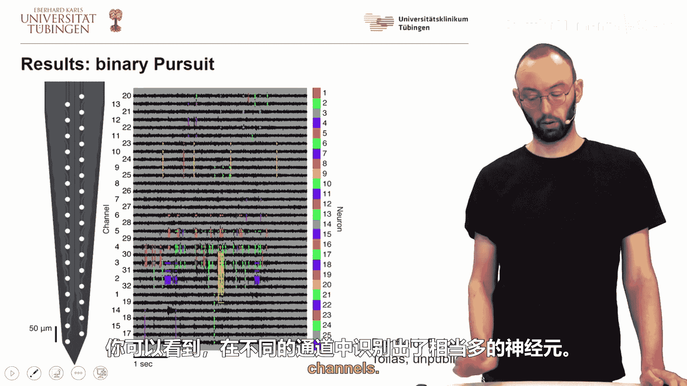
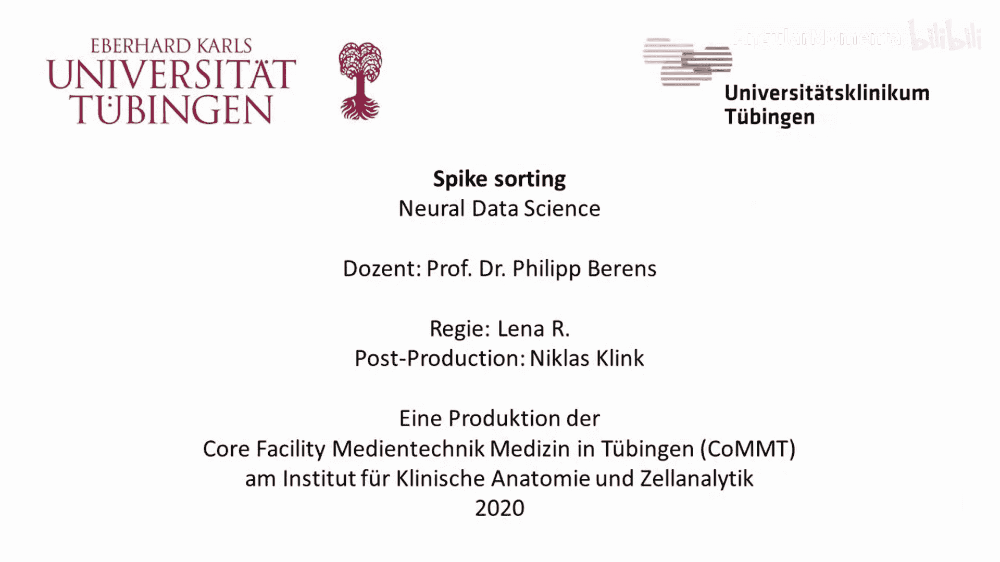

# 002：尖峰分类 🧠

在本节课中，我们将学习神经数据科学流程中的核心环节——**尖峰分类**。我们将探讨如何将从原始数据中检测并提取出的尖峰特征，通过聚类算法归类到不同的神经元上。

上一周，我们从原始数据出发，完成了尖峰检测和特征提取。本节中，我们将聚焦于**尖峰分类**或**聚类**过程。我们的目标是，将上周从单个神经元提取出的不同尖峰或动作电位的特征，按照它们所对应的神经元进行分组。

这意味着，我们需要将四通道记录中这些未分类的尖峰波形，转化为清晰分离的类别，如下图所示。例如，这里的紫色神经元在第3通道上有高信号，而黄色簇在所有通道上的信号都低得多。那么，我们具体该如何实现呢？

## 数据可视化与手动分类的局限性 📊

以下是我们在课程和练习中会反复查看的散点图。图中绘制了不同通道上**第一主成分**的所有配对关系，例如通道1对通道2、通道1对通道3等。由于有四个通道，因此总共有六张图。

当我们绘制这些第一主成分时，可以清晰地看到数据中的一些结构。例如，我用红色圈出的这个点簇在第3通道上振幅很高，并且与其余数据明显分离。可能还有另一个簇，在观察这些二维边缘分布时也能被较好地分离出来。

那么，我们如何找出这些簇呢？一些电生理记录设备公司提供的软件中，常包含**手动聚类切割**功能。这相当于我刚刚在散点图中所做的操作：简单地画一个椭圆，并声称“这是一个簇”。然而，由于特征空间通常是高维的，人类很难在低维投影上完成这项工作。

以下是一个手动分类软件的示例。通过圈出所有这些黄色的尖峰，可以识别出一个神经元。

然而，这种策略的效果如何呢？已有研究对此进行了验证，结果表明这并非一个好方法。它主观性强、错误率相当高、人们划定的边界往往不是最优的、极其耗时，并且在不同实验者之间不可重复，也非基于模型。

研究中创建了一些合成数据来验证。在五个模拟通道上，评分者平均发现的单元数量多于实际存在的数量。此外，他们还测量了假阳性和假阴性率，结果明显不理想，且个体间差异很大。

如今，考虑到硅探针或神经像素探针拥有成百上千个通道，这种方法变得完全不可行。因此，我们需要采用**算法化**和**自动化**的方法。

另一篇论文也阐明了这一点。在图中，人类操作者有着相当高的假阳性和假阴性率。而如果使用一定数量的主成分进行自动聚类，则可以做得相当好。这是一个拥有真实数据（ground truth）的例子，我们稍后会详细讨论。

## 自动聚类方法 🚀

相比之下，自动聚类方法可以更客观、基于模型、且可重复。只要公布分析所用的代码和随机种子，任何人都能在同一数据集上运行并获得相同结果。同时，它也便于量化，可以直截了当地计算一些质量指标。

然而，聚类本身的问题在于，无论使用何种方法，它都是一个**无监督学习问题**。虽然针对该问题有许多解决方案，但也存在许多悬而未决的难题。例如，如何选择聚类数量就是一个重大的未解之谜，目前尚无原则性的解决方案。

我们将使用诸如K-Means（你可能已经了解）或**高斯混合模型**等方法。如果你对这些基础算法完全不熟悉，我建议你回顾冬季学期的机器学习课程，观看关于高斯混合模型和K-Means聚类的讲座视频，链接已提供。

接下来，我将简要回顾高斯混合模型最重要的部分。

## 高斯混合模型简介 📈

高斯混合模型将数据点的密度描述为多个高斯分量的加权和。

模型的参数包括：混合比例、高斯分量的均值及其协方差矩阵。例如，下图中的数据是由二维空间中的三个高斯分布生成的，它们具有三个不同的均值和相等的混合比例，其中一个的协方差矩阵比其他的大。

我们如何找到这样一个高斯混合模型的参数呢？通常，我们尝试优化模型下数据的**对数似然**。将其写出来，形式如下：

`L(θ) = Σ_n log( Σ_k π_k N(x_n | μ_k, Σ_k) )`

其中，`π_k` 是混合系数，`μ_k` 是簇的均值，`Σ_k` 是簇的协方差。

由于对数内部存在求和，我们无法得到参数的封闭形式解。因此，我们需要使用一种称为**期望最大化**的算法。

## 期望最大化算法 🔄

期望最大化算法可用于寻找任何**潜变量模型**的最大似然估计。潜变量模型是指，并非所有指定模型所需的变量都被观测到。在我们的例子中，潜变量就是**簇分配**，即我们不知道每个数据点具体来自哪个高斯分量。

在EM算法中，我们有一些模型参数（混合系数、均值、协方差）和未观测到的潜变量（数据点到混合分量的分配），以及观测到的数据（尖峰特征）。

EM算法交替执行以下两步，直到算法收敛（例如似然不再变化）：
1.  **E步**：在给定当前参数估计的情况下，估计潜变量。对于尖峰分类，即基于当前簇参数估计簇分配。
2.  **M步**：在给定当前潜变量（簇分配）估计的情况下，更新参数以最大化似然。

让我们详细看看这两步。

**在E步中**，我们使用当前参数值评估**责任值**。即计算数据点 `n` 属于簇 `k` 的后验概率。公式如下：

`γ_{nk} = π_k N(x_n | μ_k, Σ_k) / Σ_j π_j N(x_n | μ_j, Σ_j)`

例如，在这个小例子中，我们可视化了特定位置上的蓝色和红色簇。在第一个E步中，我们计算这些责任值，并根据责任值为点上色。靠近蓝色圆圈的数据点被染成蓝色，意味着它们有更高的责任值（后验概率）被分配到蓝色簇；反之，远处的红点则更可能被分配到红色簇。

**在M步中**，我们更新均值、协方差矩阵和混合系数。公式实际上相当简单：
*   均值是数据点的加权平均，权重就是责任值。
*   协方差矩阵同理。
*   混合系数是每个簇的责任值之和除以总数据点数。

然后，我们带着新的参数回到E步，再次计算责任值，如此迭代进行。

下图展示了这个过程：首先初始化模型，然后在第一步的M步中更新参数，移动椭圆到对应数据点的均值位置，接着计算新的责任值，并不断迭代直到收敛。

## 确定聚类数量与模型选择 🎯

如前所述，如果聚类数量未知，如何确定它尚无普遍接受的解决方案。观察这个数据集，你可能会说需要在这里放一个高斯，那里放一个，下面这里放一个或两个。

一个相对有原则的方法是优化**贝叶斯信息准则**。为什么不能只用对数似然呢？因为如果我们不断增加簇的数量，负对数似然会一直下降。理论上，如果在每个数据点上放一个单独的高斯，我们能得到最优的负对数似然，但这完全不能揭示数据的真实底层结构。

因此，我们必须平衡模型对数据的拟合程度和模型复杂度。BIC正是通过惩罚参数数量来实现这一点。在BIC公式中：

`BIC = -2 * log(L) + P * log(N)`

第一项对应对数似然（随聚类数增加而下降），第二项惩罚模型参数数量 `P`（随聚类数增加而上升）。BIC平衡了这两种趋势，给出一个折中的最优解。当然，这并非唯一方法，在特定假设下可证明其最优性，但对于有限的具体数据，它本质上也是一种启发式方法。你可以选择最小化BIC的聚类数，或者选择BIC不再显著下降的点。最终，你需要通过生物学知识或领域知识来说服自己，聚类结果是合理的。

## 处理局部最优解 🧩

该算法的另一个问题是可能存在**局部最优解**。这很容易理解，例如，你可以称这里的簇为簇1，那里的为簇2，但交换它们同样好。除了这种平凡情况，还存在非平凡的局部最优。例如，在这个数据集上多次运行聚类，可能有一个解收敛到看起来像这样的状态，而真实解更可能是那样。

我们如何确保找到尽可能好的解呢？

一种方法是简单地用不同的初始化进行多次独立运行，然后根据BIC挑选最好的结果。这概念上非常简单：从不同的起点出发，优化似然函数可能会陷入不同的局部最优，我们只需选择最好的那个。

另一种算法称为**分裂与合并**，它也是一种试图跳出局部最优的启发式方法。其工作原理如下：在EM算法收敛后，你可以测试在算法的每次迭代中，是否可以通过**分裂**一个候选簇（用两个簇替换它，并固定其他分量，运行部分EM）或**合并**一对候选簇（用一个簇替换两个簇）来进一步降低BIC。通过这种人为干预模型优化的方式，有时可以将模型从局部最优中“推”出来。

## 处理异常值与非高斯分布 📉

我们在记录中有时遇到的另一个问题是**异常值**。实际上，我们的数据并非严格高斯分布，它们可能具有**重尾**。例如，绘制数据点到均值的**马氏距离**（一种考虑了数据协方差结构的距离）与其概率的关系图。如果是高斯分布，你会期望一条直线。但在许多记录中，我们发现数据点远离均值的概率高于偶然预期。

这表明数据中存在异常值，或者说数据分布具有重尾。这在下图中也有显示：绘制残差直方图或观察混合模型对尖峰数据的拟合情况，可以看到对于这些较高的电压值，其出现概率高于高斯模型的预测。

处理这个问题的一种方法是将高斯混合分量替换为**t分布**。t分布是高斯分布的推广，它多了一个称为**自由度**的参数。当自由度趋于无穷时，t分布就是高斯分布。t分布可以被视为具有相同均值的多个高斯分布的混合，这使其能够建模具有重尾或异常值的数据。有论文表明，许多尖峰数据集用t分布拟合比用高斯分布更好。如果你想实现t分布混合模型，也可以在编程练习中尝试。

## 处理波形漂移 🕰️

我们在尖峰分类数据集中有时遇到的另一个问题是**波形漂移**。观察所有这些尖峰在特征空间中的位置，可以看到两个清晰的簇。但如果我们观察这些尖峰被采集的时间顺序，会发现其中一个相当稳定，而另一个呈拉长的香蕉形。这显然是由于电极和神经元之间发生了相对移动，例如电极向某个方向漂移，导致该神经元在某一通道上的能量随时间越来越小。

我们也可以将这种漂移纳入模型。一种方法是将高斯混合模型扩展为**卡尔曼滤波器混合模型**。我们采用标准高斯混合模型，但让簇均值随时间漂移。在每个离散时间点，均值等于前一时间点的均值加上一个漂移项。然后，我们可以在M步中使用这个漂移的均值，并利用标准的前向-后向卡尔曼滤波递归进行更新。如果你不了解卡尔曼滤波的细节也没关系，这里只想说明，你可以通过这种方式扩展模型以解决特定问题。

这种方法效果相当好。如图所示，高斯混合模型的解决方案在这里建模了一个漂亮的分量和一个巨大的分量；而卡尔曼滤波混合模型对于这个红色神经元，几乎将所有高斯分量重叠放置，对于黑色神经元，则允许它们随时间漂移。

最后，我们可以将所有方法结合起来，开发一个**漂移的t分布混合模型**。如果你对该方法的细节感兴趣，可以查阅相关论文或参考我同事Alexander Ecker的GitHub页面上的实现。

## 处理同步尖峰与生成模型方法 ⚡

我想讨论的最后一个问题是**同步尖峰**。大多数情况下，尖峰是相当短暂的事件，彼此孤立发生。但是，特别是当电极附近有很多神经元时，可能会出现尖峰重叠，即多个神经元的多个尖峰在你用作特征的时间窗口内重叠。

为了说明这可能产生的影响，假设一个神经元的尖峰簇在这里，另一个的在下边。那么，在很小一部分尖峰中，你会得到这些混合信号。你甚至会观察到这些混合信号，如果它们频繁发生，甚至可能被误认为是位于中间的第三个神经元。你还可以有各种时间偏移的叠加，从而产生这些模糊的异常值。

如果你想处理这些重叠尖峰，可以看到例如这里有尖峰，那里也有尖峰，你甚至可以通过这两个神经元在特征空间中的不同抖动来预测位置。当然，如果使用多通道探针，这个问题会更加突出，因为在某些通道上发现至少部分重叠的尖峰的概率大大增加。

因此，与我们在讲座主要部分讨论的聚类方法不同，我们可以采用一种相当不同的尖峰分类方法来处理这个问题（也适用于海量多通道数据）。与其使用聚类方法或先提取特征再聚类的方法，我们可以转向使用数据的**生成模型**来最终找到尖峰序列。

在这种情况下，我们对随时间变化的电压信号进行建模，将其视为尖峰的叠加。公式如下：

`V(t) = Σ_n Σ_i w_i * x_n(t - τ_i) + ε(t)`

其中，`w_i` 是尖峰波形模板，`x_n` 是尖峰序列（二进制信号，具有伯努利先验），`ε(t)` 是噪声。

如果我们将其用作尖峰分类算法的生成模型，那么我们就可以处理重叠尖峰了。如何优化这样的模型呢？这实际上并不容易，原因在于尖峰是发生在离散时间点上的二进制信号。

我们通过交替优化来解决：
1.  假设尖峰时间已知，估计波形（可通过线性回归完成）。
2.  假设波形已知且固定，通过**模板匹配**确定尖峰时间。我们使用一种称为**二元追踪**的算法来实现。

二元追踪算法在这个生成模型下，我们有一个同时是尖峰序列和波形函数的损失函数。我们希望尽可能好地建模观测到的电压轨迹。我们可以解析地计算在给定时间仓中添加或删除一个尖峰所引起的损失函数变化。因此，可以实现一种贪婪算法：查看所有可能的更改，翻转能带来最大损失下降的尖峰，然后更新损失函数，并迭代进行，同时估计尖峰波形。

算法的初始化也很重要，我们可以采用与讲座第一部分类似的方法。然后，重复以下步骤：给定电压数据和假设的尖峰时间，通过线性回归估计波形；计算残差和每个神经元的先验概率；接着使用二元追踪贪婪算法再次估计尖峰时间。

这可以作为我们第一部分介绍的高斯混合、t分布混合或漂移t分布混合方法之上的一个增强步骤。如果这样做，结果会相当不错。下图是一个来自32通道记录的示例，使用该算法可以识别出分布在多个通道上的相当数量的神经元。放大后，可以查看发现的不同神经元的特征。例如，这个黄色神经元确实有更高的特征，但许多其他神经元也清晰地从背景噪声中显现出来。

本节课中，我们一起学习了尖峰分类的核心概念，从手动方法的局限性，到自动聚类算法（特别是高斯混合模型与EM算法），再到确定聚类数量、处理局部最优、异常值、波形漂移以及同步尖峰等挑战。我们还简要介绍了基于生成模型的先进方法。

在下节课中，我们将探讨如何确保从尖峰分类算法中得到的结果具有生物学意义，并且确实对应于真实的神经元。祝你本周愉快！