# 003：单神经元识别

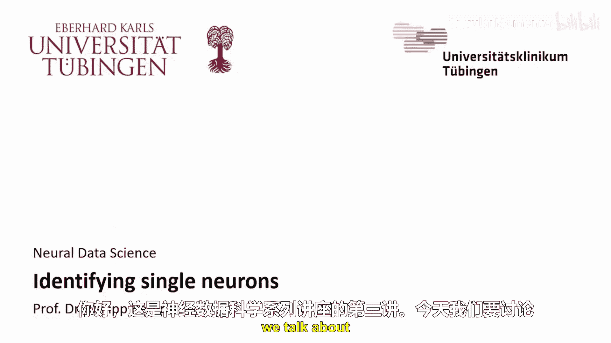

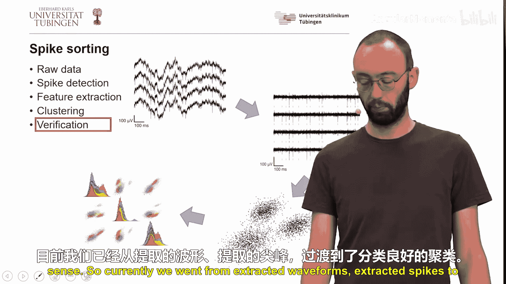

在本节课中，我们将学习如何从尖峰数据中识别出单个神经元。我们将重点介绍如何验证自动聚类步骤的生物学意义，确保我们找到的簇确实对应着单个神经元的活动。

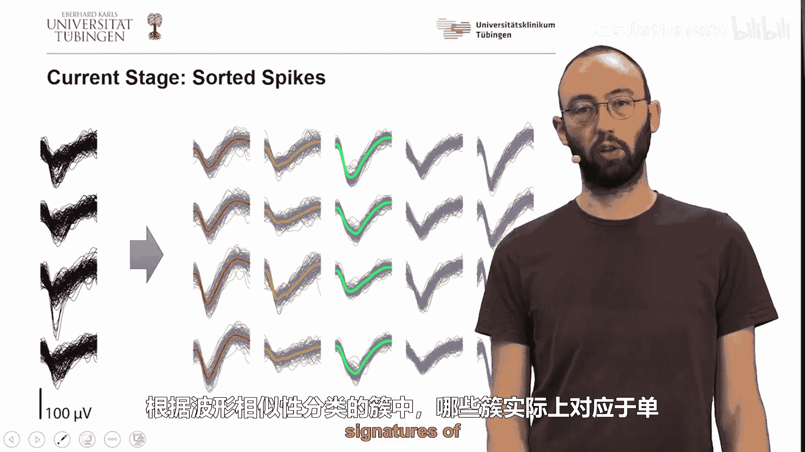

## 概述

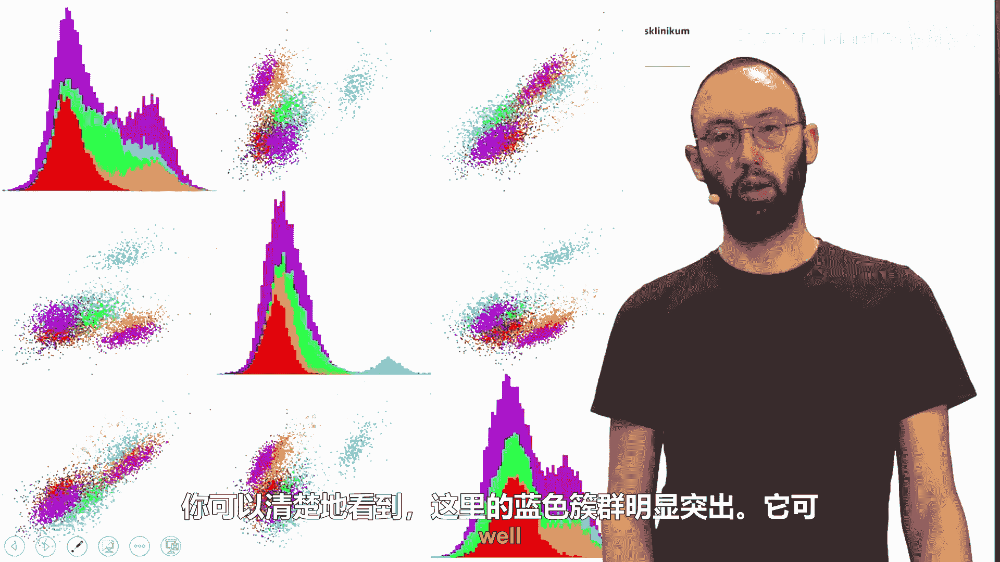

上一节我们介绍了特征提取和聚类。本节中，我们来看看如何验证聚类结果，区分哪些簇代表单个神经元（单单元簇），哪些代表多个神经元（多单元簇）。我们将引入不应期和交叉相关图等生物学概念作为验证工具。

## 簇的初步观察

首先，我们回顾一下聚类后的结果。下图展示了在三个通道上，沿各自第一主成分的二维投影。可以清晰地看到，蓝色簇与其他簇分离得很好，而橙色和粉色簇彼此之间则存在重叠。

## 单单元与多单元簇

并非所有簇都必然代表单个神经元的尖峰。理解这一点需要回顾微电极记录的工作原理。

*   **单单元簇**：距离电极尖端几十微米范围内的神经元会产生非常大的信号，通常可以被分离成独立的簇。
*   **多单元簇**：在更大半径范围内的神经元，由于其信号衰减较多，波形相似，常常无法彼此区分，从而被归入同一个簇，这代表来自特定位置的一组神经元的活动。

## 利用不应期进行验证

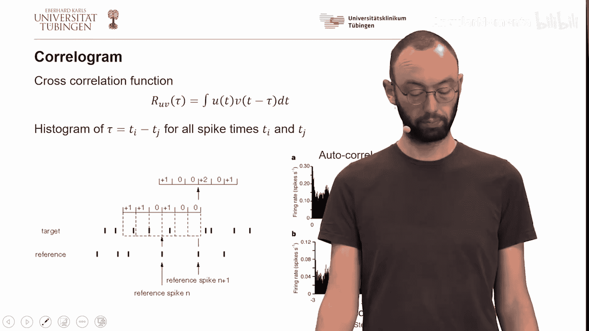

为了评估一个簇是单单元还是多单元，我们需要引入尖峰序列的时间结构知识，主要是寻找**不应期**。如果某个簇中的所有尖峰都来自同一个神经元，那么每个尖峰之后必须有一段特定的静默期，即不应期。

动作电位发生后，钠离子通道会进入失活状态，无法立即再次开放，这构成了不应期的生理基础。

## 自相关图与交叉相关图

检测不应期的一个工具是**自相关图**。对于交叉相关图，则是计算两个尖峰序列之间的时间差直方图。

具体方法是：以一个参考尖峰序列中的每个尖峰为时间零点，统计另一个比较序列中所有尖峰相对于该零点的出现时间，并累加到直方图中。如果是对同一个序列自身进行计算，得到的就是自相关图。

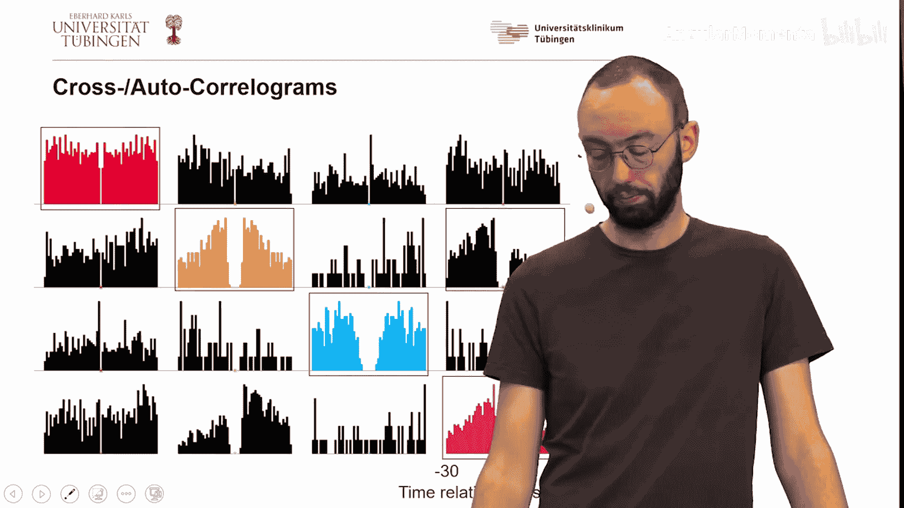

在自相关图中，如果在零时间点附近（例如几毫秒内）出现一个明显的缺口，就表明存在不应期，这是单单元簇的有力证据。交叉相关图则可用于检测神经元之间的耦合关系。

相关函数可以表示为两个时间序列的卷积：
`C(τ) = ∫ x(t) y(t+τ) dt`
对于离散的尖峰序列，可以简化为所有尖峰时间两两之差的直方图。

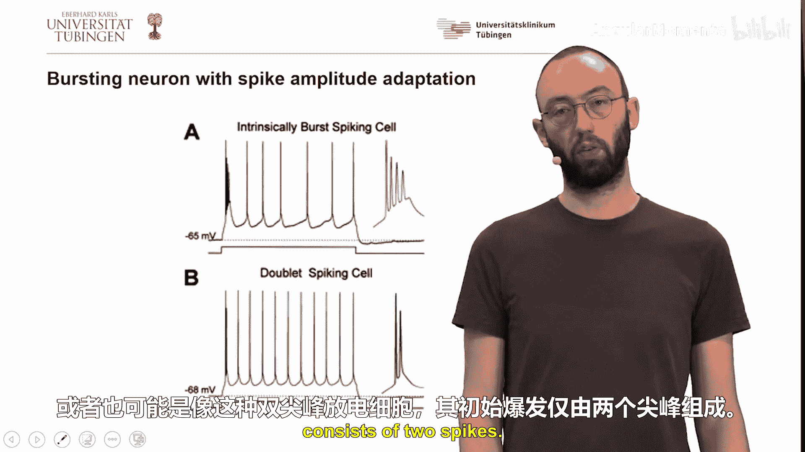

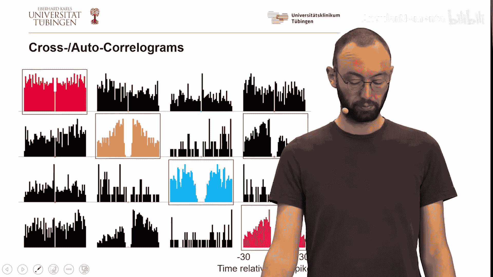

## 分析实例

让我们观察示例数据中几个簇的相关图。

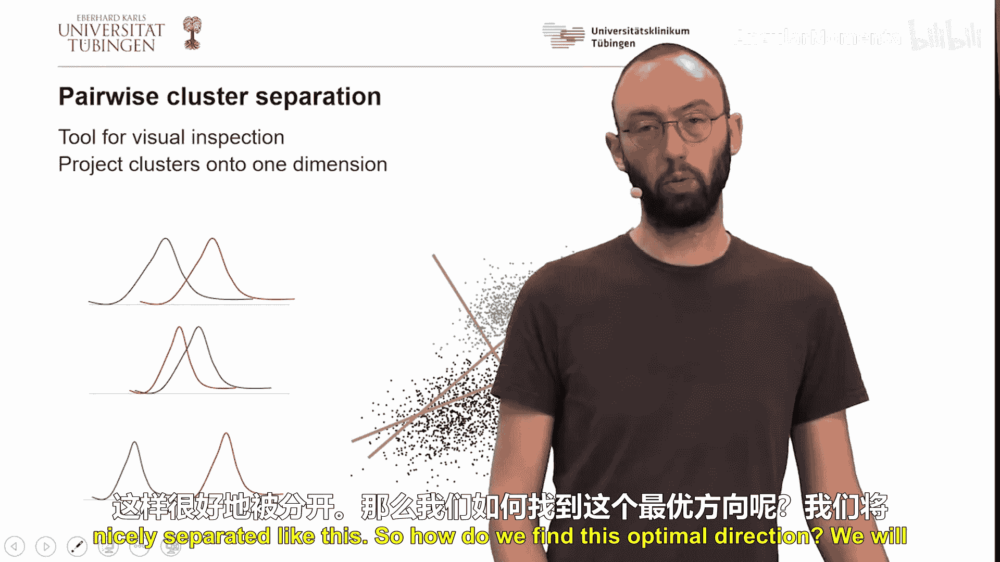

以下是关键观察结果：
*   **红色簇**：其自相关图相对平坦，在零时间点附近没有显示明显的缺口，表明没有观察到不应期。因此，它很可能是一个**多单元簇**。
*   **蓝色、橙色、粉色簇**：它们的自相关图在零时间点附近都显示出一个明显的缺口（凹陷），这为不应期提供了证据。因此，它们都是**单单元簇的候选**。

此外，观察**橙色簇和粉色簇的交叉相关图**会发现，它竟然也显示出一个不应期缺口。这非常引人注目，因为它表明橙色和粉色簇中的尖峰很可能来自**同一个神经元**。结合它们在特征空间中的重叠，这可能是由于电极漂移或尖峰幅度适应等因素，导致同一个神经元的波形随时间发生轻微变化，从而被分到了两个簇中。交叉相关图略微不对称（橙色簇的尖峰倾向于在粉色簇之前），这可能支持尖峰幅度随时间适应的假设。

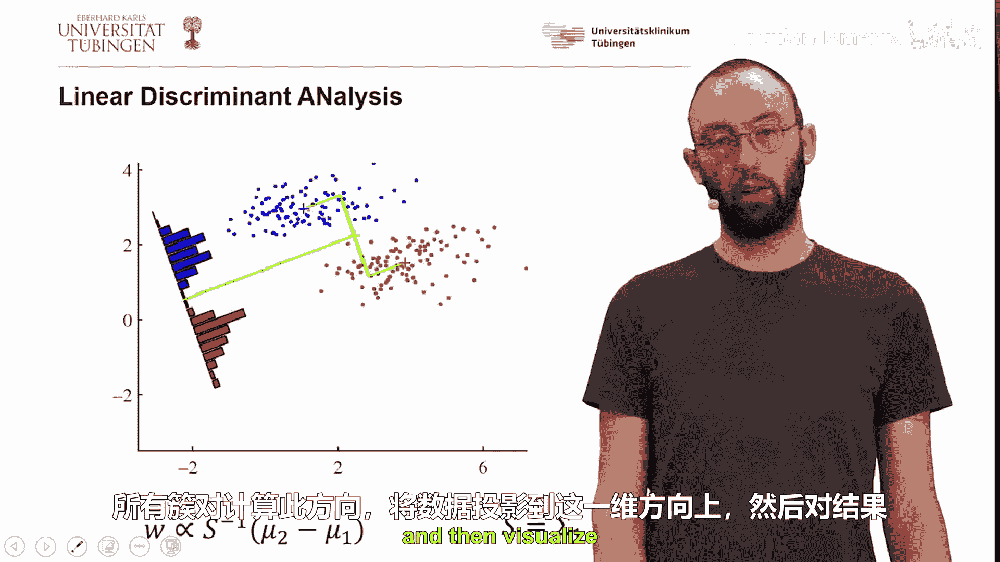

## 量化簇分离度：线性判别分析

除了观察相关图，我们还可以量化簇之间的分离程度以辅助判断。一个有用的可视化工具是**线性判别分析**。

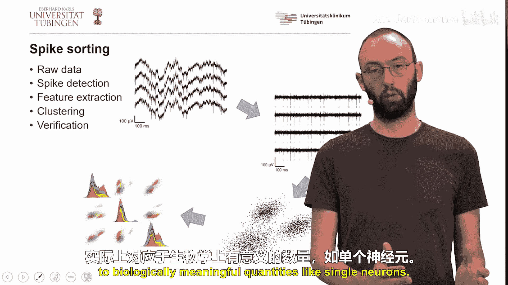

LDA 可以帮助我们找到高维空间中分离两组点的最优方向。其核心思想是找到一个投影方向，使得投影后两类数据的类间方差最大，类内方差最小。在协方差结构各向同性的简单情况下，这个方向正比于两类均值的差向量。在更一般的情况下，需要根据数据的协方差结构进行调整。

我们将对所有簇对计算这个最优的一维投影方向，并将数据投影上去进行可视化。这能直观地显示哪些簇是真正分离良好的。

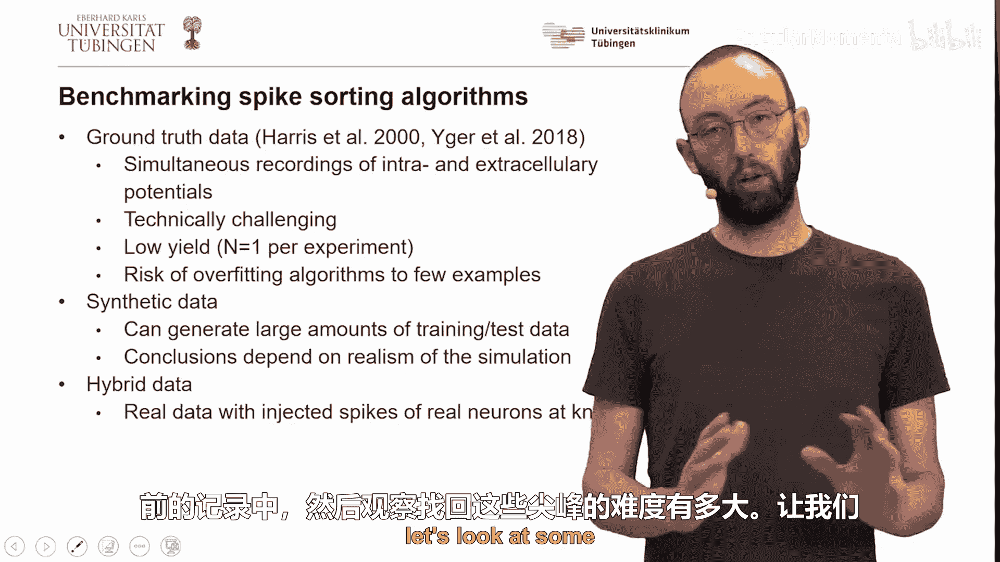

从图中可以看到，蓝色簇与几乎所有其他簇都分离得很好。而橙色和粉色簇在投影上有相当大的重叠，这与我们之前认为它们可能属于同一神经元的推断一致。

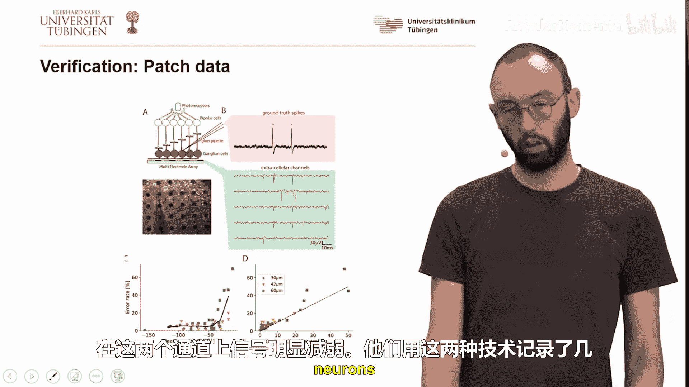

## 尖峰分选流程总结

至此，我们完成了完整的尖峰分选流程回顾。在前三讲中，我们从原始记录开始，检测尖峰、提取特征、进行聚类，最后验证了哪些簇具有生物学意义，对应着单个神经元。

## 算法性能评估基准

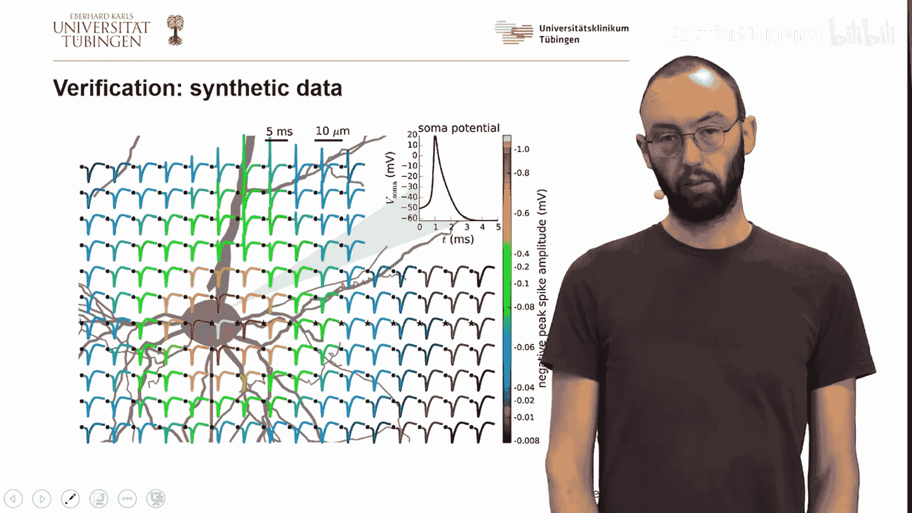

评估尖峰分选算法的性能是一个挑战，因为获取真实数据（Ground Truth）非常困难。主要有三种策略：

1.  **真实数据**：通过同时进行细胞内和细胞外记录来获取真实数据。这在技术上极具挑战性，数据产出率低，且数据量少可能导致算法过拟合。
2.  **模拟数据**：通过计算机模拟神经组织来生成大量合成数据。其结论的有效性很大程度上取决于模拟的真实性，尤其是噪声特性的模拟非常困难。
3.  **混合数据**：将已知的、来自真实神经元的尖峰波形模板，在已知的时间点注入到真实的记录数据中。这种方法结合了真实噪声背景和可控的尖峰信号，是目前进行大规模算法基准测试的较好方法。

## 总结

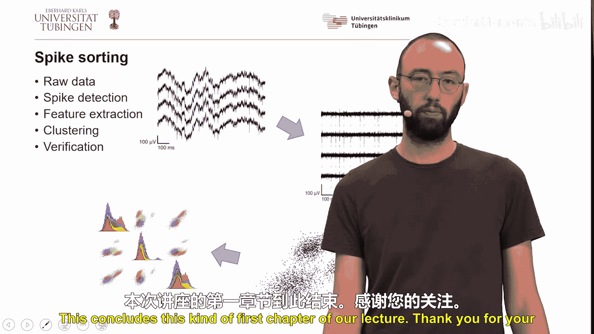

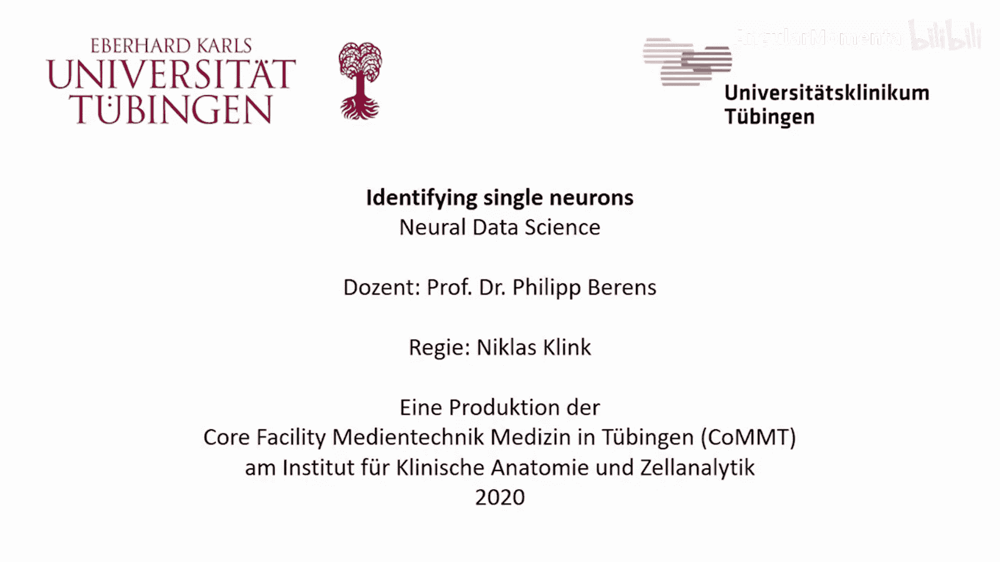

本节课中，我们一起学习了如何识别单神经元。我们了解到，不能仅凭聚类结果就断定找到了单个神经元，必须进行生物学验证。我们引入了**不应期**的概念，并学会了使用**自相关图**和**交叉相关图**来区分单单元簇和多单元簇。我们还介绍了使用**线性判别分析**来可视化簇的分离程度。最后，我们探讨了评估尖峰分选算法性能的三种基准策略：真实数据、模拟数据和混合数据。掌握这些验证和评估方法，对于确保神经数据分析结果的可靠性至关重要。