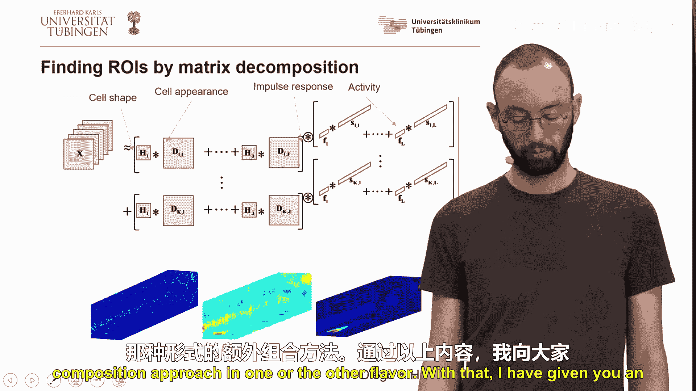
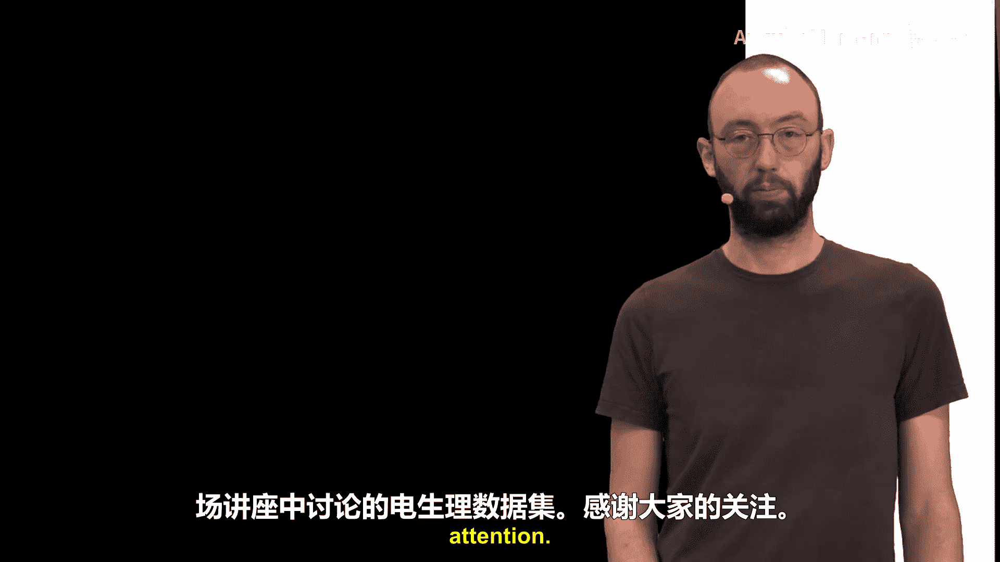
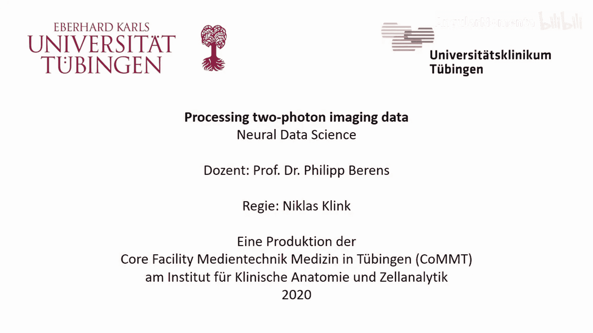

# 004：钙成像数据中的脉冲推断 🧠

在本节课中，我们将学习如何对双光子钙成像数据进行预处理，特别是如何从钙信号中推断出神经元的脉冲序列。我们将从钙成像的基本原理开始，逐步介绍从简单到复杂的脉冲推断模型，并比较不同方法的优劣。

上一节我们介绍了电生理记录中的脉冲排序。本节中，我们来看看其互补技术——双光子钙成像。

## 双光子钙成像简介

双光子钙成像是一种广泛使用的技术，用于记录神经元群体的活动。其原理是将钙指示剂引入细胞。当神经元放电产生动作电位时，细胞内的钙离子浓度会瞬时升高。钙指示剂与钙离子结合后，其荧光特性会发生改变。通过双光子显微镜测量这种荧光变化，就能间接反映神经元的电活动。

与电生理记录相比，钙成像有其优势和局限：
*   **优势**：可以记录不常放电的“沉默”神经元；能获取细胞的空间布局信息；结合遗传工具，可以特异性地标记和研究特定类型的神经元。
*   **局限**：时间分辨率较低（通常为几赫兹到几十赫兹），无法像电生理那样精确定位毫秒级的单个脉冲；钙信号动力学比电压信号慢得多。

## 从钙信号推断脉冲：问题定义

钙成像数据处理通常面临两个核心任务：
1.  从图像中识别细胞体或感兴趣区域。
2.  从记录的荧光信号中推断出原始的脉冲序列。

本节课我们聚焦于第二个任务：**脉冲推断**。其目标是将缓慢变化的钙信号（代理变量）转换回对神经元放电活动（脉冲序列）的估计。

## 方法一：简单的反卷积模型

我们从一个非常简化的模型开始。假设每个脉冲都会引起一个钙瞬变，而钙瞬变的形状可以用一个指数衰减的核函数来建模。

**公式**：`C(t) = (S * k)(t) + ε`
*   `C(t)`：观测到的钙信号。
*   `S(t)`：脉冲序列（0或1的序列）。
*   `k(t)`：钙核函数（例如，衰减时间常数约500毫秒的指数函数）。
*   `*`：卷积操作。
*   `ε`：噪声。

脉冲推断的目标是**反演**这个前向模型。一个直观的想法是直接对钙信号进行反卷积。

**算法思路**：
1.  对钙信号进行低通滤波，去除高频噪声。
2.  使用一个自定义的迭代局部平均程序，去除低于特定阈值的噪声，避免产生伪脉冲。
3.  用指数核函数的逆核对信号进行反卷积，得到脉冲序列的估计。

**局限性**：
*   需要预先知道或校准钙核函数的时间常数。
*   只能重建低通滤波后的放电率，时间精度有限。
*   可能产生无意义的负放电率。
*   在真实噪声数据上，效果往往不理想。

## 方法二：生成式模型与凸优化

为了获得更好的结果，我们可以使用更复杂的生成式模型，并明确地加入对脉冲序列的先验假设。

**模型描述**：
1.  **观测模型**：荧光信号 `F_t` 是钙浓度 `C_t` 的线性函数加上噪声。
    `F_t = α * C_t + β + noise`
2.  **动力学模型**：钙浓度的演化遵循一阶自回归过程，并由脉冲 `n_t` 驱动。
    `C_t = γ * C_{t-1} + n_t`
    其中，`n_t` 代表在时间区间 `Δt` 内发生的脉冲数，我们假设它服从泊松分布，其期望为 `λΔt`。

直接优化这个模型（寻找最可能的脉冲序列）在计算上很困难，因为涉及离散的泊松先验。一个有效的近似方法是**松弛约束**：允许脉冲序列取连续的正值，并将泊松先验替换为指数先验。这使得优化问题变成凸优化问题，可以通过交替固定参数（如钙动力学参数和脉冲序列）并迭代求解。

**优势**：
*   强制脉冲率为非负值，更符合生理实际。
*   能更准确地定位脉冲时间。
*   比简单反卷积方法表现更好。

## 方法三：扩展的生成式模型 (MLspike)

我们可以进一步扩展模型，以处理钙成像数据中常见的复杂情况。

**MLspike 算法的改进**：
*   **漂移基线**：允许荧光基线存在缓慢的漂移。
*   **可变振幅**：允许钙瞬变的振幅随放电频率变化，可以模拟饱和或超线性响应。

该算法使用了一种类似维特比算法的动态规划反向递归方法，来联合推断最优的钙浓度轨迹和脉冲序列。它还需要一套启发式方法来估计模型参数，例如通过分析钙瞬变振幅的直方图来估计单脉冲的响应幅度。

## 方法四：监督学习（数据驱动）方法

除了基于生物物理知识的生成式模型，另一种思路是使用**监督学习**。我们可以利用那些同时记录了钙信号和膜片钳电生理信号（“金标准”）的数据集，训练一个模型直接从钙信号的特征回归到脉冲序列。

例如，可以构建一个小型神经网络，其输出参数化一个泊松分布的放电率，该放电率由钙信号的历史窗口决定。

**代码思路**（概念性）：
```python
# 伪代码：一个简单的两层网络用于脉冲率推断
rate_t = neural_net(calcium_signal[t - window : t])
spike_train_estimate = sample_from_poisson(rate_t)
```

在2016年的一项研究中，这种简单的神经网络方法在多个数据集上取得了当时最先进的性能。

## 方法比较：Spikefinder 竞赛

为了系统比较不同方法，研究者组织了 **Spikefinder 竞赛**。竞赛收集了超过50个参赛算法，包括各种生成式模型和深度学习模型。

**主要发现**：
*   在25赫兹的采样频率下，推断放电率与真实放电率之间的相关系数普遍不高（约0.5），这反映了从钙信号推断脉冲的内在难度。
*   表现最好的算法组中，**同时包含生成式模型（如MLspike）和深度学习模型**。它们的性能在统计上无法区分。
*   不同顶级算法预测结果之间的相关性很高，表明它们学到了相似的数据结构。
*   一些深度学习模型存在对训练数据过拟合的问题。

竞赛结果表明，**没有一种方法（生成式 vs. 数据驱动）具有绝对优势**。未来结合两者优势的混合方法可能带来更好的结果。

## 预处理的前一步：运动校正与细胞分割

在能够进行脉冲推断之前，我们首先需要从原始图像数据中提取每个神经元的荧光信号。这涉及两个关键步骤：

1.  **运动校正**：在活体成像中，动物运动或组织搏动会导致图像帧之间的错位。需要使用**非刚性运动校正算法**。常用方法是基于**傅里叶变换的相位相关法**，它在局部图像块上计算位移，并能处理不同空间区域的不同形变。
2.  **细胞分割（ROI提取）**：识别图像中对应单个神经元胞体的区域。主流方法主要基于**生成式建模思路**，将电影数据分解为空间足迹（细胞形状）、时间模板（钙响应动力学）和活动序列（脉冲）的乘积。另一种方法是使用计算机视觉的深度学习模型直接进行细胞分割，但目前应用较少。

## 总结

本节课中我们一起学习了双光子钙成像数据的预处理，重点探讨了从钙信号中推断神经元脉冲序列的多种方法：
*   我们从**简单的线性反卷积模型**入手，了解了其基本思想和局限。
*   接着介绍了更复杂的**生成式模型**，它通过明确的概率模型和凸优化来估计脉冲，效果更好。
*   然后看到了**MLspike**等算法如何通过扩展模型来处理基线漂移和响应非线性等实际问题。
*   我们还探讨了**监督学习方法**的潜力，它直接从数据中学习映射关系。
*   通过**Spikefinder竞赛**，我们了解到目前生成式模型与数据驱动模型性能相当，未来二者结合是发展方向。
*   最后，我们简要回顾了脉冲推断前的必要步骤：**运动校正**和**细胞分割**。







理解这些预处理步骤对于正确解读钙成像数据、并最终理解神经环路的功能至关重要。