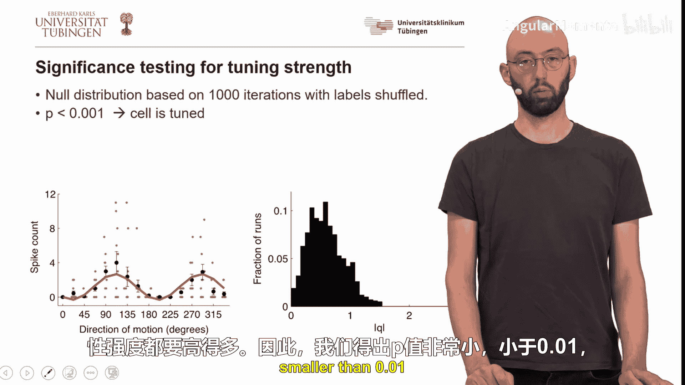
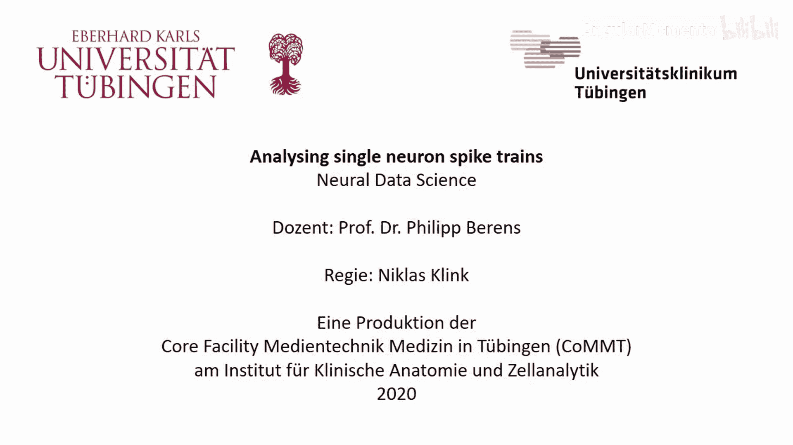

# 005：分析脉冲序列 🔬

在本节课中，我们将学习如何分析单个神经元的脉冲序列数据。我们将从可视化脉冲序列开始，介绍时间直方图，探讨如何识别简单细胞与复杂细胞，并学习如何通过调谐曲线来总结神经活动，包括方向与朝向调谐。最后，我们将为调谐的显著性建立一个统计检验方法。

---

## 脉冲序列的可视化 📊

上一节我们介绍了神经数据的预处理。本节中，我们来看看如何可视化处理后的脉冲序列数据。

分析数据时，首要步骤是观察原始数据。在试图拟合调谐函数或计算调谐指数之前，应先可视化脉冲序列本身。数据应能直观地展示你感兴趣的效果。

我们将基于前三次讲座和练习中分析过的电生理记录数据。在这些记录中，动物观看了一个移动的正弦光栅刺激，该刺激在多个试次中呈现，每个试次约2秒，光栅在16个运动方向上移动。

以下是可视化脉冲序列数据的第一种也是最简单的方法：

*   **排序与对齐**：根据每个试次中呈现的刺激方向对记录进行排序，并以刺激开始时间为基准对齐脉冲序列。
*   **观察模式**：通过这种对齐方式，可以直观地看出某个神经元并非对所有运动方向都有反应。例如，某个神经元可能只对22度、45度、202度和225度这几个方向敏感，且对不同方向的偏好程度可能不同。我们还能观察到响应中的波动模式。

---

## 时间直方图与脉冲密度函数 📈

上一节我们介绍了如何通过排序和对齐来观察脉冲序列。本节中，我们来看看如何将其转换为更定量的度量——时间直方图。

我们可以将脉冲序列转换为**时间直方图**。其计算步骤如下：

1.  再次以刺激开始时间为基准对齐所有脉冲序列。
2.  将时间划分为合理的小区间。
3.  统计每个区间内的脉冲数量。

如果需要，可以进一步平滑这个直方图，得到平滑的曲线，这被称为**脉冲密度函数**。

这两种方法都有效，适用于不同场景，且密切相关。以下是计算PSTH的示意图：

```
时间轴被划分为多个区间（bin）。
每个区间内的脉冲数被计数并绘制成柱状图。
平滑后得到连续的脉冲密度函数曲线。
```

在实践中，选择合适的分区间隔（带宽）通常需要反复尝试，因为PSTH主要是一种视觉探索工具。然而，也存在一种优化策略，通过最小化一个成本函数来选择能最佳估计平均发放率的区间大小。对于脉冲密度函数，同样可以通过优化核宽来获得最佳平滑效果。

---

## 发放潜伏期与变点检测 ⏱️

上一节我们介绍了如何计算和优化PSTH。本节中，我们来探讨神经响应中的一个重要时间特征——发放潜伏期。

**发放潜伏期**是指从刺激呈现到神经元开始显著发放脉冲之间的时间间隔。从理论上定义很简单，但从数据中检测却非易事。

有多种方法可以估计潜伏期：

*   **半高法**：计算发放率达到其峰值一半的时间点。
*   **阈值法**：估计神经元的自发发放率，并设定一个阈值。
*   **变点检测**：这是一个统计问题，可以形式化为寻找发放率从λ1变为λ2的时间点θ。虽然理论上清晰，但在脉冲序列数据上实现效果不一定理想。
*   **贝叶斯分箱法**：该方法在建模PSTH时，可以同时估计出潜伏期及其不确定性。

---

## 简单细胞与复杂细胞 🧠

回顾我们之前看到的PSTH，它们显示出振荡模式。这与刺激的结构以及神经元的感受野特性有关。

在视觉皮层，我们通常有两种细胞模型：

*   **简单细胞**：具有Gabor滤波器状的感受野，对光栅的空间频率、朝向和**相位**敏感。当移动光栅经过其感受野时，其发放率会随着光栅相位与感受野最优相位的匹配程度而振荡，这与我们观察到的PSTH振荡模式一致。
*   **复杂细胞**：对光栅的空间频率和朝向敏感，但对**相位不敏感**。它们会在其偏好朝向或方向出现时持续发放，而不表现出明显的振荡。

我们可以通过计算**线性指数**来量化一个细胞更接近简单细胞还是复杂细胞模型。该指数比较了神经元响应在刺激频率（F1分量）上的振荡强度与其平均发放率（DC分量）的比值。

---

## 调谐曲线建模 🎯

除了观察时间动态，我们还可以总结神经元在整个试次中的平均发放率如何随刺激参数（如运动方向）变化，这称为**调谐曲线**。

对于简单细胞模型，其朝向调谐曲线通常可以用余弦函数描述。在几何上，我们可以将朝向视为一个二维单位向量，并将调谐建模为刺激向量与神经元偏好向量之间的点积。

**余弦调谐曲线公式**：
`f(θ) = A + B * cos(θ - φ)`
其中，`φ` 是神经元的偏好朝向。

在实际数据中，神经元的调谐曲线通常比余弦曲线更尖锐。我们可以通过引入非线性（如指数函数）来建模，得到**冯·米塞斯调谐曲线**。

**冯·米塞斯调谐曲线公式**：
`f(θ) = A * exp(κ * cos(θ - φ))`
其中，`κ` 控制调谐的锐度。

许多神经元不仅对朝向敏感，还对**方向**敏感（即对相反方向的反应不同）。为了建模方向调谐，我们可以在模型中加入第一谐波分量。

我们可以使用**泊松模型**来拟合这些调谐曲线。假设在给定朝向下的脉冲计数服从泊松分布，其均值由调谐函数决定，然后通过最大似然估计来拟合参数。

---

## 调谐显著性的统计检验 📊

上一节我们学习了如何拟合调谐曲线。本节中，我们来看看如何检验一个神经元的调谐是否具有统计显著性。

我们想知道，观察到的调谐模式是否显著不同于在所有方向上均匀发放的零假设。由于没有现成的标准检验方法，我们可以构建一个**置换检验**。

**置换检验步骤**：
1.  **选择检验统计量**：例如，使用线性模型中第二傅里叶分量的系数 `Q2`，它反映了发放率随方向变化的强度。
2.  **生成零分布**：在零假设（无调谐）下，所有试次是等价的。因此，我们可以随机打乱试次的刺激方向标签，生成许多（如1000次）人工数据集。
3.  **计算人工统计量**：对每个打乱标签后的人工数据集，计算相同的检验统计量 `Q2`。
4.  **计算p值**：比较实际观测到的 `Q2` 值与零分布。p值等于零分布中大于或等于观测值的比例。
5.  **做出推断**：如果p值小于预设阈值（如0.05），则拒绝零假设，认为该神经元的调谐是显著的。

---

## 总结 🎓

本节课中，我们一起学习了分析单个神经元脉冲序列的核心方法。

我们首先介绍了如何通过排序和对齐脉冲序列来可视化数据，然后将其转换为时间直方图或脉冲密度函数以量化时间动态。我们探讨了发放潜伏期的概念与检测方法，并区分了视觉皮层中简单细胞与复杂细胞的响应特性。接着，我们学习了如何用调谐曲线（如余弦曲线和冯·米塞斯曲线）来总结神经元对刺激参数（如朝向和方向）的编码特性，并介绍了使用泊松模型进行拟合。最后，为了判断调谐是否真实存在，我们构建了一个基于置换的统计检验来评估其显著性。






这些方法是理解神经元如何编码外部信息的基础。