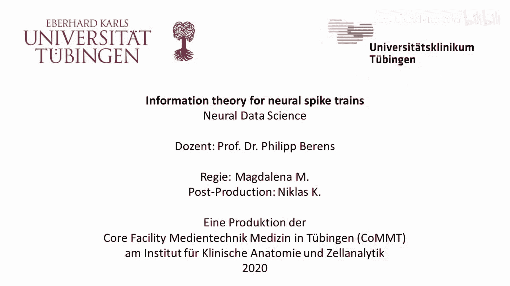

# 006：估计神经脉冲序列中的信息 📊

在本节课中，我们将学习如何将信息论应用于神经脉冲序列的分析。我们将探讨信息论的基本概念，特别是熵和互信息，并了解如何从有限的实验数据中准确估计这些量。

## 信息论简介

信息论是一门关于如何度量信息的数学理论，其起源可追溯至20世纪40至50年代，由克劳德·香农等人奠定基础。最初，它被用于卫星通信或军事侦察等领域，但很快人们发现，它同样适用于分析神经元等通信系统。

在信息论模型中，我们通常有一个发送者通过一个信道向接收者发送信息。在信道中，信息会受到噪声的干扰。发送者发送符号 **X**，每个符号有其出现的概率 **P(X)**。在神经科学背景下，**X** 通常代表输入系统的**刺激**。神经系统本身被视为**信道**。在接收端，我们观测到被记录为符号 **Y** 的**脉冲序列**，其出现概率为 **P(Y)**。

## 熵：信息的度量

熵是信息论中一个核心且重要的度量，本节我们将介绍离散熵。熵的公式如下：

\[
H(X) = -\sum_{x} P(x) \log_2 P(x)
\]

其中，**H(X)** 是随机变量 **X** 的熵。让我们看几个例子。

**抛硬币的熵**：对于一个参数为 **p** 的伯努利分布（例如抛硬币），其熵为：

\[
H = -p \log_2 p - (1-p) \log_2 (1-p)
\]

如果绘制熵随成功概率 **p** 变化的曲线，可以发现，当硬币是公平的（即 **p = 0.5**）时，熵达到最大值 **1 比特**。这意味着观察一次公平抛硬币的结果，能带来1比特的信息。如果硬币不公平（**p** 偏离0.5），熵则会降低，因为你在实验前就能以更高概率猜中结果。

**K个等可能结果的熵**：例如掷一个K面的骰子，其熵为：

\[
H = \log_2 K
\]

一般而言，随机变量 **X** 的熵可以理解为，为了确定其具体结果，平均需要提问的“是/否”问题数量，其值在 **H** 和 **H+1** 之间。熵的最小值为0，最大值不超过 **log₂(符号数量)**。当所有符号等可能出现时，熵达到最大。

为什么这个公式是信息的好度量？早期研究者为信息度量设定了一些理想属性：信息应为非负的；概率为1或0的事件不应提供信息（因为它们是确定的）；度量应是连续且随概率单调递减的；独立事件的信息应具有可加性。满足所有这些属性的函数，正是对数函数，从而导出了熵的公式。

熵的度量可以选择不同的底数。以2为底时，单位是**比特**；以自然常数e为底时，单位是**奈特**。这是两种最常用的单位。

## 条件熵与互信息

上一节我们介绍了熵，本节我们来看看条件熵和互信息。

**条件熵** **H(X|Y)** 表示在已知另一个随机变量 **Y** 的条件下，**X** 剩余的不确定性。在神经科学背景下，**X** 代表刺激，**Y** 代表观测到的脉冲序列。由于信道存在噪声和随机性，一个给定的脉冲序列可能对应多个可能的刺激。条件熵度量的就是已知脉冲序列后，刺激仍然存在的不确定性。

这个概念是对称的。我们也可以定义 **H(Y|X)**，即给定特定刺激时，脉冲序列的熵。

**互信息** **I(X;Y)** 衡量的是两个变量之间共享的信息量。它可以通过熵和条件熵来定义：

\[
I(X;Y) = H(X) - H(X|Y)
\]

这可以理解为，观察脉冲序列 **Y** 后，关于刺激 **X** 的不确定性（熵）减少了多少。互信息也可以对称地定义为：

\[
I(X;Y) = H(Y) - H(Y|X)
\]

这衡量了知道刺激 **X** 后，关于将出现哪个脉冲序列 **Y** 的不确定性减少了多少。

## 数据处理不等式

信息论中有一个非常基本的不等式，称为**数据处理不等式**。它指出，如果我们对随机变量 **X** 或 **Y** 进行任何处理（例如变换、分箱、忽略某些特征），那么它们之间的互信息只会减少或保持不变，绝不会增加。

在神经科学中，这意味著许多数据处理步骤都会导致信息损失。例如，将精确的脉冲发放时间进行分箱处理，或者忽略脉冲序列之间的相关性，都会降低我们从数据中计算出的互信息估计值。因此，所有形式的数据误处理或模型误设，都必然会导致互信息估计值的降低。

## 信息论在神经科学中的应用与挑战

信息论在神经科学中曾受《Spikes: exploring the neural code》一书影响深远，该书为分析神经编码提供了一个理想的定量观察者框架，尤其在研究苍蝇神经元方面应用广泛。

然而，信息论如今并非分析神经数据的首选框架。原因主要有两点批评：首先，信息是一个纯粹的句法概念，生物体不一定实际“使用”这些信息；其次，尽管有其行为相关性，但从数据中准确估计信息量实际上非常困难，这也是我们接下来要重点探讨的问题。

## 从数据估计熵的挑战

现在，我们来看看从实际的脉冲序列数据中估计熵时会遇到的具体困难。

我们可以将脉冲序列描述为短离散序列，例如在10个时间仓内，每个仓要么有脉冲（1），要么没有（0）。这样一个“词”就是10维的二进制序列。这个离散空间共有 **2¹⁰ = 1024** 种可能的状态。

在所有可能的概率分布中，为这1024种状态中的每一种分配相等的概率 **1/1024**，会得到最大的熵。这个最大熵很容易计算：**H_max = log₂(1024) = 10 比特**。

现在，假设我们从一个真实分布（例如这个均匀分布）中观测到一组数据样本 **{x₁, ..., x_N}**。一个最直接的熵估计方法是使用**最大似然估计**：我们简单地统计每个不同的“词”在数据中出现的频率，用这个经验频率除以总样本数来估计概率 **P(x)**，然后将这些估计值代入熵的公式。

这种“即插即用”的估计量效果如何？核心问题在于**未观测到的符号**。由于我们只观测到有限数量的样本，总会有一些本应等概率出现的脉冲序列模式在数据集中一次也没出现。这会导致我们对熵的估计产生偏差。

## 估计量的偏差与方差

要理解这个问题，我们需要回顾估计量的两个基本属性：**偏差**和**方差**。

*   **偏差**：估计量的期望值与真实参数值之间的差异。
*   **方差**：估计量自身的波动程度。

估计量的总误差可以分解为**偏差的平方加上方差**，这被称为**偏差-方差权衡**。

对于熵的估计量，尤其是最大似然估计量，**偏差是一个严重问题**。模拟显示，即使样本数量达到数千，估计出的熵值仍然系统地低于真实熵值（向下偏差）。只有当样本数量非常大（例如接近或超过可能状态数）时，估计值才接近真实值。

为什么这在神经科学中是个问题？因为互信息 **I(X;Y) = H(Y) - H(Y|X)** 正是我们关心的量。其中，**H(Y)** 可以利用所有实验条件下的数据来估计，偏差相对较小。但**条件熵 H(Y|X)** 的估计则只能使用对**特定刺激**做出响应的那些脉冲序列数据，数据量少得多，因此其向下偏差会非常大。最终，这会导致互信息 **I(X;Y)** 的估计产生**向上偏差**，即我们可能高估了脉冲序列实际携带的关于刺激的信息量，从而得出错误的科学结论。

## 校正互信息偏差的技术

多年来，人们提出了大量技术来校正互信息估计中的这种偏差。以下介绍几种常见方法。

**Miller-Madow 校正**：这是一种简单的校正方法。通过对偏差进行泰勒展开，可以证明一阶偏差近似为 **（使用的符号数 - 1） / （2N ln(2)）**，其中 **N** 是样本数。因此，我们可以在最大似然估计值上直接加上这个项来进行校正。这种方法有一定效果，但校正往往不充分。

**刀切法估计量**：这是一种重采样方法，可用于估计和减少偏差。其做法是：计算原始数据集的熵估计值，然后依次剔除一个样本，计算剔除后的熵估计值，利用这些值来估计总体偏差并进行校正。这种方法简单且效果显著，能大幅降低偏差。

**覆盖调整估计量**：这种方法的思路是将熵的公式分解为已观测符号和未观测符号两部分。它同时做两件事：1）缩小已观测符号的概率估计值；2）为罕见（未观测）符号的贡献引入一个膨胀项。这种方法能非常有效地减少平均偏差，但代价是引入了较大的方差，使得单次估计的结果波动很大。

实际上，还存在更多样化的估计量。例如，**最佳上界估计量** 在平均偏差和方差控制方面都表现优异，仅用约200个样本就能相当准确地估计一个拥有1024种状态的分布的熵，这令人惊讶，但得益于其内置的归纳偏置。

关键在于，从有限数据中估计熵是可行的，但必须谨慎选择适合当前数据和问题特性的估计量。

## 总结

本节课中，我们一起学习了如何将信息论应用于神经脉冲序列分析。我们回顾了熵、条件熵和互信息的核心概念及其公式。我们深入探讨了从有限神经数据中估计这些信息量时面临的核心挑战——由未观测事件引起的估计偏差，以及这种偏差如何导致互信息的高估。最后，我们介绍了几种校正偏差的技术，包括 Miller-Madow 校正、刀切法和覆盖调整估计量，并强调了根据具体问题选择合适的估计量的重要性。准确估计神经信息是理解神经编码的关键一步，但需要借助严谨的统计方法来实现。