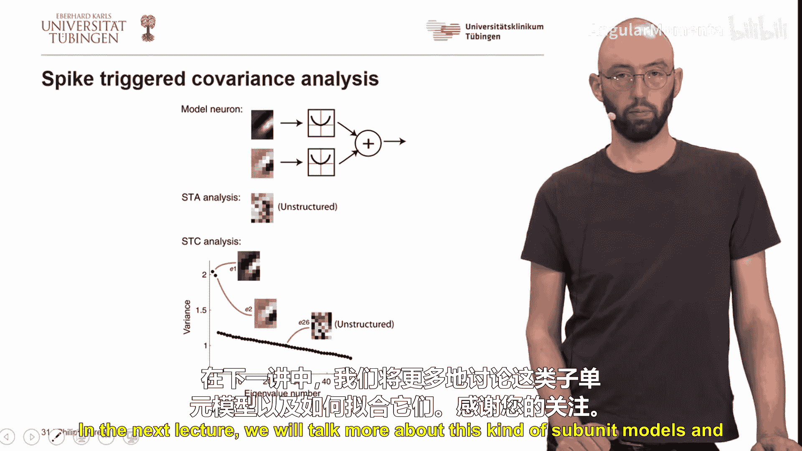
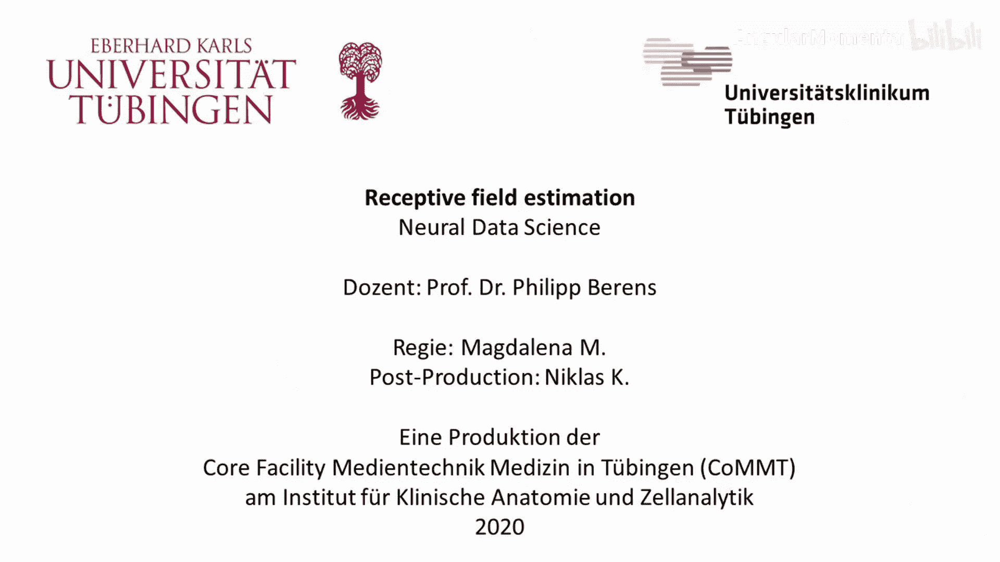

# 007：单细胞感受野估计 🧠

在本节课中，我们将学习如何估计单个神经元的感受野。感受野描述了刺激的哪些特征会引发神经元的反应。我们将从线性模型开始，逐步深入到更复杂的非线性模型，并学习如何从数据中有效地估计这些模型参数。

## 感受野与线性模型

上一节我们介绍了调谐曲线的概念，它适用于一维或二维的简单参数化刺激。本节中，我们来看看一个更普遍的问题：刺激或动物行为的哪些方面会导致特定神经元放电？

例如，弱电鱼通过其电感受器官感知周围电场的波动。如果我们记录其侧线叶中某个神经元的活动，并同时记录鱼周围电场的调制信号，我们会发现放电通常发生在电场信号的下降阶段。

为了量化这种关系，我们可以在刺激和神经元电活动之间建立一个线性模型。我们可以尝试将放电率估计为刺激与感受野核的卷积。

**公式表示：**
`rate(t) = ∫ stimulus(t - τ) * kernel(τ) dτ`

如果我们计算这个核，它可能呈现特定的形状。例如，当刺激先上升后下降时，神经元会放电。

## 感受野的理论基础与类型

从理论上讲，这可以追溯到级数展开，类似于函数的泰勒展开，但这里我们将一个函数展开为其他函数的组合。这些核就是我们用来描述刺激与神经元反应之间关系的感受野。

对于一个在空间和时间上的简单细胞，其感受野可能看起来像一个拉长的正形区域和一个拉长的负形区域。随着时间推移，这个形状会变得更加明显，然后逐渐消失。

这种卷积不仅限于一维或二维（如电感受侧线叶的例子），实际上也可以是三维的，即同时跨越空间和时间。我们可以从中看到神经元的潜伏期，即刺激变化与相关放电变化之间的延迟，这大约在75毫秒左右，因为此时感受野的表达最强。

如果我们只沿着一条线切割这些感受野，会看到振幅最高点，并且随着时间的推移，振幅会略微反转。这样的感受野被称为**时空可分离感受野**。

**公式表示：**
`receptive_field(x, t) = spatial_kernel(x) * temporal_kernel(t)`

这意味着我们可以通过一个空间核和一个时间核的简单相乘，来获得二维感受野。因此，二维感受野可以分解为两个一维感受野。

## 方向选择性与感受野

那么，我们如何分析这种感受野的方向选择性或朝向选择性呢？为此，我们需要能够在时空图中展示移动的光栅。否则很难展示。

在时空图中，x和y是空间坐标，我们让光栅随时间沿某个方向移动。如果我们绘制x和时间T的关系，这种平行于x轴的运动看起来就像对角线条纹。

对于时空可分离的感受野，无论光栅向哪个方向移动，其反应的时间调制看起来都是一样的。这意味着运动方向无关紧要。

那么，如何使感受野具有方向选择性呢？为此，我们实际上需要一个**非时空可分离的感受野**。在感受野的时空图中，我们需要一个倾斜的轴。

因为如果我们有这样一个非时空可分离的感受野，那么当光栅沿一个方向移动时，对齐度高，反应强；而沿相反方向移动时，无论在任何时间点如何对齐，反应都几乎为零。

**结论：** 要实现方向选择性，我们需要一个非时空可分离的感受野。

## 数据分析：线性-非线性泊松模型

前面我们讨论了很多关于刺激与反应、时空可分离与非可分离感受野的关系。现在，我们转向数据分析。

我们通常用一个简单的预测模型来总结这种关系，即所谓的**线性-非线性泊松模型**。

在LNP模型中，我们假设有一个刺激（具有一维或二维空间维度和一个时间维度）。现代神经元具有感受野，即线性滤波器。将这些线性滤波器在空间和时间上应用于刺激的结果，通过一个非线性函数，然后加上一些噪声过程（在LNP神经元中通常是泊松过程），就生成了神经元的反应。

我们如何估计这样一个神经元的参数呢？我们感兴趣的一个量是所谓的**脉冲触发集合**。

我们观察那些在脉冲之前出现的刺激。如果这是我们的反应序列，在这些时间点有脉冲，那么我们从刺激中提取在脉冲前不久发生的部分。我们感兴趣的是寻找这个脉冲触发集合中有意义的结构。

## 脉冲触发平均与感受野估计

我们可以从脉冲触发集合中计算的第一个量，也是感受野的一个简单估计，就是所谓的**脉冲触发平均**。

具体做法是：取脉冲触发集合的各个组成部分，将它们相加，然后除以脉冲数量，得到脉冲触发平均。

**公式表示：**
`STA = (1/N) * Σ stimulus(t_i - τ)`

脉冲触发平均告诉你神经元平均偏好什么。

如果我们的刺激是白噪声刺激（意味着在空间和时间上没有相关性），那么最初通过级数展开定义的线性感受野实际上就是脉冲触发平均。对于白噪声刺激和我们的LNP神经元模型，这一点也成立。

然而，一般来说，情况未必如此，我们稍后会讨论这一点。

需要注意的是，在许多情况下，我们的符号在空间和时间上是连续的，因为空间和时间是连续量。但对于计算机科学家来说，在计算机中精确表示连续信号非常困难，因此我们只需离散化，并将所有积分转化为求和来计算这些量。

## 最大似然估计与正则化

如前所述，脉冲触发平均是感受野的一个估计，但在某些情况下它是有偏的。例如，如果刺激是非白噪声的（即刺激中存在相关性），比如展示自然电影而不是简单的白噪声时。

在这种情况下，我们可以进行最大似然估计。就像在调谐函数的情况下一样，我们再次假设一个泊松似然，其中给定时间仓内的脉冲按照参数为λ的泊松分布分布。这里的速率λ不是由一维调谐函数指定，而是由感受野与刺激的乘积决定。

然后我们可以写下似然函数，计算负对数似然，并计算导数（对感受野参数求导）。我们可以通过优化似然函数来找到其最大值，从而得到线性滤波器的估计（例如，在LNP神经元模型中，适用于任意刺激）。

这样做的一个问题是，你的估计在平均意义上是无偏的，但方差很高。如果这是真实的感受野，使用一定量的数据，你会得到一个看起来非常嘈杂的最大似然估计。你可以看到整体形状，但它几乎被噪声覆盖。

在统计学中，我们可以**正则化**我们的估计，或者在贝叶斯框架下计算最大后验估计，将我们对感受野应该是什么样子的先验假设纳入推理框架。

我们可以用这样的图模型来表示：我们的反应Y由刺激X和感受野K决定。我们对感受野K有一些超参数，决定了它的属性。这也被称为先验信息推理。

这里的新内容是带有超参数的先验。然后我们取使后验概率最大化的感受野K，即最大化似然和先验乘积的感受野。

## 不同的先验与正则化方法

当然，可以使用一系列不同的先验。如果你的先验是系数服从正态分布，那么你的惩罚项类似于L2收缩（也称为岭惩罚）。使用L2收缩，你已经可以得到更好的感受野系数估计，至少方差减少了很多。

你也可以使用拉普拉斯分布作为先验，这相当于使用LASSO惩罚或L1收缩。这会在你的感受野系数中引入稀疏性。在这种情况下，你可以看到这里的许多条目实际上被推到了零。总体而言，感受野看起来比以前更曲折，但它很好地遵循了整体形状。

这些方法很好，但还可以做得更好，使用两种技术：**自动局部性检测**和**自动平滑度确定**。

通过自动局部性检测，你可以得到这样的滤波器估计，其假设是感受野在时空上是局部的。因此，在先验中，你以某种方式将感受野在时空中局部化。在先验中，你不再假设系数估计是独立的，而是需要为你的先验分布设置一个协方差矩阵。

你也可以在傅里叶空间中假设局部性，这意味着只允许某些频率分量活跃。你可以在傅里叶谱上设置先验，这实际上效果出奇地好。你还可以结合这两种先验，从而得到非常好的感受野形状估计。

## 超参数选择与经验贝叶斯

现在，我们如何找到这些模型的超参数呢？到目前为止，我们只是简单地假设了它们。但本演示所基于的论文作者使用了称为**经验贝叶斯**的技术。

在经验贝叶斯中，我们在这个贝叶斯框架中计算一个称为“证据”的项，然后简单地使用使证据最大化的超参数。对于某些模型，实际上可以以相当封闭的形式或相当高效地计算证据。

由此，我们得到了一整套不同的感受野估计方法，它们都比朴素的最大似然估计要好。我们可以使用L2收缩或岭惩罚、LASSO惩罚，以及各种在空间、频率或空间-频率上局部化的先验。基于一些先验知识，这些方法已经可以局部化我们的感受野估计，并且即使使用很少的数据，也能获得非常好的感受野估计。

## 样条基函数：一种高效的替代方法

到目前为止，我忽略的一个问题是，为了计算超参数的经验贝叶斯解，我们需要使用线性高斯模型。但当然，我们也希望在LNP模型中能够计算这种数据高效的感受野。

此外，进行这种证据优化步骤通常非常耗时。因此，我们最近开发了一种高效的替代方法，即使用**样条基函数**。

我们通过选择基函数（这里是样条）来指定我们的先验信念。样条是平滑的函数，或者是在特定准则下最平滑的函数。我们在这里使用的一类样条看起来像这些带有轻微波动的“高斯帽”。

使用这些样条基，我们可以轻松地近似不同形状的感受野，也可以在二维中这样做，因为样条基可以在多个维度上高效计算。

通过这样做，我们获得了什么？如果我们处理高维刺激（因为每个像素都是一个维度，时间也是），我们对所有这些都有独立的系数。使用样条基，我们将刺激空间的维度从三维感受野中的像素数减少到我们需要的样条基分量的数量。

这样做，我们也可以得到非常好看的感受野估计。这是脉冲触发平均，这是使用样条基的最大似然估计器，这是加上L1惩罚和样条基的估计。可以看到，在没有自动局部性检测框架的情况下，我们得到了与贝叶斯框架一样好的估计。

## 非线性计算：复杂细胞与能量模型

那么，那些在计算上是非线性的细胞呢？在上一节课中，我们简要讨论了复杂细胞和Hubel-Wiesel复杂细胞模型。其思想是，皮层中的简单细胞由LGN神经元的投射产生，这些神经元以有序的方式排列感受野，从而在简单细胞中产生这些条纹状Gabor-like感受野。复杂细胞被认为是具有相同偏好朝向但不同偏好刺激相位的简单细胞的组合，因此复杂细胞整体上对刺激的相位不敏感。

对于这种复杂细胞，线性感受野实际上是平坦的。因此，如果你想模拟它们的反应，需要做一些更聪明的事情。

一般来说，复杂细胞的主导模型是所谓的**能量模型**。我们有一对滤波器（余弦和正弦滤波器），它们通过二次非线性组合并相加。通过这种二次非线性操作，我们使细胞的反应对刺激的精确位置不敏感，从而引入了一定的位置不变性。

我们可以使用一种技术（例如**脉冲触发协方差**）来恢复这样的滤波器。在脉冲触发协方差中，我们再次取脉冲触发集合，计算其协方差矩阵，并进行特征向量分析（很像PCA）。然后使用这些作为脉冲触发协方差分量的特征向量。

如果我们有一个根据复杂细胞模型指定的模型神经元（即具有这两个滤波器和相加的二次非线性），那么我们的脉冲触发平均将是无结构的。但如果我们观察特征值谱，会有两个滤波器或两个分量（两个特征值）明显突出。这两个分量很好地恢复了原始滤波器，尽管存在二次非线性。

在下一讲中，我们将更多地讨论这类亚单位模型以及如何拟合它们。

## 总结 🎯

本节课中，我们一起学习了单细胞感受野估计的核心概念与方法。我们从基础的线性模型和脉冲触发平均出发，探讨了感受野的时空特性与方向选择性。接着，我们深入了更高级的估计技术，包括最大似然估计、贝叶斯正则化（如L1/L2惩罚、自动局部性检测）以及使用样条基函数的高效方法。最后，我们简要介绍了处理非线性反应的复杂细胞能量模型与脉冲触发协方差分析。这些工具使我们能够从神经数据中更准确、更高效地揭示刺激与神经反应之间的复杂关系。