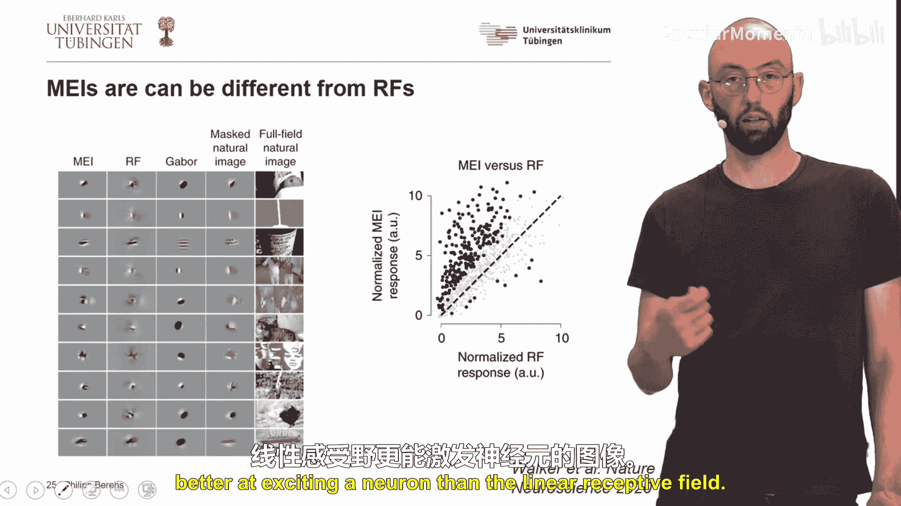
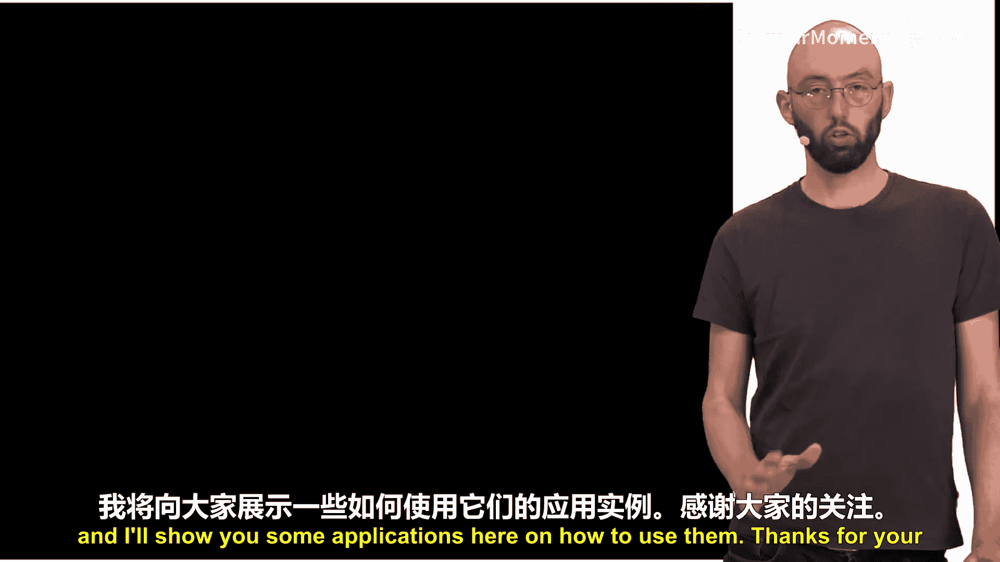
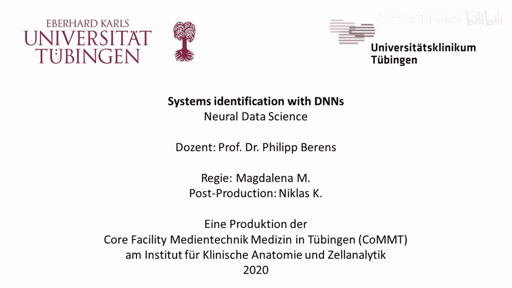

# 008：基于深度神经网络的系统辨识 🧠

在本节课中，我们将学习如何使用深度神经网络进行神经系统的系统辨识。我们将从简单的线性-非线性模型出发，逐步过渡到更复杂的子单元模型，并最终探讨如何利用深度神经网络来预测神经活动。通过本教程，你将理解这些模型的基本原理、优势以及在实际神经科学数据中的应用。

---

## 从线性-非线性模型到子单元模型

上一节我们介绍了感受野模型及其高效估计方法。本节中，我们将探讨更复杂的系统辨识模型，例如使用深度神经网络。

我们上周从一个线性-非线性-泊松模型开始。在该模型中，刺激信号通过一个线性感受野滤波器，然后经过一个非线性变换，并加上噪声来生成响应。

**公式**：`响应 = 非线性(线性滤波器(刺激)) + 噪声`

然而，对于执行非线性计算的神经元（例如复杂细胞），这样的模型可能不够充分。因此，我们可以将此概念扩展为所谓的线性-非线性-线性-非线性子单元模型。

在这种模型中，刺激信号通过一组感受野滤波器阵列，每个滤波器都有自己的非线性变换。然后，这些非线性变换的输出被求和，并再次通过一个输出非线性变换。

**公式**：`响应 = 输出非线性( Σ 子单元非线性(子单元滤波器_i(刺激)) ) + 噪声`

这类模型为我们模拟刺激-响应关系提供了更丰富的可能性。此外，我们还可以添加类似响应历史滤波器等组件。

---

## 子单元模型的优势与应用

子单元模型在复杂性上介于简单的LNP模型和极其复杂的视网膜或皮层回路模型之间。它提供了一个适中的复杂度水平。

在上一讲中，我介绍了使用稀疏基来推断感受野的概念。由于子单元模型有更多参数（每个子单元都需要学习一个参数），在这种情况下使用稀疏基更有帮助。

以下是使用LNP模型和子单元模型对某个神经节细胞进行建模的对比。可以看到，在可用数据量有限的情况下，子单元模型的拟合结果可能较为模糊。但使用稀疏基后，我们不仅能获得更好的LNP模型拟合，还能为各个子单元获得清晰且定位准确的感受野。

在某些系统中，这样的子单元可以提高模型性能。通过绘制预测响应率与真实数据之间的相关系数，我们发现子单元模型通常能改善预测效果。

更有趣的是，有证据表明，在某些情况下，此类子单元模型中的子单元可能对应于实际神经回路中的元素。例如，在视网膜中，神经节细胞从双极细胞接收输入。一些研究表明，通过子单元模型获得的子单元实际上可能对应于单个双极细胞。这有助于弥合统计模型与基于回路的模型之间的差距。

---

## 迈向深度神经网络

虽然子单元模型通常受到接近视网膜回路的启发，但我们也可以采取另一种方法：使子单元连续化，并使用深度神经网络来预测神经活动。

在深度神经网络，特别是卷积神经网络中，已经内置了这种子单元机制。卷积神经网络的思想是，你有一个在整幅图像上移动的滤波器，这可以对应于单个双极细胞类型的感受野，在其输出被组合之前应用于整个图像，然后由某种神经节细胞类型从这些表示中采样。

因此，可以将深度神经网络或卷积神经网络的表示视为另一种受视网膜回路启发的尝试，用于预测神经响应。事实上，深度神经网络在这方面表现相当出色。

使用深度神经网络预测神经活动的一个好处是，有大量来自深度学习领域的开源工具可供使用，这大大简化了系统辨识的实现。

**代码示例（概念性伪代码）**：
```python
# 定义一个简单的卷积神经网络模型
model = Sequential([
    Conv2D(filters=32, kernel_size=(3,3), activation='relu', input_shape=(height, width, channels)),
    MaxPooling2D(pool_size=(2,2)),
    Flatten(),
    Dense(units=128, activation='relu'),
    Dense(units=1, activation='linear')  # 输出神经活动预测
])
model.compile(optimizer='adam', loss='mse')
```

---

## 深度神经网络的训练与扩展

深度神经网络参数优化的关键成分是所谓的反向传播。在前向传播中，我们将一个样本送入带有参数B和W的神经网络，计算线性表示和非线性表示，并将其传递到不同层，直到我们可以评估该特定刺激的损失函数。反向传播则是将损失信号的导数高效地传递回这个计算图的过程。

**公式（链式法则）**：`∂损失/∂参数 = (∂损失/∂层输出) * (∂层输出/∂参数)`

借助深度学习的工具箱，我们可以实现更复杂的模型。虽然之前讨论的模型是针对单个神经元拟合的，或者具有为单个神经元训练的特征，但现在我们也可以跨神经元使用特征共享。

我们可以使用从数据中学习但模拟单个神经元响应的特征空间。这在恢复细胞类型时可能很有用。例如，在模拟中，我们有两种类型（小型和大型），在我们的特征共享空间中学习到的核与这些类型非常吻合。

我们还可以为这样的模型添加更多功能。例如，可以添加时间动态。此外，如果记录了眼动或跑步等活动，我们可以通过调制器和移位器网络将其添加到模型中，自动校正并考虑这些因素。

---

## 迁移学习与预训练网络

我们不仅可以训练新的网络，还可以使用预训练网络。这意味着我们可以使用在线可用的大型神经网络架构（如AlexNet或VGG16），这些网络已经在海量图像集上训练用于物体分类。

现在，我们可以直接使用这些网络的参数来预测神经活动。其背后的希望是，网络学习到的表示在纯粹的物体分类任务之外，具有更普遍的用途。

例如，在一项研究中，研究人员向两只猴子展示了快速闪现的图像序列，并尝试建模这些图像与引发的神经活动之间的关系。他们使用了一个基于VGG的模型，其中他们简单地使用了预训练VGG的参数来计算特定特征图中的表示，然后训练线性读出器来模拟神经元的活动。在这种情况下，特征提取部分是固定的，他们只是学习了读出部分。

这种方法通常比在特定数据上从头开始训练的卷积网络效果更好，因为它从物体分类任务中继承了许多归纳偏置，因此数据效率更高。

---

## 深度神经网络的预测能力与“最兴奋图像”

近年来，研究表明，虽然深度神经网络并不特别接近底层神经组织用于计算信息的神经回路或生物物理机制，但它们提供了非常好的预测模型。一个能证明这些预测模型有多好的概念是“最兴奋图像”。

其过程是：向动物展示一组自然图像，并记录大量神经响应。然后训练一个人工神经网络来模拟这些响应。该网络可以很好地预测响应。接着，可以使用该模型找到一个应该能最优地、最强烈地兴奋某个模型神经元的图像（即“最兴奋图像”）。在后续实验中，可以向真实的神经元展示这个特定的MEI，以检验预测是否正确——即该MEI是否比其他图像更能激发神经元。

这些MEI与简单的感受野不同。在某些情况下，它们可能相似，但在其他情况下，它们可能截然不同。通常，神经元对MEI的响应比对线性感受野等控制刺激的响应要高得多。因此，通过非线性的深度神经网络，可以找到比线性感受野更能激发神经元的图像。

---



## 总结





本节课中，我们一起学习了深度神经网络在神经系统辨识中的多种应用。我们从基础的线性-非线性模型出发，探讨了更复杂的子单元模型及其生物学解释。接着，我们深入了解了如何利用深度神经网络，特别是卷积神经网络和预训练模型，来高效地预测神经活动。最后，我们看到了深度神经网络强大的预测能力，例如通过生成“最兴奋图像”来验证模型。总之，深度神经网络已成为神经科学系统辨识中 versatile 且强大的工具。