# 009：神经群体分析（一）

在本节课中，我们将学习如何分析同时记录的整个神经元群体的活动。我们将扩展之前讨论的单神经元模型，引入神经元自身的放电历史效应以及神经元之间的相互作用，并介绍两种用于描述群体活动模式的统计模型。

## 从单神经元到神经元群体

在过去的几周里，我们讨论了如何分析单个神经元。这些神经元被单独或作为一组记录，以响应不同的刺激。

今天，我们将进一步扩展我们的模型，讨论如何分析同时记录的整个神经元群体。

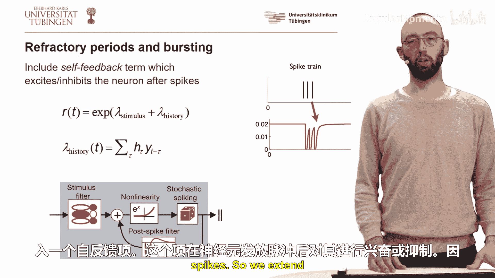

## 扩展模型：纳入放电历史效应

我们目前拥有的模型，主要是具有刺激依赖性的变体，这种依赖性通常被建模为线性滤波器，然后通过非线性传递，最后是一个随机的放电过程。

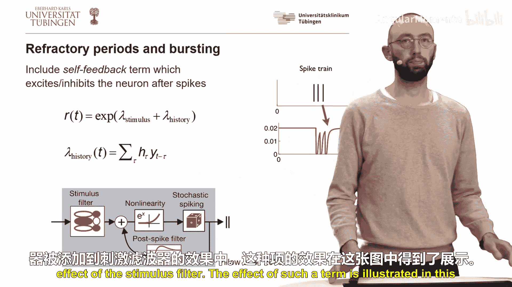

在过去的讲座中，我们也介绍了这个基本框架的扩展，其中刺激滤波器可以由子单元模型、多个并行的刺激滤波器甚至非线性深度神经网络组成。

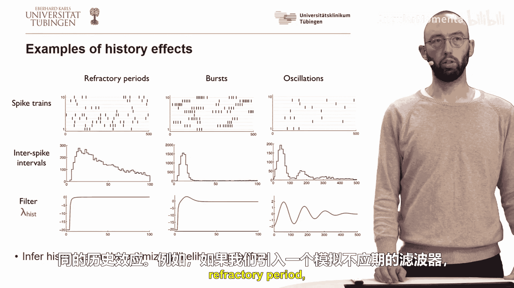

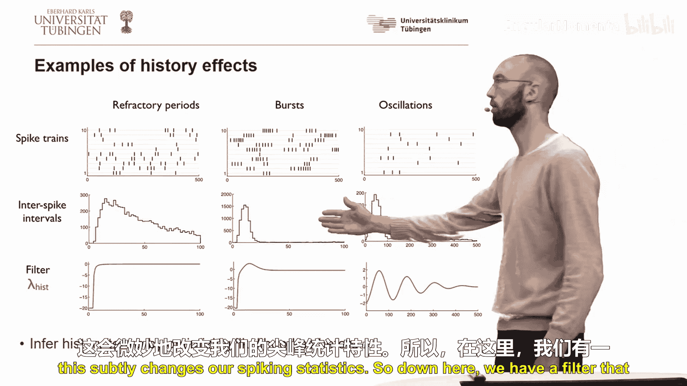

然而，我们到目前为止没有包含或没有明确讨论的是单个神经元放电动力学的影响，例如不应期或爆发式放电，以及同时记录的神经元之间的相互作用。我们今天将讨论这些内容。

为了提醒你，不应期是动作电位之后神经元无法再次放电的一段时间。不应期的生物物理基础是钠通道在激活和失活后进入一种失活状态，在这种状态下它们不能被直接再次打开。

为了在我们的神经数据中模拟不应期，我们需要包含一个细胞反馈项。这是一个在放电后兴奋或抑制神经元的项。

因此，我们在这里扩展了我们的速率函数 `r(t)`，增加了一个放电历史项。我们将放电历史也建模为一个线性滤波器。你可以在下图的示意中看到，神经元自身的随机放电作为后放电滤波器反馈回模型中，与刺激滤波器的效果相加。

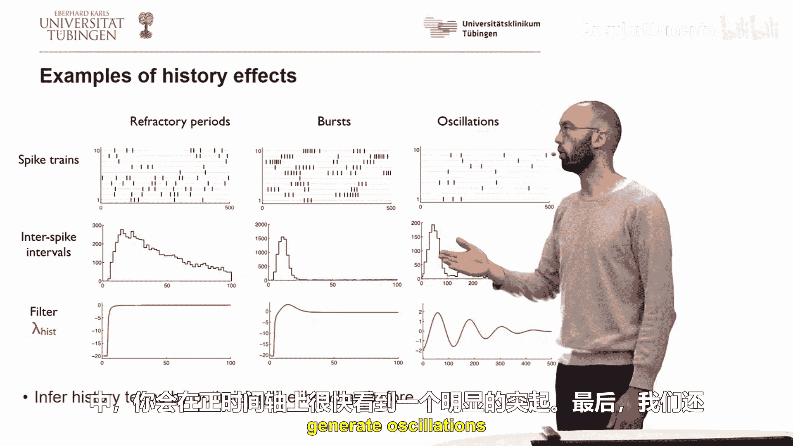

这种项的效果在下图中说明。每次放电后，一个抑制性的自我反馈项会降低在任何给定时刻发生放电的概率。

你可以用这个框架模拟非常不同的历史效应。例如，如果我们只输入一个模拟不应期的滤波器，这会微妙地改变我们的放电统计特性。

我们有一个滤波器，可以防止每次放电后极短时间内再次放电。如果你观察对放电间隔分布的影响，你基本上也能看到在开始处概率的下降。

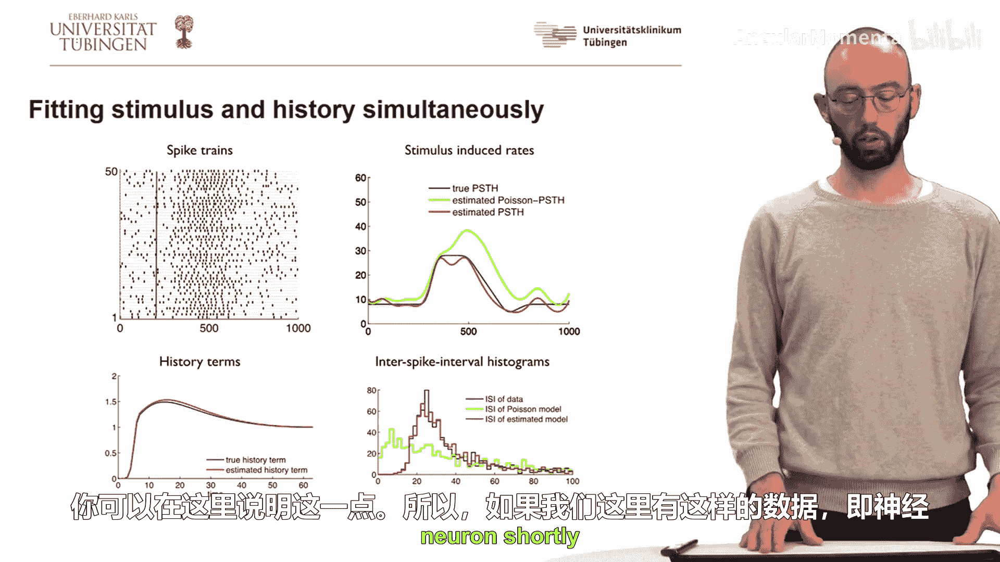

从模型中可以生成或采样的放电序列看起来相当正常。

如果你想模拟爆发式放电，你可以清楚地看到，一旦神经元在这里放电一次，它通常会紧接着再发出几次放电。这可以通过一个这样的爆发滤波器来建模，它在不应期之外，在放电后不久有一个这种自我兴奋的凸起。

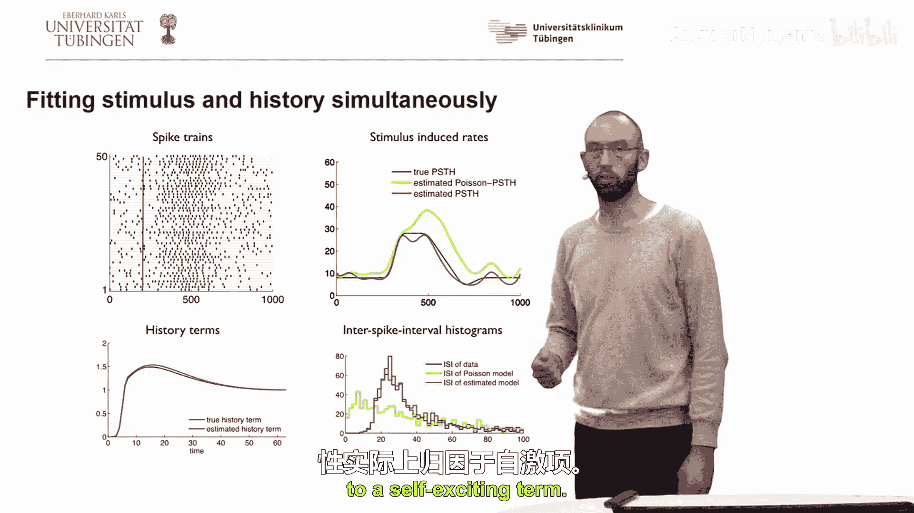

这非常强烈，以至于在放电间隔分布中，你可以在正的时间滞后处看到一个明显的凸起。

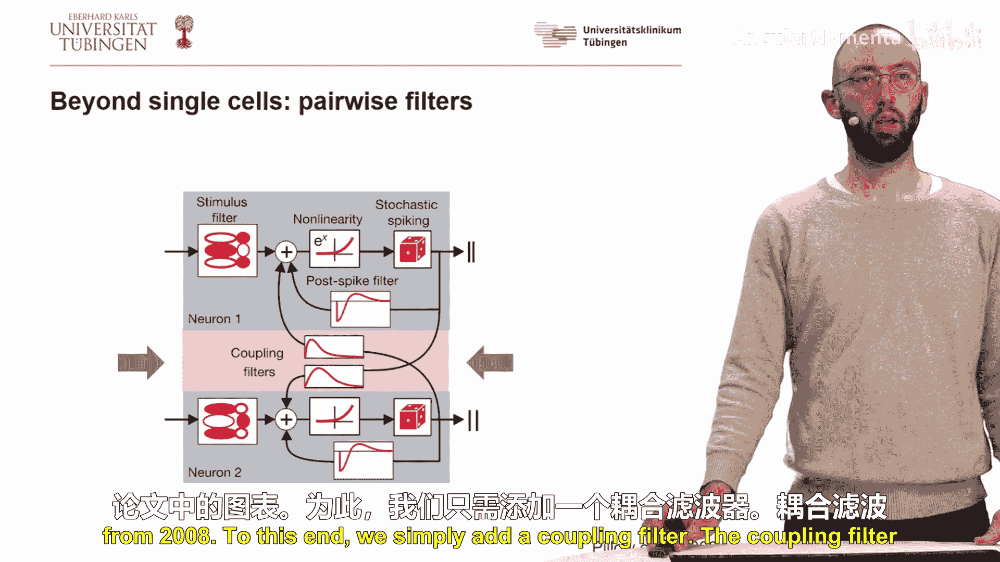

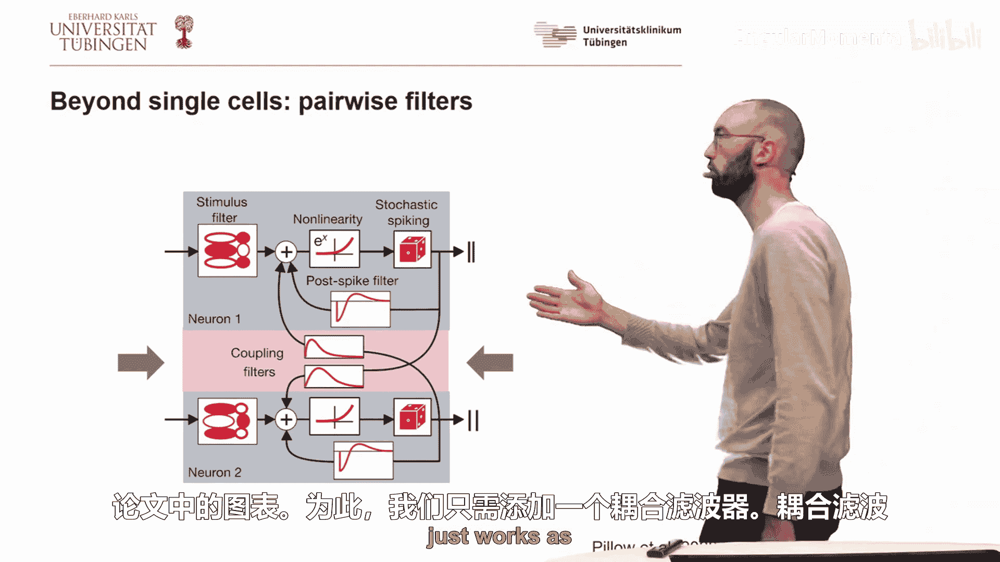

最后，我们也可以在放电活动中产生振荡。在原始放电数据中，使用振荡性放电历史滤波器，这些振荡有点难以发现。

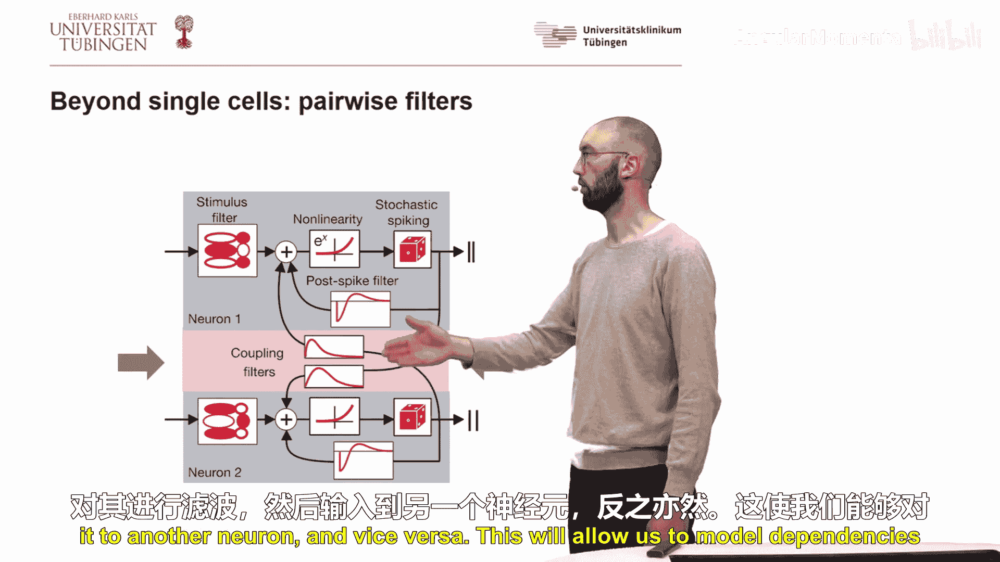

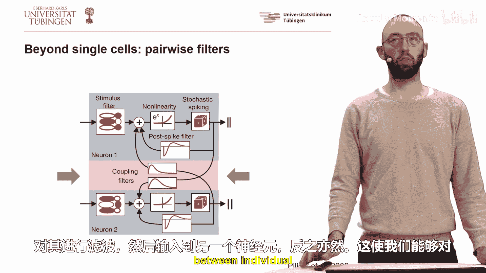

这些滤波器然后也会产生振荡性的放电间隔分布。

你可以像以前一样，通过优化似然函数，从数据中估计这些滤波器。

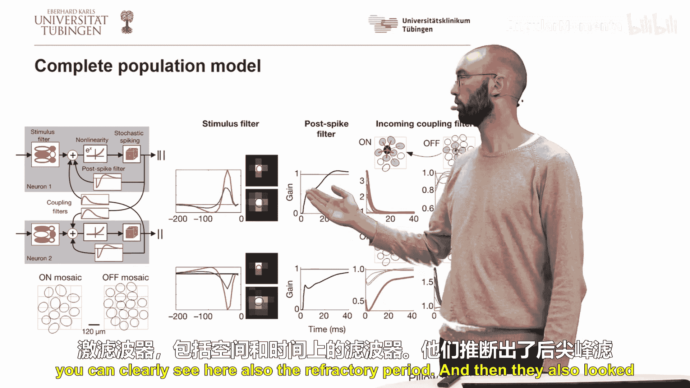

如果你有包含多次试验的数据，并且想要同时模拟PSTH（刺激后时间直方图）或刺激依赖性以及放电历史依赖性，那么你需要同时推断这两项。因为在时间 `t` 发生的放电，可能是由于刺激开始导致刺激诱发速率高，也可能是由于最近的放电历史（例如，在一次爆发中）的结果。如果你在推断模型之前只是跨试验平均，这会混淆这两者。因此，如果你同时推断它们，你至少可以在一定程度上分离这些效应。

我们可以在这里说明这一点。如果我们有这种数据，其中神经元在刺激开始后不久有一段升高的放电期。那么，如果我们不考虑放电历史效应，仅根据数据估计PSTH，我们会得到这种PSTH。但如果我们同时估计这两项，那么这实际上与我们的模型PSTH匹配，并且这里的一些变异性、一些依赖性实际上被归因于自我兴奋项。

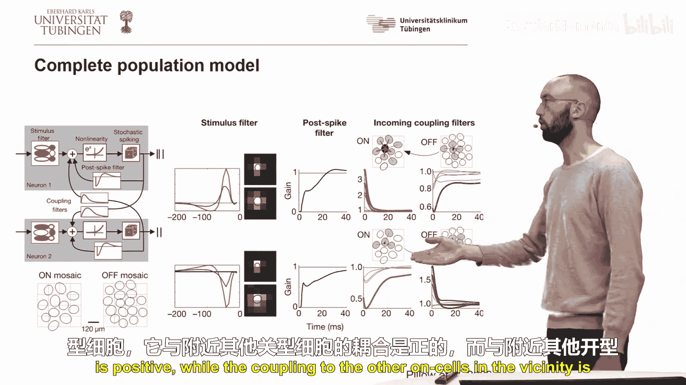

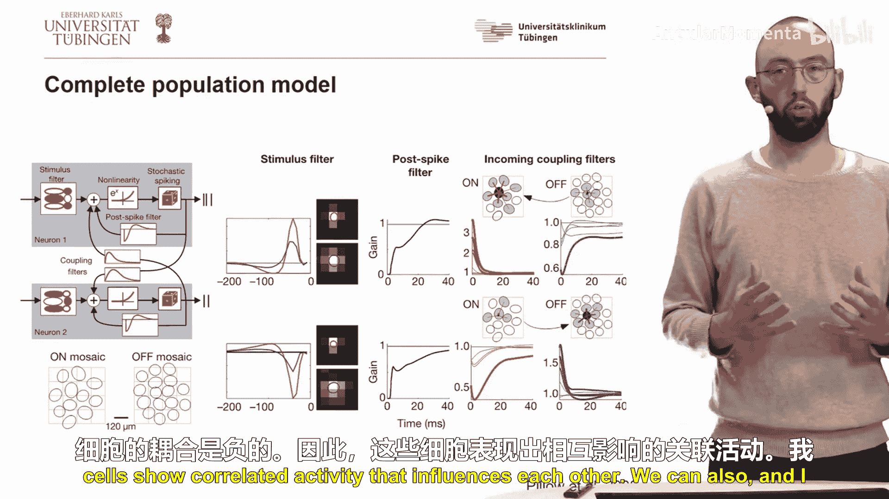

## 超越成对效应：神经元间相互作用

你也可以超越成对效应，模拟同时记录的神经元之间的相互作用。

为此，我们简单地添加一个耦合滤波器。耦合滤波器的工作原理与后放电滤波器类似，但它将一个神经元的放电活动作为输入，进行滤波，然后输入到另一个神经元，反之亦然。

这将允许我们模拟单个神经元之间的依赖性。

例如，在2008年的这篇论文中，他们拟合了这样一个大规模群体模型。他们推断了个体的刺激滤波器（在空间和时间上）、后放电滤波器（你可以清楚地看到不应期），并且他们还研究了耦合滤波器。例如，对于中间的这个ON细胞，你可以查看来自周围ON和OFF细胞的所有耦合滤波器。

对于这个中间的OFF细胞，与附近其他OFF细胞的耦合是正的，而与附近其他ON细胞的耦合是负的。因此，这些细胞显示出相互影响的关联活动。

## 模型的灵活性与非线性

我们也可以，我之前简要提到过，替换我们的非线性。通常，我们使用指数非线性，因此在统计术语中，我们基本上拥有泊松广义线性模型。但我们也可以使用，例如，S型非线性。如果我们使时间仓非常小，使得每个时间仓最多只有一个放电，那么这就是一个二项式或伯努利广义线性模型。

原则上，我们也可以使我们的非线性非常灵活，并从数据中拟合它，要么使用直方图方法，要么使用样条基。例如，在这里，你可以看到这个非线性由样条基的系数参数化，因此可以非常灵活地模拟模型线性阶段输出与放电活动之间的不同关系。

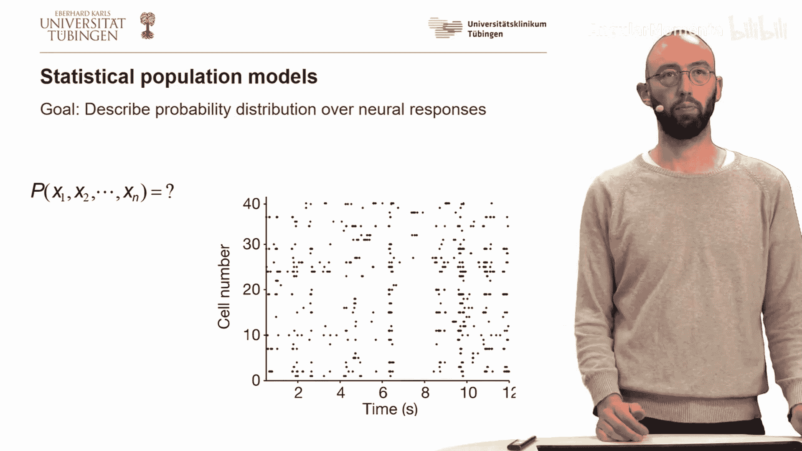

## 总结：预测性群体模型

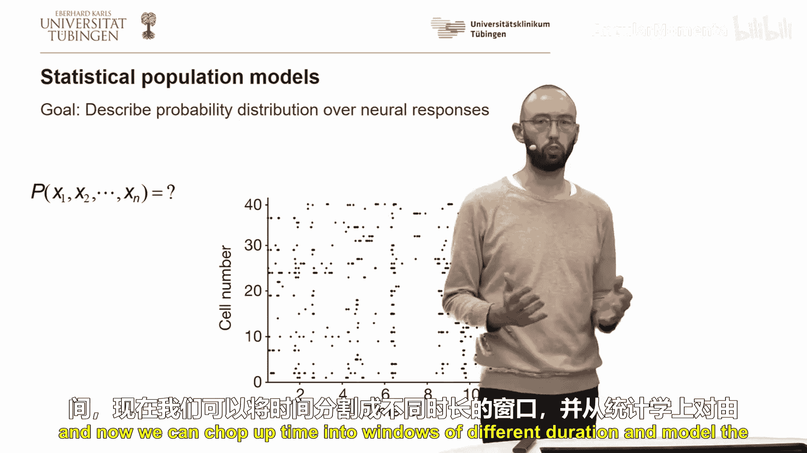

总而言之，我们这里的预测性群体模型非常灵活，我们可以轻松地调整它们。有许多现有的框架可以用来拟合它们。例如，几乎每种编程语言中都有的GLM拟合工具箱。从统计学的角度来看，它们也得到了很好的理解。如果我们有想要添加到模型中的额外项，例如行为数据、眼动数据、奔跑数据，只需以与包含放电历史滤波器相同的方式，将另一个预测因子输入到同一框架中即可。

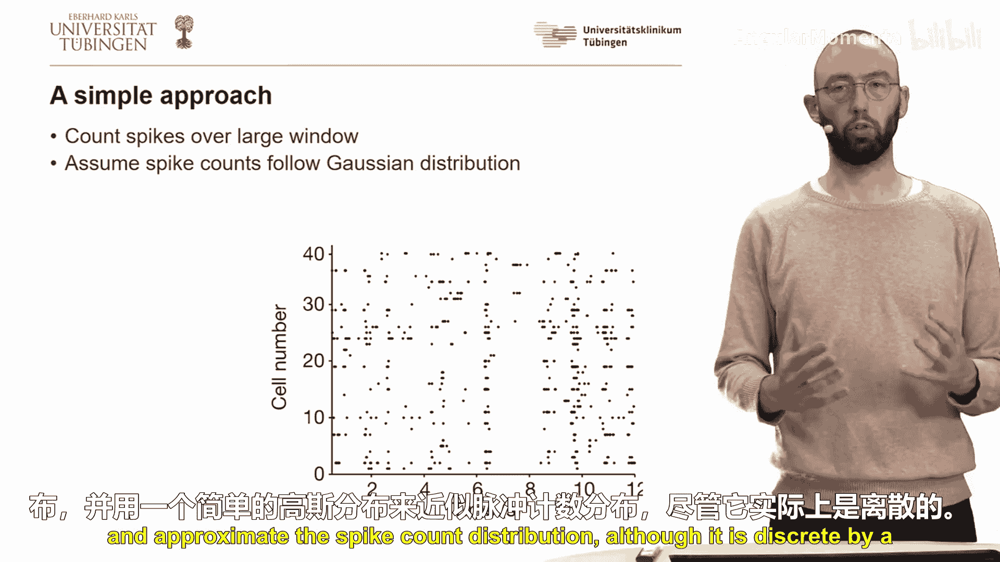

人们还研究了大量的扩展，以估计隐藏神经元或非线性相互作用，模拟共同输入，模拟状态依赖性等等。

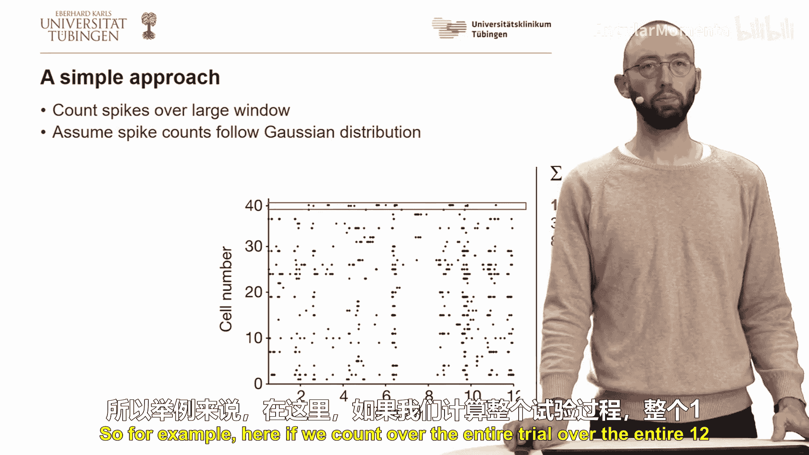

当你将这样的模型拟合到数据时，一个普遍的问题是，最终，耦合滤波器没有一个良好的机制基础。它们模拟了神经元之间的功能或统计连接性，但它们并不是这些功能实现背后真实突触连接性的良好或必要模型。

因此，在文献中，你会经常听到“功能连接性”这个术语。实际上，如果你愿意，它并不是连接性，而更像是功能影响或有向相关性之类的东西。

## 第二类模型：统计群体模型

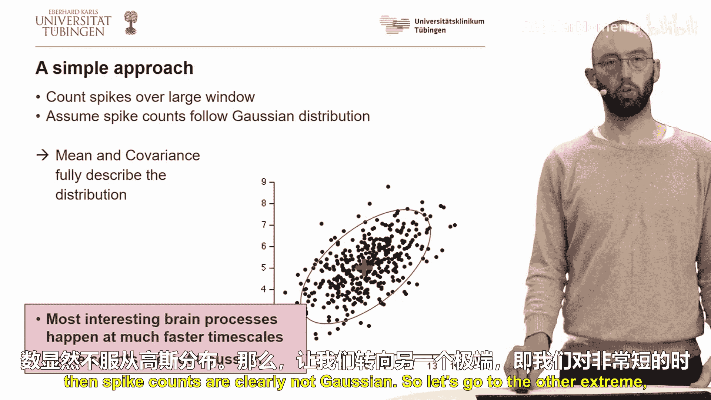

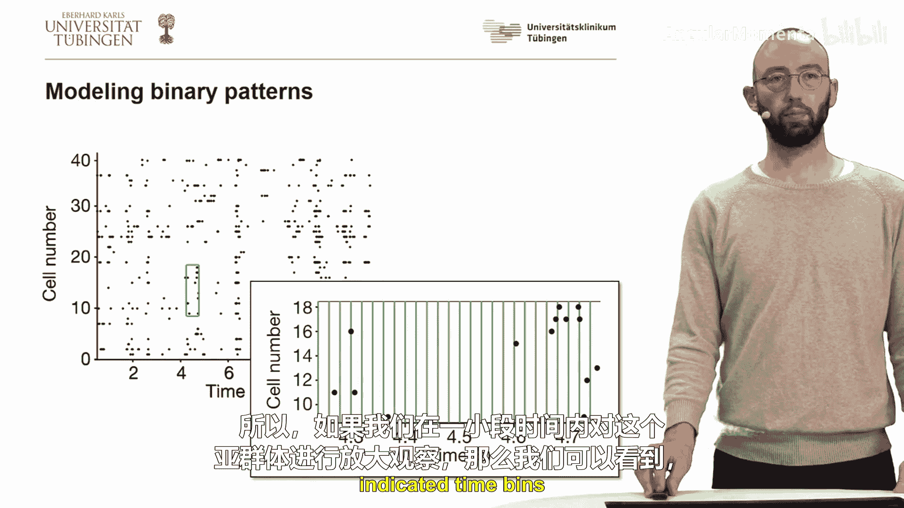

今天我想讨论的第二类群体模型是统计群体模型。在这些统计群体模型中，我们的目标不是预测神经元或神经元群体对刺激的反应，而是描述神经反应的概率分布，无论是在自发活动期间还是在响应不同刺激集合时。

因此，我们的目标是对这个分布 `P(x1, ..., xN)` 进行建模，它模拟了群体在特定时间窗口内的活动。例如，这里有40个神经元，时间在这个维度上。现在我们可以将时间分割成不同持续时间的窗口，并对由此产生的活动模式进行统计建模。

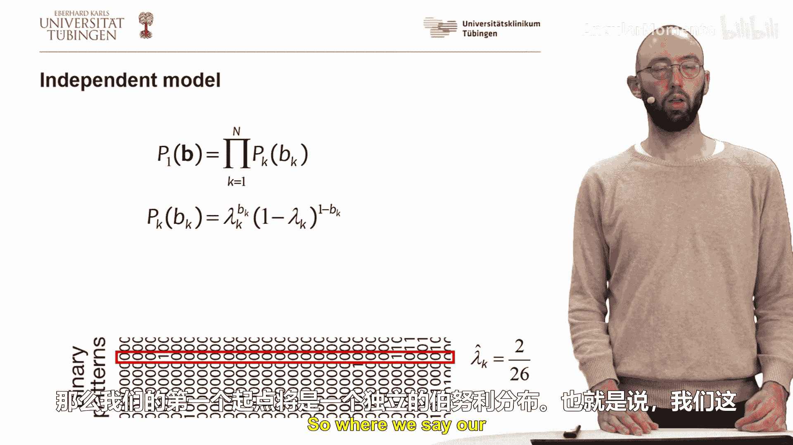

## 如何建模群体活动分布

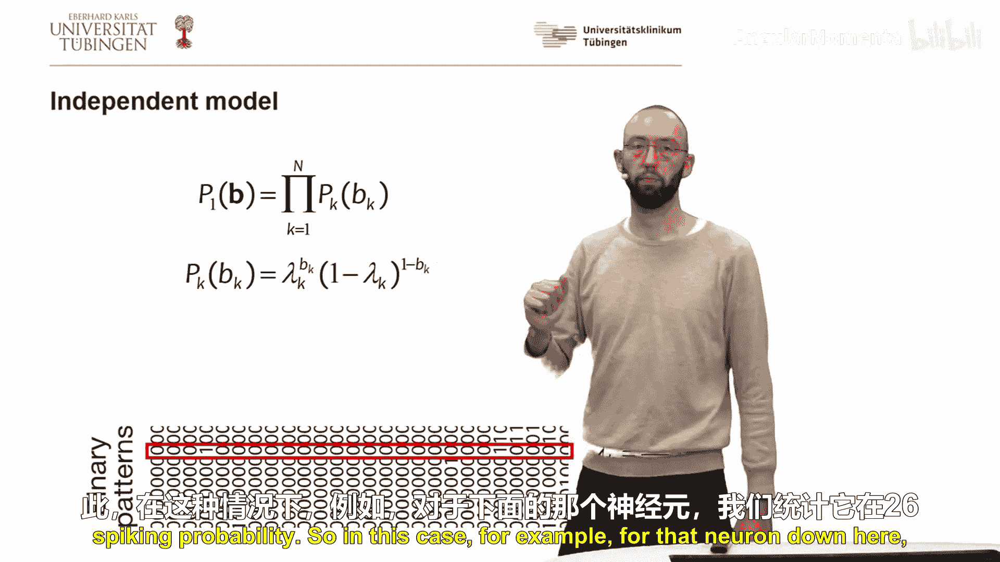

那么我们该怎么做呢？如果我们使我们的放电计数窗口足够大，那么我们可以简单地假设我们的放电遵循高斯分布，并用简单的高斯分布来近似放电计数分布，尽管它是离散的。

例如，在这里，如果我们计算整个试验（整个12秒）的放电次数，我们会得到相当大的数字，使得我们的放电计数分布作为高斯分布是一个很好的模型。高斯分布不仅允许我们模拟平均放电计数，还可以模拟它们的协方差或相关性。因此，对于大的时间窗口，均值和协方差完全描述了放电计数分布。

实际上，在这种情况下，使用相关的泊松分布要困难得多，因为泊松分布的离散性。

但我们想要模拟的大多数有趣过程发生在更快的时间尺度上，那时放电计数显然不是高斯的。因此，让我们走到另一个极端，在非常短的时间窗口（比如20毫秒）内模拟放电计数，在那里我们通常发现要么有一个放电，要么根本没有放电。

在这种情况下，它看起来是这样的。在这里，如果我们放大那个子群体在一个小时间窗口上的活动，我们可以看到任何这些指示的时间仓要么包含0个要么包含1个放电，所以我们可以将我们的放电模式转换为如下所示的二进制模式。我们将这些模式记为 `B`，然后我们问，对于这些二进制模式 `B`，什么是好的概率分布？当然，它不是高斯分布。高斯分布是二进制分布的一个糟糕近似。那么，我们还能用什么？

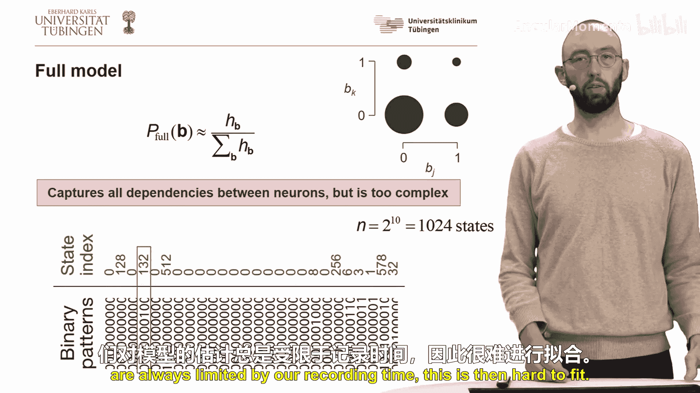

我们的第一个起点将是一个独立的伯努利分布。

因此，我们说这里的概率分布，即这些二进制模式 `B` 的独立概率分布，仅仅是每个具有其边缘放电概率的个体神经元的伯努利分布的乘积。

例如，在这种情况下，对于下面的那个神经元，我们计算它在26个时间仓中放电两次，因此我们估计的放电率为 `2/26`，并将其用作我们伯努利分布的均值。如果我们这样做，该模型的参数非常容易估计。但它没有捕捉到神经元之间的任何依赖性。

另一方面，在另一个极端，我们可以直接指定完整模型，即给定群体中所有可能状态上的分布。对于下面这10个神经元，我们总共有1024个（即 `2^10`）不同的状态，每个不同的模式可以被唯一地分配一个状态索引。然后原则上，我们只需要计算每个状态在数据中出现的频率来估计其概率。这显示在上面。然而，由于这种指数关系（10个神经元有 `2^10` 种状态，20个神经元有 `2^20` 种状态），该模型的参数很快变得无法估计，因为它捕捉了神经元之间的所有依赖性，但过于复杂而无法实际拟合数据。对于10个神经元，我们有1000种状态；对于20个神经元，我们已经有一百万种不同的状态，其中一些只会非常罕见地出现。由于我们的模型估计总是受到记录时间的限制，这很难处理。

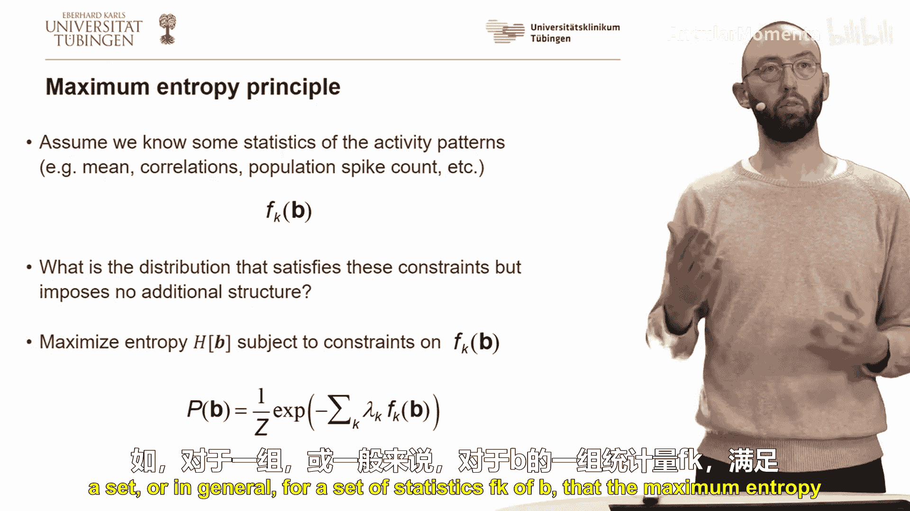

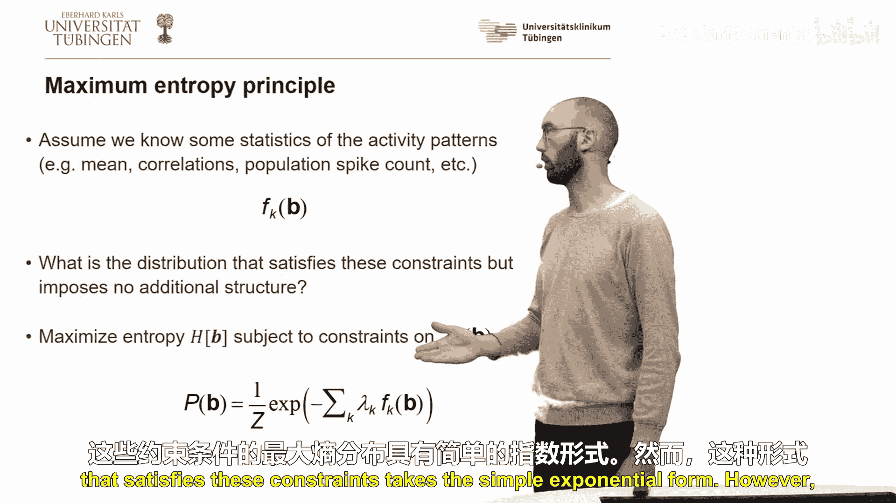

## 最大熵原理

那么我们还能做什么？我们将诉诸一个称为最大熵原理的原则。你已经从过去的一节课中知道了熵是什么。

最大熵原理背后的想法实际上非常简单。如果我们知道一些统计量（统计量只是对这个二进制向量的一种测量），我们知道活动模式的一些统计量。例如，每个神经元的平均活动、它们的相关性、群体放电计数等等。这些就是这些函数 `F_k(B)`。然后，我们想回答这个问题：满足这些约束条件，但不对数据的分布施加任何其他统计结构的分布是什么？因此，它只受到必要的约束，但不过度约束。这就是所谓的最大熵分布。

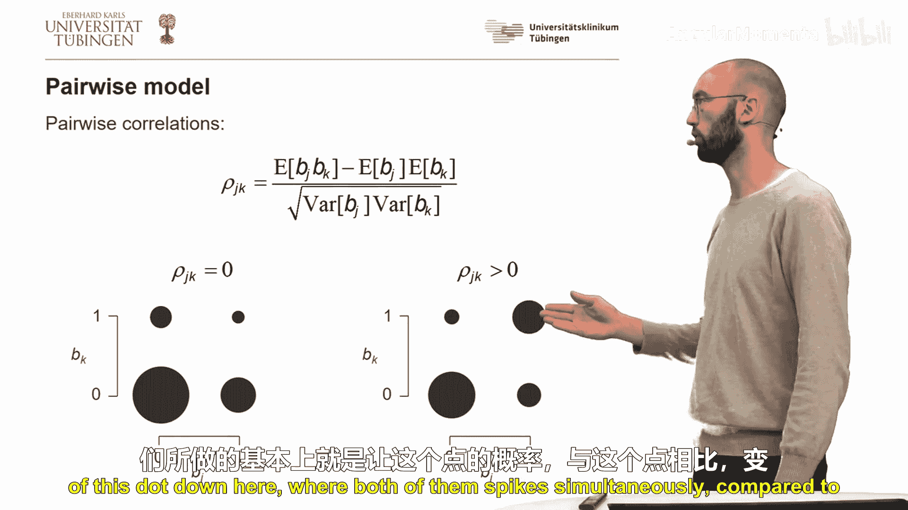

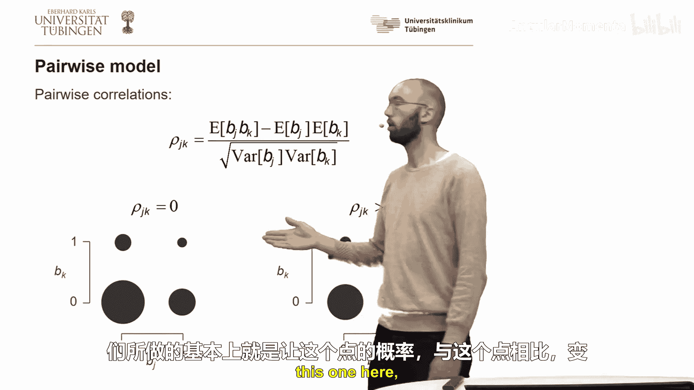

你可以通过最大化熵 `H(B)` 来找到该分布，但要满足你所拥有的统计量的这些约束条件。并且可以证明，例如，对于一组统计量 `F_k(B)`，满足这些约束的最大熵分布取简单的指数形式。

然而，这种形式的简单性具有欺骗性，因为难点实际上在于归一化常数 `Z` 的细节。正如我们稍后将讨论的，这很难计算。这里有一些统计量的例子。如果我们只设 `F_k(B)` 为 `B`，这就是均值。如果我们把它设为下面的项，那么我们就有协方差，或者我们也可以有群体放电计数。

## 成对模型与伊辛模型

在成对模型中，我们希望约束我们的模型以捕捉神经元之间的成对相关性。

因此，如果这些神经元之间没有相关性，而这些神经元之间有一些相关性，我们所做的本质上是使下面这个点（两者同时放电）的概率，与这里这个点相比，变得更大。

好的，那么，如果我们写下满足均值和这些相关性约束的最大熵分布，即二阶最大熵模型（也称为伊辛模型，以德国物理学家命名），它取以下形式。其中模型的参数实际上是 `J` 和 `h`。这些需要从数据中估计。你可以将其视为一个二次模型。它有 `n*(n+1)/2` 个参数。对于一个10维模型，学习这些参数是困难的，正如我所说，因为你需要估计这个归一化常数 `Z`，以便在任何时候评估概率，因为这不能以封闭形式完成，因为你需要再次对所有可能的状态求和。

你需要通过采样（例如）来近似它。因此，没有封闭形式的极大似然解。你可以做的是使用一种称为玻尔兹曼机学习的技术，在那里你只需评估似然函数关于参数的梯度，然后进行梯度下降。

有趣的是，实际上就是这个公式，它向你展示了在每个步骤中你需要如何改变成对耦合参数 `J_jk`。你只需评估数据中的相关性，然后减去当前模型在当前参数下预测的相关性。这就是梯度指向的方向，也是你需要迈出一步的方向。

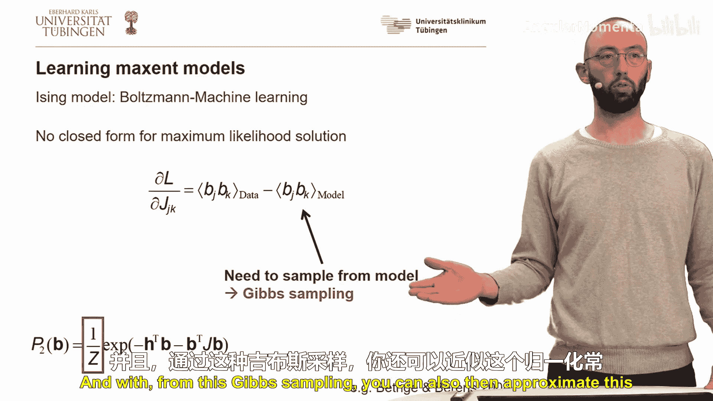

你从模型中得到这些预测，例如，通过蒙特卡洛方法。因此，你需要从模型中采样，例如使用一种称为吉布斯采样的技术。通过这种吉布斯采样，你也可以近似这个归一化常数，如果你需要评估概率的话。

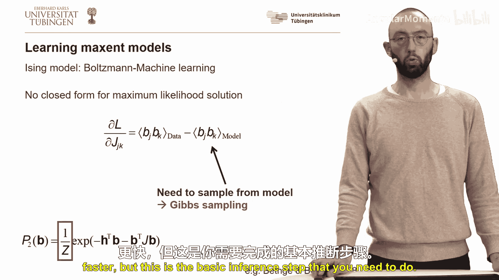

但现在有很多技术可以近似该模型的各个方面，或者使用各种技巧使推断更快。但这是你需要做的基本推断步骤。

## 模型性能评估

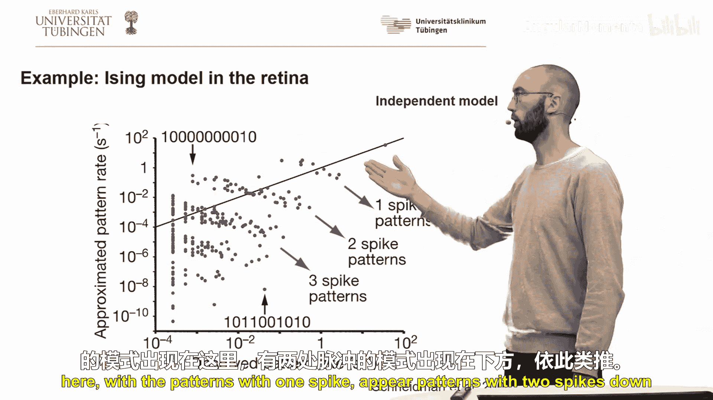

现在，所有这些模型在描述视网膜等神经群体放电活动方面有多好？例如。我们在这里可以看到独立模型的预测，下面你有观察到的模式率，以及模型预测的模式率。正如你所看到的，沿着对角线有相当多的分散点，这里有一个放电的模式，下面有两个放电的模式，等等。因此，对于那个特定群体，独立模型并不是一个特别好的模型。

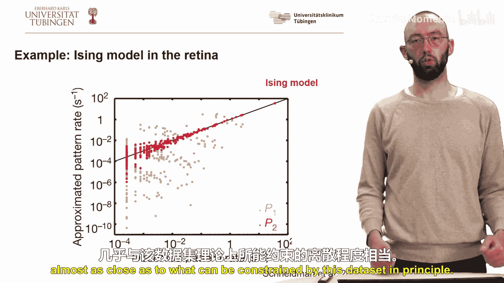

如果使用伊辛模型来拟合数据，那么所有这些点都更接近对角线。事实上，你可以证明，从对角线观察到的分散程度，几乎与这个数据集原则上所能约束的程度一样接近。

然后，人们还可以评估这个模型解释了总结构的多少。如果我们尝试拟合我们的完整模型和二阶模型，在这种情况下，你可以看到这里几乎解释了数据中超过90%的方差。

## 替代模型：二值化高斯模型

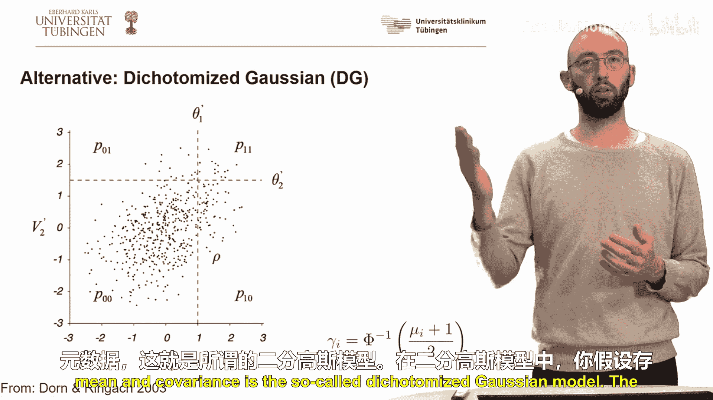

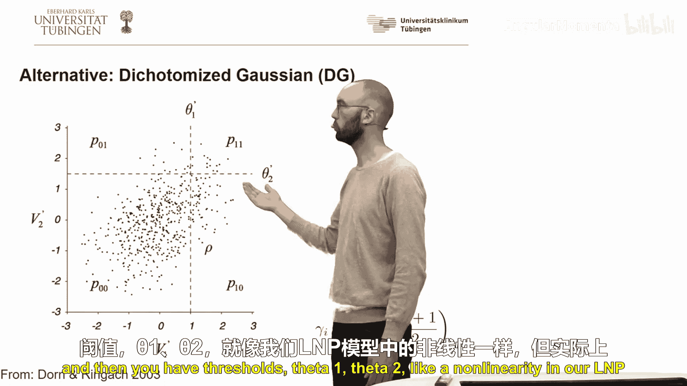

由于伊辛模型中的采样和模型参数推断并不容易，包括我们在内的人们长期以来也在思考替代方案。

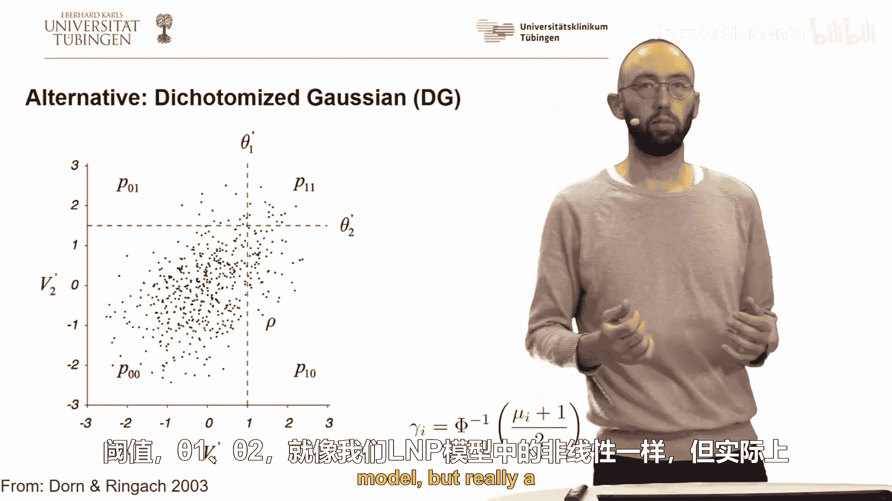

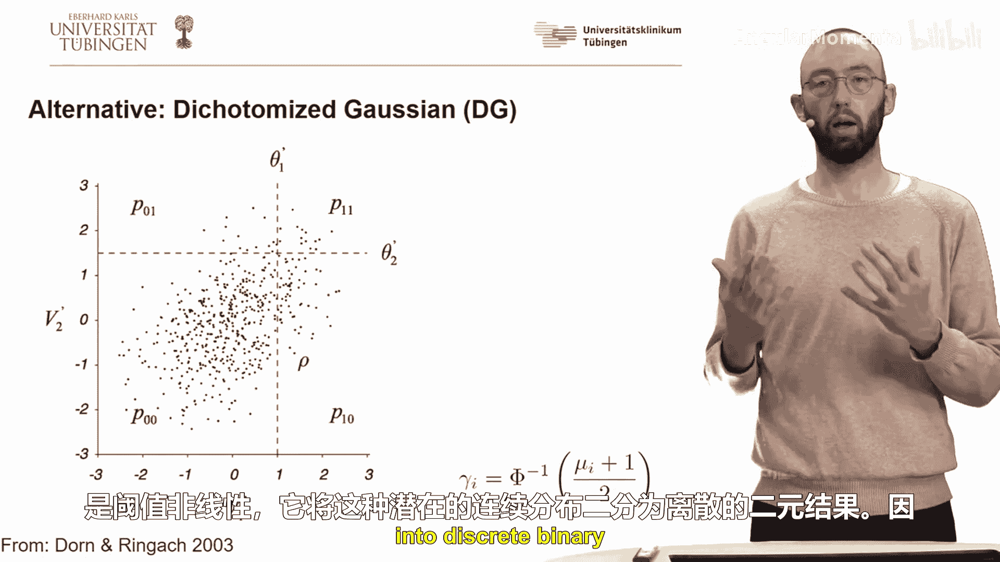

一个非常简单的、可以轻松使用的替代方案，例如用于生成具有指定均值和协方差的二进制数据，就是所谓的二值化高斯模型。在二值化高斯模型中，你假设有一个潜变量，它具有相关性和潜均值。然后你有阈值 `θ1`、`θ2`，就像我们LNP模型中的非线性，但实际上是一个阈值非线性，它将这个潜在的连续分布二值化为离散的二进制结果。

因此，如果你从你的潜高斯分布中采样，并且你的点落在下面的这个象限，那么你会分配那个 `(0,0)` 状态，即两个神经元都不放电。如果它落在上面的那个象限，你会说神经元2放电；如果落在下面这个象限，神经元1放电；如果落在上面这个象限，两者都放电。

因此，通过移动潜高斯的均值（或者等价地，保持均值为0并移动阈值），你可以轻松地改变每个神经元的平均活动。通过改变相关性，你可以改变在不同象限中观察到模式的概率。

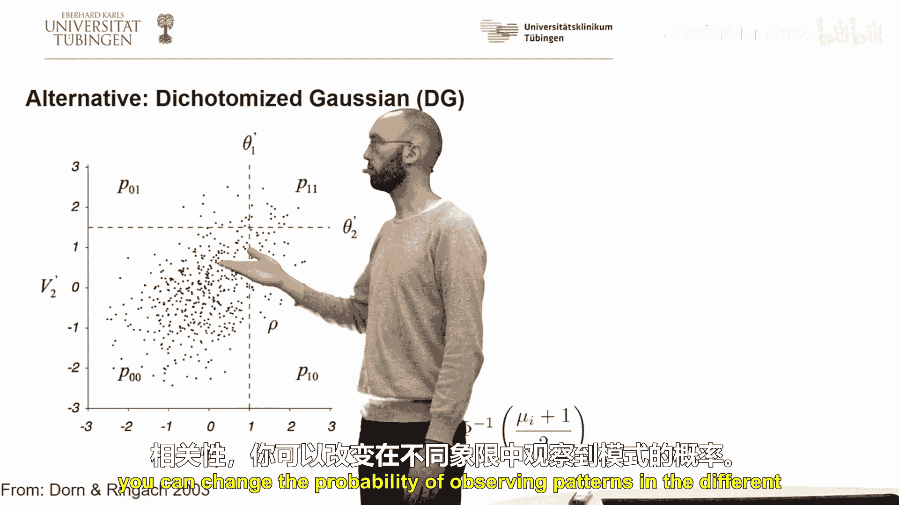

在某种意义上，你可以将其视为一个膜电位，一个非常简单的膜电位电压模型，它在背景中以高斯分布波动，并在超过阈值时产生放电。

优点是，该模型的参数可以以非常直接的方式计算。通过使用逆高斯正态分布函数，我们可以简单地从观察到的二进制数据的均值计算出潜高斯变量的阈值均值。我们可以对协方差矩阵的参数做同样的事情。

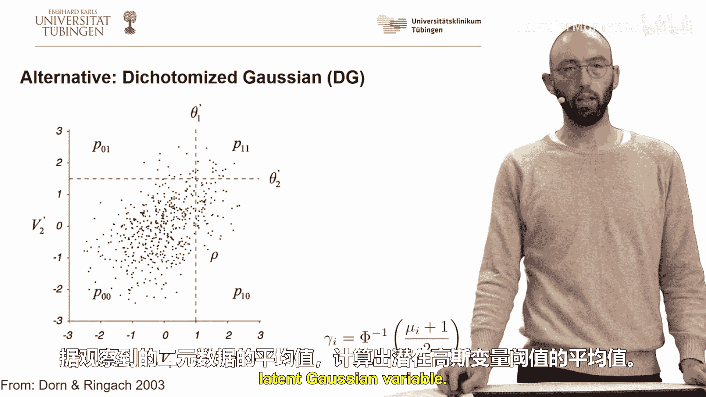

二值化高斯模型的好处是，对于参数空间的大部分区域，它实际上非常接近最大熵。因此，它几乎没有做出额外的假设。这些假设也可以被很好地理解。

因此，如果我们在这里比较，例如，二值化高斯模型和伊辛模型在参数空间范围内的差异，你可以看到，只要你的相关性不是太大，两个模型的熵实际上非常接近。如果相关性变得很大且均值非常小，那么它们就会产生相当大的分歧。

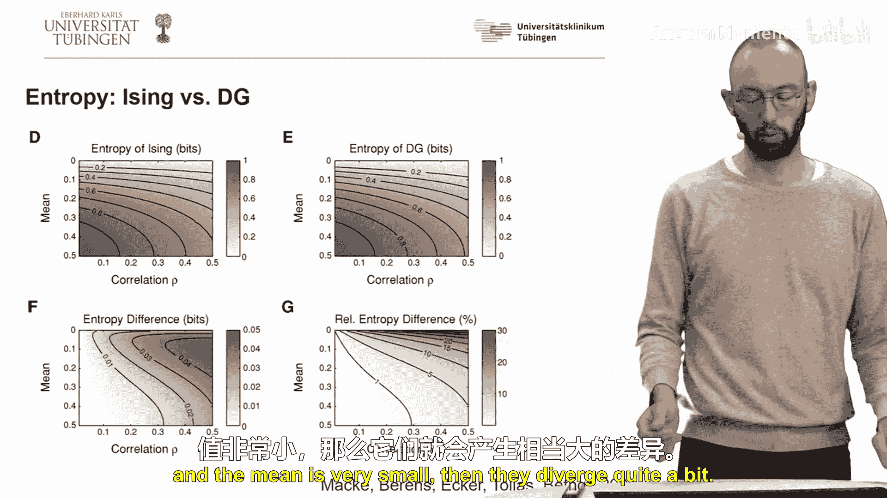

这种二值化高斯模型的优点是模型更容易拟合，同时保持了接近最大熵的特性。因此，它没有做出超出严格必要范围的结构假设。你可以将其解释为阈值膜电位，并且它也可以推广到不同于0和1的放电计数。

但是存在一些二进制分布，没有对应的二值化高斯模型存在。可以证明这一点。并且也没有简单的方法来计算似然函数，因此你也必须评估高维高斯积分。

## 课程总结

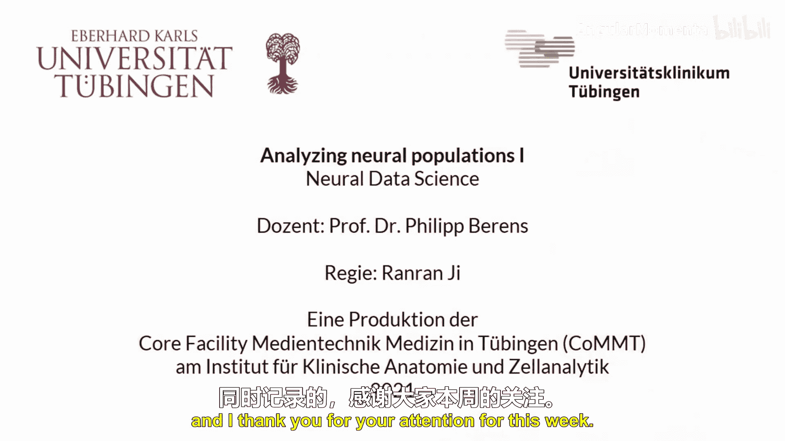

本节课中，我们一起学习了两种方法来模拟同时记录的神经群体中的群体结构。我向你展示了如何扩展单神经元模型以包含放电历史效应和神经元间耦合，并介绍了最大熵原理下的伊辛模型以及更易处理的二值化高斯模型，用于描述群体活动的统计特性。感谢你本周的关注。