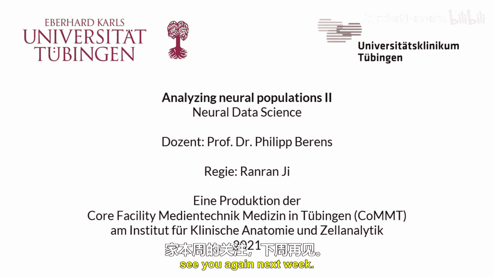

# 010：神经群体分析（二）

在本节课中，我们将继续学习如何分析神经群体活动。我们将重点探讨神经元反应中的“噪声相关性”，了解其来源、对信息编码的影响，以及如何通过潜变量模型来分析和解释这些相关性。

## 概述：神经反应的变异性与相关性

上一节我们介绍了分析神经群体活动的基本概念。本节中，我们来看看神经元反应中一个关键特性：变异性与相关性。

即使面对完全相同的刺激条件，神经元的反应也具有高度变异性。这种在不同试次中观察到的变异性，通常被称为“噪声”。这种噪声甚至可以在不同神经元之间相互关联，我们称之为“噪声相关性”。

我们将其与“信号相关性”区分开来。信号相关性源于神经元调谐曲线的相似性。例如，两个具有相同偏好方向的神经元，其平均反应模式会高度相关。

## 噪声相关性的来源与影响

### 来源：共同输入

噪声相关性是如何产生的？一个经典理论认为，它们源于神经元接收的**共同输入**。例如，如果两个神经元从同一组上游神经元接收大量输入，它们的反应波动就会相关。

### 影响：对群体编码的限制

噪声相关性对从神经群体中读取信息有重要影响。考虑一个场景：我们需要根据一群神经元的活性来区分垂直和水平光栅。

*   我们有两个“决策神经元”，一个汇总所有偏好水平方向的神经元，另一个汇总所有偏好垂直方向的神经元。
*   如果神经元之间没有噪声相关性（相关性为0），那么信噪比会随着群体规模的增加而增长。
*   然而，如果存在正的噪声相关性，信噪比的增长会达到饱和，且相关性越高，饱和得越快。

这意味着，超过一定数量后，增加更多的神经元对决策过程没有帮助。这解释了为什么在某些实验中，单个神经元的敏感度与整个生物体的行为表现惊人地接近——群体汇总信息的潜力可能被神经元之间的相关性严重限制了。

## 噪声相关性的结构

为了直观理解为什么噪声相关性有害，我们可以可视化群体活动。每个点代表一个神经元，其位置对应其偏好方向，颜色代表不同试次下的活性。

在**无相关性**的群体中，每次试次的活性分布大致围绕其平均调谐曲线（黑色曲线）波动。

在**均匀相关性**结构中，所有神经元具有相同的噪声相关性。这导致整个群体活性“山丘”在每次试次中整体上移或下移。这种全局波动如果能够被识别和消除，实际上可能有助于解码。

在**有限范围相关性**结构中，偏好方向相近的神经元具有更高的噪声相关性。这导致群体活性“山丘”的峰值在每次试次中发生漂移。从这种结构中解码刺激信息会比从独立群体中解码困难得多，即使采用最优读取方式，噪声相关性也会显著损害编码性能。

## 真实系统中的噪声相关性

在实际系统中，噪声相关性有多大？一项对清醒动物视觉皮层的研究发现，平均噪声相关性非常小（约0.02），即使对于物理位置很近、调谐曲线相似的神经元对也是如此。

这与早期许多研究报告的较高相关性形成了对比。那么，哪些因素会影响我们对相关性的估计呢？

以下是可能影响噪声相关性估计的关键因素：
*   **全局脑状态**：如睡眠或麻醉。
*   **决策与注意**：例如，动物注意某个区域时，该区域神经元的增益会被调制。
*   **不同行为策略**。
*   **技术伪迹**：如 spike sorting 错误或电极漂移。

## 案例研究：麻醉对噪声相关性的影响

本节我们聚焦于**全局脑状态**，特别是麻醉的影响。麻醉会诱发大脑皮层神经活动产生类似睡眠的波动。

比较清醒和麻醉状态下的数据：
*   **清醒状态**：神经活性波动主要与刺激相位锁定。
*   **麻醉状态**：神经活性会出现与刺激无关的、全脑范围的同步波动（如暂停发放），这些波动在不同试次中模式不同但在神经元间高度一致。

量化差异：
*   **Fano因子**（方差与均值之比）：麻醉状态下更高（2.4 vs 1.1），表明神经活性波动更大。
*   **平均噪声相关性**：麻醉状态下更高（0.06 vs 0.01）。

## 使用潜变量模型分析群体活动

为了理解并量化麻醉状态下的这种变化，我们引入**潜变量模型**，具体是**高斯过程因子分析**。

GPFA 假设观测到的脉冲计数由一个**未观测到的网络状态**（潜变量）生成，该状态随时间平滑变化，并同时影响所有神经元。

模型的核心公式描述了观测活性 `y`、潜变量 `x`、加载权重 `C` 和独立噪声之间的关系。总协方差可以分解为：
`Cov(y) = C * C^T + diag(ψ)`
其中 `C * C^T` 代表由潜变量解释的协方差，`diag(ψ)` 代表各神经元的私有噪声。

通过**期望最大化算法**，我们可以从数据中估计出潜变量轨迹 `x(t)` 和模型参数。在麻醉数据中，推断出的潜变量清晰地捕捉到了群体兴奋性的全局波动。

## 模型应用：解释麻醉下的高相关性

使用训练好的 GPFA 模型，我们可以在测试集上估计潜变量，并计算**残差协方差矩阵**（即去除潜变量影响后的神经元间相关性）。

结果发现，去除这个代表麻醉诱导的全局脑状态的潜变量后，麻醉状态下的噪声相关性结构变得与清醒状态下的无法区分。这表明，麻醉状态下观察到的更高相关性，很大程度上可以由这个单一的、随时间波动的全局脑状态变量来解释。

该潜变量波动的时间尺度约为250毫秒（1-2 Hz），这与已知的麻醉下脑波动特征一致。

## 模型扩展与前沿

基础 GPFA 模型可以扩展，例如考虑脉冲计数的泊松特性，或使用更复杂的生成模型。

一个前沿方向是**潜因子分析动态系统**，它利用循环神经网络作为编码器和生成器，将高维神经活动映射到低维潜空间。这类模型能更好地在**单试次**水平上解析神经群体动力学，揭示在试次平均中掩盖的细节，对于研究决策策略等具有重要意义。

## 总结

本节课中我们一起学习了：
1.  **噪声相关性**的概念、来源及其对神经群体信息编码的限制性影响。
2.  噪声相关性的不同结构（均匀 vs 有限范围）如何影响解码性能。
3.  在真实系统中，全局脑状态（如麻醉）是导致噪声相关性升高的重要因素。
4.  如何利用**高斯过程因子分析**等潜变量模型来推断和分离神经活动中的全局波动成分。
5.  通过建模，我们可以将麻醉下增强的相关性归因于一个单一的、缓慢波动的脑状态变量，从而更清晰地理解神经编码的本质。

潜变量模型是研究神经群体动力学的强大工具，通过结合低维状态空间和到神经反应的映射，帮助我们揭示神经群体活动背后的结构和原理。