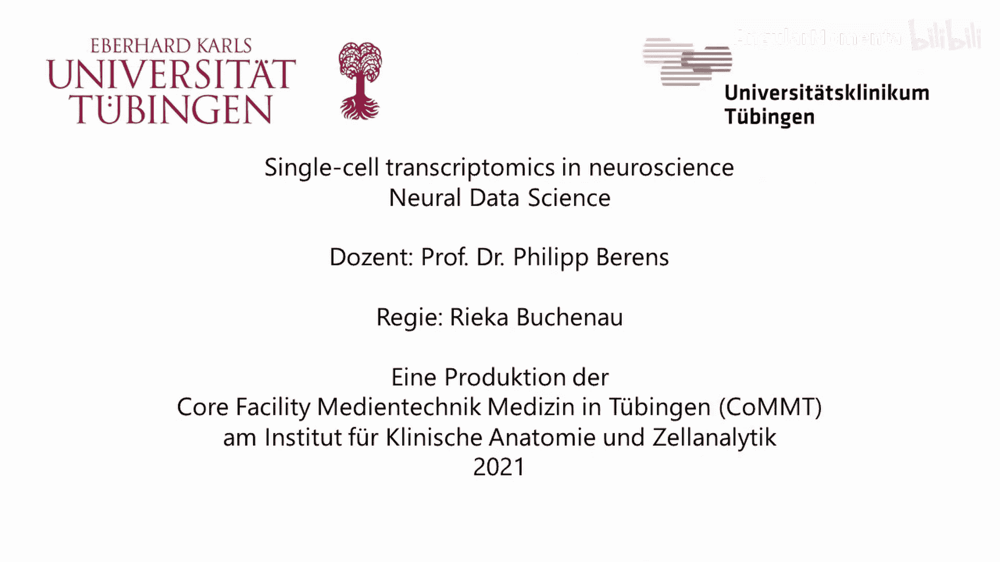

# 011：单细胞转录组学 🧬

在本节课中，我们将学习神经科学中的一种新数据模态——单细胞转录组学。我们将了解其基本原理、数据获取方法、常见的数据分析任务，并重点探讨数据预处理、可视化以及细胞类型识别等核心步骤。

---

## 什么是单细胞转录组学？🧬

上一节我们介绍了课程的整体安排，本节中我们来看看单细胞转录组学的定义。

细胞中，遗传信息从DNA通过**转录**过程生成mRNA，mRNA再通过**翻译**过程生成蛋白质。单细胞转录组学专注于测量单个细胞的mRNA含量。

在许多情况下，这可以告诉我们细胞的**身份**、**细胞类型**以及细胞后续将转录或翻译的蛋白质种类，从而揭示大量关于细胞身份的信息。

---

## 数据获取方法 🧪

在过去的十年中，出现了多种从单个神经元或身体其他部位单个细胞获取这些测量的方法。这些方法大致遵循以下流程：

以下是典型单细胞RNA测序（scRNA-seq）工作流程的步骤：
1.  **组织解离**：将组织解离，使单个细胞在溶液中真正分离。
2.  **细胞捕获**：捕获单个细胞。
3.  **裂解与逆转录**：裂解细胞膜，通过逆转录将mRNA反转录回cDNA。
4.  **扩增与准备**：扩增细胞的DNA含量，并为测序做准备。
5.  **测序与分析**：使用新一代测序技术进行快速测序，然后进行数据分析。

一个例子是微滴法：细胞从上方进入微流体装置，与条形码结合，并被浸入油滴中。在油滴中发生细胞裂解，使得单个细胞的mRNA内容与一个条形码结合，从而可以确定细胞身份，随后进行扩增和测序，最终我们获得这些细胞中许多不同基因的表达水平。

目前可用的方法范围很广，从相当慢的方法（如显微移液或激光捕获显微切割）到非常快的方法（如微滴或微流体方法）。

显微移液方法的优点是几乎可用于任何组织，并且可以真正靶向感兴趣的特定细胞。例如，如果在大脑的某个部分用荧光标记标记了一个细胞亚群，显微移液可以让你特异性地靶向这些荧光细胞，从而在测序前富集或选择该亚群。当然，另一方面，它相当耗时。

另一个极端是微滴法，如上一张幻灯片所示。这些方法速度超快，也非常便宜。可以以可承受的价格观察大量细胞，如今可达数十万。但另一方面，对观察目标没有同等的控制力。

---

## 研究现状与示例 📈

单细胞转录组学是近年来神经科学中非常热门的话题。如果你查看过去20年左右提及该术语的研究数量，可以看到近年来急剧上升。

不仅是研究数量急剧上升，每项研究测序的细胞数量也迅速增加。大约四五年前，拥有几千个细胞的研究相当常见。如今，许多研究报告的细胞数量高达数十万甚至数百万。

例如，该领域一些最突出、最美丽的可视化结果来自斯坦福大学实验室的两项研究。他们观察了小鼠神经系统的分子结构，首先是成年动物，后来也包括发育过程。他们测序了神经系统中许多不同部位的细胞，包括大脑、脊髓甚至消化道的肠神经系统。他们的研究总共约有5万个细胞，然后创建了如此美丽的可视化结果，真正展示了组织中细胞的多样性。

在最近的一项研究中，他们增加了发育维度，观察了这些不同的“岛屿”和“大陆”在动物发育过程中是如何出现的。在这个美丽的可视化中，你可以看到一个大的“神经元大陆”，并且作为该神经元大陆中的“等高线”，你可以看到不同的发育阶段。

---

## 数据结构与特点 📊

上一节我们了解了单细胞转录组学的研究概况，本节中我们来看看处理这类数据时遇到的数据结构和常见分析任务。

这与我们目前处理的数据有些不同。在锋电位序列或双光子成像数据中，时间总是一个维度，它真正排序了数据的维度或特征。在数据矩阵中索引接近的特征，在时间上也接近。因此，在时间上存在一种自然的顺序。图像也是如此。例如，计算锋电位序列与图像关系的模型时，也存在固有的空间维度来定义邻域。

对于单细胞转录组学数据，情况不一定如此。在这种情况下，特征维度是**基因**。在小鼠和人类中，我们大约有25000个基因可以测量表达水平，但这些基因没有自然的顺序，因此数据矩阵的列可以被置换。例如，在该数据矩阵上计算卷积没有太大意义。

数据矩阵的另一个维度通常是**细胞**。可能从只有1万个细胞开始，如今通常更多。但正如我们将看到的，这是一个非常稀疏的矩阵，没有很多条目。

具体数字取决于情况。如果我们处于低端，因为研究规模较小，但我们测量了25000个基因，那么我们处于样本数量确实小于特征维度的范围。但另一方面，如今如果我们测量更多的细胞，也可以进入更好的采样状态。

---

## 核心数据分析任务 🎯

以下是使用该数据矩阵进行的典型数据分析任务，这些任务在初始数据获取之后进行：
1.  **预处理与质量控制**：执行质量控制和一些预处理步骤，以便能够很好地处理数据并去除技术伪影。
2.  **数据可视化与探索性分析**：进行数据可视化以进行探索性分析。
3.  **细胞类型识别**：尝试识别细胞类型，即执行某种聚类。

当然，也可以用转录组学数据做其他事情。例如，可以观察发育轨迹并根据伪时间对细胞排序，可以尝试将转录组学测量与更多生理学启发的模型联系起来。但今天，我们将专注于这些基本任务。

在许多情况下或许多实验范式中，这个数据矩阵以所谓的**UMI计数矩阵**的形式出现。UMI代表**唯一分子标识符**。这些是在逆转录后添加到DNA片段上的标签，用于识别输入的DNA分子。这是在扩增之前添加的，它可以用来减少扩增偏差。如果你查阅关于这些实验技术如何工作的技术文献，有相当多的潜在偏差来源需要处理，UMI是解决该问题的一种实验方案。

我们今天在示例中将要查看的数据来自Kenneth Harris及其同事的这篇论文，该论文研究了CA1海马神经元以及单细胞转录组学揭示的多样性。

---

## 任务一：数据预处理 🔧

现在让我们看看我们的三个数据分析任务，从第一个开始：预处理。

首先，如果我们有一个数据矩阵，或者我们从Ken Harris的研究中获取数据矩阵，那么我们发现总共有大约3600个细胞和大约18000个不同的基因。这也是数据矩阵的形状告诉你的信息。

在每个条目中，是每个基因在每个细胞中的UMI计数。即在扩增版本中，在给定细胞中检测到给定基因的频率。

整个矩阵的最小值是0。这意味着有些基因在某些细胞中根本没有被检测到。这并不奇怪。最大计数是923。这意味着至少有一个基因在一个细胞中，我们发现了923个重复。

现在，如果我们查看数据矩阵中有多少条目实际上大于0，即在多少细胞和基因组合中我们至少有一个条目，那么这个值实际上相当小，只有15%。所以这是一个非常稀疏的矩阵，对于大多数细胞中的大多数基因，我们没有发现任何表达。

最后两个测量值是我们所说的**测序深度**。这意味着我们在给定细胞中跨所有基因发现了多少基因计数。具有最小基因计数的细胞的测序深度大约为1111，具有最高基因计数或UMI计数的细胞的测序深度为20000。

你也可以查看这些测序深度的完整分布。在这个直方图中，你可以看到它从大约1000开始，然后也有一个很长的尾巴延伸到非常高的数字。但测序深度的主体平均在5000左右。

但正如你可以想象的，这当然是我们数据分析中一个潜在的混淆因素。因为如果对于一个给定的细胞，我们只能检测到任何基因的1000个拷贝，那么，当然，找到一个与在检测到20000个基因的细胞中表达水平相同的基因的概率将是完全不同的。

---

### 理解技术变异：过离散性

让我们更详细地看看这个混淆因素可能是什么。

因为UMI计数是计数，我们首先可以问，这些UMI计数的分布实际上是否符合泊松分布？因为泊松是计数变量的标准或首选分布。如果你查看这些，并将它们与相应的泊松分布可能的样子对应起来，那么你可能会看到，特别是在这些较大的范围内，泊松分布往往变得相当对称，而我们在UMI计数数据中发现的分布实际上有一个相当长的尾巴。

所以可能泊松分布不太适合这个UMI计数数据。

我们可以通过绘制跨基因的均值-方差关系来更精确地量化这一点。这个图中的每个点代表一个基因。我们查看所有细胞的平均表达和所有细胞的表达方差，并将它们相互绘制。

对于一个纯粹的泊松分布，这些点应该都落在一条线上，因为对于泊松分布，均值等于方差。事实上，对于许多基因，我们离得并不太远。

但有两个变异来源加入到这个图中。一个是**生物变异**，另一个是**技术变异**。生物变异实际上是我们最终感兴趣的。生物变异来自例如不同细胞类型之间基因表达的差异。所以一种细胞类型可能表达某种受体基因，因为它需要持续地将该受体放在其树突上，而另一种细胞类型不这样做，因此不表达该基因。所以这将在某些基因中导致真正的生物变异，其大于纯粹从计数统计中预期的变异。

另一方面，你也有技术变异，它来自这种测序深度效应，即不同细胞只是被更频繁地测序或扩增。通常，你可以看到生物变异体现在这些散布在线周围的单个点上，而技术变异主要影响高均值处的长尾。

我们可以用另一种方式来看待这一点。通过取方差与均值的比率，这也称为**离散系数**。离散系数是方差除以均值。如果对于泊松分布，方差和均值相同，那么我们期望离散系数为1。

这基本上带出了上一张幻灯片最后一个图中的相同结构。如果这完全是一个水平分布，那么这些点应该都非常接近这里的一条恒定线。我们确实看到了生物变异的证据，出现在不同基因组之间差异表达的基因中。然后我们看到了我们感兴趣去除的技术变异的特征，位于这些线上扬的斜率中。这意味着对于跨细胞基因的高平均计数，方差会增加。所以在更高的表达水平，我们也有更高的方差。因此，数据在统计学上被称为**过离散**。

---

### 建模与归一化

现在，这与测序深度问题有何关系？对于一个特定的基因，假设我们发现该基因的计数是两个因素的乘积。一个因素是这里的N，这是测序深度。另一个是P，这是概率或该基因在细胞表达中所占的比例。

假设在某种细胞类型中，来自该特定基因的转录本百分比是1%。如果我们有两个这种类型的细胞，对于一个细胞，测序深度为1000，那么我们的预期计数是10。如果测序深度为10000，那么我们的预期计数是100。从我们一开始已经查看过的测序深度变化这一事实，我们可以推断，与纯粹的泊松变量相比，我们将需要有一些过离散。

一个常见的用于模拟相对于泊松过离散的分布是所谓的**负二项分布**。在负二项分布中，你确实假设你的计数遵循泊松分布。但然后速率参数也是一个随机变量，它从伽马分布中抽取。这导致了额外的变异性，超过了纯泊松分布的变异性，并且在高均值处特别明显。

负二项分布看起来有点像这样。这里我们有一个小动画，取决于负二项分布的参数。它很适合模拟我们在数据中也看到的这些长尾。

现在，这是我之前展示给你的离散系数图。如果我们通过测序深度对计数进行归一化，在这种情况下，我们简单地将每个基因除以测序深度，然后乘以中位数测序深度，那么这里的许多弯曲形状实际上就消失了。

然后我们可以使用这样的图，例如，显示一个基因的离散系数与平均表达水平的关系，来选择我们特别感兴趣的基因，因为我们知道这些基因独立于它们显示的确切表达水平，表现出比我们通常预期更高的变异性。所以这些基因是不同细胞类别或细胞类型之间真正生物变异的良好候选者。

如果你对如何预处理单细胞转录组学数据或如何为单细胞转录组学数据计算良好分布以选择基因进行进一步分析这些主题更感兴趣，你也可以参考我们最近的预印本，该预印本可在bioRxiv上找到，我们在其中更深入地处理了这些情况。

---

### 方差稳定变换

好的，现在我们已经完成了第一个预处理步骤。我们已经通过测序深度对计数进行了归一化，并将它们重新缩放到相同的尺度，以解释数据中技术变异的一个来源。

单细胞转录组学数据经常做的另一个预处理步骤是应用非线性方差稳定变换，例如平方根变换或log(x+1)变换。这两者都具有将方差带到更相似范围的效果。这实际上是有用的。

例如，如果我们在该域中的原始数据矩阵上进行主成分分析，并简单地在原始数据上绘制前两个主成分，数据看起来会有点像这样。这里不同的颜色代表不同的细胞类别，数据重叠相当严重。

如果我们先进行平方根变换，然后再进行PCA，你已经可以看到现在这个图揭示了一些不同的细胞簇之间的明显差异。

最后，如果我们应用log(x+1)变换，这似乎更适合，那么即使在简单的PCA图中，这些不同的簇也能更清晰地分辨出来。

因此，应用这种非线性方差稳定变换或多或少是任何转录组学分析流程的标准步骤。

---

## 任务二：数据可视化与降维 📉

我们在处理单细胞转录组学数据时的下一个目标是创建一个低维嵌入，原则上我们可以使用PCA，但也可以使用其他更非线性的算法。我们为什么要这样做？因为数据的维度和缺乏固有结构，实际上很难查看转录组学数据。当然，我们可以简单地制作一个图，可视化每个细胞中每个基因的平均表达。但对于肉眼来说，除非我们以良好的方式对数据进行排序，否则很难看出太多。当然，当我们查看图像或时间轨迹时，情况就非常不同了，因为图像和时间序列具有固有的内部结构。

因此，创建这些低维嵌入对于单细胞转录组学数据的探索性数据分析尤为重要。

---

### 高维数据降维的挑战

现在，为什么这甚至是一个困难的任务？对于那些听过我们机器学习课程或了解t-SNE及相关算法的人来说，可以跳过接下来的几分钟或简要听一下。

很难对高维数据进行良好的低维嵌入，因为不可能保留高维距离。如果你在二维中查看，并从标准高斯分布中采样点，在二维中，你查看成对距离，那么这就是你会得到的直方图。如果你进入50维，那么直方图，即点对之间的平均距离已经大得多，平均为10。如果你进入更高维的状态，比如500维，那么平均距离变得更大得多。

在保留所有这些成对距离的同时将其嵌入二维根本不可行。

因此，一类流行的嵌入算法（称为邻域嵌入算法）背后的一个想法是保留邻居，而不是绝对距离。一个例子是流行的算法，称为**t分布随机邻域嵌入**或**t-SNE**。

其思想如下：对于一个给定的点i，你查看其封闭邻域内的最近邻居。对于这些点，你有一个损失函数，它基本上是**高维空间中的成对相似性**（即p_ij）与**低维空间中的成对相似性**之间的Kullback-Leibler散度。但与其他真正试图保留距离的算法相比，这里的技巧是，我们主要只关心局部邻域。

损失函数包含我刚才提到的这两个部分。我们使用这些指数核来测量高维相似性。首先，它们是有向的，但我们之后会对它们进行对称化。这个核宽度通过一个称为**困惑度**的参数选择，困惑度设置这个核宽度，使得局部邻域中有足够数量的点。

我们也测量低维相似性。我们使用某个核函数。在t-SNE中，这个核函数是柯西或t分布核。然后，我们也可以计算损失函数的梯度。关于这个梯度有趣的一点是，在你观察它一段时间后，它基本上由两项组成，一项是相似点被吸引，另一项是不相似点相互排斥。所以这是一个吸引-排斥的权衡。

我提到的这个参数**困惑度**控制核宽度。这里，我们有非常小的困惑度。这里，我们有更高的困惑度。许多实现中的默认值实际上是30左右，我们这样计算困惑度。它是某个熵值的幂，该熵值由这些成对相似性给出。

通过控制困惑度，你可以控制算法的分辨率，或者它权衡局部邻域与全局排斥的程度。

---

### t-SNE优化与初始化

这里我们查看t-SNE的优化过程。如果我们只是针对该损失函数优化点的位置，那么你可以看到它确实需要一段时间，这里有很多次迭代，并且它在优化过程中经历不同的阶段。这里我使用的数据是MNIST数据集。所有这些不同的簇对应不同的数字。你可以看到随着优化的进行，该数据集中的结构是如何出现的。

该优化问题的问题在于它是非凸的。所以，如果你简单地使用许多标准实现，那么这些t-SNE实现可能不擅长保留全局几何结构。例如，如果我们查看这项同样非常引人注目的研究“跨新皮质区域的共享和不同的转录组学细胞类型”，那么这里有一个非常美丽的可视化。

但如果你查看GABA能神经元的位置，在这种情况下，GABA能中间神经元分布在两个大岛中。在它们之间，是谷氨酸能神经元。当然，在全局尺度上，谷氨酸能神经元与这些GABA能神经元或那些GABA能神经元（它们彼此更密切相关）的差异要大得多。但算法却将它们放在中间。这是一个不希望出现的特性。

让算法至少更好地尊重这种全局关系的一种方法是，用一个相当好的解决方案初始化算法，例如通过PCA。

如果你用PCA坐标初始化算法，那么它已经处于非线性优化之后发生的正确值范围内。所以你可以在这里看到，在这种情况下，优化是如何运行的。这里有来自MNIST数据集的三个不同的“岛”，包含不同的数字类别。因为我们通过PCA初始化，然后算法的后期阶段更详细地塑造了这些不同岛屿和子岛屿的外观。

---

## 任务三：细胞类型识别（聚类）🔍

好的，现在我们有了一个嵌入。如果你对t-SNE的更多细节感兴趣，我已经为你链接了一个视频。

所以下一步将是识别细胞类型。这基本上是聚类的一个实例。

我们在课程中已经多次做过聚类，例如，在使用高斯混合算法寻找电生理记录中的细胞时。原则上，当然也可以在这里使用这样的混合分布，并调整所使用的分布。高斯混合可能不好，因为计数是离散的，并且均值相对较低，使得高斯近似不是一个好的拟合。但是，例如，可以使用**负二项混合分布**，这也被提出过。

与我们在其他情况下讨论的许多情况一样，我们事先不知道簇的数量，许多人更喜欢使用非参数聚类技术，这些技术不像负二项分布那样做出明确的建模假设。一个算法需要能够处理数百万个细胞，所以它需要非常高效，并且需要能够在高维数据上运行，因为即使在降维之后，经过基因选择，你查看的可能只有几千个基因，我们确实有多达30、40、50个主成分的信息量。

该领域最流行的一类聚类算法是使用数据的**K最近邻图**的**社区检测算法**。

---

### K最近邻图与社区检测

什么是K最近邻图？例如，对于这个人工数据集。它只是一个图，其中对于每个数据点，你简单地将其连接到最密切相关的10个邻居（取决于你的K值）。在这个图中，你已经可以看到相当多的结构。在上面这里，连接非常密集，在这个岛中，连接非常密集，这里也是如此。很少有连接超出这两个岛屿。

因此，可以想象，如果你对这个K最近邻图进行社区检测，你会将原始簇作为这些社区找到。

这类社区检测算法在图中用于检测簇时经常优化的成本函数是这样的。这称为**模块度**，模块度测量的是：一对节点之间存在的边数，并将其与在随机图中如果它们在同一社区中你预期会有的边数进行比较。所以这试图达到的是，平均而言，真正紧密连接或更紧密地聚集在一起的社区，比你从随机图中预期的要多。

---

### Louvain 与 Leiden 算法

有两种流行的算法来解决此类问题。第一个提出的算法称为**Louvain算法**。我把伪代码放在这里。

Louvain算法背后的思想如下：你从节点的随机社区分配开始。然后在第一步，你以随机顺序访问每个节点。你检查，并将其移动到可能不同的社区，如果这改进了成本函数。你这样做的方式在这里的`move_node`函数中指定。这里，对于每个被访问的节点，你检查如果将其分配到与其他节点相同的社区或其中一个其他社区，成本函数的增量是多少。如果这个增量大于0，那么你就进行分配；如果不大于0，那么你就不分配。你迭代这个过程。如果你完成了所有节点，那么你执行一个聚合步骤，通过该步骤你将单个社区中的所有节点组合成一个更高级别的图。然后你一遍又一遍地重复相同的过程。当这个过程收敛时，你就完成了社区检测。

这里也是聚合步骤的伪代码，它基本上说，如果两个节点在同一个社区，那么将它们组成新图的一个元节点。

然而，这个简单算法有一些问题，其中之一是这个：可能因为你以随机顺序访问节点，最终会出现一种情况，即一个社区仅由这里的节点0维系，并且算法的工作方式可能更好。可以证明，在某些情况下，当你最后访问这个节点时，将其移动到另一个社区可能是有益的。然后你最终会为rat节点得到一个不连通、分裂的社区。

这可以通过所谓的**Leiden算法**来修复。Leiden算法只是有一个额外的步骤，称为**细化分区**，确保这种情况不会发生。

---

### 聚类结果示例

如果你将这种Leiden聚类应用到我们一直使用的标准示例数据集（我们的Harris数据集）上，那么你可以看到它在这里产生了一个相对合理的聚类。这也与我们在该数据集的低维可视化中看到的情况匹配得很好。

---

## 总结 📝

本节课中我们一起学习了单细胞转录组学的基础知识。我们从定义和原理入手，了解了如何通过实验技术获取单细胞基因表达数据。我们深入探讨了处理此类数据时的核心挑战，特别是其高维、稀疏且缺乏固有排序的特点。

我们系统性地学习了三个核心数据分析任务：
1.  **数据预处理**：包括测序深度归一化以校正技术变异，以及应用方差稳定变换（如log(x+1)）来改善后续分析。
2.  **数据可视化与降维**：重点介绍了t-SNE算法，它通过保留局部邻域结构来创建有意义的低维嵌入，用于探索性数据分析。
3.  **细胞类型识别（聚类）**：介绍了基于K最近邻图和模块度优化的社区检测算法（如Leiden算法），这是一种高效且适用于高维数据的非参数聚类方法。

单细胞转录组学领域正在迅速发展，未来将在神经科学中带来更多应用，并成为现代细胞水平神经科学实验技术的基石。因此，思考我们在分析端所需的专门数据科学技术非常重要。通过本讲座以及你将在家完成的编程练习，希望我们为你在这个方向上提供了一个良好的起点。

感谢你的关注，我们下周再见。