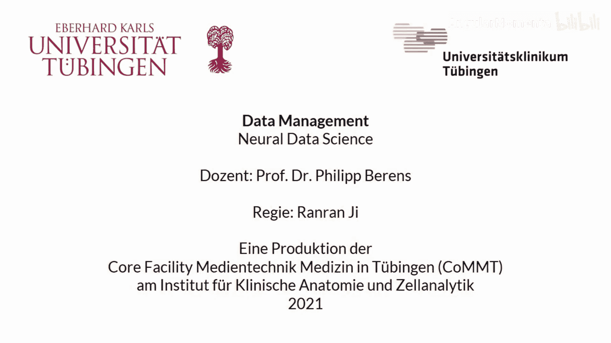

# 013：神经科学中的数据管理 🗂️


在本节课中，我们将学习神经科学研究中的数据管理。我们已经探讨了多种机器学习算法及其在数据上的应用。然而，在实验室环境及更广泛的场景中，有效使用数据的一个重要组成部分是数据管理的标准。我们将了解如何保持数据的整洁有序、易于访问，以及如何跟踪结果以确保其可重复性。


## 现代实验室的数据挑战

正如我们在课程中所见，在现代实验室环境中，我们记录着海量信息。例如，在一次实验中，我们可能同时监测小鼠在跑步机上的运动、呈现视觉刺激、进行钙成像、记录动物的眼动和胡须活动，甚至用电极同步记录单个神经元的膜电位或局部场电位。此外，我们还有大量元数据，例如动物编号、所属转基因品系、使用的刺激参数等等。

随着我们尝试不同的预处理参数设置或后续的推理方法，这个过程会变得极其复杂。因此，当你处理的数据超出几个简单示例时，一个关键问题就是：如何将所有信息保持得井井有条？

## 传统工作流程及其问题

传统的工作流程通常如下：
1.  实验结束后，将原始文件存放在实验室存储服务器上。
2.  在实验记录本上写下大量元数据（如果一切顺利的话），或者仅凭记忆，有时甚至会忘记记录。
3.  使用实验室通常采用的参数设置对数据进行后处理。这可能是手动完成，或通过运行某个函数。这个函数通常是已离开实验室的博士生编写的，并且后续可能经过了多次修改。
4.  进行分析时，在后处理数据上运行脚本，并将中间结果保存在本地或存储服务器上。
5.  每次需要生成图表时重新运行分析，或者如果数据量太大，则保存结果并在发现错误时重新运行。
6.  最终，手动为论文整理所有能找到的数据。

当然，这是对常规实验室工作略带夸张的描述。我知道实验和计算实验室的同事们都非常认真地跟踪数据。但处理真实数据本身就是一个复杂的过程，即使非常努力，如果全靠手动操作，最终仍会丢失大量信息。

以下是传统工作流程中常见的问题：
*   **代码版本混乱**：不确定计算感受野时使用了哪个版本的代码。如果需要用当前版本的代码为大量细胞重新计算，这将耗费很长时间。
*   **数据丢失或混乱**：不确定是否删除了保存神经元1到42感受野的文件。如果找不到，就需要从头重新计算，这在时间紧迫时（例如会议截稿前或准备报告时）是难以承受的。
*   **数据顺序不匹配**：不确定附加的细胞标签（例如标记哪些细胞被转基因品系标记）是否顺序正确，以及是否与感受野数据的顺序匹配。
*   **元数据缺失**：需要查找大脑中的确切坐标、皮层位置、视网膜位置或记录时的动物体温等信息时，可能发现实验记录本中没有相关信息，或者当时只检查了大致范围而未记录具体测量值。

## 解决方案：数据管理系统


那么，我们能做些什么呢？一种方法是使用数据管理系统。其中一种对神经科学实验室（以及其他领域，如深度学习模型训练、生物物理模型模拟或任何其他类型的实验数据）非常实用的系统叫做 **DataJoint**。

在DataJoint中，数据科学家通过编写数据管道来指定数据处理流程。有一个客户端（支持MATLAB或Python）管理与后端架构的交互，后端可以是用于大文件的二进制对象存储，也可以是用于较小数据的MySQL服务器。


这种数据管理系统的重要之处在于，一旦数据和元数据进入系统，它就能**保持它们之间的依赖关系**。它能自然地与MATLAB和Python接口，并拥有简单高效的查询语言，可以轻松直接地进行分布式计算。


## DataJoint的核心：关系数据模型

DataJoint建立在**关系数据模型**之上。如果你熟悉数据库，这对你来说并不陌生。


关系数据模型需要几个基本概念：
*   **元组**：一组属性名-值对。例如：`(mouse_id: 1001, measure_date: ‘2023-10-10’, weight: 25)`。
*   **关系**：一组具有相同属性名的元组的集合。关系中的每个元组必须是唯一的。你可以将关系看作一个**表**。
*   **模式**：一组逻辑上相关的关系的集合。
*   **主键**：用于唯一标识一个元组的属性子集。例如，在一个包含 `mouse_id`、`measure_date` 和 `weight` 的关系中，`mouse_id` 和 `measure_date` 可以共同作为主键。
*   **外键**：从另一个关系中继承的属性子集。这确保了数据的**引用完整性**。


### 引用完整性的重要性


让我们通过一个具体例子来理解外键和引用完整性。


假设我们有一个名为 `mouse_info` 的关系（表），主键是 `mouse_id`，它还包含老鼠的性别信息。


```plaintext
表：mouse_info
| mouse_id | sex    |
|----------|--------|
| 1001     | Male   |
| 1002     | Female |
```


然后我们有第二个关系 `mouse_weight`，它**继承**了 `mouse_info` 中的 `mouse_id` 作为外键，并记录在特定日期测量的体重。

```plaintext
表：mouse_weight
| mouse_id | measure_date | weight |
|----------|--------------|--------|
| 1001     | 2023-10-10   | 25     |
| 1002     | 2023-10-11   | 22     |
```

**外键的作用**：
1.  **强制元数据录入**：如果你想在 `mouse_weight` 表中为某只老鼠录入体重数据，系统会要求这只老鼠必须首先存在于 `mouse_info` 表中。这迫使你必须先录入老鼠的性别等元数据，避免了遗忘。
2.  **保证引用完整性**：如果你从 `mouse_info` 基表中删除了一只老鼠（例如，`mouse_id: 1001`），系统会自动确保 `mouse_weight` 表中对应的条目也被删除。这防止了存在引用“孤儿”数据的情况。

**这有什么好处？** 映射到感受野计算的例子：如果你在数据预处理（如尖峰排序）中发现了一个错误并进行了修改，那么所有基于错误预处理结果计算的感受野数据都会被自动标记为无效或删除。这样，你就不会遇到不确定某个感受野文件是否是用有错误的代码计算出来的情况。


## DataJoint的便捷操作


这样的系统通过定义一些映射到数据库操作的关键运算符，使得数据过滤和操作变得非常容易。


以下是几种核心操作：
*   **匹配**：如果两个元组在相同命名的属性上具有相等的值，则它们匹配。例如，`mouse_info` 表和 `mouse_weight` 表通过相同的 `mouse_id` 进行匹配。
*   **限制**：选择符合特定条件的元组，即过滤表格。例如，选择所有在 `2010-10-10` 测量了体重的老鼠。
*   **连接**：连接两个关系，生成一个包含所有匹配元组及双方原始信息的新关系。例如，连接 `mouse_info` 和 `mouse_weight` 表，得到同时包含性别和体重信息的新表。


## 自动化计算与数据存储


DataJoint 使得实现自动化计算变得简单。你可以将一些关系指定为“手动”关系，数据需要手动录入或由实验系统自动录入。然后，你可以定义“计算”关系，其中的数据是其他关系中信息的简单函数。


例如，定义一个 `mouse_bmi` 表，其数据基于 `mouse_height` 和 `mouse_weight` 表中的信息计算得出。你只需在 `mouse_bmi` 表中指定计算规则，然后调用一个简单的 `populate()` 函数。系统会自动检查需要填充的条目，并为这两个基表中所有唯一的组合执行计算。

**数据存储方式**：
*   每个关系映射到 MySQL 数据库中的一个表。
*   数据库中的每个表都与一个 MATLAB 或 Python 对象关联。
*   用户通过调用这些封装了对应表的 Python 或 MATLAB 对象来操作数据。
*   对象本身不包含数据，必要时从数据库中获取。你可以通过类似 `fetch()` 的命令将数据调入工作空间进行处理。

与直接编写复杂的 SQL 查询相比，DataJoint 提供了更直观、更安全的接口。例如，在 DataJoint 中过滤所有 BMI 大于 28 的值非常简单，而对应的原生 SQL 语句则更复杂且容易出错。

此外，并行处理也很容易，因为填充某个元组中的一个条目可以在单个核心上完成，因此可以简单地使用计算集群来并行计算某个表的所有条目。系统还支持为关系或元组定义绘图函数，以便用标准化图表轻松浏览数据。


## 实际应用案例与总结


这是一个来自我们过去项目的简化示例。一个数据集包含多个象限的刺激呈现、每个象限的附加信息、每个双光子成像实验定义的感兴趣区域、针对每个区域和刺激组合提取的信号轨迹，以及对其中使用噪声刺激的轨迹子集基于钙信号计算的感受野。

通过将整个工作流程实现为 DataJoint 关系，我们获得了所有附加好处：引用完整性、轻松过滤、实验室成员的标准访问接口等。系统可以配置为一旦所有手动定义的组件就位，就自动执行后处理。


**如果你想开始使用 DataJoint**，有一个优秀的教程网站：`tutorials.datajoint.org`。这是一个开源系统，你可以免费下载和使用。


本节课是《神经数据科学》课程的最后一讲。我们探讨了神经科学研究中数据管理的重要性、传统工作流程的挑战，并介绍了一个强大的解决方案——DataJoint 关系数据管理系统。通过保持数据依赖性和引用完整性，该系统能帮助研究人员更可靠、更高效地组织、处理和复现复杂的实验数据。希望本课程让你对在神经科学乃至更广泛的科学领域中使用机器学习和数据科学的前景感到兴奋，并激励你在此方向继续探索。




感谢你的关注，请保持健康。