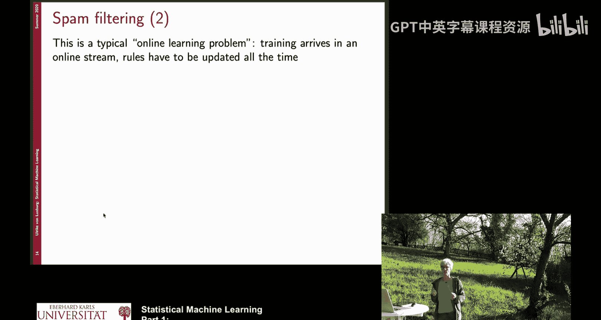
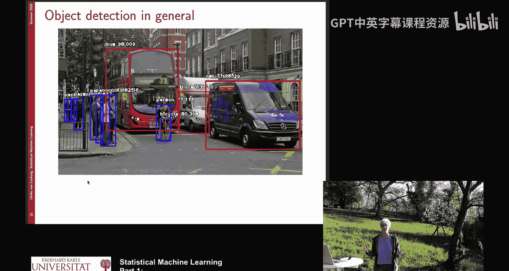
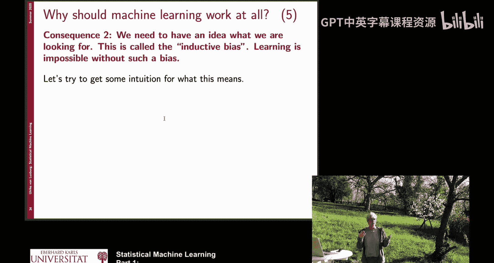
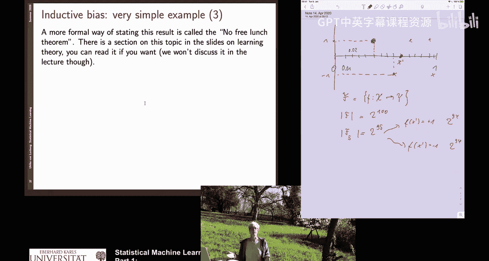
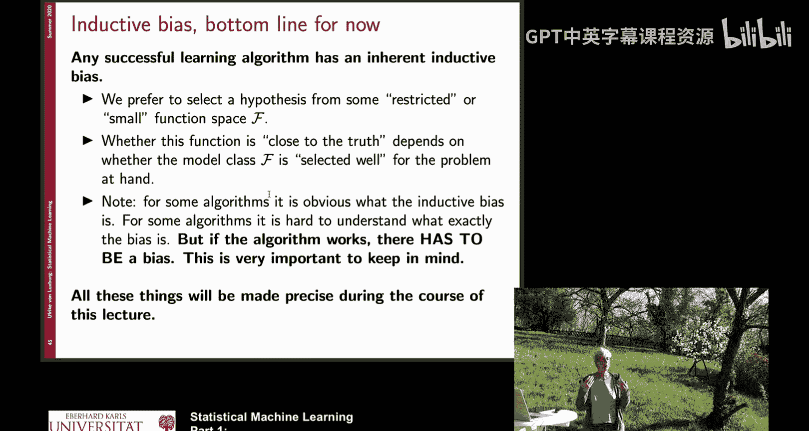

# 01：机器学习与归纳偏置

## 概述

在本节课中，我们将要学习机器学习的基本概念，并通过一系列实例了解其应用场景。我们将探讨机器学习的定义，并深入理解其核心思想——归纳推理。课程将重点解释为什么机器学习算法需要“归纳偏置”，以及没有它为何无法进行有效学习。最后，我们会通过实例讨论过拟合与欠拟合现象。

## 机器学习应用实例

以下是几个关键的机器学习应用领域，它们展示了机器学习如何解决现实世界中的复杂问题。

*   **手写数字识别**：这是机器学习的奠基性问题之一。问题描述为：给定一个16x16的灰度图像（每个像素是0到1之间的值，代表灰度），我们需要学习一个函数 `f: R^256 -> {0,1,...,9}`，该函数能将代表数字的图像向量映射到正确的数字标签上。不同人的手写风格差异使得设计手工规则非常困难。
*   **垃圾邮件过滤**：这是一个典型的在线学习问题。系统根据用户标记的“垃圾邮件”示例，持续更新一个分类器，以区分正常邮件和垃圾邮件。这与手写数字识别不同，因为垃圾邮件的模式会随时间演变。
*   **物体检测**：这是自动驾驶等应用中的核心问题。给定一个复杂的场景图像（如道路），系统需要识别出其中的行人、车辆、交通标志等多种物体。这是手写数字识别问题的更复杂、更通用的版本。
*   **生物信息学**：机器学习被广泛应用于生物领域。例如，在微阵列数据分析中，根据蛋白质活性模式（可视为由0和1组成的矩阵）对癌症细胞类型进行分类；在药物发现中，预测特定小分子是否能与蛋白质的三维结构口袋结合。
*   **医学应用（如皮肤癌检测）**：通过智能手机拍摄皮肤照片，利用自动分类器判断病变是否为皮肤癌。这类系统的准确度已可与训练多年的医学专家相媲美，能有效辅助医生。
*   **考古学**：通过对古人类基因组数据进行分析，机器学习帮助研究者发现了人类进化树中一个此前未被发现的支系，展示了其发现新知识的能力。
*   **语言处理**：从2011年IBM Watson在智力问答节目中获胜，到如今的语音助手（如Siri、Alexa）和高质量的机器翻译（如DeepL），自然语言处理取得了显著突破。
*   **游戏AI（如AlphaGo）**：与早期依靠强大计算力和搜索算法战胜人类国际象棋冠军的计算机不同，AlphaGo纯粹使用机器学习（特别是神经网络），通过模仿专家棋谱和自我对弈来学习，最终在2016年击败了世界围棋冠军。

## 什么是机器学习？

上一节我们介绍了机器学习的多种应用，本节中我们来看看如何定义机器学习。

一个常见的定义是：**机器学习是开发能从训练示例中学习特定任务的算法**。这包含几个要点：
1.  **特定任务**：当前机器学习旨在解决具体问题（如皮肤癌检测、翻译），而非构建通用人工智能。
2.  **训练示例**：学习需要数据，即任务实例（如图像及对应的“癌症/正常”标签）。
3.  **泛化**：学习意味着计算机不仅能记住训练示例，还能对**未见过的实例**做出正确预测。这是机器学习的核心目标。
4.  **提取规则**：理想情况下，计算机应从示例中提取出执行任务的通用规则。

另一个更本质的解释是：**机器学习试图将归纳推理的过程自动化**。

## 归纳推理与演绎推理

为了理解上述定义，我们需要区分归纳推理和演绎推理。

*   **演绎推理**：从一般性前提（公理）出发，通过逻辑规则推导出必然正确的结论。例如：
    *   前提1：这个房间里的每个人都是学生。
    *   前提2：每个学生都大于10岁。
    *   结论：这个房间里的每个人都大于10岁。
    *   只要前提正确，结论就必然正确。数学体系建立于此。
*   **归纳推理**：从具体的观察中推导出一般性的命题或假设。例如：
    *   观察：一个孩子多次掉落物体，物体每次都落到地上。
    *   归纳出的假设：所有掉落的物体都会落向地面。
    *   归纳得出的结论**无法保证绝对正确**，未来可能出现反例。人类和科学探索大量依赖归纳推理。

机器学习正是自动化归纳推理的过程：我们给计算机提供训练数据（具体观察），它需要从中学习并形成一个能解释和预测新数据的假设（一般规则）。

## 机器学习为何可行？需要何种假设？

通过一个简单的回归例子，我们可以理解机器学习成功所需的条件。假设我们有一些输入(x)和输出(y)的数据点，想要学习预测函数 `y = f(x)`。

观察四个数据点后，对于新的输入x=0.4，其输出y是多少？可能有两种拟合方式：
1.  用一条简单的直线（线性函数）拟合。
2.  用一条复杂的、上下波动的曲线拟合。

两种函数都能完美拟合已有数据，但会对x=0.4做出不同的预测。**如果没有额外知识或假设，我们无法判断哪个预测更好**。

可能的假设包括：
*   **简单性假设**：倾向于选择更简单的函数（如直线）。这符合奥卡姆剃刀原则。
*   **领域知识**：如果知道数据来自昼夜温度变化，可能会倾向于选择周期性函数。

**核心结论**：如果数据本身没有可学习的模式（例如，x和y完全是随机关系），则无法进行预测。要使机器学习可行，通常需要以下隐含假设：
1.  **输入与输出相关**：输出值必须以某种（未知）方式依赖于输入。
2.  **平滑性假设**：相似的输入应产生相似的输出。
3.  **存在简单规则**：输入与输出之间的关系可以用一个相对简单的函数来描述。数据越多，可以学习的函数可以越复杂。
4.  **偏好简单函数**：在能解释数据的所有函数中，我们倾向于选择更简单的那个。

这些假设很少被明确说明，但它们是所有机器学习算法的基础。如果假设错误，学习结果很可能也是错误的。

## 归纳偏置：学习的关键

上一节我们讨论了机器学习需要假设，本节中我们正式引入“归纳偏置”这个概念，并看看为什么它必不可少。

**归纳偏置**是指学习算法为引导学习、做出泛化预测而必须具有的偏好或假设。它决定了算法在众多可能解中更倾向于选择哪一类。

考虑一个极端的例子：输入空间X是100个离散点，输出Y是{+1, -1}。函数空间F包含所有可能的函数，共有 `2^100` 个。

*   **场景一：无归纳偏置**：算法考虑所有 `2^100` 个函数。即使我们观察到5个无噪声的训练数据，排除了不符合这些数据的函数，剩余的函数空间仍然非常庞大（`2^95` 个）。对于一个新的测试点x‘，会有同样多的函数（`2^94` 个）预测其为+1或-1。**在没有偏置的情况下，算法无法做出任何有意义的预测**。无论收集多少数据，对于未见过的新点，不确定性始终存在。这直观地说明了“天下没有免费的午餐”定理：没有任何算法能在所有可能的问题上都表现良好。
*   **场景二：强归纳偏置**：假设我们知道函数只能是常值函数，即 `f(x) = +1` 或 `f(x) = -1`。那么，只需一个无噪声的训练样本，我们就能确定是哪个常值函数，并对所有其他点做出完美预测。

现实中的机器学习介于两者之间。**模型选择**的核心就是为特定问题找到一个大小适中、合适的函数空间（即归纳偏置）。

## 过拟合与欠拟合

选择不当的函数空间会导致两个典型问题：

以下是两种常见的问题表现：

*   **过拟合**：使用的模型过于复杂（如用20阶多项式拟合二次函数数据）。它能够非常好甚至完美地拟合训练数据，包括其中的噪声。但其预测对于新数据通常很差，因为模型学习了噪声而非潜在规律。其特征是**近似误差低，但估计误差高**。
*   **欠拟合**：使用的模型过于简单（如用直线拟合二次函数数据）。它无法很好地拟合训练数据，模型过于稳定，对新数据的预测同样很差。其特征是**近似误差高，但估计误差低**。

## 归纳偏置的普遍性

归纳偏置并非机器独有。任何成功的学习系统，包括人类和动物，都必须具备归纳偏置。

著名的“加西亚效应”实验说明了这一点：老鼠能快速学会将食物的**味道**与生病联系起来（这是一种合理的、进化形成的偏置），但却无法学会将**灯光或声音**等环境线索与生病联系起来（因为自然界中这种关联不常见）。这证明了老鼠的学习机制内置了特定的归纳偏置，限制了它能学习的内容。

## 总结

本节课中我们一起学习了机器学习的基本概念。我们了解到机器学习旨在通过训练数据自动化归纳推理的过程，以学习特定任务并实现泛化。**归纳偏置**是任何机器学习算法能够成功的关键，它是对学习结果的偏好或假设，引导算法在无数可能解中进行选择。没有归纳偏置，有效的学习是不可能的。最后，我们探讨了因模型选择不当导致的**过拟合**与**欠拟合**问题，并认识到归纳偏置在人类和动物学习中也普遍存在。理解这些基础概念是深入探索具体机器学习算法的第一步。