# 03：第二部分 - 热身：k近邻分类器

在本节课中，我们将学习第一个机器学习算法——k近邻算法。我们将了解如何设置机器学习实验，如何计算训练误差和测试误差，并深入探讨k近邻分类器的工作原理、参数选择及其优缺点。

## 实验设置与误差计算

上一节我们介绍了机器学习的基本概念。本节中，我们来看看如何为一个具体的算法设置实验并评估其性能。

首先，我们需要数据。数据是一组点，称为 `(X_i, Y_i)`。`X_i` 始终是输入，`Y_i` 是我们希望算法预测的输出。我们有 `N` 个这样的训练点，即 `(X_i, Y_i)`，其中 `i` 从 `1` 到 `N`。这些是抽象的点，我们将把它们交给机器学习算法。

算法需要训练一个函数 `F`，该函数以输入空间（称为 `X`）中的点作为输入，并输出一个结果。在本例中，输出是 `0` 或 `1`。这是一个非常简单的二元分类任务。

接下来，一旦我们有了算法，就需要测试它。我们考虑一组测试点，其形式与输入点相同，称为 `(X_j, Y_j)`，其中 `j` 从 `1` 到 `M`。非常重要的一点是，测试集独立于训练集，即没有任何测试点已经出现在训练集中。这就是我们在上一讲中定义的“未见过的点”。测试集将用于最终评估我们的算法。

现在我们假设有训练数据和某个算法（可以是k近邻算法或其他算法）。该算法基于训练点构建一个函数，在本幻灯片中我称之为 `F_alg`（算法选择的函数）。

现在我们要计算什么是训练误差和测试误差。

训练误差的计算方法如下：对于所有训练点，我们使用算法构建的函数来预测该函数认为此特定测试点的输出应该是什么。

我们取一个输入点 `X_i`，将函数 `F` 应用于此输入点，该函数产生一个输出，我们称之为 `Y_i_hat`。在统计学中，`hat` 符号用于表示估计量，因此 `Y_i_hat` 是算法对真实标签 `Y_i` 的估计。

现在我们可以计算损失：算法预测正确与否。我们定义一个损失函数 `L`（代表损失）。通常，损失函数接受三个输入：输入点 `X_i`、真实标签 `Y_i` 和预测标签 `Y_i_hat`。在最简单的情况下，它是0-1损失函数，它简单地检查预测标签 `Y_i_hat` 是否与真实标签 `Y_i` 相同。

如果相同，我们不产生损失（损失为0）。如果不同，我们产生损失1。因此，我们只是计算犯了多少错误，以及有多少情况算法预测了正确的输出。

这个损失函数首先计算单个数据点（一个训练点）的损失，因此有时被称为逐点0-1损失。

现在，我们想对所有训练点取平均值，得到所谓的训练损失或训练误差，通常也称为分类器的风险。在本幻灯片上，分类器应用于函数 `F` 的训练风险，是函数在所有输入数据点上预测输出并与训练点的真实输出比较时的平均损失。

直观上这很简单：我们的函数为训练点预测输出应该是什么，然后我们取平均值，看看我们犯了多少错误。例如，在许多应用中，10%的错误率可能是一个好的结果。

这个量稍后将被称作分类器的经验风险。

对于测试误差，我们做完全相同的事情，只是现在计算测试点上的误差。对于每个测试点 `X_j`，我们再次应用规则 `F`。规则输出一个标签 `Y_j_hat`，即算法认为正确的标签。然后我们再次评估损失：在这个真实标签为 `Y_j` 的测试点 `X_j` 上，预测标签是 `Y_j_hat`，如果预测标签和真实标签一致，损失为0，否则为1。

我们再次定义测试误差为所有测试集上的平均值，即对所有测试点从 `j=1` 到 `M` 的损失求和并平均。这给出了一个介于0和1之间的数字，即我们分类器的测试误差。

这里有一个小的技术说明：我们将测试误差定义为测试集上的平均值。稍后，我们还将定义在所有可能出现的点上的测试误差作为期望值，这将被称作分类器的真实风险，我们稍后会看到这一点。

## 关于误差的说明

在真正开始我们的第一个分类器之前，有两点说明。

显然，产生一个训练误差低的分类器并不是真正的挑战，因为训练集我们已经知道输出，在最坏的情况下，我们可以直接生成一个查找表，告诉所有输入点的预期输出应该是什么。因此，仅凭获得低训练误差本身并不是真正的挑战。

尽管如此，机器学习算法通常无法达到零训练误差。可能有很多原因。可能是因为零训练误差是不可能的，我们稍后会看到例子，因为标签中存在歧义。我们稍后会看到一些例子。

此外，有很多原因说明为什么产生零训练误差并不总是最好的主意。我们在上一讲中已经谈到了过拟合。通常，如果我们产生一个零训练误差的分类器，它会试图过拟合，因为它也模拟了噪声，这是我们经常要避免的。

无论如何，无论训练误差是多少，我们真正感兴趣的量是测试误差。这是我们机器学习算法成功的唯一衡量标准。最终，机器学习旨在产生一个能很好预测新的、未见过的实例的函数。我们并不真正关心训练误差是多少。训练误差可能是我们在构建算法时用来找到一个相当好的函数的工具。

但评估纯粹是在测试数据上进行的，测试误差最终是我们唯一感兴趣的量，因为这个量告诉我们，在未来应用我们的学习模型时，我们犯错误的可能性有多大。

特别地，正如我已经暗示的，低训练误差并不总是自动意味着低测试误差。例如，如果发生过拟合，情况就不是这样。

## k近邻分类器

现在让我们谈谈k近邻分类器。解释k近邻分类器最简单的方法是使用幻灯片上的这张图。

在这张图中，我们有两类数据：绿色的叉号，称为类别0；黑色的叉号，称为类别1。

现在我们想要预测一个新点的标签，即图中中心的红点。我们该怎么做呢？

我们取红点，评估所有训练点（叉号）中哪些点离这个红点最近。例如，如果我们使用5近邻分类器，我们检查哪些训练点是最近的5个点。

我在这个测试点中心周围画了一个红色的圆圈，你可以看到这里最近的5个点是什么。然后你简单地取平均值，让这5个最近邻投票决定他们认为结果应该是什么。在这种情况下，我们有三个绿色叉号和两个黑色叉号，所以测试点的5个最近邻中的大多数说它是一个绿点，因此我们会预测绿色类别，即0。

这就是k近邻算法所做的。这真的是你能想到的最简单的算法。

让我们试着让它更正式一些。形式上，我们给定训练点 `(X_i, Y_i)`，`i` 从 `1` 到 `N`。这些点来自某个输入空间 `X` 和二元输出空间 `{0, 1}`。

此外，我们在输入空间上给定一个距离函数，因为如果我们想评估一个点的最近邻是谁，我们需要有某种方法来衡量数据点有多接近。

所以我们需要一个距离函数，它告诉我们给定两个输入点，这些点有多接近。这个函数将用 `D` 表示，代表距离函数。

现在我们想构建一个分类器，能够预测新的测试点的结果。

它是如何工作的？我们给定这个测试点 `x'`。我们现在计算这个测试点 `x'` 到所有其他输入点（所有训练点）的距离。然后我们根据谁最接近测试点来对这些距离进行排序。我们取那些最接近测试点的几个点，`K` 是算法的参数。在前面的图中，我们有 `k=5`，我们看了5近邻算法。一般来说，我们谈论的是K近邻算法，所以 `K` 是我们要查看的邻居数量。假设我们以某种方式固定了它，所以我们取这个测试点的 `K` 个最近邻。

然后我们简单地分配这些 `K` 个邻居标签的多数票，这就是幻灯片底部的公式。`y'` 应该是函数赋予新数据点的标签。

我在这里所做的本质上是，我对所有传入的标签求和。因为我们有 `K` 个传入标签，即 `K` 个最近邻的标签，我们对它们全部求和。

在这种情况下，因为标签是 `0` 或 `1`，我们简单地检查和是小于 `K/2` 还是大于 `K/2`。如果小于 `K/2`，大多数标签会预测 `0`，所以我们也预测 `0`。如果和大于 `K/2`，大多数标签预测了 `1`，所以我们会输出 `1`。这就是k近邻分类器的工作原理。

这是一个非常非常简单的算法。它甚至简单到没有真正的训练阶段。在大多数其他算法中，我们会有一个训练阶段，检查许多可能的函数，以确定使用哪个函数最好。而k近邻算法甚至没有训练阶段。我们只需要查看数据，我们需要能够根据距离排序，然后我们就可以立即开始预测新测试的结果。

## 参数K的选择

现在，k近邻算法有一个参数 `K`，即我们要查看的邻居数量。这个参数 `K` 的范围可以在 `1` 到 `N` 之间。

`K=1` 意味着我们只取最近数据点的标签。没有平均，没有多数投票。我们只是检查测试点，哪个是最近的训练点，我们使用它的标签来预测测试点的结果。

在另一个极端情况下，我们可以使用 `K=N`，这意味着我们查看所有数据点，并使用多数投票评估标签。

现在我想请你思考一个问题：你认为参数 `K` 的范围应该是多少？`K` 小好还是大好？如果 `K` 非常小（比如1）和如果 `K` 非常大（比如 `N`）会发生什么？请现在暂停视频，认真思考一分钟，因为我认为理解这个概念很重要。

好的，我希望你已经有了自己的想法。你得出了关于 `K` 值小和大之间差异的一些想法。我想用一张图展示给你看。

这里你可以看到一个数据集，有黄色和蓝色的点。你看到黄色的圆圈和蓝色的圆圈，这些圆圈是我们给定的训练点。然后你看到小点，橙色和蓝色的点，这些是测试点。点的颜色表示该测试点将被分类为黄色还是蓝色。

你在左侧看到两个这样的图，你看到的是1近邻分类器。图中的黑线表示两个类别之间的决策边界，即类别标签将在哪里翻转，介于蓝色和橙色之间。这就是算法所做的，1近邻算法隐含地产生了这样的边界。

现在你可以看看它，你会发现1近邻分类器的这个边界真的非常非常弱。你几乎看不到任何连贯的东西，你甚至可以看到许多小岛，比如在许多橙色数据点中间有一个蓝色数据点，然后在这个蓝色数据点周围有一个小区域将被分类为蓝色，而其余部分将被分类为橙色。

这看起来甚至已经不太对劲了。你会很惊讶，如果你要分类的自然现象会有这样的决策边界。

这里发生的就是过拟合现象。因此，在这里，算法将适应我们数据中的每一个小的噪声位，即如果有一个点以某种方式是其自身类别的异常值，算法将在这个点周围制造一个小岛，这就是过拟合，它拟合了噪声，数据中的噪声对分类结果有太大的影响，这是不希望的。

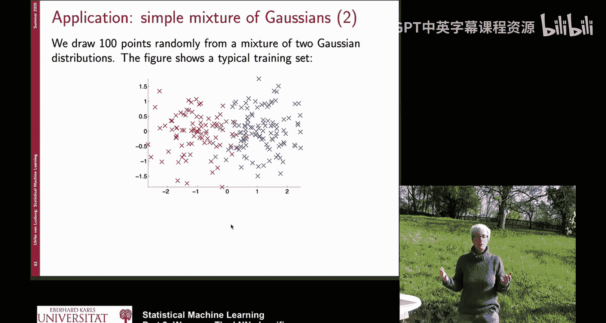

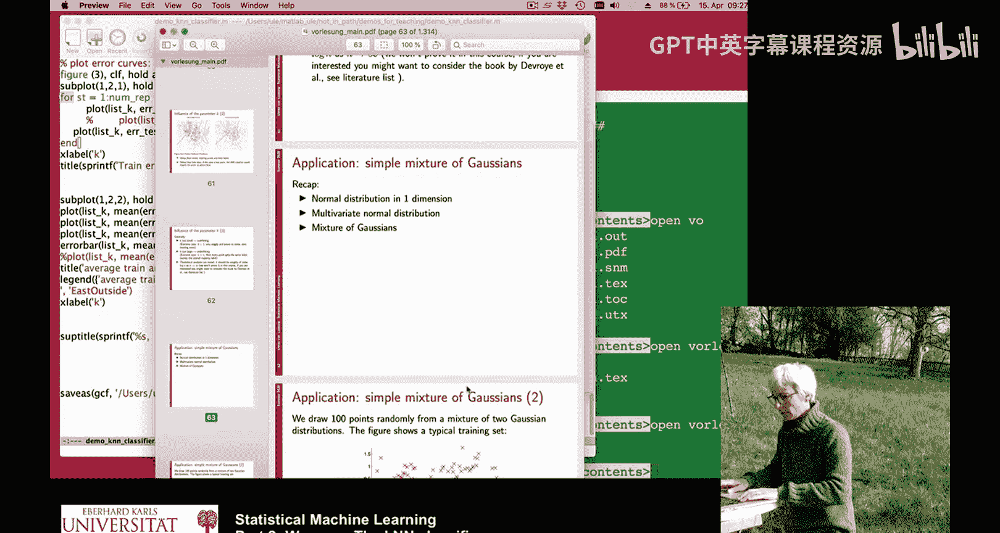

一个更适中的参数 `K` 显示在这个图的右侧，这里你看到的是15近邻分类器。因此，这里的分类器取邻域中的15个点，并使用它们来分类测试点。当然，这里发生了多数投票，因为我们总是要对这15个最近邻进行平均。

你可以看到两个类别之间的边界比以前平滑得多。在这里，我们可能不会说它真的过拟合了。它似乎是对这个特定数据集的合理拟合。

你还可以看到，这意味着右侧情况下的训练误差不为零。因为有一些橙色点位于蓝色区域，反之亦然，它们会被错误分类。但总体而言，我们可能会认为右侧的分类器是更好的选择。

这是这个特定案例的一个要点：如果你看k近邻算法，如果参数 `K` 太小，你倾向于过拟合。如果你有一个适中的 `K`，情况就还好。然后如果参数 `K` 变得太大，你就会欠拟合。

如果你考虑极端情况，你可以选择 `K=N`。所以对于每个测试点，你将考虑数据集中的所有点作为邻居并进行多数投票。因此，无论你的测试点是什么，你总是会输出整个训练集中的多数标签，所以你产生的函数将是一个常数函数。

如果你的训练集中有更多标签为 `0` 的点，你将总是预测 `0`。如果你有更多标签为 `1` 的点，你将总是预测 `1`。这现在是欠拟合的明显情况。因此，除非你真的认为应该有一个常数函数，否则模型可能不够强大来拟合你的数据集，但那样你可能就不需要机器学习了。但如果你认为你的结果应该更复杂一些，那么如果你选择 `K=N`，就会发生欠拟合。

好的，这一切都在幻灯片上描述了，也许从理论角度再多说一句。k近邻算法是一个非常好的算法，因为它将是普遍一致的，我们稍后会看到这意味着什么。

为了从理论角度实现一个一致的算法，我们可以证明参数 `K` 应该是什么。你可以证明参数 `K` 应该大约是 `log N` 的数量级。所以如果你有 `N` 个训练点，参数 `K` 应该选择为训练点数量的对数。

这将实现的是，如果你有越来越多的数据点，你围绕测试点取的小区域会变小，所以在 `N` 趋于无穷的极限下，如果你有很多很多数据点，你将只对非常接近你的测试点的东西进行平均，这是有道理的，因为你不想对真的很远的东西进行平均。

但另一方面，即使你取平均的区域的直径在缩小，同时我们在这个区域内有 `log N` 个点，所以我们对越来越多的点取平均，点的数量在增长 `log N`，它不是常数。在统计学中，每当你想估计某物时，你至少需要在极限内有无限数量的点来取平均值，否则平均值不会趋于稳定。

如果我们选择 `log N`，这就会发生。当然，我们可以非常正式地证明这一点，我们现在不会在讲座中做这个，只是把它当作一个经验法则。

## 算法演示与实例分析

现在让我们简单地看看这对几个例子的表现，我们从高斯混合模型开始。我希望你已经完成了所有的数学复习，如果没有，请重新考虑什么是正态分布，从一维正态分布开始，考虑什么是多元正态分布，然后再思考什么是高斯混合。

直观地说，一个高斯混合，就像多个维度上的一个高斯分布，就像是多个维度上的高斯钟形曲线山。现在，高斯混合由许多这样的模式组成。我们马上会看到一个例子。

我们现在要做的是，我从高斯混合中抽取一个训练点样本，然后使用k近邻分类器，我只想在我写的一个Matlab演示中展示给你看。

（演示部分描述图表和结果，展示了不同 `K` 值下训练误差和测试误差的变化，以及数据分布变化对结果的影响。）

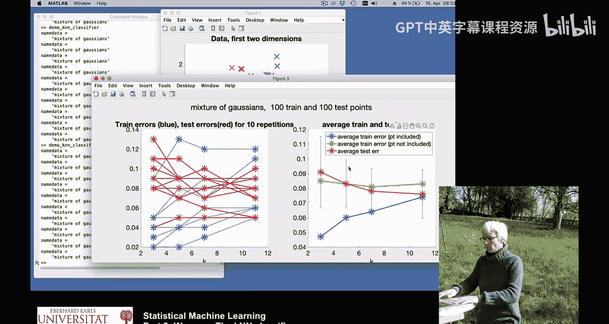

## 手写数字识别实例

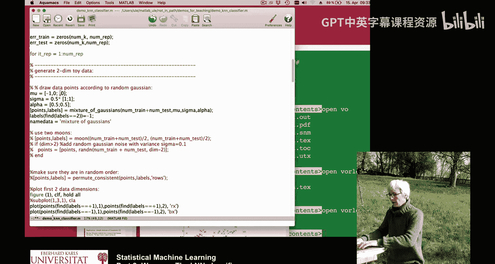

我想向你展示第二个应用，它比高斯混合更自然一些，即手写数字识别。这是你在练习中也会经常看到的数据，称为USPS或MNIST数据。USPS是美国邮政服务，这是20世纪90年代创建的数据，是真正的邮政服务数据，他们想学习如何为邮政编码分类手写的0-9数字。

这个数据集由许多手写数字组成，像这样。所有这些数字都被很好地记录并居中在图像中间。这些是灰度图像，16x16像素。所以每个像素用0到1之间的灰度值编码。

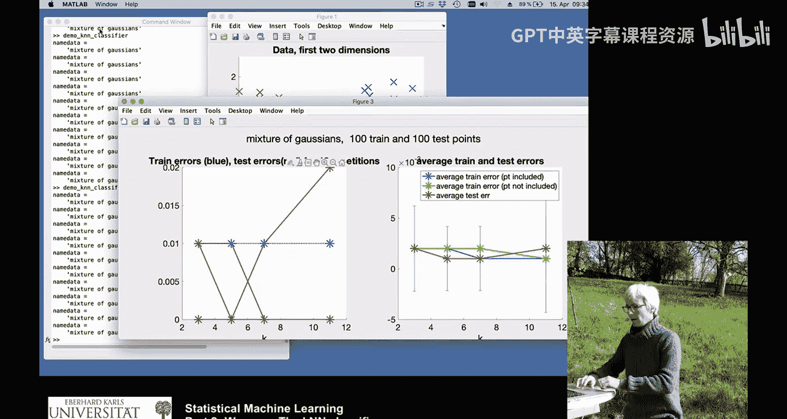

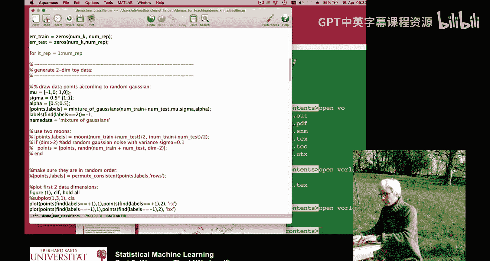

每个图像，因为它是16x16，由256个介于0和1之间的不同数字组成。

现在我们想看看两个不同分类任务的结果，因为目前我们看的是二元分类，我只想向你展示如何分类数字8与数字1，所以我们只想学习区分8和1。

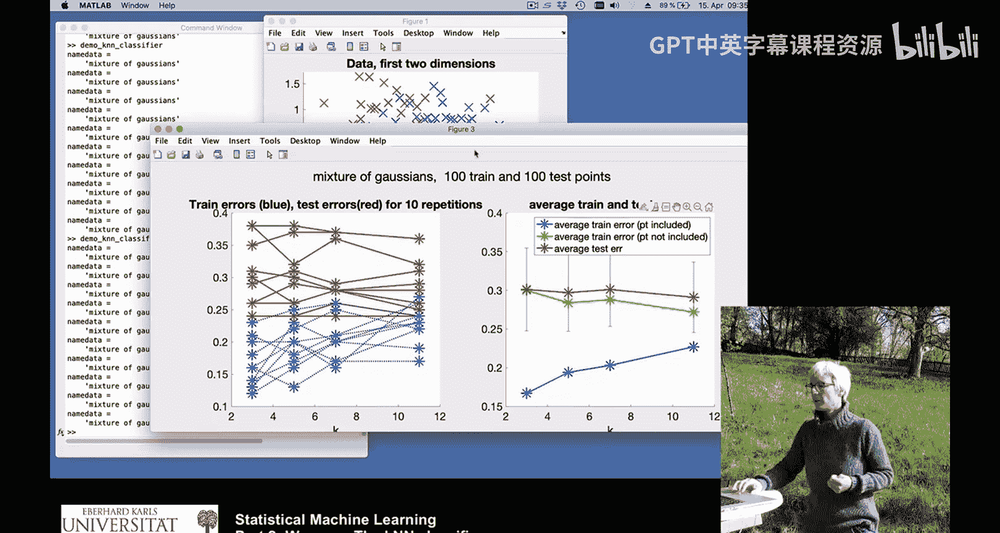

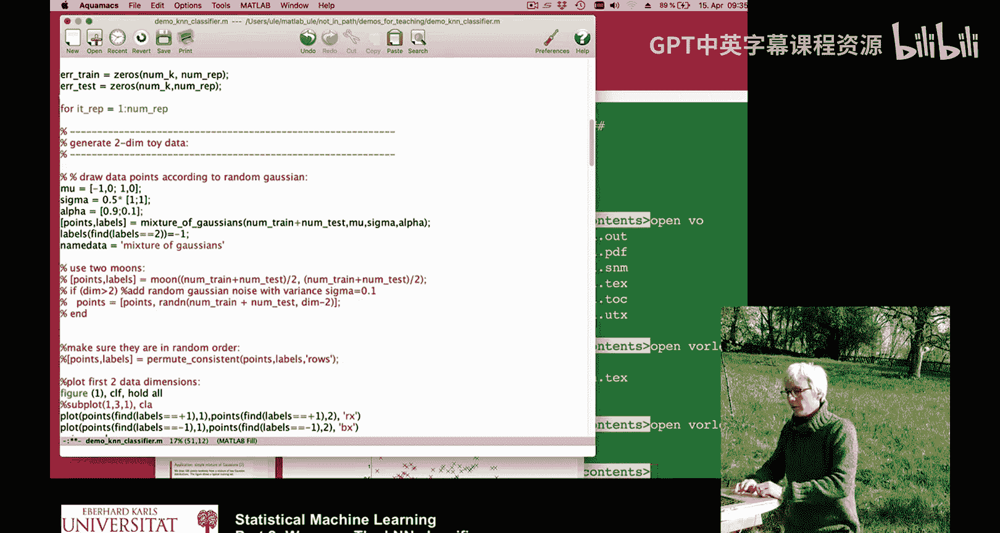

如果你想想这些数字的样子，8对1似乎相当简单，因为1是一条非常直的线，而8是卷曲的东西。

现在，如果你想对手写数字使用k近邻分类器，现在第一个障碍是：我们需要定义数字之间的距离函数，因为k近邻分类器最终要检查谁是我的最近邻，然后你需要评估它们的标签。要知道谁是你的最近邻，你需要有某种方法来测量距离。

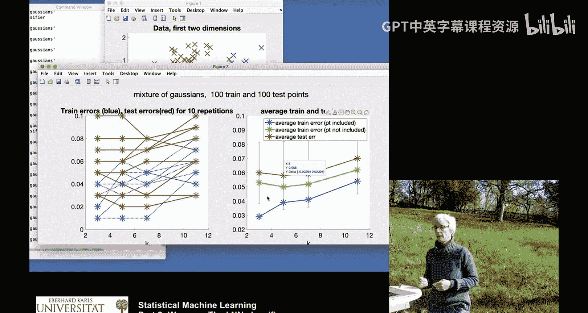

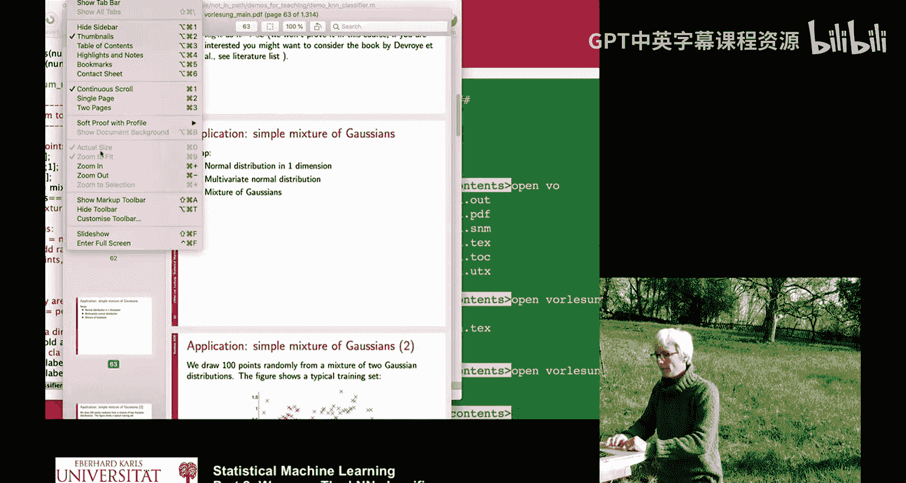

你如何计算两个手写数字之间的距离？有很多不同的方法。如果你从数学角度思考，每个数字都表示为一个256维的向量。

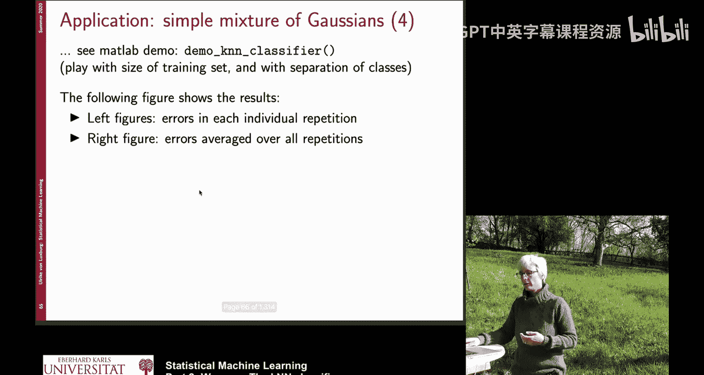

所以你可能做的最天真、最直接的事情就是简单地使用向量空间中的欧几里得距离。这就是我们要做的，这是一种非常朴素的方法。

我们有一个输入点 `x` 和一个输入点 `x'`，每个点由256个坐标组成，我们简单地计算这些点之间的欧几里得距离。如果你不知道这意味着什么，它只是向量空间距离，你对点的坐标之间的平方距离求和，然后取平方根。

这是向量空间中的欧几里得距离。好的，这就是我们使用的距离函数。

现在你可以在这里看到结果。这与我们刚刚在高斯混合演示中看到的设置类似。同样，我对此类问题进行了独立的测试运行、训练和测试运行。USPS数据包含许多数字，我只取了500个训练数字和100个测试数字，都只来自类别1和8。

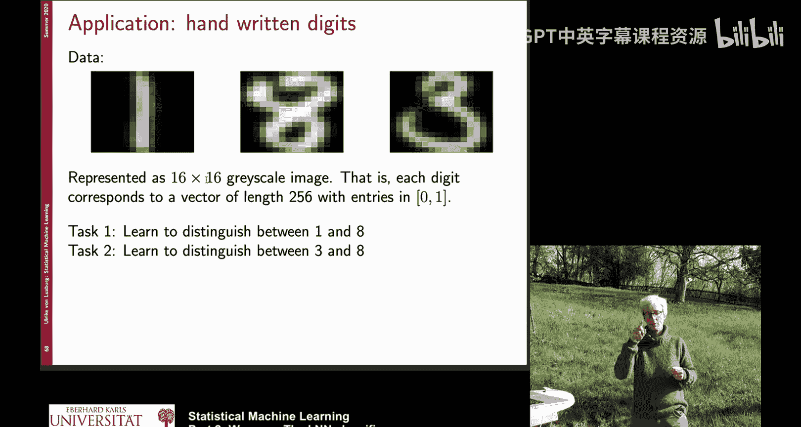

你可以在左侧看到结果，即每当我独立抽取训练集和测试集时，这些独立运行的训练和测试结果。在右侧，也许我们应该关注这个，我们看到过程的误差，特别是测试误差，你可以看到它在这里。对于 `k=3`，误差约为0.013。对于 `k=11`，它上升到接近0.04。还有不同的训练误差，它们彼此非常接近，现在可能不那么重要。

现在我想问你，也许这又是一个你可能想暂停视频并盯着这个图看一分钟的点。你认为这是一个好结果还是坏结果？请先试着自己思考一下。

好的，我希望你已经有了决定。这是一个非常好的结果。如果你想一想，这是手写数字识别，这真是一个不那么容易的问题。你所有的数据点都由256维的灰度值向量组成。

而用这个愚蠢简单的k近邻分类器，它没有什么复杂之处，我们甚至使用了在大多数情况下不起作用的欧几里得距离，但在这里它起作用了，我们得到了仅仅1%的误差（对于 `k=3`），如果你选择更大的 `K`，它会增加一点。

这表明我们可能应该选择一个相当小的 `K`，至少对于我们在这里选择的这种设置。测试误差为1%，使用一种朴素的方法，这通常在你的机器学习实验中是得不到的。如果你为某家公司工作，他们希望你解决一个机器学习实验，不要指望在第一个简单的朴素方法之后就能达到1%的测试误差。所以这真的非常非常好。

这多少表明，毕竟，手写数字识别可能不是最复杂的问题。

也许再多说一句，当然，我们这里只分类数字1和数字8，如果你在所有10个测试点中进行分类，误差会增加，我们将在本讲座后面看到我们如何做到这一点，如何从二元方法扩展到多类方法，这并不复杂，但当然测试误差会增加，因为有更多不同的方式可能混淆你的真实测试标签。

这里是另一个分类任务的结果，我们分类数字3与数字8，这可能更复杂一些，因为如果你想象这些数字的样子，8是这样的，而3是8的一半，至少大致如此，所以混淆这两个数字的可能性更大。

让我们现在看看结果，我们使用完全相同的设置，你现在看到这里的红线又是测试误差，你看到它更高一些，所以这里最好的情况是3%（抱歉，是3%），而之前是1%左右，在这里它增加得更高一些。

因此，我们可以通过比较这张图和前一张图看出，这种情况稍差一些，区分3和8至少比区分1和8的测试误差稍高，但在两种情况下，测试结果都非常非常好。

## 算法的局限性与归纳偏好

现在我说过，我们到目前为止所做的真的是所有方法中最简单的，你甚至可以称之为朴素，我们使用了k近邻分类器，使用小的 `K`，并使用欧几里得距离作为距离函数或相似性函数。在大多数应用中，欧几里得距离不起作用。

当然，只有当你的距离函数编码了关于数据的重要内容时，应用k近邻分类器才能成功。事实上，在许多应用中，为你的数据集想出一个好的距离函数并不容易。

我这里有一个例子，你想分类蘑菇。蘑菇应该被分类为可食用和不可食用，所以你走过森林，看到一个蘑菇，你想知道，我能吃它吗？你有一组特定的特征，也许是蘑菇的大小、重量、颜色、外观等等。

现在，如果你想应用k近邻分类器，你需要有一个这些蘑菇之间的距离函数。现在，如果你记录的所有关于蘑菇的信息是重量和大小，并使用距离函数，比如这里使用欧几里得函数，或者更简单的情况，甚至只是重量差，它可能不会起作用，因为重量并不是真正指示你是否能吃蘑菇的因素。

在这个例子中，你可能会说，好吧，也许我没有真正选择正确的特征，如果我选择了其他特征，比如进行一些化学分析，然后得到蘑菇中某些部分的浓度，那么也许它会起作用，是的。但还有许多其他应用甚至更加复杂。

这里的例子是：假设你想对一首歌曲的类型进行分类。你有一个Last.fm或其中一个网络电台，你想播放一首歌，然后下一首歌应该与上一首歌相似。你如何计算两首歌之间的相似性？你的歌是你电脑中的声波。

声波之间的欧几里得距离可能不会给你一个好的距离函数。特别是，如果你想编码一些非常复杂的东西，比如一首歌的类型，它是流行歌曲还是古典音乐？这种欧几里得距离不会起作用。

因此，需要大量工作来设计这个距离函数。事实上，这在机器学习中经常发生。需要进行大量的预处理，以使你的数据格式能够成功应用机器学习算法。

这种预处理通常需要大量工作，并且这种预处理通常是你的算法成功或失败的关键，而顶层的机器学习，至少在很多时候，并不是那么重要。我的意思是，当然，它有影响，但我使用一个非常朴素的算法或一个更好的算法。但关键通常是你数据的预处理。

现在这里还有一个问题给你，再次请暂停视频思考一下：你认为k近邻算法的归纳偏好是什么？在上一讲中，我们谈到了没有任何归纳偏好的机器学习是不可能的。

那么，你认为k近邻算法将学习到哪种类型的函数？也许有哪些类型的函数是我无法使用k近邻分类器学习的？请暂停视频思考一下。

好的，对于这个问题，你可以给出许多不同的答案。我认为最简单、最直接的关于归纳偏好的答案是，k近邻算法试图编码的是：相似的输入点应该导致相似的输出。因为当你应用算法时，你取一个测试点，检查谁是最相似或最接近的数据点，然后你说，好吧，我想做这些接近的数据点告诉我的任何事情。

也许用一个更实际的例子：你想预测一个人是会购买三星手机还是苹果手机。现在你该怎么做？你有某种方法来衡量人与人之间的相似性，有无数种方法可以做到这一点，但假设你只是这样做，你查看谁是最亲密的朋友作为相似性函数，来预测我是否会购买三星手机或苹果手机。

我们简单地检查我的朋友们会做什么。如果我所有的朋友都有苹果手机，那么我买苹果手机的可能性也很大。这就是归纳偏好。所以你检查谁与我自己非常相似，然后你做这些人一直在做的事情。这就是k近邻分类器的归纳偏好。

## 算法的扩展与应用

现在有许多扩展，你可以使用k近邻分类器，或者我应该说k近邻工具箱非常强大，因为你可以将其应用于许多许多不同的问题。

一件非常简单的事情是应用于回归。在回归中，输出将是一个实数，而不是二元标签。例如，在回归中，你可能想预测某个特定人10年后的收入。你查看过去的教育历史等等，然后你想输出一个数字：这个人10年后能赚多少钱。所以这不是一个分类问题，而是一个回归问题。

同样在这里，你可以应用k近邻分类器。在你的训练数据中，你会有很多人，你知道他们的教育背景，也知道他们10年后赚了多少钱。现在你检查谁是我在训练集中最相似的人，我检查像10个最相似的人中，他们10年后赚了多少钱，我取平均值，这也许是对我10年后能赚多少钱的一个很好的预测，至少在平均水平上是这样。

然而，k近邻方法也可以用于更复杂的任务，如异常值检测、分类、密度估计、聚类等等。所以，对于你可能想出的所有机器学习任务，在k近邻算法方面都有一个解决方案。它们往往是有用的基线考虑。

## 总结

现在，让我们总结一下关于k近邻算法。

k近邻分类器是你能看到的最简单的分类器。它通常表现得相当合理。主要的挑战是你需要定义一个对你的任务有用的距离函数。

我的建议是，每当你有一个想要解决的机器学习问题时，先尝试k近邻算法。在某些情况下，比如数字识别，k近邻算法可能已经表现得相当好。那么，如果基线算法已经这么好，也许就没有必要再花五周时间试图改进机器学习算法了。

可能有很多很多其他例子，基线并不差，或者说基线要差得多。那么也许有足够的空间通过应用更聪明的机器学习算法来改进你的结果。

从理论角度来看，我已经提到k近邻算法是一个很好的算法，因为它将是普遍一致的，我们将在下一讲中看到这意味着什么。

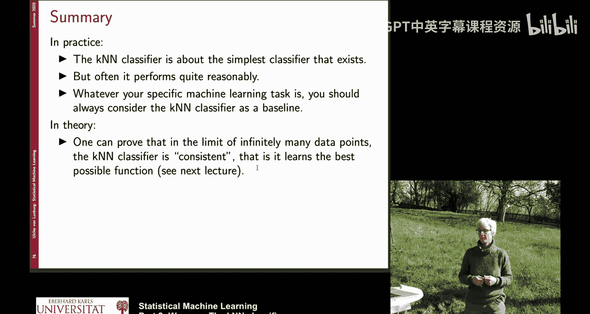

在本节课中，我们一起学习了如何设置机器学习实验并计算训练与测试误差，深入探讨了k近邻分类器的工作原理、其参数 `K` 的选择如何影响过拟合与欠拟合，并通过高斯混合模型和手写数字识别的实例观察了算法的表现。我们还讨论了算法的关键挑战——距离函数的设计，以及其核心的归纳偏好：相似的输入应产生相似的输出。k近邻算法作为一个简单而强大的基线方法，是开始解决新机器学习问题的良好起点。