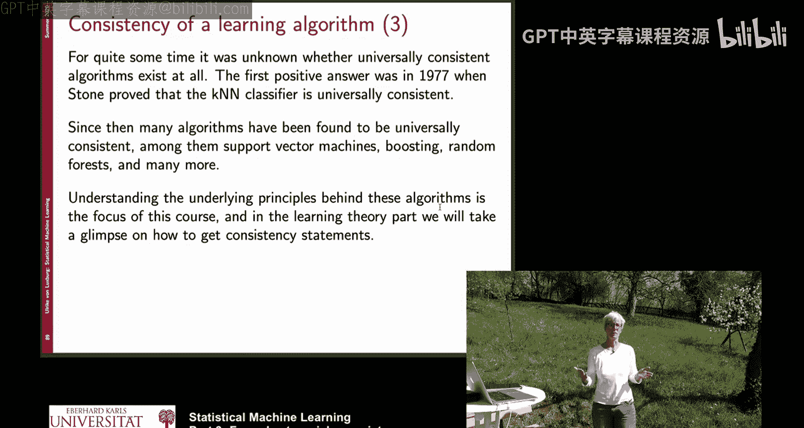

# 04：形式化设定、风险与一致性

在本节课中，我们将学习监督机器学习的形式化设定。我们将定义其核心组成部分，并介绍两个关键概念：贝叶斯分类器与学习算法的一致性。

---

上一节我们介绍了k近邻分类器作为机器学习算法的第一个例子。现在，我们将采取更形式化的方法，明确定义监督机器学习所需的要素，并解释一些重要概念，如贝叶斯分类器和学习算法的一致性。

## 输入与输出空间

首先，我们需要讨论监督（有时也包括无监督）机器学习问题的基础空间。

我们通常假设存在一个**输入空间**，记作 **X**。

在监督学习中，我们还有一个**输出空间**，记作 **Y**。

这些空间可能具有数学结构。例如，空间可能存在拓扑结构，或者是一个度量空间（例如，为了在k近邻分类器中测量距离），甚至可能是一个向量空间或更复杂的结构。机器学习有多种形式，目前我们只需要空间 **X** 和 **Y**。

## 概率分布与可测性

现在，我们需要在这些空间上定义概率分布，因此需要一个σ-代数。如果你不熟悉这个概念，可以暂时忽略它。我们假设在空间 **X** 和 **Y** 上分别存在σ-代数，以便定义概率测度。

在实际的机器学习中，可测性问题通常不是重点，因为现实世界中的测量都是有限的（例如有限的数据点、计算机的有限精度）。如果你不了解可测性，完全不必担心，这只是形式化设定的一部分。

有了空间 **X** 和 **Y** 上的σ-代数，我们现在可以定义概率测度。重要的是，我们考虑**乘积空间 X × Y**（及其乘积σ-代数）。这意味着我们有一个 **X** 的副本和一个 **Y** 的副本，最终我们将观察到成对的 **(x, y)**。正如之前所见，训练数据点 **(X_i, Y_i)** 就来自这个乘积空间。

## 机器学习的关键假设

机器学习的关键在于，我们**不对这个概率分布做任何假设**。我们不知道它是否来自某个特定类别（如高斯分布或指数分布）。这是机器学习与统计学的一个关键区别。在统计学中，你通常假设数据服从某种分布，如果假设成立，就能得到很强的结论。但在机器学习中，许多过程（例如在线商店的客户分布）非常复杂，难以用简单的概率分布建模。

本课程就属于**不对数据分布做特定假设**的统计机器学习分支。

另一个重要点是，输入变量和输出变量都是**随机变量**。输入变量是随机的（例如，从总体中随机抽取一个人）。输出变量也可能是随机的。例如，根据一个人的身高预测其性别（男/女），对于一个身高1.7米的人，其性别并非由身高唯一确定，因此输出本身也是一个随机量。

## 分类器与损失函数

一个**分类器**是一个函数，它接收输入并产生输出，即一个从输入空间 **X** 到输出空间 **Y** 的函数。

机器学习的目标是构建一个“好”的函数，使其具有较低的测试误差。为此，我们需要在形式化设定中定义训练误差、测试误差等概念。

首先，需要区分**分类**与**回归**问题：
*   如果输出空间 **Y** 是**离散的**（例如二元空间 {0, 1} 或有10个数字的类别），这类问题称为**分类**。我们通常从二元分类开始。
*   如果输出空间 **Y** 是**实数轴 R**（任何实数都可以是输出），则称为**回归**（例如预测收入或价格）。
*   还存在更复杂的输出空间（如结构化预测），但我们现在从分类开始。

为了评估分类器的好坏，我们需要定义一个**损失函数**。

损失函数是一个从 **X × Y × Y** 映射到非负实数的函数 **L(x, y, y‘)**，其中 **x** 是输入，**y** 是真实输出，**y‘** 是预测输出。

以下是两个常见的损失函数示例：

*   **0-1损失（用于分类）**：如果预测错误，损失为1；否则为0。
    `L_0-1(y, y‘) = I(y ≠ y‘)`，其中 `I(·)` 是指示函数。
*   **平方损失（用于回归）**：测量预测值与真实值之差的平方。
    `L_squared(y, y‘) = (y - y‘)^2`

损失函数的选择会极大地影响学习算法的归纳偏好，我们在线性回归等例子中会看到这一点。

你可能会注意到，上述两个例子中的损失函数并不依赖于输入 **x**。但存在损失函数也需要依赖 **x** 的情况。

请思考一下，你能想出一个损失函数需要依赖输入值 **x** 的例子吗？

一个例子是医疗诊断。对于某些人群（如老年人），分类错误的代价可能远高于其他人群。因此，损失函数可以设计为：当分类器在关键人群（如老年女性）上犯错时，损失值要大得多。这样，分类器就会更专注于学习空间中重要的部分。

此外，在应用中，**错误的类型**也可能很重要，这体现在损失函数中两个参数 **y** 和 **y‘** 的顺序上。

再思考一下，你能想出一个错误类型很重要的例子吗？

一个明显的例子是**垃圾邮件检测**。
*   如果将正常邮件误分类为垃圾邮件（假阳性），可能导致你错过重要邮件（如工作录用通知），造成很大损失。
*   如果将垃圾邮件误分类为正常邮件（假阴性），只是有点烦人，但损失较小。
因此，在垃圾邮件检测中，两种错误类型是不对称的。这也说明了为什么损失函数有三个参数，且参数的顺序很重要。

## 风险与贝叶斯分类器

现在我们需要定义一个分类器的**风险**。

一个分类器（或任何预测函数）**f** 关于给定损失函数 **L** 的**真实风险**（或称真实期望损失），是其损失的期望值。

风险 **R(f)** 定义为：
`R(f) = E[ L(X, Y, f(X)) ]`
其中，期望 **E** 是对随机抽取的点对 **(X, Y)** 取的，**(X, Y)** 来自乘积空间 **X × Y**。你随机抽取一个点对，用函数 **f** 对输入 **X** 进行预测，计算损失函数，然后对所有可能抽取的点对取期望。

在当前的设定中，**f** 是一个给定的固定函数。机器学习的目标是利用训练数据，构建一个风险尽可能小的函数。我们关心的正是这个**真实风险**，而不是训练误差或其他指标。

那么，可能想到的最好的分类器是什么？

为了定义这个最佳分类器，我们引入**贝叶斯风险**的概念。

**贝叶斯风险 R\*** 定义为所有可能函数风险的下确界：
`R* = inf { R(f) : f 为可测函数， f: X -> Y }`
直观上，我们考虑所有从 **X** 到 **Y** 的可能函数，查看它们的风险，其中最小的风险就是贝叶斯风险。我们取下确界是因为最小值可能不存在。

如果存在一个分类器 **f\*** 能达到这个下确界（即达到最小风险），我们称这个分类器为**贝叶斯分类器**。

## 训练数据与学习目标

在机器学习中，我们需要训练数据。

我们有一个基础空间和其上的概率分布。对于机器学习，我们从该空间中独立同分布地抽取 **n** 个点。

**IID** 意味着独立且同分布。每次抽取一个新点都与之前的数据点独立，并且所有点都服从相同的分布（即来自乘积空间 **X × Y** 上的特定概率分布）。

IID 是一个在数学上非常方便的假设，但从实践角度看，这是一个非常强的假设。现实中数据往往存在结构（例如，早上和晚上的客户行为可能不同）。此外，我们目前假设概率分布是固定不变的，也存在在线学习等场景，其中分布会发生变化，但我们目前不处理这些情况。

在目前定义的形式化设定中，机器学习的目标是：获取从基础概率分布中 IID 生成的训练数据，构建一个分类器 **f_n**（下标 n 表示它依赖于 n 个训练点），并希望该分类器的风险尽可能接近贝叶斯风险。

## 一致性

在统计学中，**一致性**是至关重要的性质，它表明你的算法最终会做正确的事。

现在我们考虑一个无限的数据点序列 **(X_i, Y_i), i=1,2,3,...**。我们希望表达：如果我们记录无限多的训练数据点，最终当 n 趋向无穷大时，分类器会做正确的事。

我们有一个从基础概率分布 **P** 中 IID 抽取的数据点序列。固定前 n 个点，我们构建一个分类器 **f_n**（这是我们的算法基于前 n 个训练点构造的函数）。

我们说这个算法对于给定的概率分布 **P** 是**一致的**，如果分类器 **f_n** 的真实风险 **R(f_n)** 收敛于贝叶斯风险 **R\***。

用公式表达，即对于任意 ε > 0，满足：
`lim_{n->∞} P( |R(f_n) - R*| > ε ) = 0`
如果你学过概率论，会认出这是**依概率收敛**。

这里的关键是，**R(f_n)** 是一个随机量，因为函数 **f_n** 依赖于我们的（随机）训练数据。而这个风险是在所有可能的测试点上计算的期望。这个依赖于有限训练集的函数的真实风险，应该收敛到贝叶斯风险。

需要注意的是，这个定义依赖于基础概率分布 **P**。一个算法可能对某些 **P** 是一致的，但对另一些 **P** 则不一致。

## 普适一致性

当然，我们并不知道实际应用中的概率分布是什么。我们希望的是：无论底层概率分布是什么，我都希望这个算法是一致的。

因此，我们定义：如果一个算法对**所有可能**的概率分布 **P**（在空间 **X × Y** 上）都是一致的，则称该算法是**普适一致**的。

机器学习的终极目标（从形式化角度看）就是找到**普适一致**的学习算法。无论底层概率分布多么奇怪复杂，只要我们能看到足够多的数据点（n 趋向无穷大），最终我们分类器的风险都将收敛到可能达到的最佳风险——贝叶斯风险。

这是一个很高的目标，因为它包含了所有你能想到的、最奇怪的概率分布。很长一段时间里，人们甚至不知道普适一致的学习算法是否存在。据我所知，第一个证明是1997年的**Stone定理**，它证明了k近邻算法是普适一致的。自此以后，许多经典机器学习算法（如支持向量机、Boosting、随机森林等）也在特定构造方式下被证明是普适一致的。机器学习理论的一个重要方面就是理解如何证明一个算法的（普适）一致性，或者需要什么假设才能保证一致性。

---

本节课中，我们一起学习了监督机器学习的形式化设定。我们定义了输入/输出空间、概率分布、分类器、损失函数以及核心的**风险**概念。我们了解了理论上最优的**贝叶斯分类器**及其对应的**贝叶斯风险**。最后，我们探讨了衡量算法渐近性能的**一致性**与**普适一致性**概念，并了解到寻找普适一致算法是统计机器学习理论的核心目标之一。