# 05：贝叶斯决策理论

在本节课中，我们将学习贝叶斯决策理论。我们将探讨在已知所有底层概率分布的理想情况下，如何找到最优的分类器。我们将通过一个预测人身高性别的具体例子，逐步介绍几种不同的决策方法，并最终理解如何结合损失函数来做出最优决策。

## 从监督学习到决策理论

上一节我们介绍了监督机器学习问题的形式化设置，了解了分类器的真实风险、贝叶斯分类器的概念以及分类算法的一致性定义。

本节中，我们将退一步，暂时不考虑数据有限的情况。我们假设自己拥有世界的全部知识，即知道所有底层的概率分布。那么，我们想要找到的最佳分类器是什么？我们应以何种方式决定分类规则？

## 一个运行示例：根据身高预测性别

我们假设在一个房间里有很多人。对于每个人，我们可以测量其身高（例如，1.68米）。这是我们可以获取的唯一测量值。我们的目标是：给定一个人的身高，预测此人的性别（男性或女性）。

请花一分钟思考一下，你会如何解决这个问题。假设有人告诉你一个人的身高是1.80米，你认为此人是男性还是女性？请暂停视频，尝试提出你的解决方案。

## 已知分布下的决策

我们将在已知底层概率分布的假设下审视这个机器学习问题。例如，我们知道类条件分布。

类条件分布是给定类别 `y` 时，特征 `x`（身高）的概率分布，即 `P(x|y)`。对于女性群体和男性群体，身高分布可能不同。我们假设身高大致服从正态分布。女性群体的分布（红色曲线）峰值可能在1.60米左右，而男性群体的分布（蓝色曲线）峰值可能在1.80米左右。

现在，请思考：如果我告诉你某人身高是1.60米，你认为此人是男性还是女性？更重要的是，你得出这个答案背后的推理算法是什么？

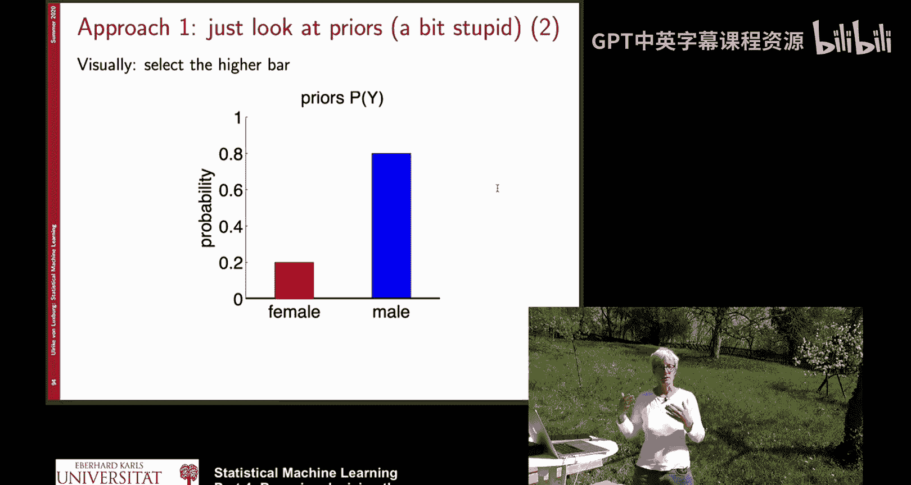

## 几种不同的决策方法

接下来，我将带你了解几种不同的方法，它们看起来都或多或少有道理，但可能导致不同的结果。

### 方法一：朴素先验法

第一种非常朴素的方法是，只查看两个类别的先验分布。例如，如果我们所在的计算机科学课堂中90%的人是男性，那么你可能根本不需要看身高测量值，直接预测“男性”即可。

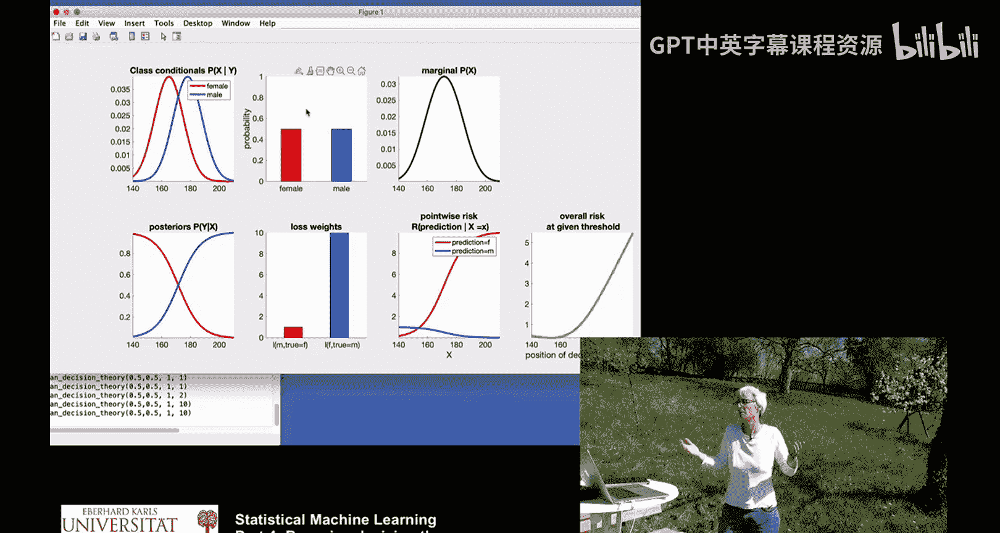

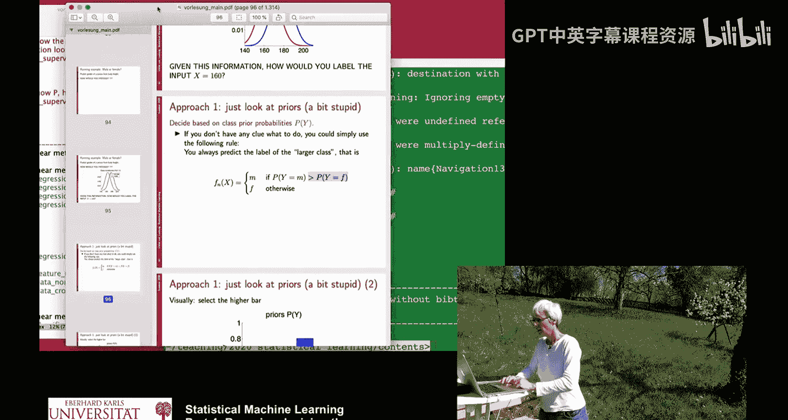

形式化地，这意味着根据类别的先验概率进行预测。你的分类规则 `n(x)` 如下：

*   如果男性在底层人群中的概率 `P(Y=男)` 大于女性的概率 `P(Y=女)`，则预测为男性。
*   反之，则预测为女性。

这种方法完全不看测量值 `X`。这听起来很愚蠢，但在某些情况下，如果只追求分类准确率，这可能不是最差的做法。例如，在垃圾邮件检测中，如果99%的邮件都是垃圾邮件，那么对所有邮件都预测为垃圾邮件，准确率已经达到99%。不过，我们通常更关心那1%的非垃圾邮件。

在视觉上，这意味着我们绘制男性和女性先验概率的条形图，然后选择较高的那个条形所代表的类别。

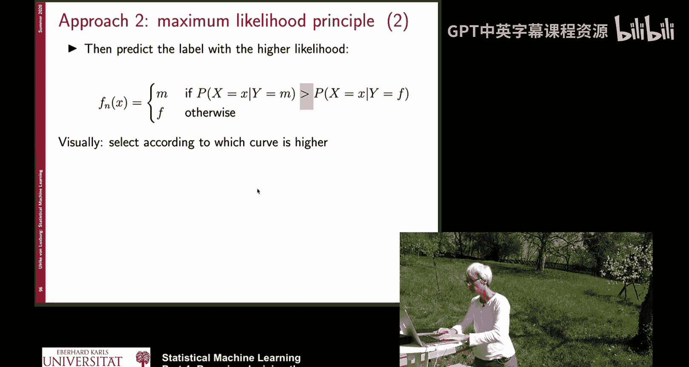

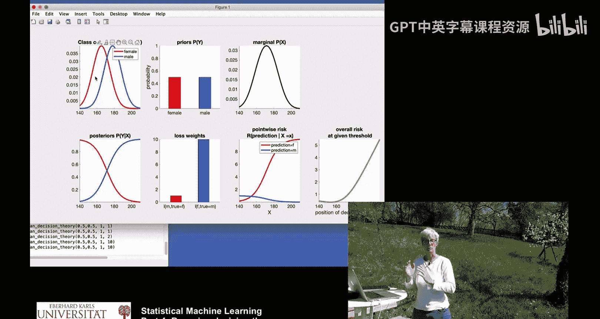

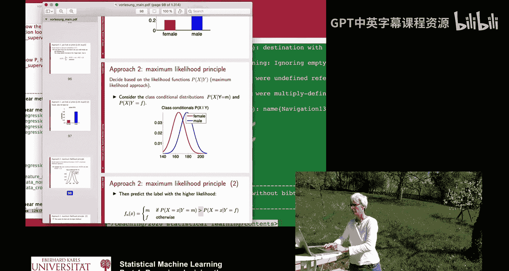

### 方法二：最大似然法

第二种方法更有意义，统计学家称之为最大似然法。

其思想很简单：我们查看之前提到的类条件分布图。对于给定的输入（例如身高1.60米），我们看哪个类别的分布在此身高值上具有更高的概率密度。

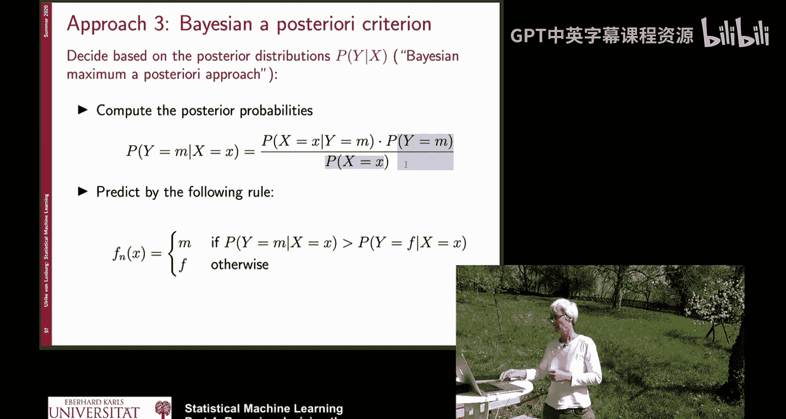

形式化地，最大似然原则的规则如下：

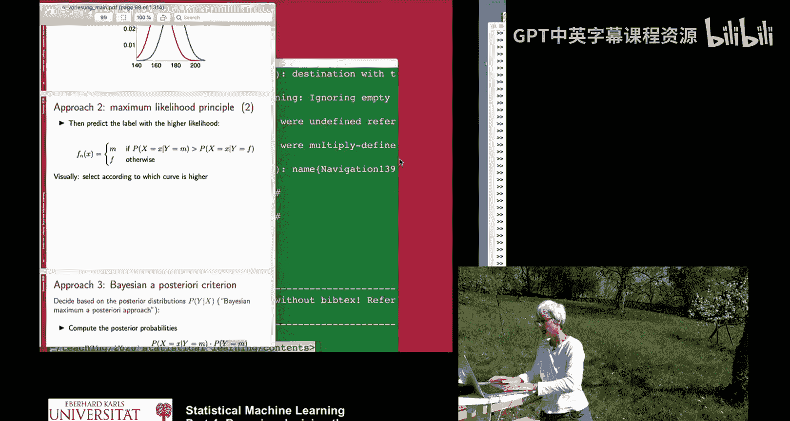

我们比较在给定测量值 `x`（如1.60米）的条件下，假设此人为男性或女性时，得到该测量值的概率：

*   如果 `P(X=1.60 | Y=男) > P(X=1.60 | Y=女)`，则预测为男性。
*   反之，则预测为女性。

这感觉像是“反过来的”推理：我们假设知道类别，然后看得到此数据的可能性。在许多情况下，我们更希望进行“正向”推理：给定数据，看属于某个类别的概率。这引出了下一种方法。

### 方法三：贝叶斯后验法

第三种方法是贝叶斯方法，即后验准则。它进行的就是我们刚才提到的“正向”推理。

我们想知道：**给定**我们测量到一个人身高1.60米，此人是男性的可能性更高，还是女性的可能性更高？然后我们使用这个标准来决定。

形式化地，我们想比较后验概率 `P(Y=男 | X=1.60)` 和 `P(Y=女 | X=1.60)`。

为了计算这个量，我们需要使用贝叶斯公式。贝叶斯公式可以帮助我们转换条件概率中的参数：

`P(Y=男 | X=1.60) = [P(X=1.60 | Y=男) * P(Y=男)] / P(X=1.60)`

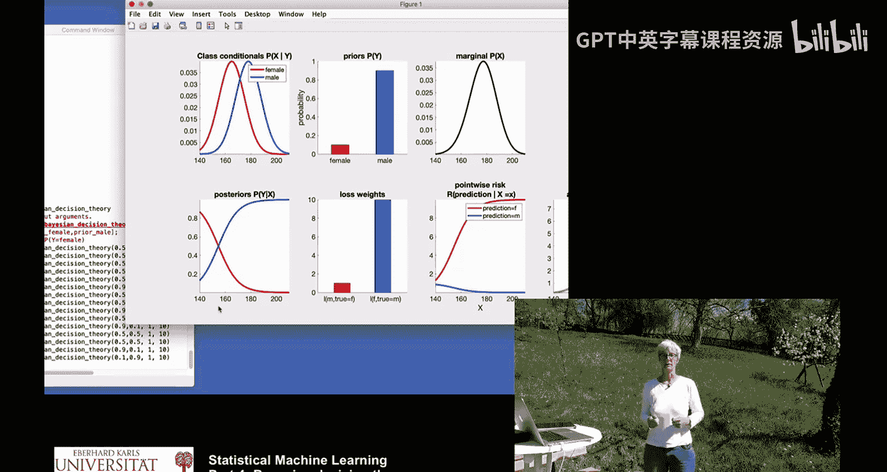

其中 `P(X=1.60)` 是边际概率，可以通过全概率公式计算：`P(X=1.60) = P(X=1.60|Y=男)P(Y=男) + P(X=1.60|Y=女)P(Y=女)`。

**贝叶斯决策规则**是：
*   如果 `P(Y=男 | X=x) > P(Y=女 | X=x)`，则预测为男性。
*   反之，则预测为女性。

**与最大似然法的关键区别**：贝叶斯方法考虑了类别的**先验概率**（即“基础率”），而最大似然法忽略了它。当先验分布均匀（即男女人数相等）时，两种方法给出相同结果。但当先验分布不平衡时，结果会不同。

例如，如果房间里几乎全是女性（先验概率 `P(Y=女)` 很高），那么即使一个身高1.70米的人（在均匀先验下难以判断），在贝叶斯方法中也更可能被预测为女性，因为房间里女性基数太大。只有当身高非常高（如1.90米）时，才可能预测为男性。决策边界（后验概率相等时的身高值）会向右移动。

## 引入损失函数

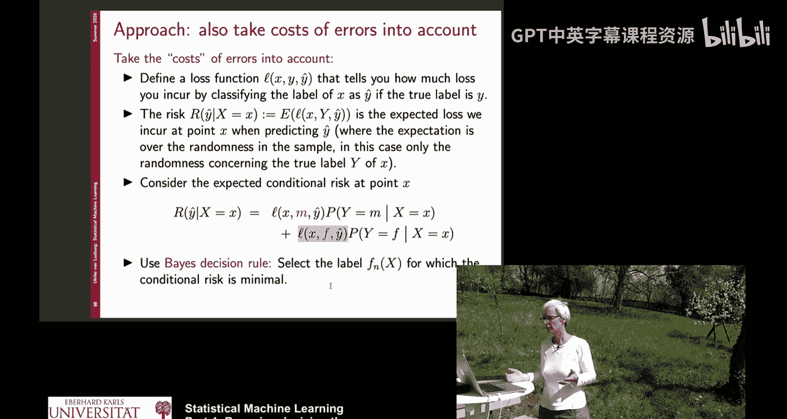

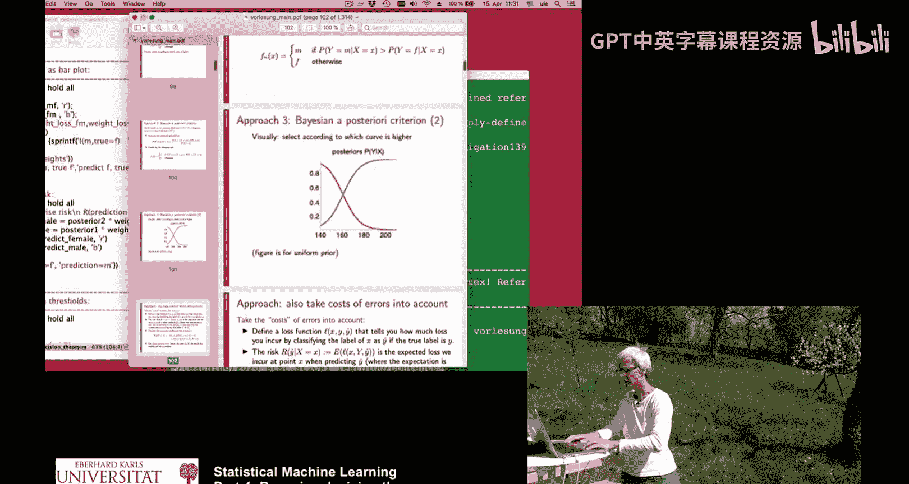

在机器学习中，我们通常会定义一个损失函数，用以惩罚算法犯下的不同类型错误。如果我们知道这个损失函数，就应该设计能够考虑它的算法，使其能特别关注那些犯错代价高昂的区域。

以下是形式化的工作方式：

我们定义一个损失函数 `L(x, y, ŷ)`，其中 `x` 是输入数据（身高），`y` 是真实标签，`ŷ` 是预测标签。

我们考虑**条件风险**。假设我们想为测量到身高 `x`（例如1.60米）的人做预测。在给定输入为 `x` 的条件下，预测 `ŷ` 的风险是期望损失：

`R(ŷ | X=x) = E[L(x, Y, ŷ) | X=x]`

这里，`Y` 是真实标签的随机变量，我们对其取期望。`ŷ` 是我们看到确定值 `x` 后做出的确定性预测。

这个条件风险可以分解为：

`R(ŷ | X=x) = P(Y=男 | X=x) * L(x, 男, ŷ) + P(Y=女 | X=x) * L(x, 女, ŷ)`

**贝叶斯决策规则**扩展为：选择那个能使条件风险最小化的标签 `ŷ` 作为预测。

### 损失函数的影响

损失函数会显著影响决策边界。例如：
*   **对称损失**：将男性误判为女性，和将女性误判为男性的代价相同。
*   **非对称损失**：例如，将女性误判为男性的代价很高（损失值大），而将男性误判为女性的代价较低。在这种情况下，算法会变得更“保守”，更倾向于预测代价低的类别（此例中为“女性”），除非有非常强的证据（如身高极高）支持另一个类别。

损失函数与先验概率会**相互作用**。例如，如果女性先验概率很高，**并且**将女性误判为男性的损失很大，那么算法会极度倾向于预测“女性”，决策边界会大幅右移。反之，如果男性先验概率高，但误判女性的损失大，决策边界则会左移。

## 总结

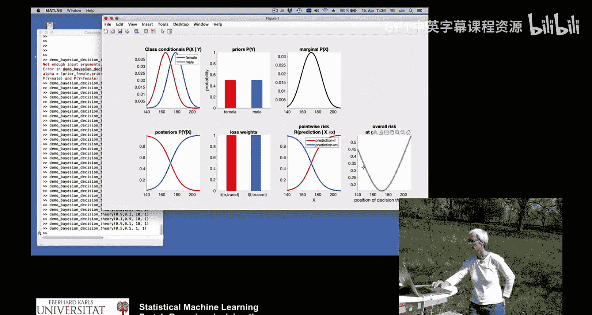

本节课中，我们一起学习了贝叶斯决策理论的核心思想。我们从最简单的仅依赖先验的方法开始，逐步引入了更合理的最大似然法和贝叶斯后验法，并指出了后者通过贝叶斯公式纳入先验知识的重要性。最后，我们探讨了如何将实际问题中的损失函数整合到决策框架中，通过最小化条件风险来实现最优决策。贝叶斯决策理论为我们提供了在已知完整概率信息和特定代价下，进行最优分类的理论基础。