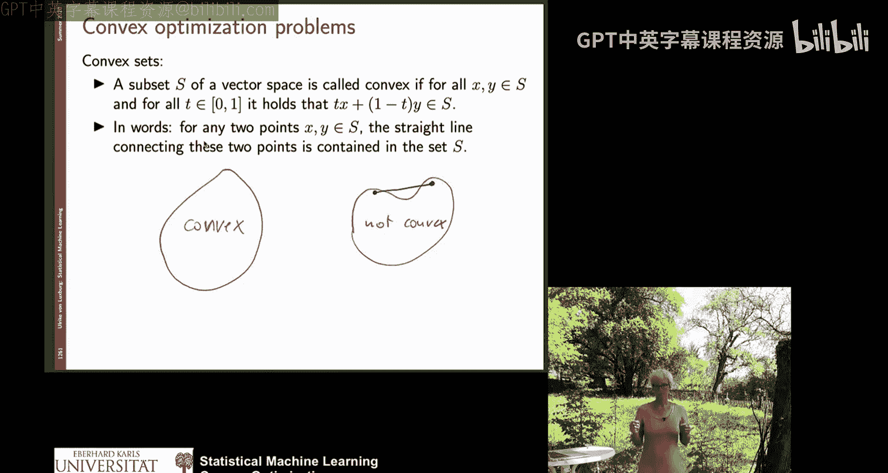
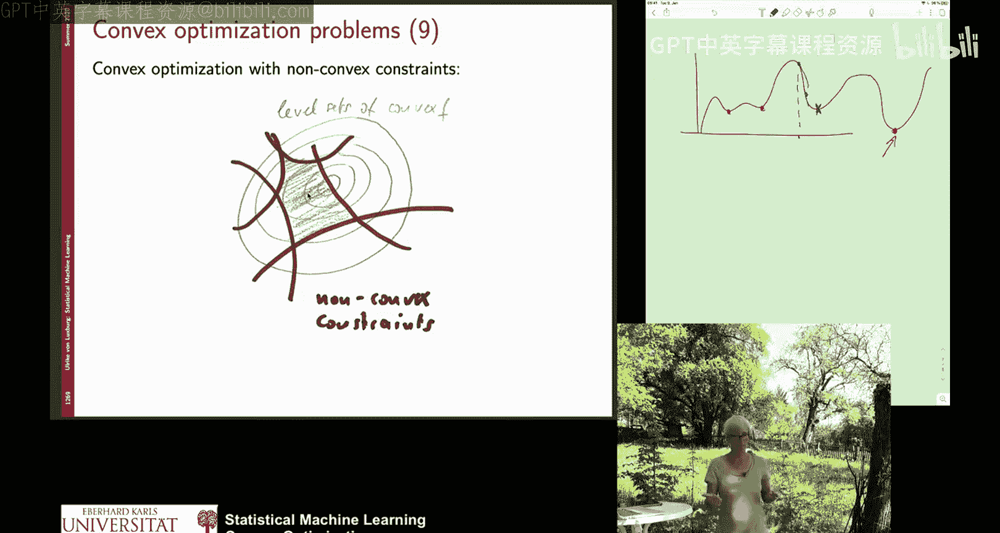
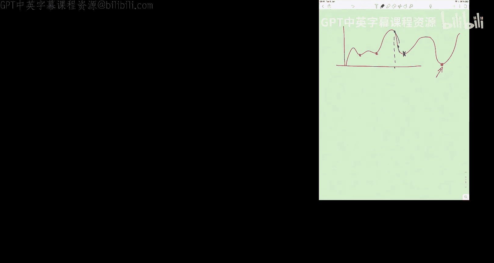

# 概率和统计机器学习：08：什么是凸优化问题

在本节课程中，我们将学习凸优化问题的定义及其重要性。凸优化是机器学习中一个非常强大的工具，因为它能保证我们找到的解是全局最优解，而非局部最优解。我们将从凸集和凸函数的基本概念开始，逐步构建出凸优化问题的完整定义。

## 凸集的定义

在讨论凸优化问题之前，我们首先需要理解什么是凸集。直观上，凸集是一个“向外凸出”且内部没有“凹陷”的集合。

以下是凸集的一个关键特性：对于集合中的任意两点，连接这两点的线段上的所有点也必须包含在该集合内。

我们可以用数学公式来精确描述凸集。首先，我们需要一个向量空间结构，因为只有在向量空间中，我们才能谈论连接两点的线段。设 **S** 是向量空间的一个子集，如果对于 **S** 中的任意两点 **x** 和 **y**，以及任意参数 **t ∈ [0, 1]**，都有：

**t * x + (1 - t) * y ∈ S**

那么集合 **S** 就是凸的。参数 **t** 控制着从点 **y** 到点 **x** 的移动。当 **t=0** 时，我们位于点 **y**；当 **t=1** 时，我们位于点 **x**。这个定义要求线段上的所有点都属于集合 **S**。

## 凸函数的定义

理解了凸集之后，我们来看凸函数。直观上，一个函数是凸的，意味着其图像上任意两点间的连线位于图像的上方。

更正式地，一个函数 **F** 是凸的，需要满足两个条件：
1.  函数的定义域 **D** 必须是一个凸集。
2.  对于定义域 **D** 中的任意两点 **x** 和 **y**，以及任意参数 **t ∈ [0, 1]**，都有：

**F(t * x + (1 - t) * y) ≤ t * F(x) + (1 - t) * F(y)**

这个不等式的左边是函数在连接 **x** 和 **y** 的线段上某点 **Z** 的值。右边是函数在 **x** 和 **y** 两点值的线性插值。凸性要求函数在线段上任意点的值，都不高于该点对应的线性插值。

一个简单的判定方法是：对于二阶可导的一元函数，如果其二阶导数非负（**F''(x) ≥ 0**），则该函数是凸的。对于多元函数，如果其海森矩阵是半正定的，则该函数是凸的。

与凸函数相对的是凹函数，其定义只需将上述不等式中的“≤”改为“≥”。也存在既非凸也非凹的函数。

## 下水平集

凸函数有一个非常重要的性质：它的下水平集总是凸集。

下水平集是指，对于给定函数 **G(x)** 和常数 **a**，满足 **G(x) ≤ a** 的所有点 **x** 构成的集合。如果函数 **G** 是凸的，那么对于任意常数 **a**，其下水平集都是凸集。

这个性质是单向的。存在一些函数，其所有下水平集都是凸的，但函数本身并不是凸函数。

## 凸优化问题的定义

现在，我们具备了定义凸优化问题所需的所有要素。

一个标准的优化问题形式如下：
*   **最小化** 目标函数 **F(x)**
*   **满足约束条件** **G_i(x) ≤ 0**，其中 **i = 1, 2, ..., K**

这里，**F(x)** 是我们希望最小化的目标函数，**G_i(x)** 是约束函数。

如果满足以下两个条件，则该优化问题是一个凸优化问题：
1.  目标函数 **F** 是凸函数。
2.  所有约束函数 **G_i** 都是凸函数（这意味着每个约束 **G_i(x) ≤ 0** 定义了一个凸的下水平集）。

关于等式约束 **H(x) = 0**，可以将其转化为两个不等式约束：**H(x) ≤ 0** 和 **-H(x) ≤ 0**。因此，上述形式具有普遍性。

在优化问题中，满足所有约束条件的点集称为**可行域**。对于凸优化问题，由于其目标函数和所有约束都是凸的，可行域本身也是一个凸集。

## 为什么凸优化如此重要？

凸优化问题之所以在机器学习等领域备受青睐，是因为它拥有一个极其理想的特性：**任何局部最小值都是全局最小值**。

对于非凸优化问题，目标函数可能像崎岖的山地，存在许多“山谷”（局部最小值）。使用梯度下降法等迭代算法时，算法可能陷入某个局部山谷而无法找到最低的那个“山谷”（全局最小值）。

然而，对于凸优化问题，目标函数的形状像一个“碗”。无论从哪个点开始执行梯度下降，最终都会到达碗底，即唯一的全局最优点。这保证了我们找到的解是问题的最佳可能解。

此外，凸优化问题的凸可行域结构也避免了算法在边界处陷入困境而无法探索更好解的情况。

## 总结

本节课我们一起学习了凸优化问题的核心概念：
1.  **凸集**：集合中任意两点连线上的所有点仍属于该集合。
2.  **凸函数**：函数图像上任意两点连线位于图像上方，其定义域必须是凸集。
3.  **下水平集**：凸函数的下水平集是凸集。
4.  **凸优化问题**：目标函数和所有不等式约束函数均为凸函数的优化问题。
5.  **核心优势**：凸优化问题的任何局部最优解即是全局最优解，这为寻找可靠的最优解提供了根本保证。

理解这些基础是后续学习如何求解凸优化问题（例如使用拉格朗日乘子法）的关键。