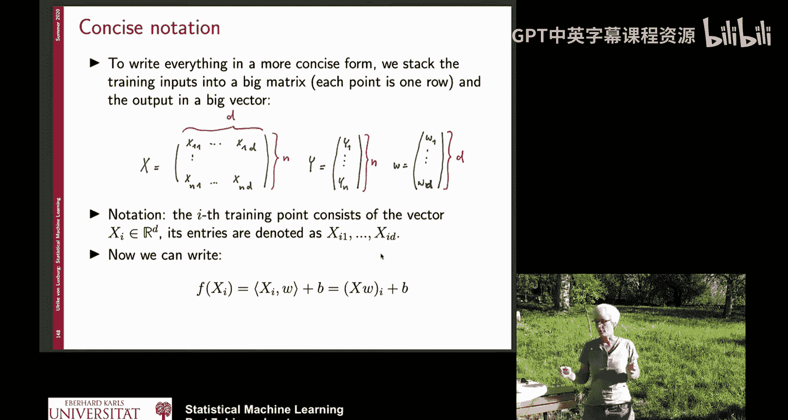
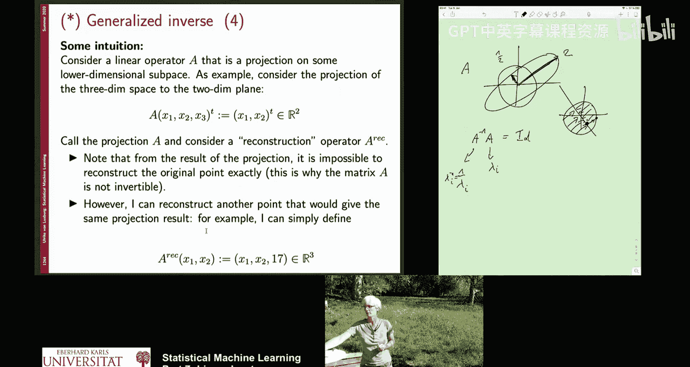
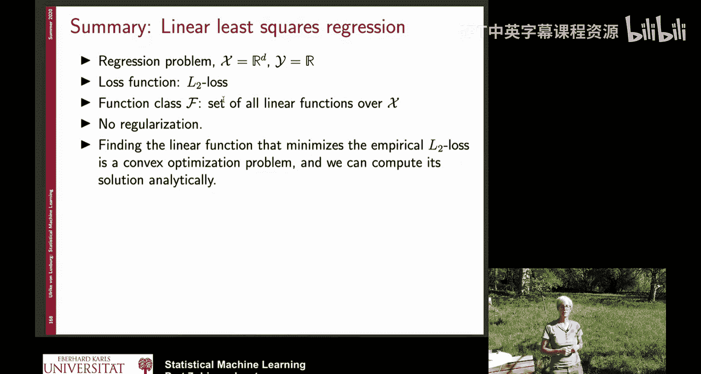

# 图宾根大学《概率和统计机器学习》：09：线性最小二乘法

在本节课中，我们将要学习线性回归，并从最经典的算法——线性最小二乘回归开始。我们将介绍其基本设置、数学推导以及在不同情况下的解析解。

## 回归问题设置

上一节我们介绍了课程主题，本节中我们来看看线性回归的具体设置。在回归问题中，我们有一些训练数据，称为 `(X_i, Y_i)`。

*   `X_i` 来自输入空间 `\mathcal{X}`。在本课程中，我们首先假设 `\mathcal{X}` 是一个欧几里得空间，即 `\mathbb{R}^D`。`D` 是空间的维度。
*   `Y_i` 来自输出空间 `\mathcal{Y}`。在回归问题中，`\mathcal{Y}` 就是实数集 `\mathbb{R}`。

我们的目标是：给定这些训练数据，找到一个能最好地拟合这些数据的函数。在线性回归中，我们考虑的函数是线性函数。

## 线性函数与损失函数

上一节我们定义了回归问题，本节中我们来看看要寻找的函数形式以及如何衡量其好坏。

线性函数的最简单形式是：
`f(x) = \sum_{i=1}^{D} w_i x^{(i)} + b`
其中：
*   `x` 是 `\mathbb{R}^D` 空间中的一个点，其坐标为 `(x^{(1)}, ..., x^{(D)})`。
*   `w_i` 是权重，每个坐标对应一个。
*   `b` 是偏移参数，有时也称为截距或阈值参数。

接下来，我们需要定义一个损失函数。在当前设置下，我们使用最小二乘损失函数，有时也因其数学背景称为 L2 损失。

线性最小二乘问题可以形式化地表述为：找到参数 `w_1, ..., w_D`（在 `\mathbb{R}^D` 中）和偏移参数 `b`，使得该线性函数 `f` 在训练数据上的经验最小二乘误差最小。

经验最小二乘误差定义为：
`\frac{1}{n} \sum_{i=1}^{n} (y_i - f(x_i))^2`
其中 `1/n` 是归一化因子，有时可以省略。

## 一个直观的例子

为了更具体地理解，我们来看一个例子。假设我们想预测一个人的鞋码，我们收集了每个人的多项测量值。

*   输入 `x` 可能包括：身高、体重、收入、年龄等。每个人由一个 `D` 维向量表示。
*   输出 `y` 是鞋码。

一个可能的线性预测函数（虚构的）可能是：
`鞋码 = \frac{2}{10} * 身高 + 0 * 体重 + 0 * 收入 + 0 * 年龄 + 1`
这个例子中，只有身高被用作主要预测因子，其他特征的权重为 0，`+1` 是偏移量。

## 矩阵表示法

上一节我们通过例子理解了问题，本节中我们引入更简洁的矩阵表示法，以便于推导和实现。

我们定义以下矩阵和向量：

*   **数据矩阵 X**：一个 `n \times D` 的矩阵，其中每一行是一个训练样本（一个人），每一列是一个特征（一项测量）。
    `X \in \mathbb{R}^{n \times D}`
*   **输出向量 y**：一个 `n` 维向量，包含所有训练样本的真实输出（鞋码）。
    `y \in \mathbb{R}^{n}`
*   **权重向量 w**：一个 `D` 维向量，包含每个特征的权重。
    `w \in \mathbb{R}^{D}`

使用这种表示法，线性函数 `f(x) = w \cdot x + b` 可以写为 `f(x) = x^T w + b`，其中 `x^T w` 是向量内积。

最小二乘问题现在可以写为：找到 `w` 和 `b`，最小化
`\sum_{i=1}^{n} (y_i - (x_i^T w + b))^2`

## 消除偏移参数 b

上一节我们得到了矩阵形式的表达式，但其中包含偏移参数 `b`，这使得问题不是纯粹的线性问题。本节中我们通过一个技巧消除它。

我们扩展数据矩阵 `X` 和权重向量 `w`：
*   定义新矩阵 `\tilde{X} = [X, \mathbf{1}]`，即在 `X` 的右侧添加一列全为 1 的列。`\tilde{X} \in \mathbb{R}^{n \times (D+1)}`。
*   定义新向量 `\tilde{w} = [w; b]`，即将偏移量 `b` 作为权重向量的最后一个元素。`\tilde{w} \in \mathbb{R}^{D+1}`。

现在，预测值可以写为：
`\tilde{X} \tilde{w} = X w + b \mathbf{1}`
其中 `\mathbf{1}` 是全1向量。这样，原问题转化为了一个没有偏移参数的纯线性问题：最小化
`\frac{1}{n} \| y - \tilde{X} \tilde{w} \|^2`
这里 `\| \cdot \|` 表示向量的欧几里得范数。

在后续讨论中，我们将默认处理这种无偏移的形式，并简记为最小化 `\| y - X w \|^2`（其中 `X` 和 `w` 已包含扩展后的维度）。

## 问题求解：满秩情况

上一节我们将问题转化为标准的线性最小二乘形式。本节中我们来看看如何求解这个优化问题。这是一个凸优化问题，幸运的是，我们可以得到解析解。

**定理 1（满秩情况）**：假设数据矩阵 `X` 的秩为 `D`（即满秩）。那么线性最小二乘问题
`\min_{w} \| y - X w \|^2`
的解由下式给出：
`w = (X^T X)^{-1} X^T y`

**维数检查**：`X` 是 `n \times D`，`X^T` 是 `D \times n`，所以 `X^T X` 是 `D \times D` 的方阵。`X^T y` 是 `D \times 1` 的向量。最终结果 `w` 是 `D \times 1` 的向量，符合预期。

**证明思路（优雅方法，使用矩阵微积分）**：
1.  定义目标函数 `L(w) = \frac{1}{2} \| y - X w \|^2`（添加 `1/2` 是为了求导后形式更简洁）。
2.  对 `L(w)` 关于 `w` 求梯度，并令其为零：
    `\nabla_w L(w) = -X^T (y - X w) = 0`
3.  整理得到正规方程：
    `X^T X w = X^T y`
4.  由于 `X` 满秩，`X^T X` 可逆，因此解为：
    `w = (X^T X)^{-1} X^T y`

**证明思路（详细方法，手动求导）**：
也可以将目标函数 `L(w)` 完全展开为分量求和的形式，然后对每个权重 `w_k` 求偏导数并令其为零，最终会得到与上述正规方程相同的方程组。

**验证是最小值**：
需要检查海森矩阵（二阶导数矩阵）`\nabla^2_w L(w) = X^T X` 是正定的。由于 `X` 满秩，`X^T X` 是正定矩阵，所有特征值大于零，因此找到的临界点确实是全局最小值。

## 广义逆与秩亏情况

上一节我们讨论了数据矩阵满秩的理想情况。但在实际应用中，矩阵可能不满秩。本节中我们引入广义逆来处理这种情况。

首先，回顾对称矩阵的谱分解：对于对称矩阵 `A \in \mathbb{R}^{D \times D}`，可以分解为
`A = \sum_{i=1}^{D} \lambda_i v_i v_i^T`
其中 `\lambda_i` 是特征值，`v_i` 是对应的单位特征向量。

如果 `A` 可逆（即所有 `\lambda_i \neq 0`），其逆为
`A^{-1} = \sum_{i=1}^{D} \frac{1}{\lambda_i} v_i v_i^T`

**广义逆（Moore-Penrose 伪逆）** 的定义是，对于可能不满秩的对称矩阵 `A`，我们只对非零特征值进行求逆操作：
`A^+ = \sum_{i: \lambda_i \neq 0} \frac{1}{\lambda_i} v_i v_i^T`
符号 `A^+` 常用来表示广义逆。它具有一些类似逆矩阵的性质，例如 `A A^+ A = A` 和 `A^+ A A^+ = A^+`。

## 问题求解：秩亏情况

现在，我们可以给出线性最小二乘在数据矩阵不满秩时的解。

**定理 2（秩亏情况）**：假设数据矩阵 `X` 的秩 `r < D`。
1.  线性最小二乘问题的一个解由下式给出：
    `w = (X^T X)^+ X^T y`
    其中 `(X^T X)^+` 是 `X^T X` 的广义逆。
2.  解不是唯一的。如果 `w` 是一个解，那么对于任何满足 `X v = 0` 的向量 `v`，`w + v` 也是一个解。
3.  然而，所有这些解在训练数据上给出相同的预测值，即对于任何两个解 `w_1` 和 `w_2`，有 `X w_1 = X w_2`。

**证明概要**：
1.  求导后得到的正规方程依然是 `X^T X w = X^T y`。
2.  可以验证，`w = (X^T X)^+ X^T y` 满足这个方程（利用广义逆的性质）。
3.  由于 `X` 不满秩，存在非零向量 `v` 使得 `X v = 0`。那么 `w + v` 也满足正规方程，因为 `X^T X (w+v) = X^T X w + X^T X v = X^T X w + 0 = X^T y`。
4.  对于任意两个解 `w_1` 和 `w_2 = w_1 + v`，有 `X w_2 = X (w_1 + v) = X w_1 + X v = X w_1`。

虽然解不唯一，但在训练集上的拟合效果相同。至于选择哪个解，以及如何在测试集上获得更好、更稳定的性能，我们将在后续关于正则化的课程中讨论。

## 数据点数量 n 与维度 D 的关系

最后，我们讨论一个在机器学习中非常重要的问题：训练样本数量 `n` 和特征维度 `D` 之间的关系。

考虑两种极端情况：
1.  **`D << n`（低维情况）**：例如，5个特征，5000万个样本。这是相对“无害”的情况。我们不太容易过拟合，因为数据量远大于模型复杂度（参数数量）。主要风险可能是欠拟合。
2.  **`D >> n`（高维情况）**：例如，在生物信息学中，20个病人（样本），但测量了10000个基因表达水平（特征）。这是极具挑战性的情况。线性函数空间在高维下已经非常庞大，极易发生过拟合。这是一个活跃的研究领域，称为高维统计学。

线性最小二乘问题总是有解的。解的（不）唯一性取决于 `X^T X` 是否可逆（即 `X` 是否满秩），而这与 `n` 和 `D` 的相对大小有关，但更直接地取决于 `X` 的列向量是否线性独立。

## 总结

本节课中我们一起学习了线性最小二乘回归。

*   **问题**：给定 `\mathbb{R}^D` 中的输入和 `\mathbb{R}` 中的输出，用线性函数拟合数据，并使用最小二乘损失。
*   **技巧**：通过扩展矩阵，将偏移项融入权重向量，将问题转化为无偏移的纯线性最小二乘问题。
*   **求解**：
    *   这是一个凸优化问题，存在解析解。
    *   若数据矩阵 `X` 满秩，唯一解为 `w = (X^T X)^{-1} X^T y`。
    *   若 `X` 不满秩，解不唯一。一个特解可由广义逆求得：`w = (X^T X)^+ X^T y`。所有解在训练集上预测相同。
*   **维度考量**：特征维度 `D` 与样本数量 `n` 的关系至关重要。`D >> n` 时需格外警惕过拟合。

这是最传统的回归方法，其解析解形式优美。然而，面对高维、共线或存在噪声的数据时，我们需要引入正则化等工具来改进模型，这将是后续课程的内容。