# 概率和统计机器学习：10：特征表示 🧩

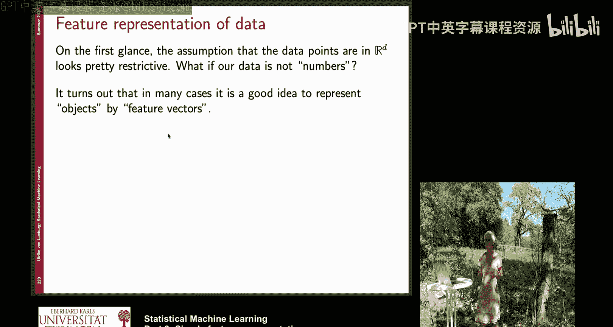

在本节课中，我们将要学习如何将非向量空间中的抽象对象（如文本、分子、图像）表示为欧几里得空间中的向量。这是机器学习中处理多样化数据的关键步骤。我们将探讨几种常见的特征表示方法，并了解如何对特征进行标准化，以及如何通过特征映射引入非线性。

## 从抽象对象到向量表示

在上一讲中，我们主要讨论了输入空间为 **R^D** 的回归问题。然而，许多自然对象（如文本、分子、图像）本身并不具备向量空间结构。本节中我们来看看，为何将数据假设为存在于 **R^D** 中可能并不像看起来那么具有限制性。

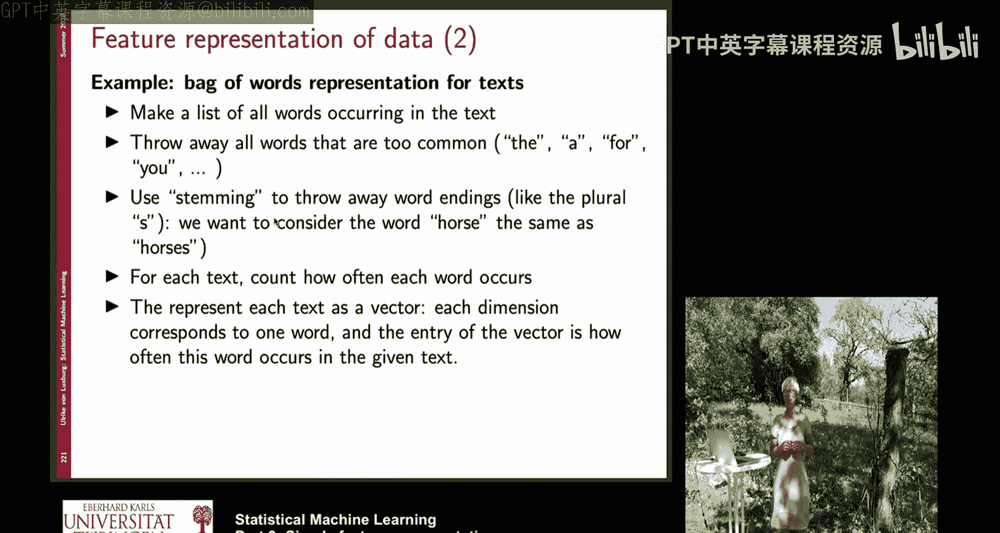

通过特征映射，我们可以将这些抽象对象转化为向量。这个过程通常涉及以下几个步骤：
1.  识别或设计一组能够描述对象特性的“特征”。
2.  对每个对象，计算这些特征的值。
3.  将这些值组合成一个 **D** 维向量。

以下是几个具体的例子：

### 示例一：文本的词袋表示 📄

处理文本时，一种简单而有效的方法是“词袋”表示法。

*   **步骤**：首先，收集所有文本中出现过的词汇，形成一个词汇表。接着，对每个文本，忽略不具信息量的词（如冠词、代词），并进行词干提取（例如将“trees”还原为“tree”）。最后，用向量表示文本，向量的每个维度对应词汇表中的一个词，其值为该词在文本中出现的次数（或简单的0/1表示是否存在）。
*   **向量化**：一个文本最终被表示为一个高维稀疏向量 **x** ∈ **R^V**，其中 **V** 是词汇表大小，大部分元素为0。

### 示例二：生物信息学中的字符串表示 🧬

对于生物序列（如DNA或蛋白质序列），可以通过统计固定长度的子串（k-mer）出现频率来向量化。

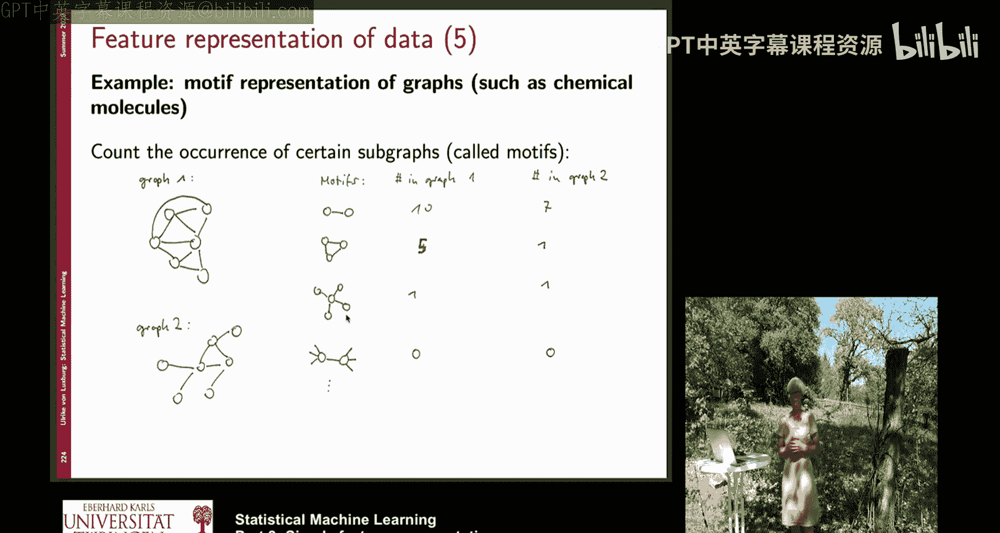

*   **步骤**：给定一个字母表（如{A, C, T, G}）和子串长度 **k**，枚举所有可能的 **k** 长子串。然后，像滑动窗口一样扫描目标序列，统计每个特定子串出现的次数。
*   **向量化**：序列被表示为一个向量，其维度为 **|字母表|^k**，每个元素的值是对应子串的计数。

### 示例三：分子的图结构表示 ⚗️

分子可以看作图（原子为节点，化学键为边）。我们可以通过统计图中特定子图（称为“模体”）的数量来向量化。

*   **步骤**：定义一组有意义的子图模体，例如：边、三角形、星形结构等。对于每个分子（图），计算这些预定义模体在其中出现的次数。
*   **向量化**：分子被表示为一个向量 **x** ∈ **R^M**，其中 **M** 是模体类型的数量，**x_i** 是第 **i** 类模体的计数。

### 示例四：用户-物品交互的表示 🛒

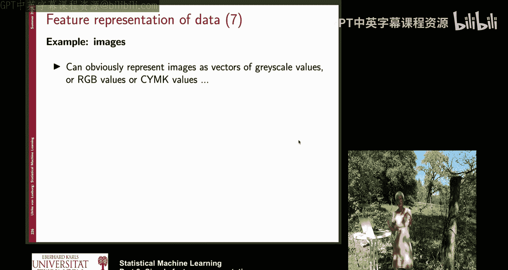

在推荐系统中，用户和物品（如书籍）可以通过他们的交互历史来表示。

*   **表示物品**：一本书可以表示为一个向量，其维度是用户数量，每个元素表示相应用户是否购买过该书（1/0）。即，用矩阵的行来表示物品。
*   **表示用户**：一个用户可以表示为一个向量，其维度是物品数量，每个元素表示该用户是否购买过相应物品。即，用矩阵的列来表示用户。

### 通用方法：特征工程 🛠️

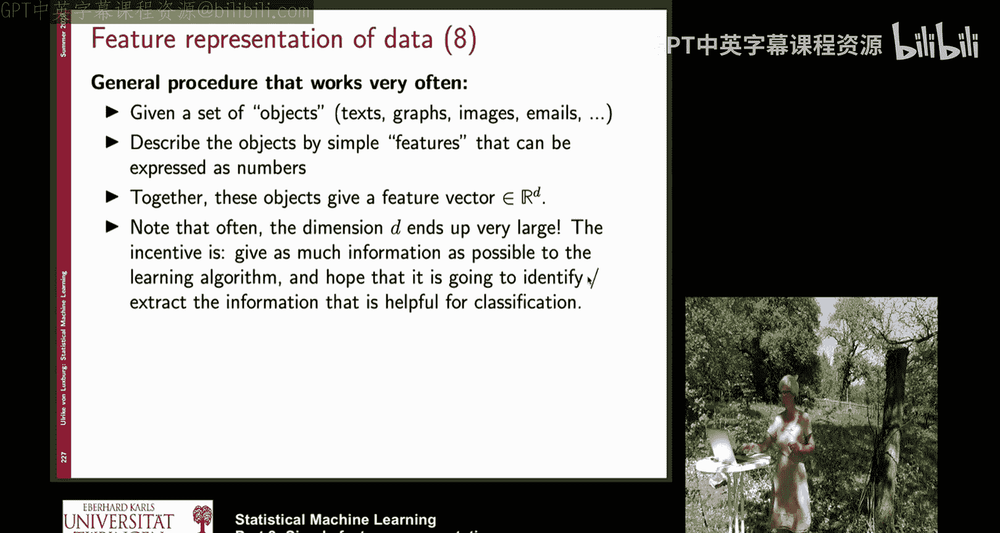

上述例子都遵循一个通用模式，即**特征映射**。我们定义一组特征函数 **{φ_1, φ_2, ..., φ_D}**，每个函数从对象中提取一个数值特征。对于一个抽象对象 **o**，其特征表示为：
**Φ(o) = [φ_1(o), φ_2(o), ..., φ_D(o)]^T ∈ R^D**

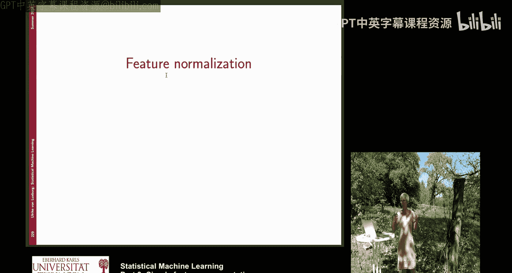

这种方法虽然简单，但在许多应用中作为基线方法非常有效。

## 特征标准化 📏

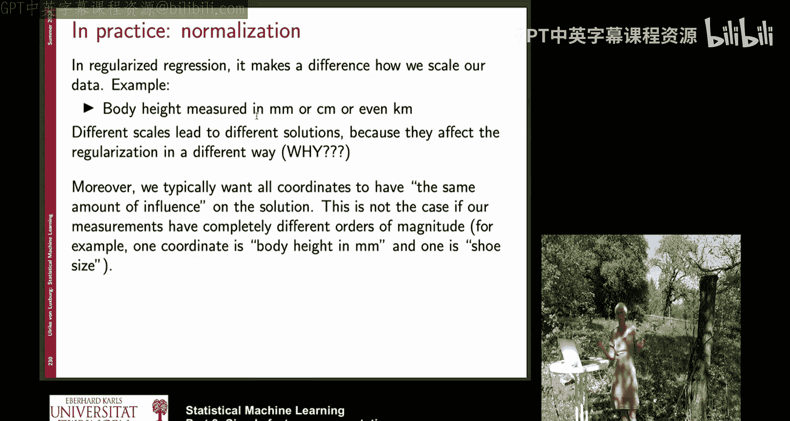

将不同对象转化为向量表示后，我们通常需要对这些特征进行标准化，以确保它们在模型中具有可比的影响力。

考虑一个预测鞋码的例子，特征可能包括年龄（0-100）、身高（1500-2000毫米）、收入（1000-5000欧元）。这些特征具有完全不同的尺度和范围。如果直接使用，在优化模型参数时，尺度大的特征（如身高以毫米计）会天然占据主导地位，影响正则化的效果，并使得参数解释变得困难。

标准化的常见步骤如下：

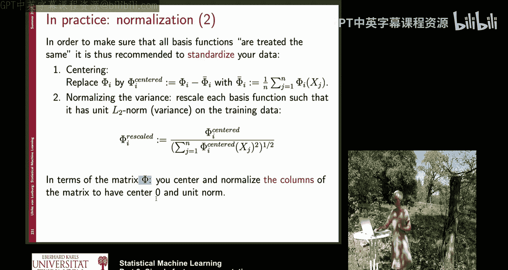

1.  **中心化**：使数据均值为零。计算每个特征维度上的均值 **μ_j = (1/N) Σ_{i=1}^N φ_j(x_i)**，然后对每个数据点进行变换：**φ‘_j(x_i) = φ_j(x_i) - μ_j**。
2.  **缩放**：使数据具有单位方差（或统一尺度）。计算每个特征维度上的标准差 **σ_j**，然后进行变换：**φ’‘_j(x_i) = φ‘_j(x_i) / σ_j**。经过这两步，每个特征维度上的数据近似服从均值为0、标准差为1的分布。

标准化后的数据有助于提高许多机器学习算法的数值稳定性和性能。

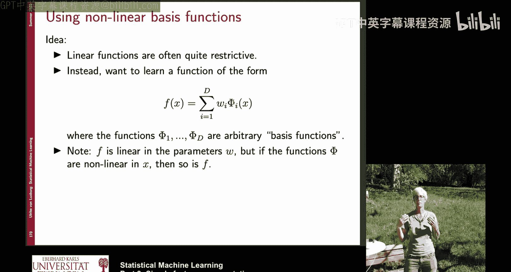

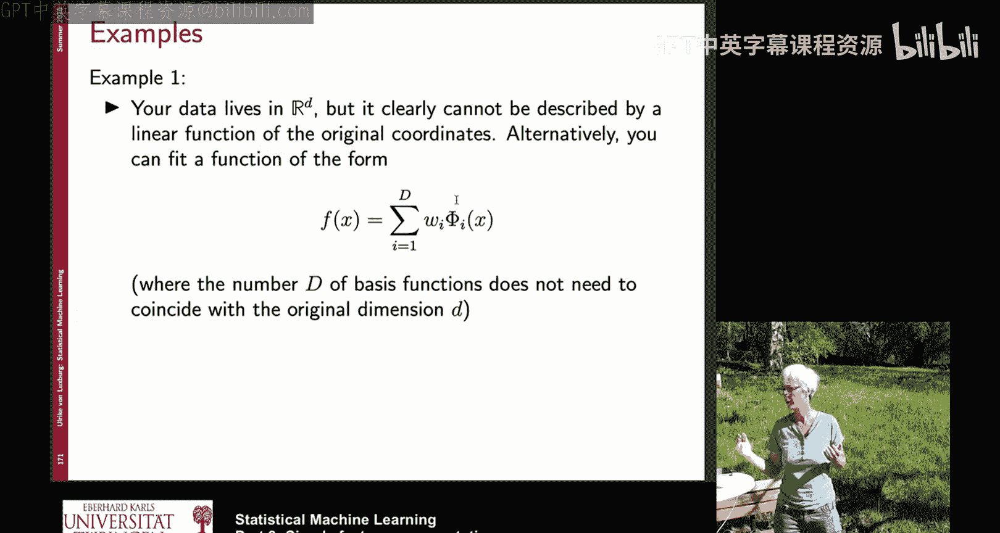

## 引入非线性：基函数扩展 🌀

线性模型有时表达能力不足。为了捕捉数据中的非线性关系，我们可以使用**基函数扩展**（或特征映射）的技巧。

其核心思想是：我们不再直接对原始特征 **x** 进行线性建模，而是先通过一个非线性变换 **Φ(x)** 将其映射到一个新的高维空间，然后在这个新空间中学习线性模型。模型形式为：
**f(x) = w^T Φ(x) = Σ_{j=1}^D w_j φ_j(x)**
请注意，函数 **f** 对于参数 **w** 是线性的，但对于输入 **x** 可能是非线性的，这取决于 **φ_j** 的选择。

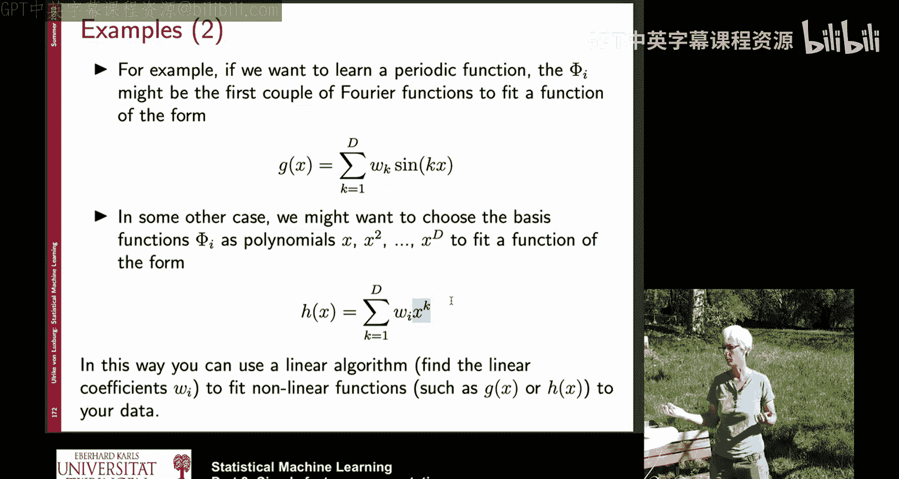

以下是几个例子：

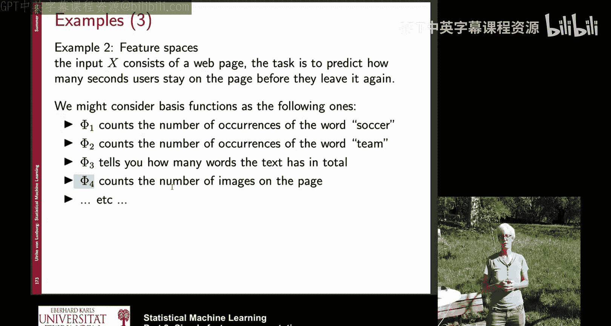

*   **拟合周期函数**：要预测一天内的温度变化，可以使用傅里叶基函数，如 **φ_k(x) = sin(kx)** 和 **cos(kx)**。
*   **拟合多项式趋势**：可以使用多项式基函数，如 **φ_k(x) = x^k**。
*   **自定义特征提取**：就像前面文本处理的例子，**φ_1(x)** 可以统计“足球”一词出现的次数，**φ_2(x)** 统计文本长度等。

### 模型求解与注意事项

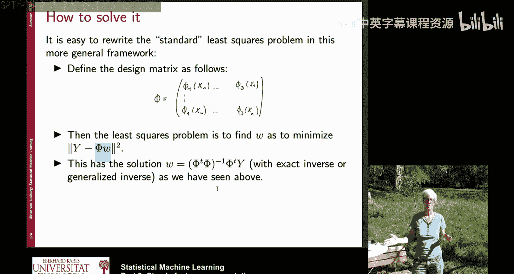

在定义了特征映射 **Φ** 之后，我们将所有训练数据 **x_i** 转换为新的特征矩阵 **Ψ**，其中第 **i** 行是 **Φ(x_i)^T**。原来的线性回归问题 **y ≈ Xw** 就变成了 **y ≈ Ψw**。求解方法（如最小二乘法）在形式上完全不变。

关于基函数扩展，有几点需要注意：

1.  **基函数的选择**：通常依赖于领域知识，在见到数据之前就预先设定。更复杂的方法是“字典学习”，即从数据中学习基函数，但这超出了本课程范围。
2.  **特征维度 D**：这是一个关键权衡。**D** 太小可能导致模型欠拟合，无法捕捉复杂模式；**D** 太大则容易导致过拟合，并且计算量增加。例如，即使对于二次多项式，如果原始维度是 **d**，则扩展后的特征维度约为 **O(d^2)**，增长很快。
3.  **线性与非线性**：最终模型在参数上是线性的，这使得许多线性模型的优化和理论工具仍然适用，同时又能拟合输入空间中的非线性关系。

## 总结 🎯

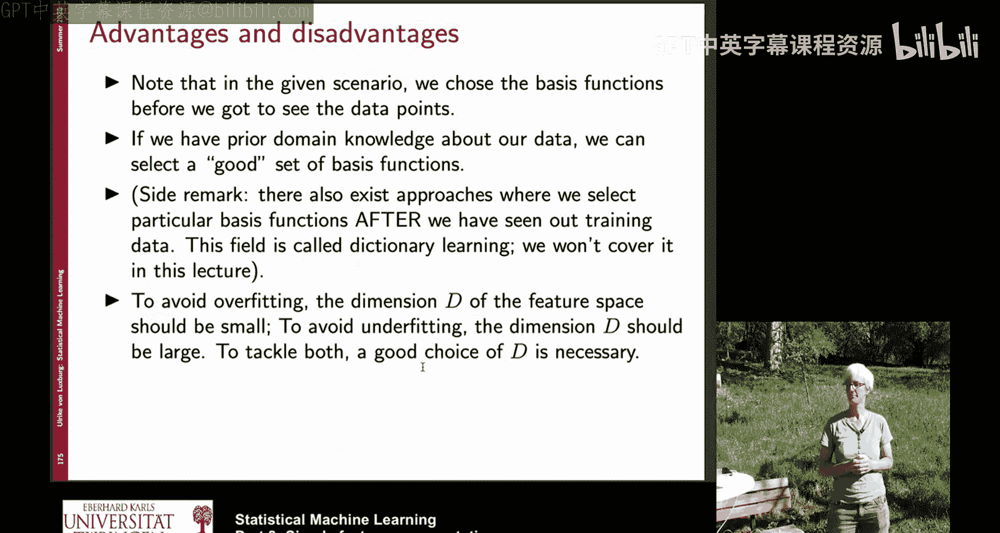

本节课中我们一起学习了机器学习中特征表示的核心思想。
*   我们了解到，通过**特征映射 Φ**，可以将文本、图、序列等抽象对象有效地表示为欧几里得空间 **R^D** 中的向量，从而能够应用广泛的机器学习算法。
*   我们探讨了词袋、子串统计、图模体计数等多种具体表示方法。
*   我们强调了**特征标准化**（中心化和缩放）的重要性，它确保了不同特征在模型中的公平性。
*   最后，我们介绍了通过**基函数扩展**来引入非线性模型的方法，即先对输入进行非线性变换，再在新空间中进行线性学习。这让我们在保持模型求解简便性的同时，大幅提升了模型的表达能力。

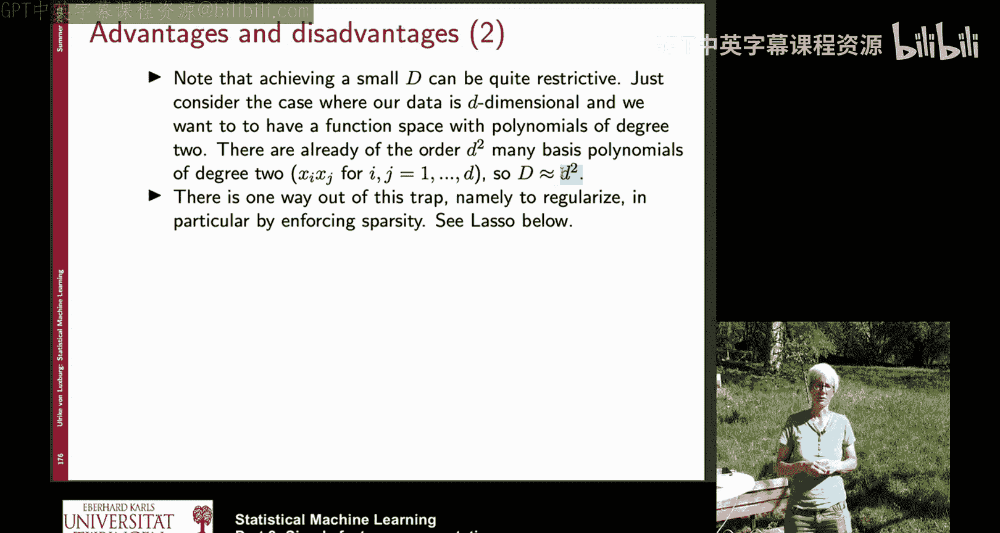

掌握这些特征工程的基本技巧，是构建有效机器学习模型的重要基础。