# 9：岭回归 📈

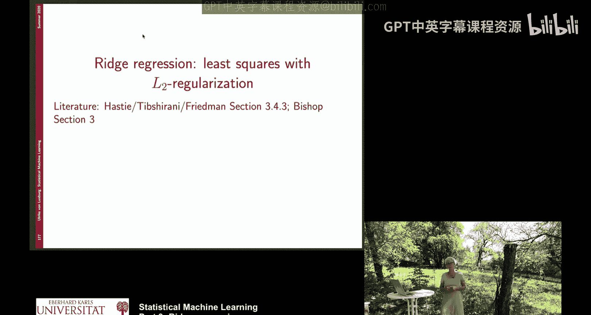

在本节课中，我们将要学习普通最小二乘法的一个正则化版本，它被称为岭回归。我们将探讨其动机、数学形式、求解方法以及正则化参数的影响。

## 从普通最小二乘法到岭回归

上一节我们介绍了普通最小二乘法。本节中我们来看看它的一个正则化变体。

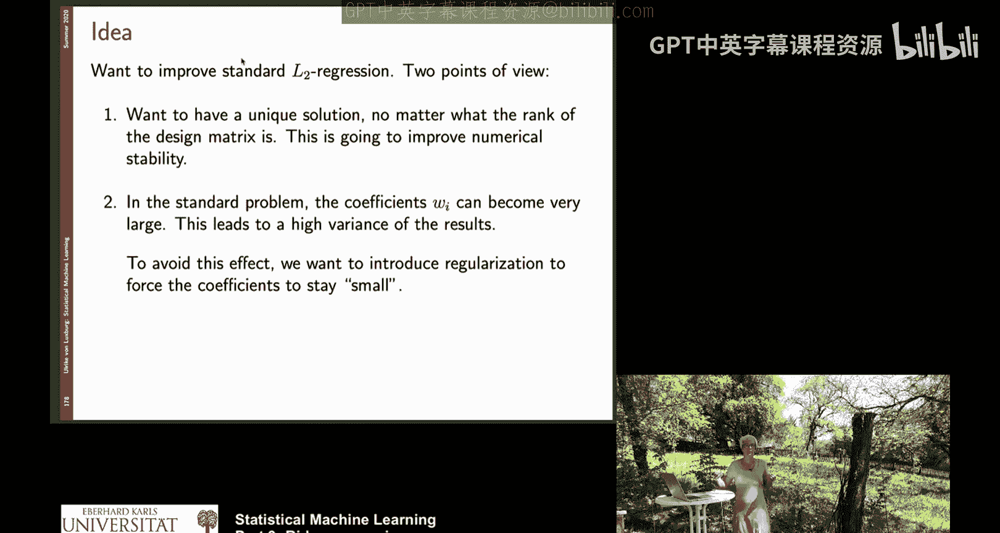

我们已经在上一讲中看到，如果不使用任何正则化，当数据空间的维度非常高时，最小二乘法可能会遇到问题。此外，标准普通最小二乘回归设置可能不是最优的，还有其他原因，我们稍后将进行讨论。

现在，我们想看看这个算法的一个变体，它被称为岭回归。

## 岭回归的动机

我们主要从两个角度来理解引入岭回归的必要性。

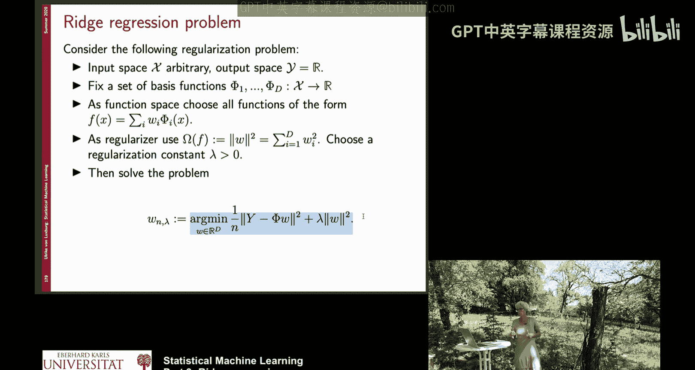

第一个角度是关于解的数值稳定性。回顾普通最小二乘法的解，特别是在数据矩阵不满秩的情况下，我们遇到了解不唯一的问题。这意味着我们的问题可能有许多解，而我们甚至不知道哪一个更好。此外，计算矩阵的伪逆时，如果特征值接近0，会导致数值上的不稳定，这是我们希望避免的。

第二个角度是关于模型参数的规模。在标准的最小二乘回归公式中，没有任何机制阻止权重参数 `w_i` 变得非常大。如果这些参数变得非常大，就会给我们的结果引入很大的方差。考虑一个函数 `f(x) = 2*x1 + 100*x2 + 200*x3`。由于 `x2` 和 `x3` 的系数很大，即使 `x2` 或 `x3` 有微小的扰动（例如数据中的噪声），也会导致函数值 `f(x)` 产生巨大的波动，从而带来高方差。为了避免这种效应，我们希望引入一种正则化，试图减小这类参数的规模。同时，这也能解决第一个关于数值稳定性的问题。

## 岭回归的数学定义

我们现在考虑以下的正则化问题，它将被称作岭回归。

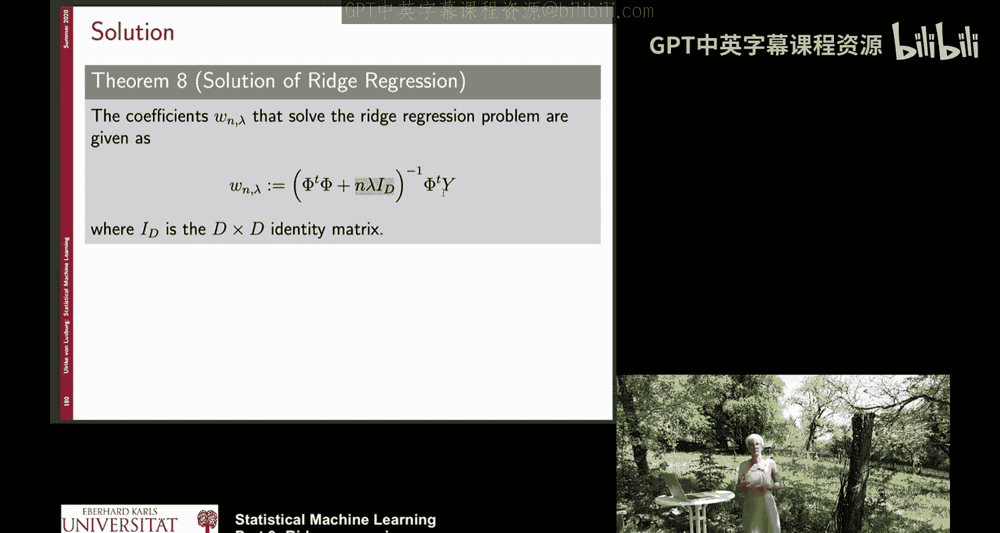

输入空间 `X` 是任意空间，输出空间是 `R`。我们固定一组基函数 `{φ_1, ..., φ_D}`，然后使用一个函数，即这些基函数的线性组合：`f(x) = Σ_{i=1}^{D} w_i * φ_i(x)`。

我们希望使用一个惩罚系数 `w_i` 大小的正则化项。我们定义一个函数 `Ω(f)`，它将作为优化问题中的正则化项。在这个情况下，`Ω(f)` 简单地等于权重向量 `w` 的欧几里得范数的平方。我们说，如果这个范数小，我们就喜欢这个函数。

以下是岭回归的优化问题：

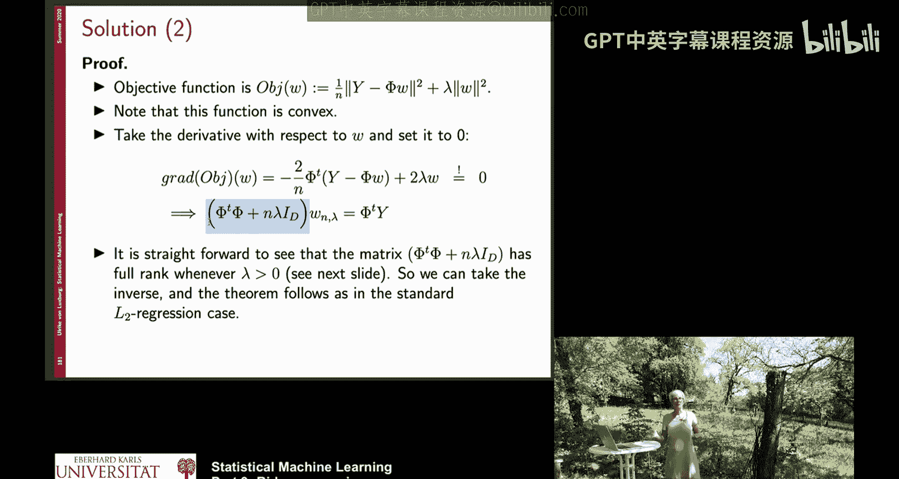

我们想要最小化经验风险（即真实输出 `y_i` 与预测输出 `Φ * w` 之间的最小二乘损失，用 L2 范数表示）加上一个正则化项。具体公式如下：

**目标函数：** `min_w (1/n) * ||y - Φw||^2 + λ * ||w||^2`

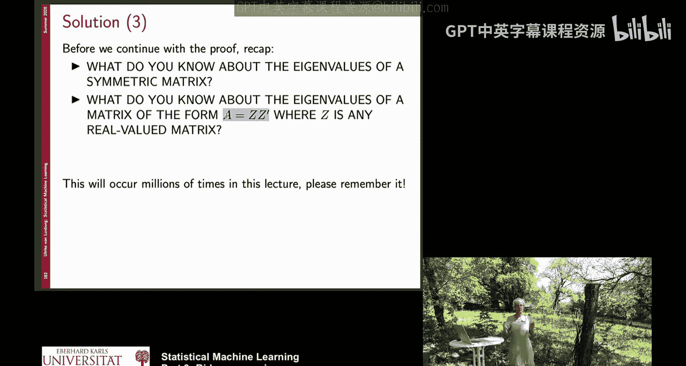

其中：
*   `Φ` 是设计矩阵，其第 `i` 行是第 `i` 个样本在所有基函数上的值。
*   `y` 是输出向量。
*   `λ` 是一个需要预先设定的权衡常数（正则化参数），我们稍后会讨论如何选择它。
*   `||w||^2` 是权重向量的 L2 范数平方。

这个和要小，理想情况下要求两项都小。一方面，我们希望经验风险小，这意味着函数对训练数据拟合得好。另一方面，我们也希望正则化项 `||w||^2` 小，这意味着我们喜欢系数较小的函数。

## 岭回归的解析解

现在，我们想要解决这个优化问题。令人惊讶的是，这个问题同样有一个解析解。

**定理：** 岭回归问题的解 `w_{n,λ}` 由以下公式给出：
`w_{n,λ} = (Φ^T Φ + nλ I)^{-1} Φ^T y`
其中 `I` 是 `D×D` 的单位矩阵。

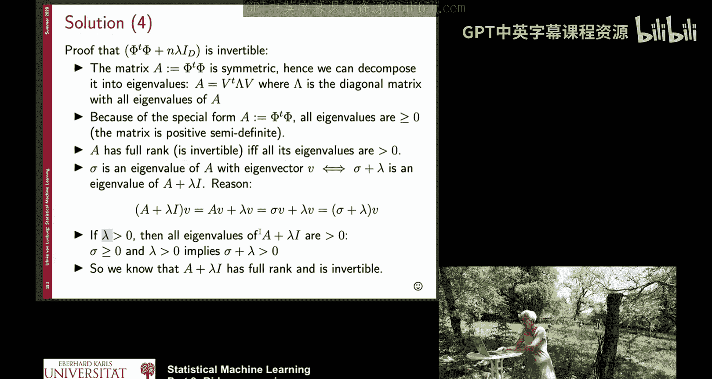

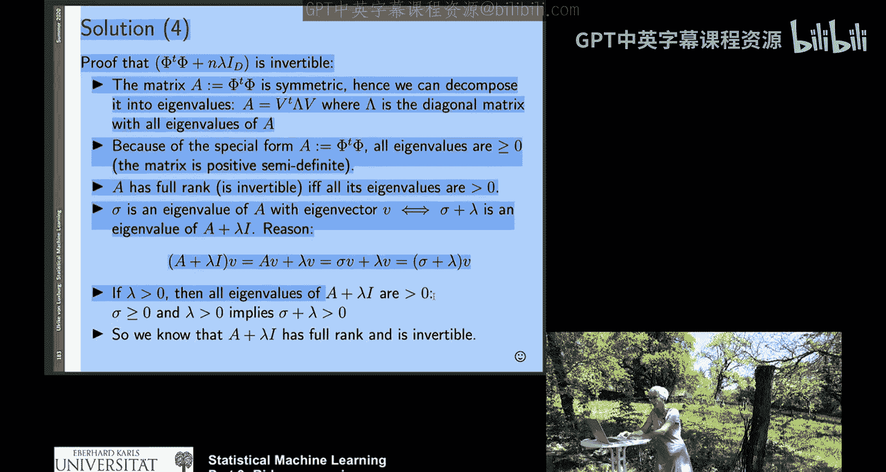

在证明之前，让我们先理解这个定理的含义。
1.  我们不再对矩阵 `Φ` 是否满秩做任何假设。无论原始设计矩阵 `Φ` 是什么，这都将是解。
2.  解的形式涉及矩阵求逆。这意味着我们希望这个矩阵总是可逆的，否则该陈述就没有意义。我们需要证明这个矩阵总是可逆的。
3.  与普通最小二乘解 `(Φ^T Φ)^{-1} Φ^T y` 相比，唯一的微小差别是多了 `nλ I` 这一项。这个蓝色标记的矩阵是一个对角矩阵，在对角线上每个元素都增加了 `nλ`。这确保了矩阵是可逆的，然后我们就可以计算解了。

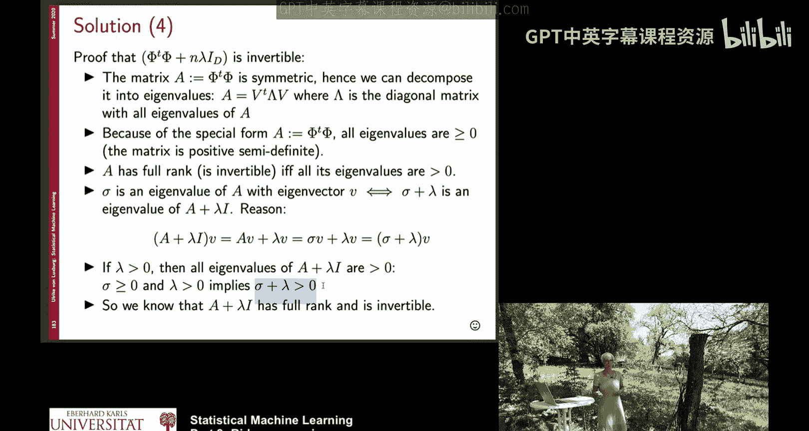

## 定理的证明

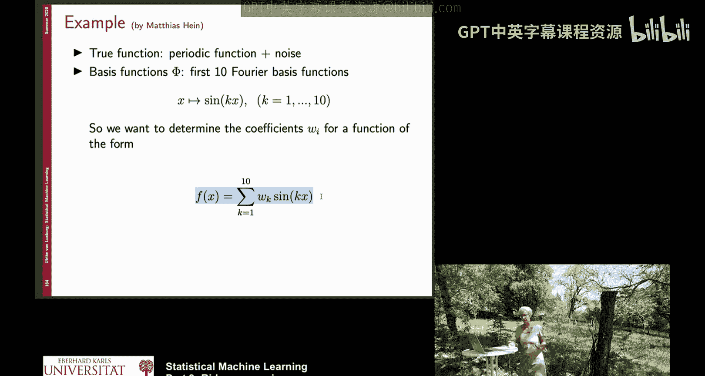

证明思路与之前类似。
1.  **凸性：** 目标函数 `J(w) = (1/n)||y - Φw||^2 + λ||w||^2` 关于 `w` 是凸的。因为第一项是凸的（已证），第二项（平方范数）也是凸的，且定义域 `R^D` 是凸集。
2.  **求梯度并设为零：** 为了找到最小值，我们计算目标函数关于 `w` 的梯度并令其为零。
    `∇J(w) = -(2/n) Φ^T (y - Φw) + 2λ w = 0`
    重新排列项，我们得到：
    `(Φ^T Φ + nλ I) w = Φ^T y`
3.  **矩阵可逆性：** 要解出 `w`，我们需要对左边的矩阵 `(Φ^T Φ + nλ I)` 求逆。接下来我们证明这个矩阵总是可逆的。

**证明矩阵 `(Φ^T Φ + nλ I)` 可逆：**
*   矩阵 `A = Φ^T Φ` 是对称矩阵。对称矩阵存在由特征向量构成的正交基，且其特征值都是实数。
*   此外，由于 `A` 具有 `Φ^T Φ` 的形式，它是一个半正定矩阵，这意味着它的所有特征值 `σ_i` 都满足 `σ_i ≥ 0`。
*   现在考虑矩阵 `A + nλ I`。一个线性代数中的基本事实是：如果 `σ` 是矩阵 `A` 的一个特征值，对应特征向量为 `v`，那么 `σ + nλ` 就是矩阵 `A + nλ I` 的一个特征值，对应同一个特征向量 `v`。
*   因为 `σ_i ≥ 0` 且 `λ > 0`（正则化参数通常为正），所以 `σ_i + nλ > 0`。
*   因此，矩阵 `A + nλ I` 的所有特征值都严格大于零，这意味着它是满秩的，从而是可逆的。

既然矩阵可逆，我们就可以解出 `w`：
`w = (Φ^T Φ + nλ I)^{-1} Φ^T y`
证明完毕。

## 一个简单示例

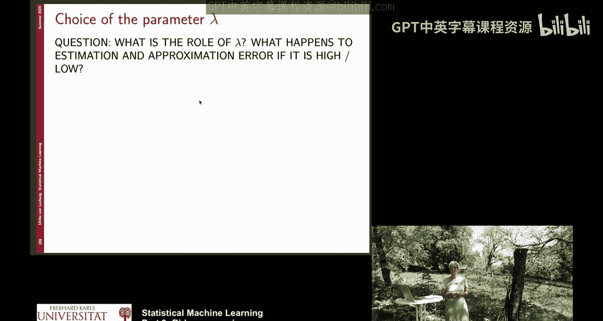

让我们看一个简单的应用示例。假设真实函数是一个周期函数加上噪声。作为基函数，我们简单地取前10个傅里叶正弦基函数：`φ_k(x) = sin(k*x)`，其中 `k` 从1到10。

我们的目标是：给定一些训练数据，找到形式为 `f(x) = Σ_{k=1}^{10} w_k sin(k*x)` 的最佳函数，即找到系数 `w_k`。

在一张示例图中：
*   黑点是训练数据点。
*   黑线是真实的回归函数（即 `E[y|x]`）。
*   红线是普通最小二乘拟合（无正则化）。
*   蓝线是岭回归拟合。

可以观察到，红线波动更大，因为它倾向于过拟合，或者说具有更高的方差。岭回归的蓝线方差要小得多，看起来更平滑。在这个具体问题中，哪个解更好可能值得商榷，但我们可以清楚地看到，岭回归通过控制参数大小，有效降低了模型的方差。

## 正则化参数 λ 的选择

这里有一个非常重要但尚未讨论的点：参数 `λ` 的选择。

我们的优化问题是：最小化 `经验风险 + λ * 正则化项`。根据 `λ` 的选择，会发生不同的事情。

请思考一下 `λ` 的作用：
*   当 `λ` 非常小（极端情况 `λ -> 0`）时会发生什么？
*   当 `λ` 非常大时会发生什么？
*   估计误差和近似误差在这些情况下如何变化？

为了回答这个问题，我们借助一个图示来说明。图中展示了在不同 `λ` 下，对同一问题多次独立实验的拟合结果（左列）及其平均（右列，红线），绿线是真实函数。

*   **λ 很大（强正则化）：** 优化问题主要由正则化项主导。我们试图找到一个 `w` 范数很小的函数，几乎不关心训练误差。结果学到的函数接近常数0（或一个很小的值）。此时，模型的**偏差（Bias）很高**（近似误差大），因为无法拟合复杂函数；但**方差（Variance）很低**，因为不同实验的结果非常相似。
*   **λ 很小（弱正则化，接近普通最小二乘）：** 优化问题主要由经验风险主导。我们尽可能最小化训练误差，不太关心正则化。结果可能对训练数据拟合得很好，但**方差很高**，因为不同实验的拟合结果差异很大。平均来看可能不错，但单个模型的稳定性差。
*   **λ 适中：** 在偏差和方差之间取得平衡。方差比弱正则化时低，偏差比强正则化时低。测试误差（泛化误差）通常在这个区域达到最小。

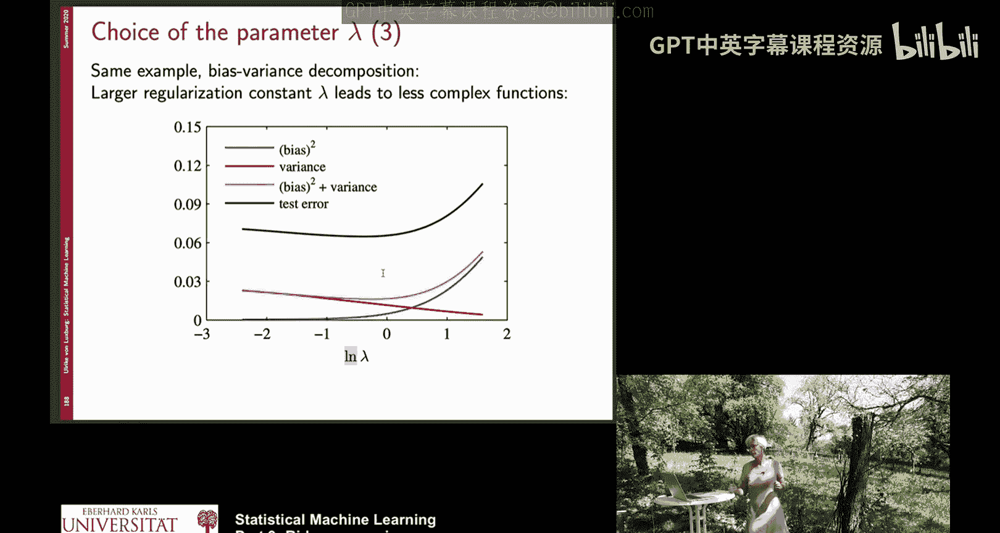

下图展示了偏差-方差分解随 `log(λ)` 变化的典型曲线：
*   **偏差（蓝线）：** 随 `λ` 增大而单调增加。
*   **方差（红线）：** 随 `λ` 增大而单调减少。
*   **测试误差（紫线）：** 是偏差和方差的综合体现，通常呈现一个U形或类似形状。存在一个“最佳点”（图中 `log(λ) ≈ 0` 附近），使得测试误差最小。

在实践中，我们无法预先知道这个最佳 `λ`。在后续课程中，我们将看到如何使用**交叉验证**等技术来尝试找到这个最佳点。

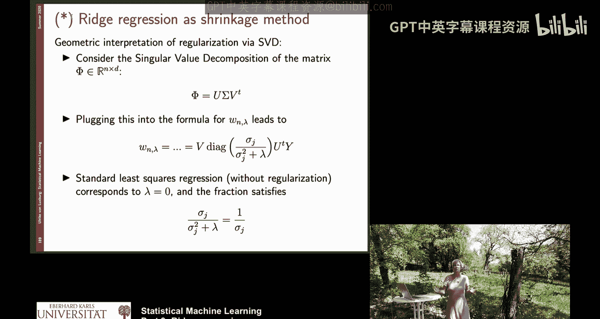

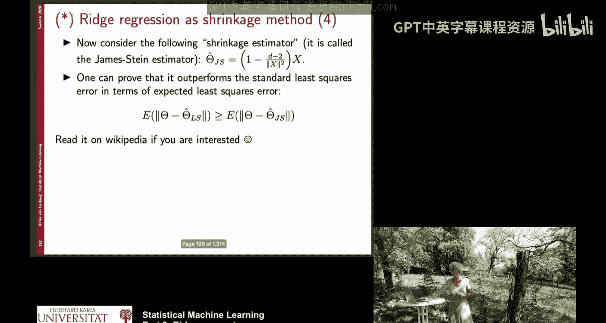

## 历史、术语与名称由来

*   **历史：** 岭回归由俄罗斯数学家 **Tikhonov** 于1943年（二战期间）在解决积分方程逆问题的背景下首次提出，旨在提高数值稳定性。因此，该算法也常被称为 **Tikhonov 正则化**。在统计学文献中，它由 Hoerl 和 Kennard 于1970年独立提出并命名。
*   **名称“岭”的由来：** 名称“岭回归”（Ridge Regression）形象地描述了其解的形式。考虑设计矩阵 `X^T X`，将其元素值按位置绘制成三维图，可能看起来像起伏的山地。在岭回归中，我们在矩阵 `X^T X` 的对角线上加上了 `λI`，这使得对角线上的值显著高于非对角线上的值。在三维图中，这就像在原本起伏的地形上，沿着对角线突起了一条长长的山脊（Ridge），因此得名。

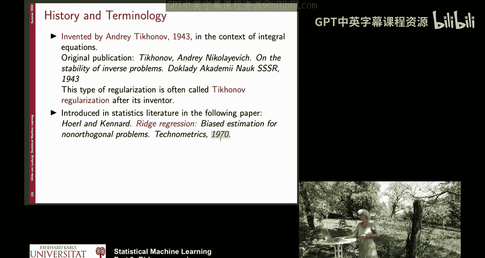

## 总结 🎯

本节课中我们一起学习了岭回归。

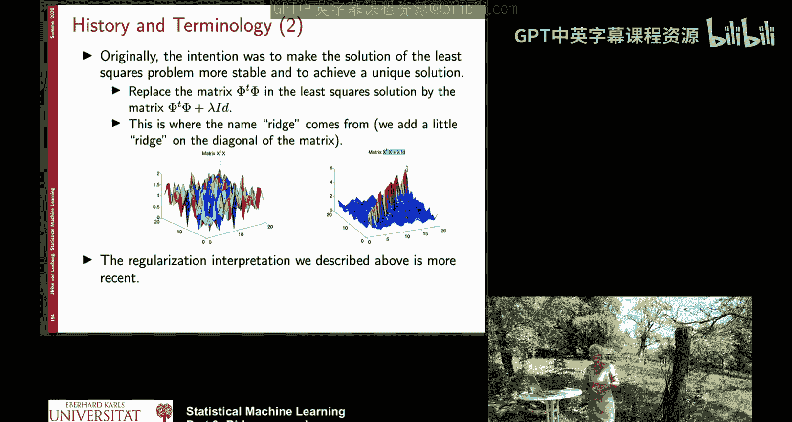

岭回归问题设定如下：
*   我们仍处于标准回归框架中，输入数据在 `R^D` 或通过基函数映射到 `R^D`，输出是 `R`。
*   我们使用平方损失。
*   函数类是线性函数，由参数 `w` 参数化（隐式包含了偏移项 `b`，如上节课所述）。
*   与普通最小二乘法不同，我们现在有一个正则化的经验风险最小化问题。
*   我们通过惩罚权重向量的**平方 L2 范数** `||w||^2` 来避免使用具有大系数的函数。

因此，我们的优化问题是：
`min_w (1/n) * ||y - Φw||^2 + λ * ||w||^2`

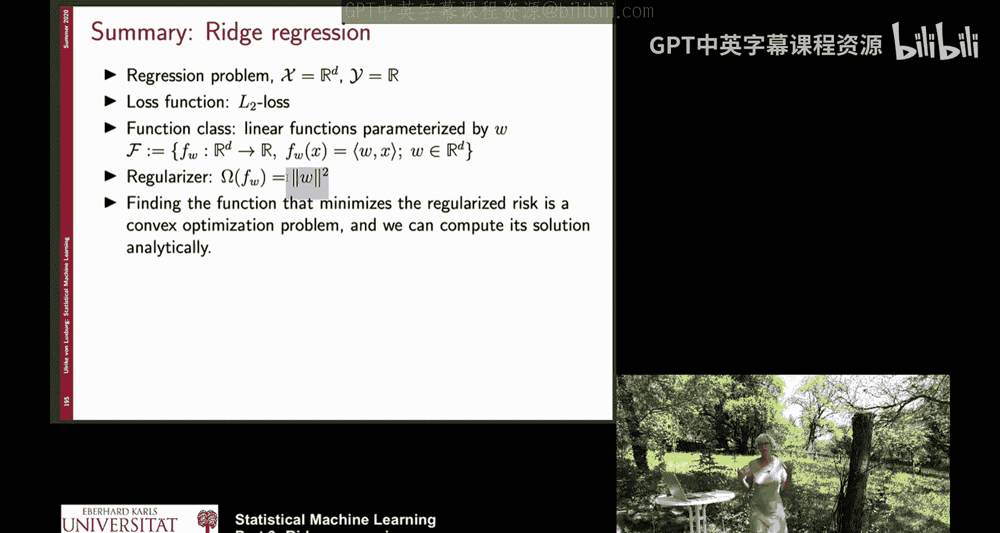

有趣的是，这个问题和普通最小二乘法一样，仍然有一个解析解，形式非常相似，只是在求逆的矩阵对角线上增加了一个“岭” `λI`。这使得问题数值上更稳定，并有助于防止过拟合。