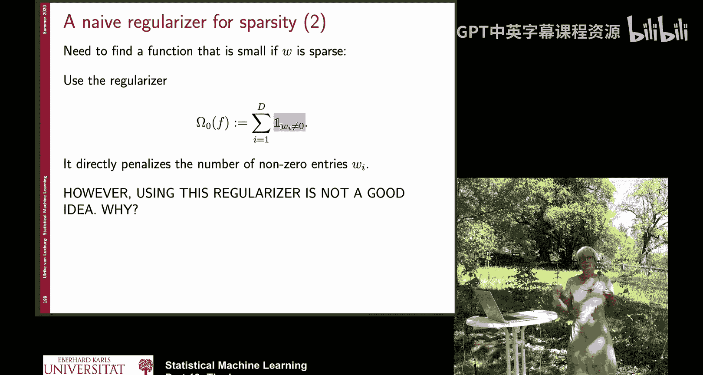
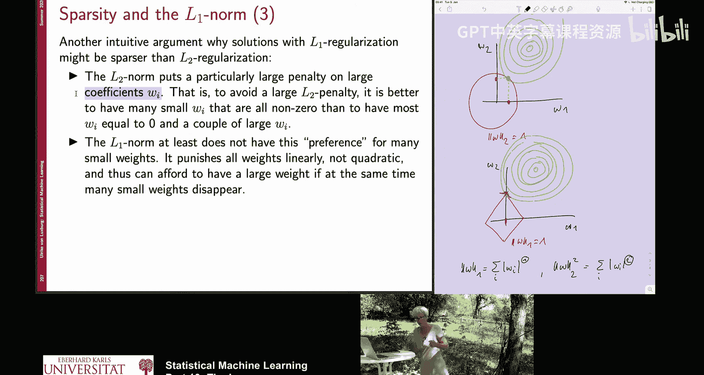
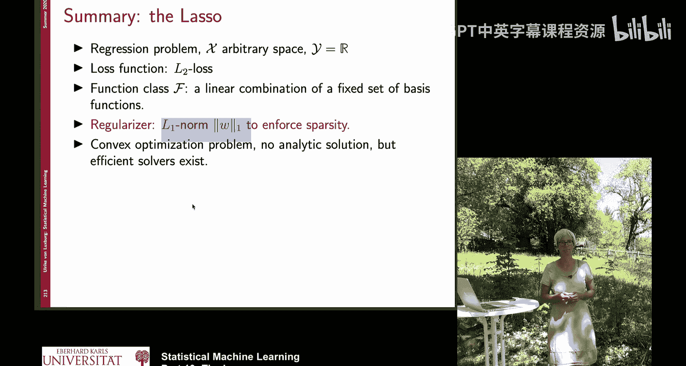

# 10b：Lasso算法详解 🎯

在本节课中，我们将要学习一种名为Lasso的回归算法。Lasso是“最小绝对收缩和选择算子”的缩写，它是对普通最小二乘回归的一种改进，通过引入不同的正则化项来达到特定的目标。

## 算法核心思想

上一节我们介绍了岭回归及其L2正则化。本节中我们来看看Lasso，它使用L1范数作为正则化项。Lasso算法相对较新，于1996年被提出。

该正则化形式的核心目标是实现解的**稀疏性**。稀疏性意味着在众多参数W1到WD中，我们希望其中许多参数的值恰好为0。

## 为什么追求稀疏性？

以下是追求稀疏解的两个主要原因：

1.  **计算原因**：当数据维度极高时，例如百万维，如果模型只需要评估其中10个维度而非全部，将显著提升计算效率，特别是在涉及矩阵乘法等操作时。
2.  **可解释性原因**：这在当今尤其重要。考虑一个医疗诊断场景，我们有病人的体温、年龄、饮食、血液成分等200项测量值。我们希望算法能诊断疾病。

如果我们使用岭回归或普通最小二乘，得到的解向量`W`中许多分量可能都较大。这使得医生难以解读：为何是这个特定的线性组合？我们能否信任这个结果？

我们更希望算法只挑选出少数关键特征，例如血压和年龄，而将不重要的特征（如饮食）对应的参数设为0。这样，医生在查看算法结果时，可以凭借专业知识判断：算法找出的这10个特征是否合理？如果算法找出了已知与疾病无关的年龄特征，我们可能不信任它；反之，如果找出了已知重要的血压特征，我们则会更信任它。在医疗等需要专家信任算法结果的领域，这种可解释性至关重要。Lasso是实现这种可解释性的一种简单方法。

## 如何实现稀疏性：从理想目标到可行方案

回到问题本身，我们寻找的函数形式与之前相同：`f(x) = Σ Wi * φi(x)`。但我们希望系数`Wi`中许多为0，这样的解称为稀疏解。如果一个向量的大部分元素为0，则称该向量是稀疏的。

现在的问题是：如果你想强制实现稀疏性，什么样的正则化器是好的选择？

我们采取与岭回归相同的思路：最小化经验风险加上λ乘以正则化项。正则化器应该在我们喜欢的函数上取较小的值。我们喜欢稀疏的解向量`W`。

一个朴素的想法是：直接惩罚非零分量的数量。我们可以使用函数`Ω0(W)`，它统计向量`W`中非零系数的个数。公式可表示为：
`Ω0(W) = Σ I(Wi ≠ 0)`，其中`I(·)`是指示函数。
这个函数的值在0到D之间，告诉我们有多少个非零系数。这是惩罚非零系数最自然的函数。

然而，这个函数存在严重缺陷。请思考一下，在正则化最小二乘回归的背景下，这个函数有什么缺点？

主要问题是：**`Ω0(W)`不是凸函数**。它是一个离散函数，仅仅检查有多少个非零系数。离散函数通常难以优化。

考虑一个直观例子：假设向量`W = [0, 0, 0.001, 2, 3]`。它有5个坐标，其中3个非零，所以`Ω0(W) = 3`。注意中间那个分量`0.001`非常小。由于噪声或优化等原因，这个参数可能没有完全归零。这个向量的惩罚值是3。

现在考虑另一个向量`W̃ = [0, 0, 0, 2, 3]`。这里`Ω0(W̃) = 2`。这两个向量几乎相同，仅在一个坐标上有微小的差别（0.001与0）。在实践中，采用哪个向量可能没有实质区别，但它们的惩罚值却不同。

关键在于：**只要一个分量从0变为任何非零数，无论这个数多小，惩罚值就会从2跳变到3**。这不是连续的变化。在优化中，我们通常处理连续函数，因为我们可以说“我减小某个参数，惩罚值会随之变化”。但在这种离散跳变的情况下无法做到。这使得此类优化问题非常困难。这个优化问题是NP难的。

因此，尽管`Ω0(W)`是我们的理想目标，但在实践中无法直接使用。

## P范数与凸松弛

作为替代，我们将研究向量略微不同的范数。首先，我需要介绍什么是P范数。

对于一个定义在R^D空间中的向量`W`，其P范数定义为：
`||W||_p = ( Σ |Wi|^p )^(1/p)`
其中`p`是一个正数。

当`p ≥ 1`时，该函数是一个范数，并且是凸函数。当`p=2`时，这就是我们熟悉的欧几里得范数（L2范数）。

当`p`在0和1之间时（`0 < p < 1`），上述表达式不是一个范数（不满足范数的某些公理），也不是凸函数。下图展示了不同`p`值对应的单位球（满足`||W||_p = 1`的点的集合）：

*   `p=2`（红色圆形）：是凸集。
*   `p=1`（蓝色菱形）：是凸集。
*   `p=0.5`等（黑色星形）：**不是凸集**。
*   `p=0`：可以定义为`||W||_0 = Σ I(Wi ≠ 0)`，这正是我们想要的`Ω0(W)`。它**不是范数**，也不是凸函数，甚至是离散的。

现在我们面临一个典型的机器学习问题：我们想优化某个函数（这里是`Ω0`），但由于它是非凸的或离散的而无法直接优化。常见的做法是尝试解决原问题的**凸松弛**版本，即寻找一个最接近原函数的凸函数来近似它。

我们希望最小化`p=0`的“范数”。从几何上看，`p=0`的单位球形状像是坐标轴。我们自问：最接近`p=0`的凸范数是哪个？观察图像，随着`p`从0增加，当`p=1`时我们首次得到一个凸范数（蓝色菱形）。因此，作为一种启发式规则，我们选择`p=1`的范数作为正则化器。

目前这只是一个启发式选择，没有保证这样一定能得到稀疏解。但接下来我们将看到，有理由相信它确实能起作用。

## L1正则化为何能诱导稀疏性：几何视角

为了理解L1正则化如何导致稀疏性，我们需要从几何角度审视这个优化问题。下图绘制了参数空间（`W1`和`W2`）中的情况。

*   **绿色等高线**：表示经验风险（训练误差）。中心点的经验误差最小，向外围移动误差增大。
*   **红色区域**：表示正则化项为常数的点集。
    *   在**岭回归（L2）**中，红色区域是一个圆（`||W||_2 = 常数`）。最优解是绿色等高线与红色圆的切点。注意，这个解（切点）的`W1`和`W2`通常都**非零**，因此不是稀疏解。
    *   在**Lasso（L1）**中，红色区域是一个菱形（`||W||_1 = 常数`）。最优解是绿色等高线与红色菱形的切点。**关键观察**：由于菱形的尖角位于坐标轴上，等高线很可能在菱形的角点处（例如`W1=0`的轴上）与之相切。这意味着最优解的一个分量（如图中的`W1`）恰好为**0**，从而实现了稀疏性。

如果使用`p<1`的范数，单位球的形状会更“星形”，更尖锐地指向坐标轴，使得解落在坐标轴上的可能性更大。这从直觉上解释了为什么L1范数比L2范数更能鼓励稀疏解。

另一个原因是两种范数对系数大小的惩罚方式不同：
*   L2范数的平方：`||W||_2^2 = Σ Wi^2`。它对**大系数**施加了极其严厉的惩罚（因为平方放大效应），因此不惜一切代价避免出现大系数，但对许多小系数则不太在意。
*   L1范数：`||W||_1 = Σ |Wi|`。它对大系数的惩罚相对温和（线性增长）。因此，模型可以“承受”让一些小系数消失（变为0），同时保留少数较大的系数。而在L2正则化下，同样的情形不会发生。

## Lasso算法正式定义

现在，我们整合所有要素来正式定义Lasso算法。

*   **输入空间**：任意空间`X`（但需通过特征映射`φ`转换到`R^D`）。
*   **输出空间**：实数`R`（回归问题）。
*   **函数空间**：特征`φ_i`的线性组合，即`f(x) = Σ Wi * φi(x)`。
*   **损失函数**：**仍然是L2损失**（平方误差），即`(yi - f(xi))^2`。
*   **正则化器**：**L1范数**，即`||W||_1 = Σ |Wi|`。
*   **优化问题**：找到参数`W`，最小化以下目标函数：
    `L(W) = Σ (yi - Σ Wj*φj(xi))^2 + λ * Σ |Wj|`
    其中，第一项是经验风险（L2损失），第二项是L1正则化项。

Lasso的目标函数是凸函数（凸损失+凸正则项）。然而，与岭回归和普通最小二乘不同，**Lasso没有解析解**。我们无法通过求导并令其为零得到一个封闭形式的解公式。

因此，在实践中，我们需要使用优化算法来数值求解。通常的做法是：
1.  将Lasso优化问题输入一个凸优化求解器。
2.  求解器会输出最优的参数`W`。
当然，存在一些特别适合Lasso问题的求解器（例如坐标下降法、近端梯度法等），它们比通用的凸优化求解器更高效，但这超出了本课程的范围。

## 示例与效果

我们通过一个示例来直观感受Lasso的效果。任务是用多项式拟合一个正弦波数据（加入噪声）。

*   **黑色点**：数据点。
*   **黑色曲线**：真实的正弦函数（目标）。
*   **红色曲线**：岭回归的拟合结果。
*   **蓝色曲线**：Lasso的拟合结果。

仅从拟合曲线看，两者都能在一定程度上拟合数据，岭回归的曲线可能略显波动。

更具启发性的是下面的分析图，它展示了随着正则化参数`λ`变化（横轴，对数尺度），各种指标的变化：

*   **绿线（Lasso）与红线（岭回归）**：表示解向量中**非零分量的数量**。
    *   对于岭回归，无论`λ`如何变化，**几乎所有分量都是非零的**，没有稀疏性。
    *   对于Lasso，当`λ`很小（接近0，即几乎不正则化）时，所有分量非零。随着`λ`增大，**非零分量数量急剧下降**。当`λ`极大时，所有分量都被压缩为0。
*   **训练误差与测试误差**：
    *   **黑色虚线**：Lasso的测试误差。存在一个`λ`的“甜点”（图中约在`10^-2`处），使得测试误差最小。
    *   **其他曲线**：分别展示了Lasso和岭回归的训练误差。随着`λ`增大，两者训练误差都会上升（因为更注重正则化而非完美拟合训练数据）。在最优`λ`附近，Lasso和岭回归都能达到相近的测试误差水平，但**Lasso是用更少的非零特征（稀疏模型）达到的**。

## 历史背景与总结

*   **名称由来**：Lasso是“Least Absolute Shrinkage and Selection Operator”（最小绝对收缩和选择算子）的首字母缩写。
*   **历史意义**：由Tibshirani于1996年提出。Lasso开启了一个新的趋势，即利用L1正则化来追求稀疏性，这一思想后来广泛应用于统计学和机器学习的诸多领域，例如低秩矩阵恢复等。

**本节课总结**：
我们一起学习了Lasso回归算法。我们从追求模型**稀疏性**的动机出发，探讨了直接使用非零计数（L0“范数”）作为正则化器的不可行性。进而引入了**P范数**的概念，并说明通过使用**L1范数**作为正则化器的**凸松弛**，可以有效地诱导出稀疏解。我们从几何角度理解了L1正则化如何通过其菱形等高线，使解更容易落在坐标轴上。最后，我们正式定义了Lasso的优化问题，指出其作为凸问题虽无解析解但可用优化算法求解，并通过示例观察了其产生稀疏模型的效果。Lasso是平衡模型精度与可解释性的重要工具。