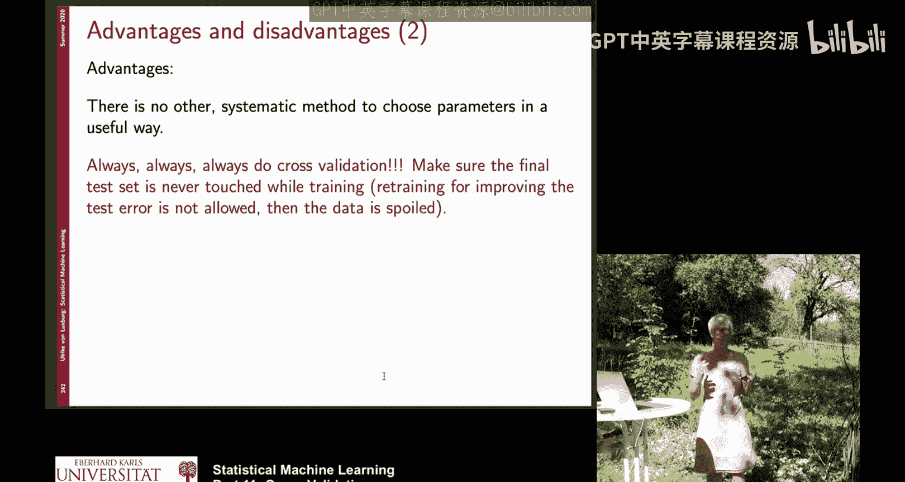

# 11：交叉验证 📊

在本节课中，我们将要学习交叉验证。交叉验证是一种系统性的方法，用于为特定算法在特定问题上找到最佳的参数选择。

---

### **为什么需要交叉验证？**

上一节我们介绍了多种机器学习算法。几乎所有我们见过的算法都有一个需要设置的参数。以K近邻分类器为例，它有一个参数 **K**，表示需要考虑多少个邻居。根据我们如何设置这个参数 **K**，模型可能会过拟合、欠拟合或表现刚刚好。

那么，问题来了：我们如何为特定的应用找出最佳的参数 **K** 呢？

---

### **交叉验证的工作原理**

选择的方法是交叉验证。本节中我们来看看交叉验证在实践中是如何工作的。

交叉验证的输入是你的训练数据点，以及一组你想要测试的不同参数组合（例如，所有你想测试的 **K** 值）。

以下是交叉验证的步骤：

1.  **划分数据**：首先，将你的训练集随机划分为 **K** 个大小相等的部分。这些部分通常被称为“折”。
2.  **迭代训练与验证**：对于你想要尝试的每一个参数（例如，每一个 **K** 值），进行以下操作：
    *   依次将每一折作为验证集，其余 **K-1** 折作为训练集。
    *   用当前的参数在训练集上训练模型。
    *   在留出的验证集上计算验证误差。
3.  **计算平均误差**：对同一个参数，在所有 **K** 次验证中得到的误差取平均值。这个平均值就是该参数的**验证误差**。
4.  **选择最佳参数**：对所有尝试的参数重复上述过程，选择验证误差最小的那个参数组合，记为 **S***。

这个过程可以用公式更精确地描述。假设我们将训练集划分为 **K** 折，对于第 **k** 折，训练集是除第 **k** 折外的所有折，验证集就是第 **k** 折。对于参数组合 **S**，在第 **k** 折上的验证误差记为 `error(S, k)`。那么，参数 **S** 的交叉验证误差为：

**CV_error(S) = (1/K) * Σ_{k=1}^{K} error(S, k)**

然后，我们选择使交叉验证误差最小的参数：

**S* = argmin_{S} CV_error(S)**

一旦你理解了原理，就会发现它其实非常简单。

---

### **交叉验证后的步骤**

通过交叉验证选出了最佳参数组合 **S*** 后，你需要进行最后两步：

1.  **最终训练**：使用选定的最佳参数 **S***，在整个训练集上重新训练模型。因为你现在希望利用所有可用的数据来得到最好的分类器。
2.  **最终测试**：在一个**全新的、独立的测试集**上评估最终模型的性能，得到**测试误差**。这个测试误差是对模型真实泛化能力的一个估计。

**⚠️ 极其重要的注意事项**：测试集必须完全独立于训练过程。你**绝对不可以在**参数选择或模型调整的任何阶段使用测试集。如果你根据测试集的结果返回去调整模型或参数，那么测试集就失去了独立性，你得到的“测试误差”将是有偏的，不能反映模型的真实泛化能力。在实践中，如果数据有限，你至少需要清楚这一点并明确说明。

---

### **实践中的问题与考量**

以下是关于交叉验证的一些常见实践问题：

*   **折数 K 的选择**：通常选择 K=5 或 K=10。折数的选择对结果影响通常不大。
*   **参数空间的大小**：当需要调节多个参数时，参数组合的数量会呈指数级增长。例如，支持向量机有参数 **C** 和核宽度 **σ**，如果每个参数有6个候选值，就有36种组合。进行5折交叉验证意味着需要训练 36 * 5 = 180 次。如果单次训练耗时很长，总时间会变得不可接受。
*   **解决方案**：对于多参数调优，可以使用更智能的方法，如在参数空间中进行网格搜索的变体或梯度下降。许多机器学习工具箱都实现了这些方法。你需要了解你所用的工具包使用的是哪种策略。
*   **交叉验证的过拟合**：交叉验证过程本身也可能发生过拟合，尤其是在数据量很小或参数空间搜索过于精细时。
*   **训练集大小**：在交叉验证中，每次用于训练的样本量是 `(K-1)/K`，略小于最终使用整个训练集的大小。对于小数据集，这可能影响参数选择。

---

### **交叉验证的优缺点**

**缺点**：
*   **计算成本高**：尤其当参数多时。
*   **理论分析复杂**：由于数据划分间的依赖性，为交叉验证的一致性等性质提供严格的理论保证比较困难。

**优点**：
*   **系统性**：它是目前唯一能系统性地为学习算法寻找最佳参数的程序化方法。
*   **必要性**：参数的默认值通常不是最优的，最佳参数取决于具体问题和数据。因此，**只要算法有参数，就必须使用交叉验证（或类似方法）来选择它们**。在使用任何机器学习软件时，都应检查它是否自动执行了交叉验证来调参，否则结果可能不可信。

---

### **总结**

本节课中我们一起学习了交叉验证。我们了解到，交叉验证是一种通过将训练数据划分为多个“折”，并迭代地使用其中一部分作为验证集来评估不同参数性能的系统方法。其核心目标是找到使模型泛化能力最佳的参数组合。我们强调了保持测试集独立性的极端重要性，并讨论了交叉验证在实践中的优缺点。记住，交叉验证是调节模型参数、避免盲目猜测的关键工具。