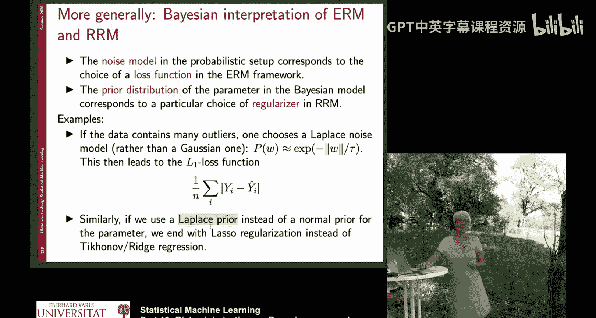

# 12：风险最小化与概率方法

在本节课中，我们将探讨机器学习中两种核心思想——经验风险最小化与概率方法——之间的联系。我们将看到，看似不同的两种思路，实际上可以相互转化，并为彼此提供深刻的解释。

## 概述

到目前为止，我们介绍回归算法的动机都源于**经验风险最小化**和**正则化风险最小化**的视角。我们总是从一个损失函数开始，例如最小二乘损失，可能会加上一个正则化项，然后求解最小化“损失 + λ * 正则化项”的问题。

许多同学也在同时学习Philip Hennig教授的概率学习课程。我们这门课中的方法与那门课中的方法有着非常紧密的联系。本节旨在简要揭示这两种方法之间的关系，并展示如何将我们课程中的方法（至少在部分情况下）转化为Philip Hennig课程中的概率方法。这是一个非常有趣且深刻的主题，虽然我们只通过几页幻灯片来一窥究竟，但它能帮助你理解这两种思路的内在联系。如果你对此感兴趣，可以进一步阅读相关材料，例如Kevin Murphy的《概率机器学习》一书。

## 风险最小化与最大似然估计

上一节我们介绍了风险最小化的基本框架，本节中我们来看看它与概率方法中的**最大似然估计**有何关联。

这种转换的核心在于：我们框架中的**经验风险最小化**，在很大程度上等同于概率框架中的**最大似然估计**。

以下是其工作原理：

*   在我们的框架中，我们总是从一个函数类和一个损失函数出发，然后希望根据定义的损失函数，找到该类中的最佳函数。
*   在概率设定中，你总是从对数据分布的假设开始。我们假设数据是由一个线性模型生成的。

具体来说，我们假设观测到的输出变量 **y** 是输入的线性函数加上一些噪声：

**y = x^T w + ε**

这里的 **w** 是真实的底层线性函数参数。我们假设存在一个以这种方式生成数据的线性机制，并希望发现这个 **w** 向量是什么。噪声使问题变得困难，因为我们看不到真实数据，只能看到它的带噪版本。

在概率设定中，我们需要做出假设。第一个假设是噪声 **ε** 服从正态分布。在许多情况下，如果噪声由多种来源叠加而成，根据中心极限定理，噪声通常会近似服从正态分布。因此，假设噪声服从正态分布是合理的。

我们假设噪声分布是均值为零、方差为 σ² 的正态分布。在一个D维设定中，我们进一步假设其协方差矩阵在所有方向上具有相同的扩展，即单位矩阵乘以噪声的幅度（σ² * I）。

将这个噪声模型转化为观测信号 **y** 的分布，给定输入 **x** 和真实参数 **w**，**y** 也服从正态分布。其均值是真实的线性预测值 **x^T w**，方差来自噪声项。因此：

**P(y | x, w) = N(y; x^T w, σ²)**

这就是我们做出的假设。

现在，**最大似然框架**告诉我们，我们希望找到参数 **w**，使得观测数据的**似然**最大化。似然指的是在给定输入 **x** 和参数 **w** 的条件下，观测到输出 **y** 的概率 **P(y | x, w)**。最大似然估计就是要找到能最大化这个概率的 **w**。

在我们的具体形式中，我们已经对底层分布做出了假设。正如上一张幻灯片所示，**P(y | x, w)** 本质上是一个高斯（正态）分布。代入高斯分布的公式，我们有：

**P(y | x, w) ∝ exp(- (y - x^T w)² / (2σ²))**

现在，检查哪个 **w** 值能最大化这个表达式。由于 σ 只是一个缩放参数，最大化这个指数表达式等价于最小化其指数项中的平方项 **(y - x^T w)²**。而这正是**最小二乘回归**所做的事情。

由此我们可以看出，当我们从这种基于模型的视角出发，假设一个高斯噪声模型并使用最大似然估计时，我们便恢复了普通的线性最小二乘算法。这是一个很好的洞见，它可以帮助你思考普通最小二乘法何时可能表现良好，何时可能不佳。如果你所处的环境符合高斯噪声模型的假设，那么这可能是一个合适的选择；反之，如果你不相信噪声是高斯的，那么选择最小二乘损失函数可能就不是正确的做法。

## 正则化风险最小化与贝叶斯最大后验估计

我们已经看到线性回归始于简单的训练误差最小化，但后来我们更倾向于选择具有低L2范数或低L1范数的函数。那么，我们能否将**正则化风险最小化**也转化为概率设定呢？

我们像上面一样开始，假设数据生成过程与上述相同。但现在，我们额外假设参数 **w** 上有一个**先验分布**。这在统计学语言中，是传统（频率派）统计学与贝叶斯方法之间的关键区别。在频率派方法中，你不假设要学习的参数 **w** 是一个随机量或具有任何先验分布。而在贝叶斯框架中，你总是假设参数有某个先验分布，然后在观测数据后，查看其后验分布，以更新你对该参数可能取值的信念。

我们现在假设参数有一个先验分布。简单来说，我们假设参数的先验分布也是一个高斯分布，它具有不同的方差，这里称为 τ²。如果我们对这个参数应该是什么没有更好的猜测，也许可以简单地假设它可能服从高斯分布。这本质上意味着，我们认为 **w** 的值较小（接近0）的可能性很高，而离0越远，我们认为它真正是我们想要找到的参数的可能性就越小。

在下面这行公式的开头，我们仍然有关于底层数据的模型，它本质上说明我们有一个贝叶斯高斯噪声模型。

现在，如果我们看**贝叶斯最大后验估计**方法，该方法认为我们应该选择能最大化**后验概率**的向量 **w**。后验概率是给定输入 **x** 和输出 **y** 的条件下，参数 **w** 的概率 **P(w | x, y)**。

根据贝叶斯定理，可以将其重写为似然函数、先验分布和证据（归一化常数）的乘积。具体推导需要一些时间，但如果你写下所有公式并尝试求解，你会发现这完全等同于解决**岭回归**问题。

岭回归问题是：最小化最小二乘损失加上 λ 乘以 **w** 的L2范数的平方。其中，参数 λ 恰好是 σ²（数据噪声方差）与 τ²（先验分布方差）的比值。

这个转换非常美妙。它为我们所做的正则化风险最小化赋予了意义。我们之前说，使用最小二乘损失是因为它方便，并且我们希望参数 **w** 的范数较小。现在，你可以将其一对一地翻译为：这等同于假设我们的数据条件分布是正态分布的，并且我们对权重向量 **w** 也有一个先验分布。

当然，正是这个先验分布对应了正则化项。正如之前所说，这里的先验表明 **w** 很小的可能性很高，因为它是正态分布，集中在0附近。随着我们远离0，我们认为它越来越不可能。因此，对于一个数据集，如果我们选择一个远离此处的 **w**，那将是相当令人惊讶的。这与我们为岭回归所做的动机完全相同：我们不希望 **w** 的L2范数太大，我们不希望它偏离太远。这是看待我们想要寻找的相同直觉的两种不同方式。

美妙之处在于，这确实归结为完全相同的问题。

## 通用转换表

在更一般的层面上，概率世界与我们本课程中考虑的统计世界之间存在一个转换表。

以下是该对应关系：

*   **概率设定中的噪声模型** 对应于 **经验风险最小化框架中的损失函数**。在很高层次上，这是合理的。如果我们固定一个损失函数，我们本质上是在说，我们如何权衡数据之间的不同偏差。哪些偏差我们认为重要或显著，哪些偏差总是发生，也许我们不太在意——这就是我们在损失函数中编码的内容。但这与你**在噪声模型中编码的内容相同**。在噪声模型中，你也会说“这是我的真实数据，然后我给它加上一些东西”。根据你相信这个“东西”的样子，你也会以非常不同的方式惩罚偏差。
*   **贝叶斯模型中的先验分布选择** 对应于 **正则化方法中的正则化项选择**。正如我们之前在高斯模型中所解释的，这也很有道理。

## 更多示例

我已经展示了对应于最大似然估计的普通最小二乘回归，以及对应于贝叶斯最大后验估计的正则化岭回归（最小二乘），它们都基于高斯模型和高斯先验。

现在，你可能做出其他假设。例如：

*   **拉普拉斯噪声模型**：如果你认为数据中出现大异常值的可能性大得多，通常会选择拉普拉斯噪声模型。拉普拉斯分布具有更重的尾部，因此出现远离分布中心的大偏差的可能性更大。如果你因为看到数据中有许多远离数据均值的异常点而相信这一点，你可能会选择拉普拉斯噪声模型。与高斯噪声模型不同，这里 **w** 的范数不是平方的。进行这种转换后，会导致 **L1 损失函数**（即绝对误差损失）。这并非巧合，因为这里你有一个1次幂，那里也有一个1次幂。在统计学中，如果你认为数据有许多异常值，如果你想获得对异常点不那么敏感的稳健估计（统计学中常称为稳健统计），就会使用L1损失而不是L2损失。在这里，你也可以从贝叶斯角度得到它。
*   **拉普拉斯先验**：类似地，如果我们讨论先验，如果你对参数使用**拉普拉斯先验**而不是高斯先验，我们最终也会得到一个不同的正则化项——不再是岭正则化（L2），而是**Lasso正则化（L1）**。

## 总结

在本节课中，我们一起学习了机器学习中经验风险最小化与概率方法之间的深刻联系。我们看到：

1.  **普通最小二乘法** 可以从**高斯噪声模型**下的**最大似然估计**推导出来。
2.  **岭回归**（L2正则化最小二乘） 对应于**高斯先验**下的**贝叶斯最大后验估计**，其中正则化参数 λ 与噪声方差和先验方差的比值有关。
3.  这种联系可以推广：**损失函数的选择** 对应着**噪声模型的假设**，而**正则化项的选择** 对应着**参数先验分布的选择**。例如，拉普拉斯噪声对应L1损失，拉普拉斯先验对应L1正则化（Lasso）。

这种对应关系不仅优美，而且极具启发性。它为我们通常从优化角度理解的方法（如选择损失函数和正则化项）提供了概率论的解释，帮助我们更深入地理解这些方法的假设、适用场景以及它们为何有效。当你面临模型选择时，这种双重视角可以指导你根据对数据噪声和参数分布的信念，做出更明智的决定。