# 概率和统计机器学习：13：线性判别分析 📊

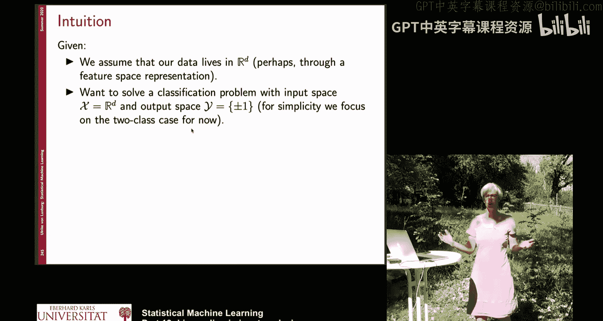

在本节课中，我们将要学习线性分类方法，并重点介绍一种经典算法——线性判别分析。我们将从线性分类的基本概念入手，探讨如何寻找一个能将不同类别数据分开的超平面，并理解线性判别分析背后的多种动机。

## 线性分类简介 📈

上一节我们介绍了多种解决线性回归问题的方法，如最小二乘法、岭回归和Lasso等。本节中，我们来看看分类问题。与回归类似，我们将从线性方法开始。

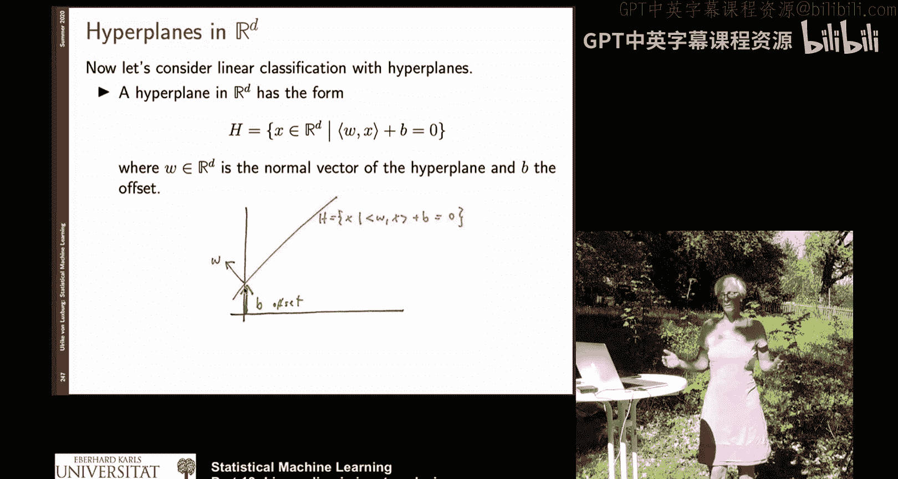

我们假设数据存在于 **R^D** 空间中，这通常是因为我们将抽象对象表示为了特征向量。分类问题的输出是一个二元向量，标签通常为 **+1** 或 **-1**。我们目前专注于两类分类问题，这是最简单的情况。

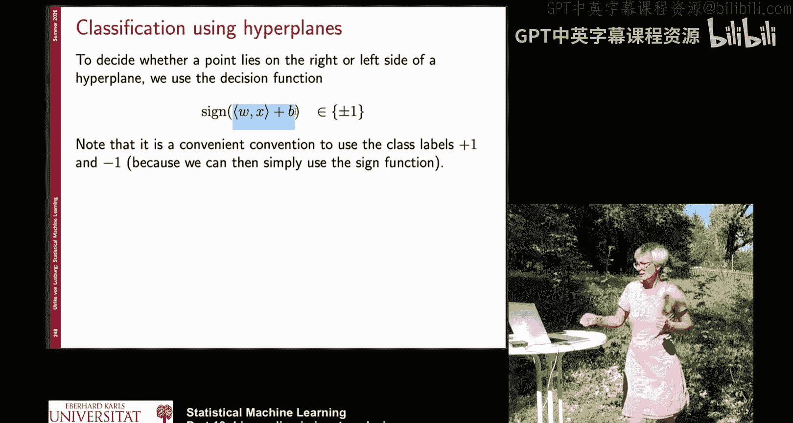

线性分类的核心思想是找到一个能将两个类别分开的**超平面**。在二维空间中，这是一个直线；在更高维空间中，则是一个维度比原空间少一的超平面。

## 超平面的定义与几何意义 📐

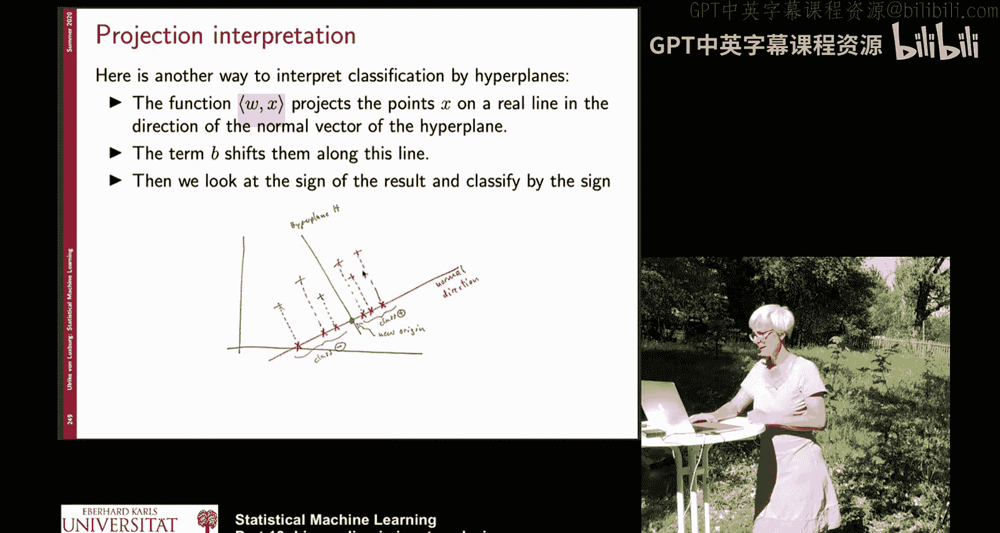

形式上，一个在 **R^D** 空间中的超平面由两个参数定义：法向量 **w** 和偏移量 **b**。超平面 **H** 是所有满足以下方程的点 **x** 的集合：

**w^T x + b = 0**

从几何角度看，法向量 **w** 垂直于超平面，而 **b** 决定了超平面相对于原点的偏移。

为了判断一个点位于超平面的哪一侧，我们使用符号函数。对于点 **x**，我们计算 **w^T x + b** 的值。如果结果为正，则预测为 **+1** 类；如果为负，则预测为 **-1** 类。

另一种理解方式是投影。点积 **w^T x** 是将点 **x** 投影到法向量 **w** 方向上的标量值。参数 **b** 则在这条投影线上设定了一个阈值，用于区分两个类别。

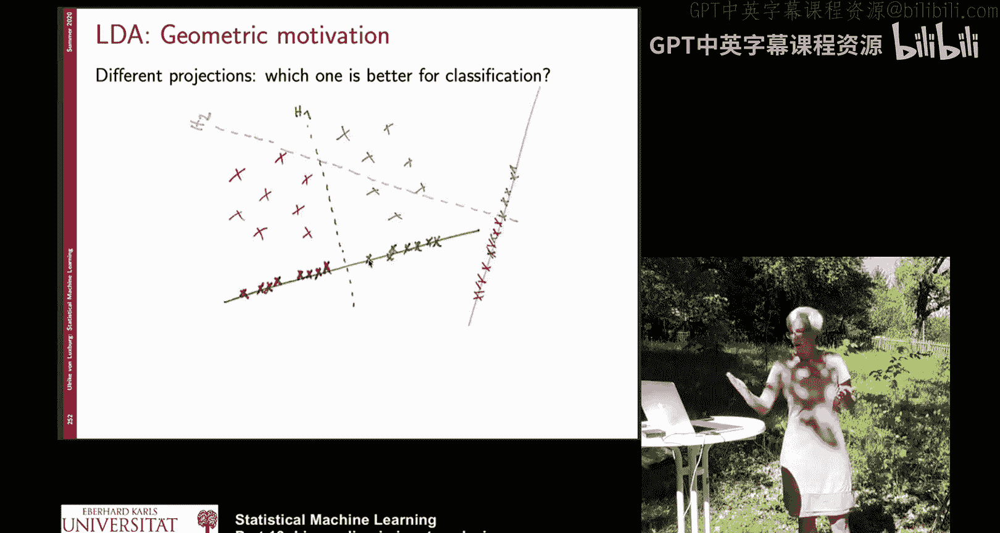

## 分类的损失函数 ⚖️

在回归中，我们常用最小二乘损失。然而在分类中，有多种损失函数可供选择，不同的算法使用不同的损失。

以下是几种常见的分类损失函数：
*   **线性判别分析**：使用最小二乘损失。
*   **逻辑回归**：使用逻辑损失。
*   **支持向量机**：使用合页损失。

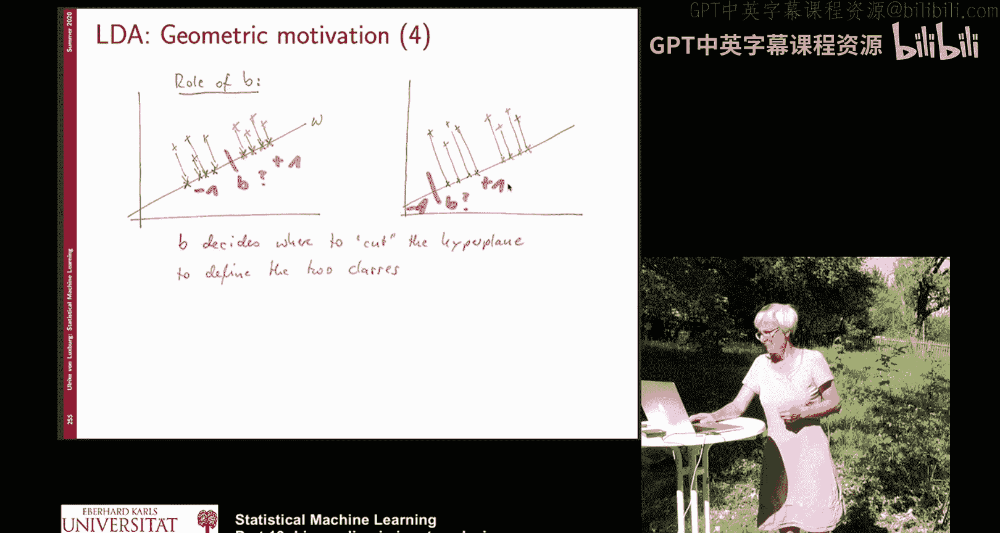

这些不同的损失函数会影响我们选择最佳分类超平面的几何解释和算法。

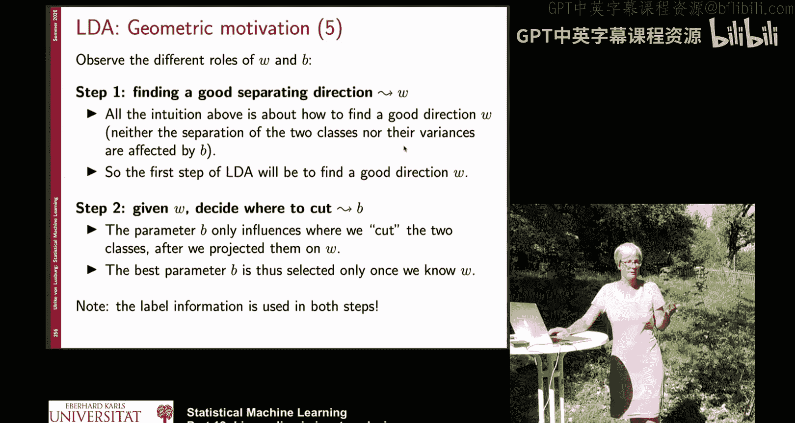

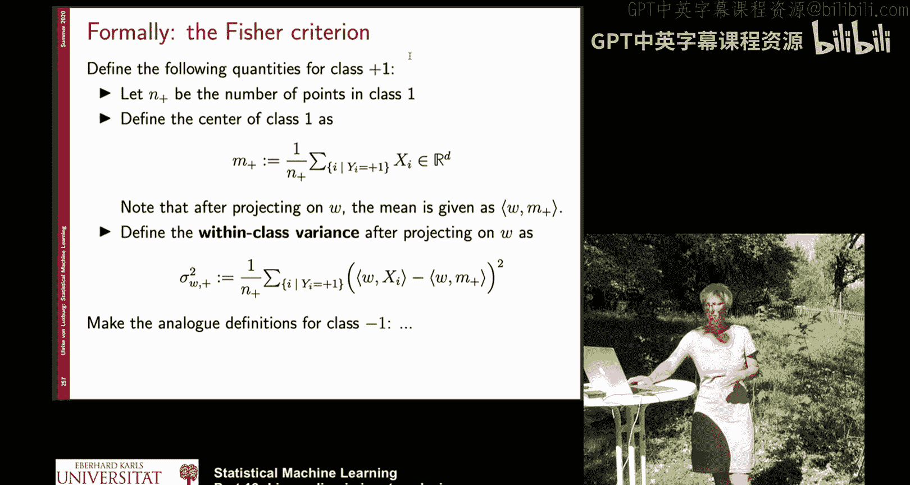

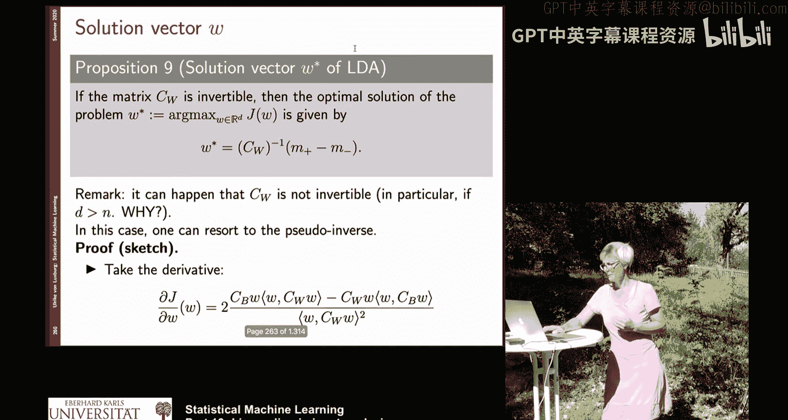

## 线性判别分析的几何动机 🔍

我们现在开始介绍线性判别分析。首先从几何角度进行动机阐述。

假设我们有一个数据集，包含红色和蓝色两类点。我们可以选择不同的超平面（及其对应的法向量方向）来投影数据。

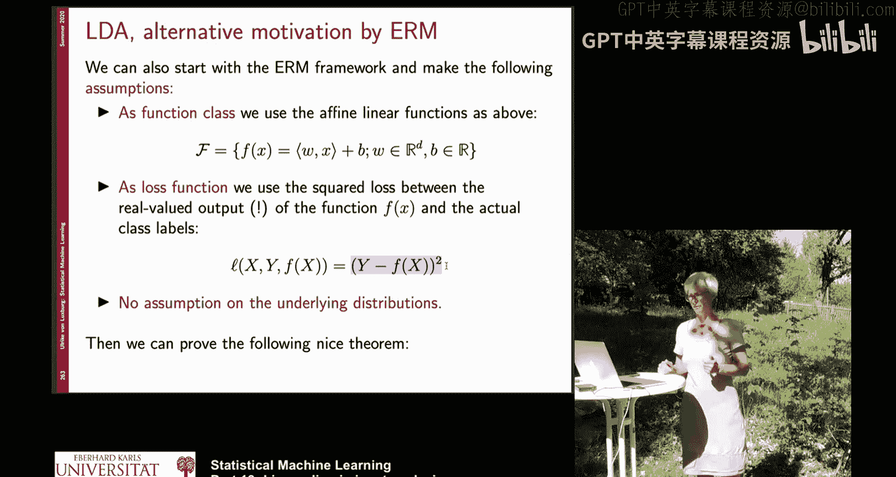

问题是，如何判断哪个投影方向更好？费希尔提出了两个判断标准：
1.  **类内方差应小**：投影后，同一类别的点应该尽可能聚集在一起。
2.  **类间方差应大**：投影后，不同类别的点应该尽可能远离。

一个好的投影方向（即一个好的超平面）能同时满足这两个条件，使得在投影后的一维空间上，两类数据清晰地分开，便于设置分类阈值。

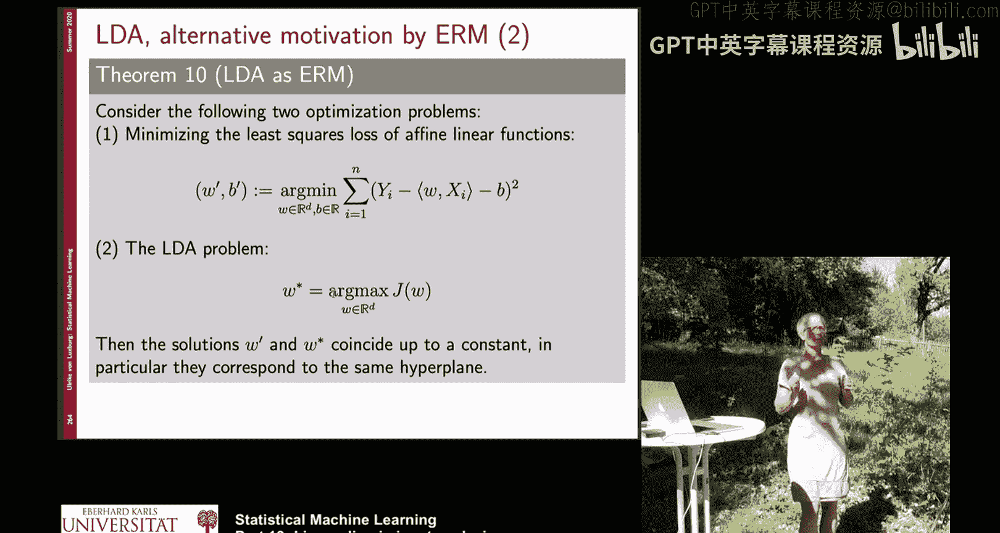

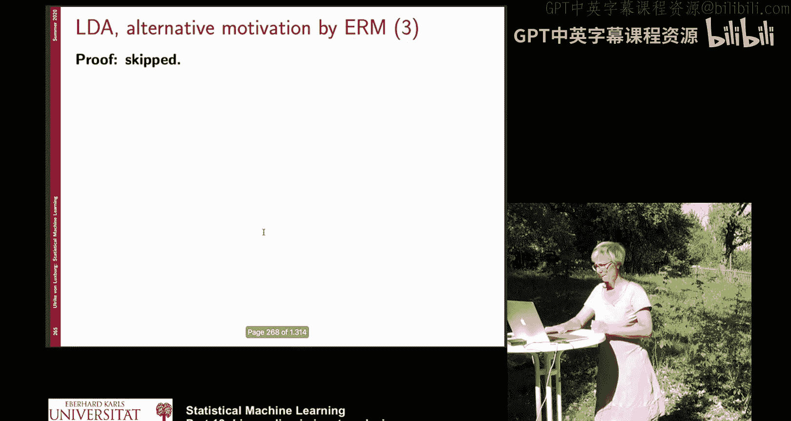

## 线性判别分析的其他动机 🔄

有趣的是，线性判别分析可以从完全不同的角度推导出来，并得到相同的解。

**动机二：经验风险最小化**
我们采用经验风险最小化的框架。我们选择线性函数作为函数类，并简单地使用最小二乘作为损失函数。这里需要注意的是，损失计算是在真实标签（+1/-1）和预测的**函数值**（`w^T x + b`，而非其符号）之间进行的。可以证明，由此得到的最优解与基于几何动机的线性判别分析解是一致的。

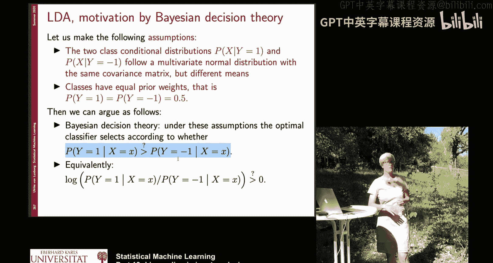

**动机三：贝叶斯决策理论**
我们还可以从概率模型的角度出发。我们假设每个类别的数据都服从多元正态分布，且具有相同的协方差矩阵，但均值不同。同时假设两个类别的先验概率相同。在这种情况下，根据贝叶斯最优决策规则（选择后验概率最大的类别）得到的决策边界，同样与线性判别分析的结果一致。

这表明，尽管出发点截然不同——几何直观、固定损失函数的经验风险最小化、基于概率模型的贝叶斯方法——但它们最终导向了同一个算法。这揭示了机器学习中频率学派与贝叶斯学派方法之间深刻的联系。

## 历史背景与总结 📜

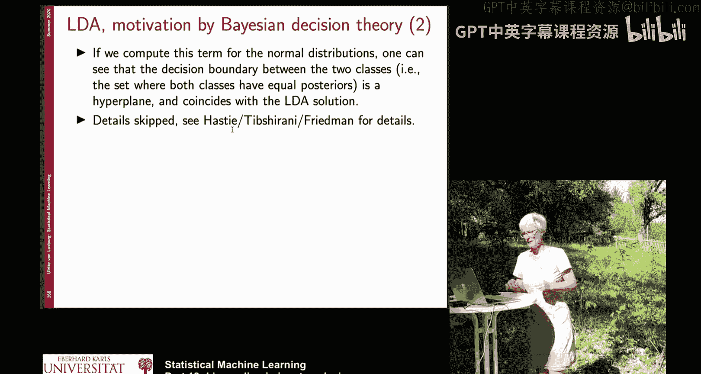

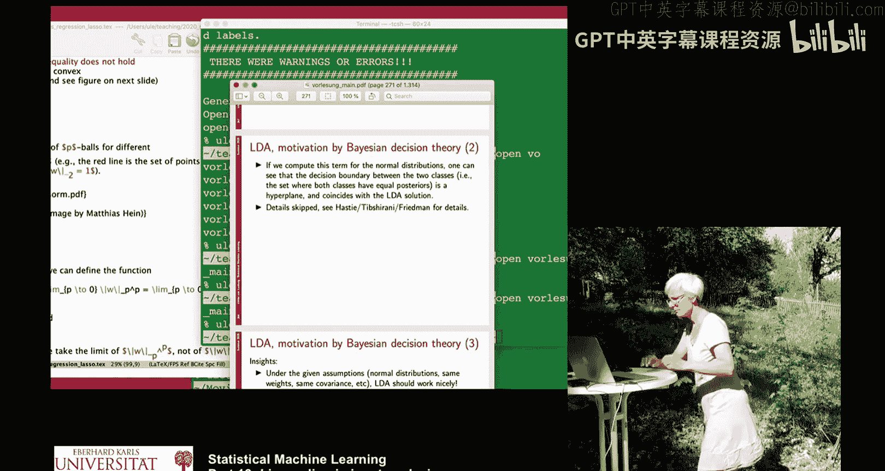

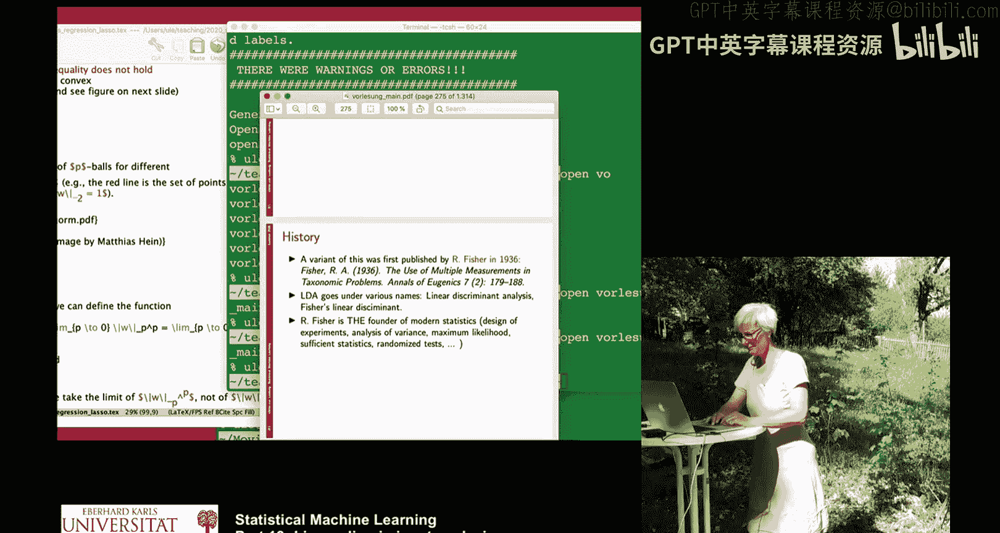

线性判别分析由统计学奠基人罗纳德·费希尔在20世纪30年代提出，也被称为费希尔判别分析。

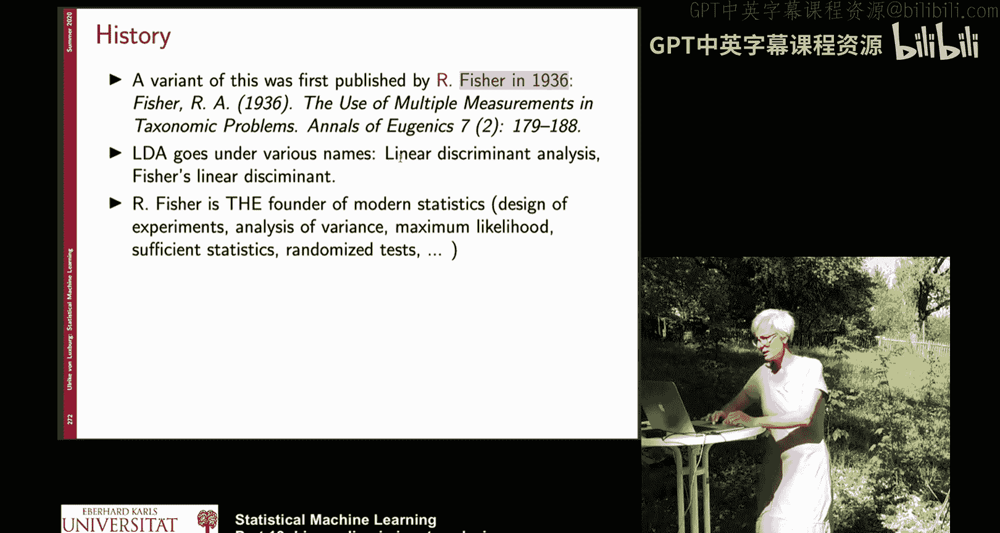

本节课中我们一起学习了线性判别分析这一经典的线性分类算法。我们了解到它可以通过三种不同的视角进行动机阐述：
1.  **几何视角**：寻找使类内聚集、类间分离的投影方向。
2.  **经验风险最小化视角**：使用线性函数和最小二乘损失。
3.  **贝叶斯视角**：假设数据来自同方差的正态分布，并应用最优贝叶斯决策。

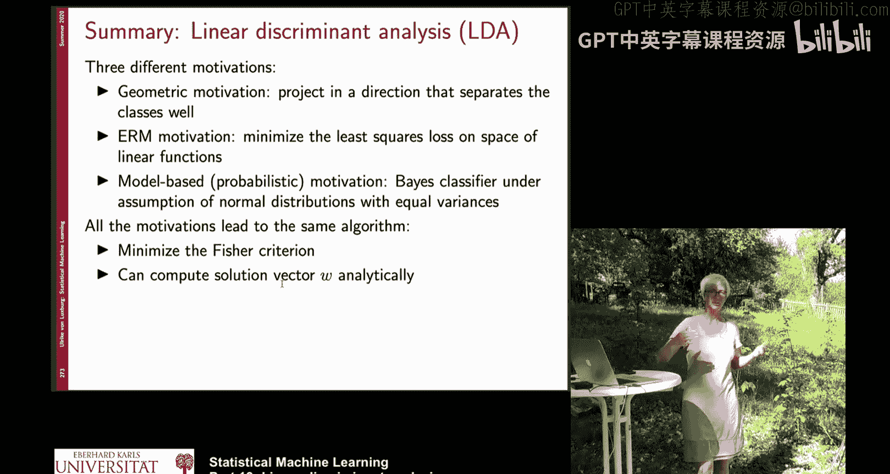

尽管该算法有解析解，但在实际应用中已不常用。然而，理解其背后的多种动机，有助于我们更深入地把握线性分类的本质以及不同机器学习范式之间的联系。