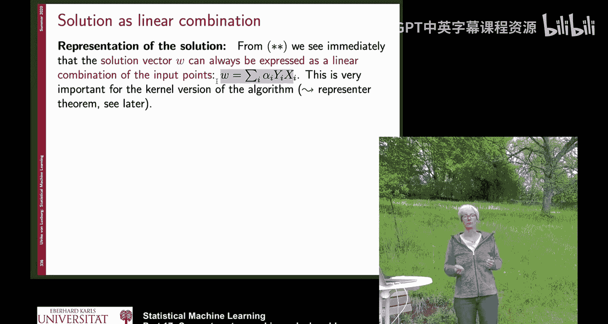
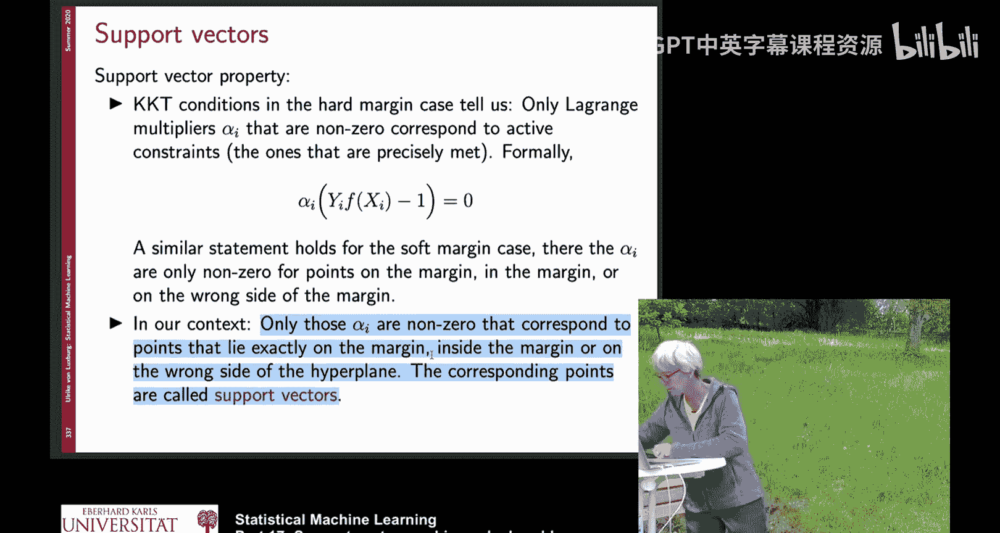
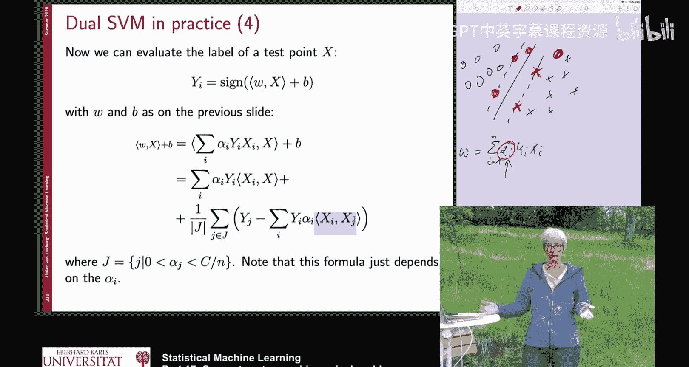
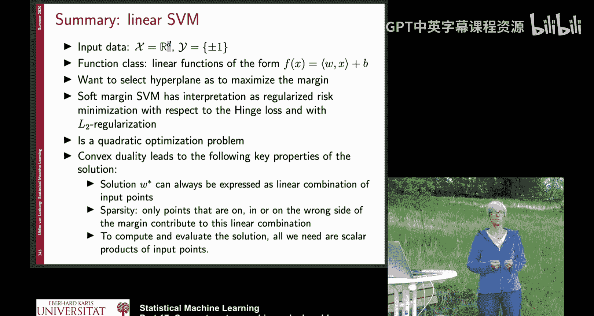

# 17：对偶问题推导 🧠

在本节课中，我们将学习如何推导支持向量机的对偶问题。我们将从回顾原始问题开始，然后应用拉格朗日乘子法，逐步推导出对偶优化问题。理解这一推导过程是掌握支持向量机核心思想的关键。

## 回顾原始问题

上一节我们介绍了支持向量机的原始问题。在硬间隔情况下，我们希望找到一个超平面，使得所有数据点都位于间隔的正确一侧。原始优化问题如下：

**目标**：最小化超平面参数 **w** 和 **b**。
**目标函数**：`(1/2) * ||w||^2`，这等价于最大化间隔（间隔为 `1 / ||w||`）。
**约束条件**：对于每个数据点 `(x_i, y_i)`，需满足 `y_i (w^T x_i + b) >= 1`。

这构成了一个带有 `n` 个不等式约束的二次优化问题。

## 引入拉格朗日乘子法

为了推导对偶问题，我们遵循拉格朗日乘子法的标准步骤。首先，为每个不等式约束引入一个拉格朗日乘子。在支持向量机文献中，这些乘子通常记为 `α_i`（而非 `λ_i`），并且由于是不等式约束，要求 `α_i >= 0`。

接下来，我们写出拉格朗日函数 `L(w, b, α)`。在标准形式中，约束需写为 `<= 0` 的形式，因此拉格朗日函数为：

`L(w, b, α) = (1/2) * ||w||^2 - Σ_{i=1}^{n} α_i [y_i (w^T x_i + b) - 1]`

## 构建对偶问题

对偶函数 `g(α)` 定义为拉格朗日函数关于原始变量 `(w, b)` 的最小值：

`g(α) = min_{w, b} L(w, b, α)`

对偶问题则是最大化这个对偶函数，并满足 `α_i >= 0` 的约束。然而，直接优化这个函数并不直观，因此我们需要进行简化。

## 利用鞍点条件简化

在原始问题的最优解处，必须满足鞍点条件，即拉格朗日函数对原始变量的偏导数为零。

**对 `b` 求偏导**：
`∂L/∂b = - Σ_{i=1}^{n} α_i y_i = 0`  =>  `Σ_{i=1}^{n} α_i y_i = 0`  （条件★）

**对 `w` 求偏导**：
`∂L/∂w = w - Σ_{i=1}^{n} α_i y_i x_i = 0`  =>  `w = Σ_{i=1}^{n} α_i y_i x_i`  （条件★★）

现在，我们将这两个条件代回拉格朗日函数中，以消去原始变量 `w` 和 `b`。

首先，利用条件★，拉格朗日函数中与 `b` 相关的项 `-b Σ_{i=1}^{n} α_i y_i` 变为零。
接着，利用条件★★，将 `w` 替换为 `Σ_{i=1}^{n} α_i y_i x_i`。

经过代换和化简（具体代数运算略），拉格朗日函数简化为仅包含对偶变量 `α` 的形式：

`L(α) = Σ_{i=1}^{n} α_i - (1/2) * Σ_{i=1}^{n} Σ_{j=1}^{n} α_i α_j y_i y_j (x_i^T x_j)`

由于在鞍点处，`L(w, b, α)` 关于 `(w, b)` 的最小值就是 `L(α)` 本身，因此对偶函数 `g(α) = L(α)`。

## 硬间隔SVM的对偶问题

最终，硬间隔支持向量机的对偶优化问题可以明确写出：

**目标**：最大化 `g(α) = Σ_{i=1}^{n} α_i - (1/2) * Σ_{i=1}^{n} Σ_{j=1}^{n} α_i α_j y_i y_j (x_i^T x_j)`
**约束条件**：
1.  `α_i >= 0`，对于所有 `i = 1, ..., n`。
2.  `Σ_{i=1}^{n} α_i y_i = 0` （来自条件★）。

这仍然是一个二次规划问题，但形式更为简洁。

## 软间隔SVM的对偶问题

对于软间隔支持向量机，可以采用完全相同的推导策略。其最终的对偶问题与硬间隔版本非常相似，唯一的区别在于对偶变量 `α_i` 的约束发生了变化：

**约束条件**变为：`0 <= α_i <= C/n`，对于所有 `i = 1, ..., n`。

这里的 `C` 是软间隔SVM原始公式中的惩罚参数。这形成了一个“框约束”的二次规划问题。

## 从对偶解恢复原始解

在实践中，我们求解对偶问题得到 `α_i`，然后需要恢复出原始的超平面参数 `(w, b)` 以用于预测。

**恢复 `w`**：
这非常简单，直接利用条件★★即可：
`w = Σ_{i=1}^{n} α_i y_i x_i`

**恢复 `b`**：
这需要利用KKT互补松弛条件。简要来说：
*   若 `α_i = 0`，则对应点位于间隔之外且分类正确。
*   若 `0 < α_i < C/n`，则对应点恰好位于间隔边界上（即支持向量）。对于这些点，有 `y_i (w^T x_i + b) = 1`。
*   若 `α_i = C/n`，则对应点位于间隔之内或被误分类。

为了计算 `b`，我们可以选取任意一个满足 `0 < α_j < C/n` 的支持向量 `(x_j, y_j)`，然后利用其位于间隔边界上的性质求解：
`b = y_j - w^T x_j = y_j - Σ_{i=1}^{n} α_i y_i (x_i^T x_j)`
为了数值稳定性，通常对所有满足条件的支持向量计算 `b` 并取平均值。

## 对新点进行预测

一旦得到 `w` 和 `b`，对于新的测试点 `x`，其预测标签为：
`y_pred = sign(w^T x + b) = sign( Σ_{i=1}^{n} α_i y_i (x_i^T x) + b )`

## 原始问题 vs. 对偶问题：如何选择？

以下是两种问题形式的对比：

*   **原始问题**：
    *   变量数量：`d + 1`（`w` 的 `d` 维 + `b`）。
    *   约束数量：`n`（数据点数量）。
    *   适用情况：当特征维度 `d` 远小于样本数量 `n` 时，求解原始问题可能更高效。

*   **对偶问题**：
    *   变量数量：`n`（拉格朗日乘子 `α_i`）。
    *   约束数量：`n + 1`（`n` 个 `α_i >= 0` 约束 + 1 个线性等式约束）。
    *   适用情况：当特征维度 `d` 非常大（甚至无穷维，如使用核函数时）或 `d > n` 时，求解对偶问题更优，因为变量数取决于样本数 `n`。

大多数支持向量机库默认求解对偶问题，这一传统源于历史原因，并且更重要的是，**核技巧**天然地在对偶形式中实现。

## 支持向量机的重要性质

推导出对偶形式后，我们可以清晰地看到支持向量机的几个关键性质：

1.  **解的表示定理**：
    由条件★★可知，最优超平面的法向量 `w*` 可以表示为训练样本的线性组合：
    `w* = Σ_{i=1}^{n} α_i y_i x_i`
    这一性质是将线性SVM扩展到非线性核方法的基础。

2.  **支持向量与稀疏性**：
    在最优解中，只有一部分 `α_i` 不为零。这些非零 `α_i` 对应的数据点称为**支持向量**，它们包括：
    *   恰好位于间隔边界上的点。
    *   位于间隔之内或被误分类的点。
    而所有其他 `α_i = 0` 的点（即那些被正确分类且远离间隔边界的点）对最终超平面的定义没有贡献。这带来了解的稀疏性，也是算法名称的由来。

3.  **仅依赖内积**：
    观察对偶问题的目标函数和决策函数：
    *   目标函数中，数据点仅以 `x_i^T x_j` 的形式出现。
    *   决策函数中，新点 `x` 仅以 `x_i^T x` 的形式出现。
    这意味着，我们**不需要知道数据点的具体坐标**，只需要知道任意两点之间的内积即可。这是引入核函数的关键洞见。

## 历史注记与总结

弗拉基米尔·万普尼克（Vladimir Vapnik）被公认为支持向量机的主要发明者，他也是统计学习理论的重要奠基人。
*   **硬间隔SVM与核技巧**：于1992年在学习理论会议上被引入。
*   **软间隔SVM**：随后在1995年发表。

**本节课总结**：
我们一起学习了线性支持向量机对偶问题的完整推导过程。我们从原始问题出发，应用拉格朗日乘子法，得到了等价的、有时更易求解的对偶优化问题。我们了解了如何从对偶解恢复原始超平面参数，并对比了原始问题与对偶问题的适用场景。最重要的是，我们揭示了支持向量机的三个核心性质：**表示定理**、**解的稀疏性（支持向量）** 以及**计算仅依赖于数据点间的内积**。最后一个性质为我们下一节课将学习的**核方法**铺平了道路，它将允许我们将线性SVM轻松地扩展到复杂的非线性分类器中。