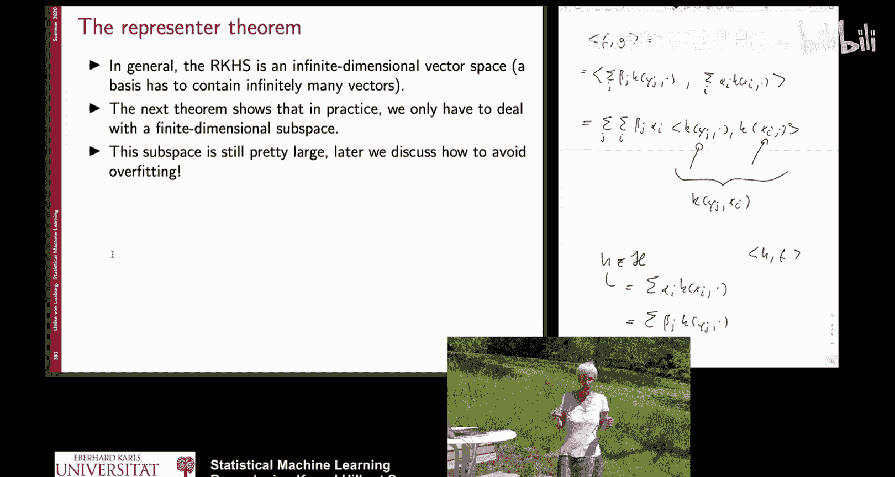
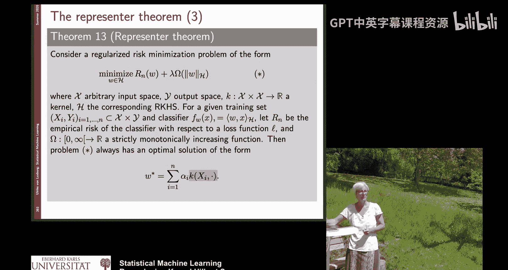
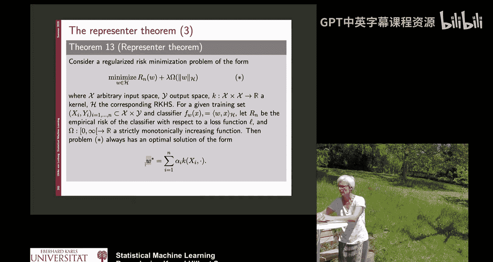
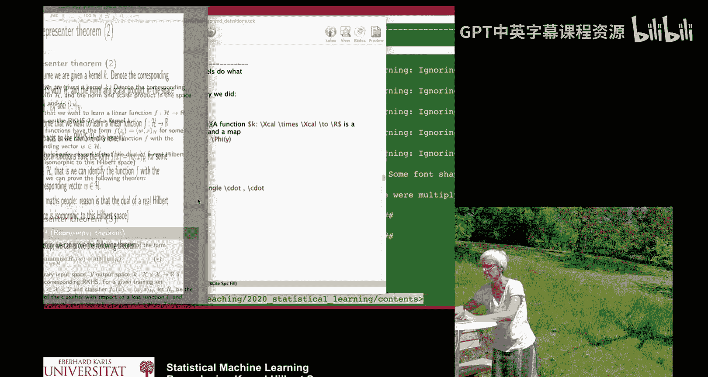
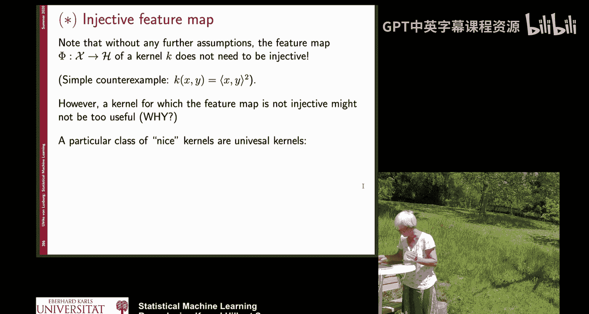
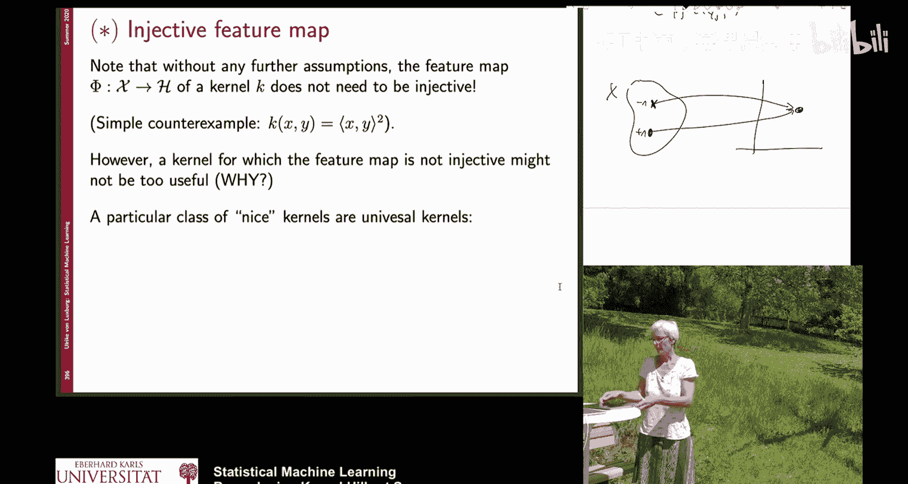
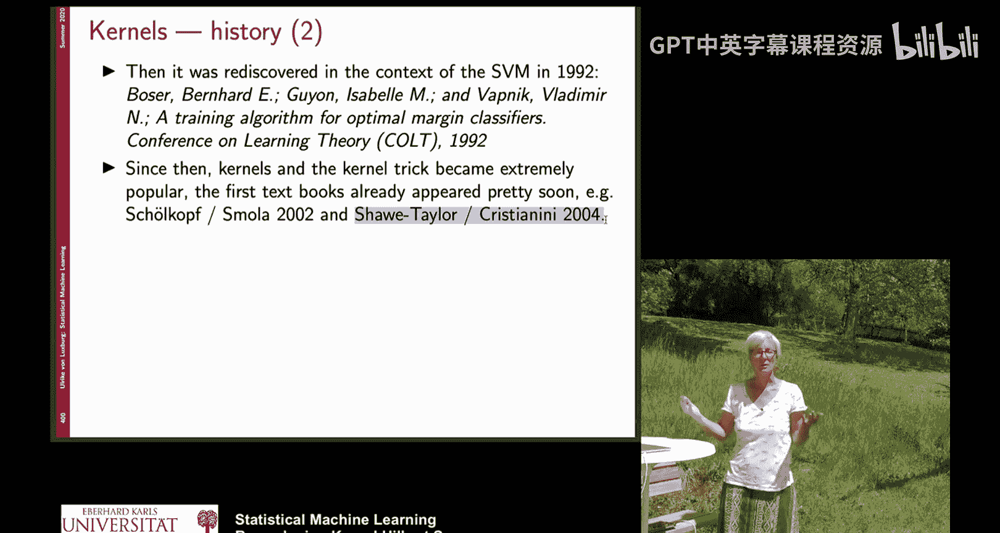

# 概率和统计机器学习：19：再生核希尔伯特空间 🧮

在本节课中，我们将要学习核函数背后的核心理论——再生核希尔伯特空间。我们将理解为什么一个满足特定条件的函数可以被视为一个核，以及如何从这样一个核函数构造出一个特征空间和映射。

---

## 回顾：核函数的目标

上一节我们开始定义核函数。本节中，我们来看看建立核函数作为机器学习合适工具的理论基础。

我们始终假设给定一个数据空间 **X**，它没有任何特定结构。我们希望有一个映射 **Φ**，将这个没有结构的输入空间映射到一个我们通常称为欧几里得空间 **R^D** 的空间。在本讲中，我们也会看到它是一个希尔伯特空间 **H**，这是比 **R^D** 更一般的概念。如果你不知道希尔伯特空间是什么，不必担心，可以始终将其理解为 **R^D**。

现在的情况是，我们有两个输入数据点 **x** 和 **y**。它们将被映射到特征空间中的另外两个点：**Φ(x)** 和 **Φ(y)**。然后我们想要计算一个标量积（内积）。我们得到 **Φ(x)** 和 **Φ(y)** 之间的内积。

我们之前已经阐述了直觉：我们希望避免计算这个迂回路径，即显式定义 **Φ** 和在希尔伯特空间中的内积。相反，我们希望有一个核函数 **K**，使得 **K(x, y)** 等于 **Φ(x)** 和 **Φ(y)** 之间的内积。

到目前为止，我们已经定义了核函数的性质，但现在我们需要证明这些性质确实能使这个方案成立。

---

## 核心定理 🔬

现在有一个定理告诉我们为什么这会成立。请查看幻灯片，我将阅读这个定理。

一个函数 **K: X × X → R** 是一个核，当且仅当存在一个希尔伯特空间 **H** 和一个特征映射 **Φ: X → H**，使得核性质成立，即 **K(x, y) = <Φ(x), Φ(y)>_H**。

让我们来解读一下。这是一个“当且仅当”的陈述，因此有两个部分，它们是等价的。
*   第一个陈述是：**K** 是一个核。
*   第二个陈述是：存在一个特征映射和一个希尔伯特空间，使得如果执行这个映射图，那么核就是这个图中的捷径。

如果你从未听说过希尔伯特空间，不用担心。简单地将其想象成欧几里得空间即可。希尔伯特空间的关键性质是：它是一个向量空间，具有内积（这很重要）。从数学角度来看，该空间需要是完备的，这意味着所有柯西序列都会收敛。特别是在希尔伯特空间中，这个内积总是与一个范数相关。但正如我所说，如果你以前没见过，就把它想成 **R^D**，这完全没有问题。

这是我们在 iPad 上刚刚看到的示意图。

这里有一个问题给你。在定理中，我说有两个方向。
*   一个方向是：如果某物是一个核，那么存在这个特征空间、特征映射和希尔伯特空间，使得图示成立。
*   另一个方向是：假设存在一个特征映射和希尔伯特空间，并且我们以标量积的方式定义 **K**。那么 **K** 是一个核吗？

如果你想证明这个定理，我们需要证明两个方向。我的第一个问题是：有一个简单的方向和一个不那么简单的方向。事实上，“不那么简单”可能说得太轻了，困难的方向是困难的。这不是你刚开始就能立即证明的。现在我问：哪个是简单的方向？请暂停视频，思考一分钟左右，找出简单的方向，然后我们可以讨论困难的方向。

简单的方向是从我们拥有希尔伯特空间中的特征映射到核函数的方向。这本质上就是我们在上一讲中已经看到的。我们说，如果某处有一个标量积，并且我们将核定义为这个标量积的求值，那么它就是一个核。这正是根据核的定义，它是对称且正定的。所以这是简单的方向，它直接遵循核的定义。我们以这种方式定义它，使得这个方向为真。

棘手的部分确实是另一个方向。

---

## 构造困难方向：再生核希尔伯特空间 (RKHS) 🏗️

所以我们现在需要证明的是：假设我们被给定任何空间（可以是任何东西，可以是文本、分子等等）和该空间上的一个核函数。假设有人给你一个函数并告诉你它确实是一个核函数，你知道它是正定且对称的。但这就是你在你的空间上所知道的全部。你没有任何结构，没有度量，没有希尔伯特空间，什么都没有。你可能甚至没有拓扑，你只有一个空间和这个函数。有人告诉你，根据核的定义，这个函数是一个核函数。

现在你需要证明的是：你需要证明存在一个向量空间 **H**（抱歉幻灯片上有笔误，这个不应该在那里），并且在这个向量空间上存在一个标量积（我们用下标 **H** 来区分它，以确保知道我们当前在哪个空间工作）。并且存在一个映射 **Φ**，将原始点映射到新空间 **H**，使得最终你的核函数恰好与这个新空间上的这个标量积一致。这对我们输入空间中的所有 **x** 和 **y** 都必须成立。

现在考虑一下，这确实不是一个简单或平凡的陈述，因为给定核，你需要构造向量空间，你需要构造向量空间上的标量积，你需要构造这个映射 **Φ**，而所有这些都需要以使得这个性质成立的方式来构造。所以这绝不是显而易见的。

这个问题的解决方案，一旦有人展示给你，就不再那么复杂了，但仍然不那么容易。解决方案就是所谓的**再生核希尔伯特空间**，缩写总是 **RKHS**。现在我们将看到这个构造是如何工作的。

---

### 第一步：定义空间和映射

我们首先想定义空间本身。这个空间将是一个函数空间。所以我们要构造的空间 **H** 中的元素将是函数。

现在我要做的是：我需要定义一个空间 **H** 和一个映射 **Φ**，使得我可以将 **X** 中的任何元素映射到空间 **H** 中。所以 **Φ(x)** 应该在空间 **H** 中。我从一个点 **x** 开始，**x** 在我的原始空间中，我想最终进入这个希尔伯特空间。

现在我要做的是（我先写下来，然后再解释）：我取原始空间中的某个点 **x**，我将把它映射到希尔伯特空间中称为 **K_x** 的点。我定义 **K_x** 为一个函数，即 **K(x, ·)**。**K(x, ·)** 是一个从 **X** 到 **R** 的函数。如果你不熟悉这个符号，点号表示参数将要代入的位置。所以 **x** 不是函数的参数，它是一个固定的参数。而点号所在的位置，就是我们放入参数的地方。所以 **X** 中的一个点 **y** 将被映射到 **K(x, y)**。再次强调，**y** 是我们函数的参数，**x** 是函数的参数。我在这里使用的符号 **K_x** 试图明确这一点：**K_x** 是一个以 **y** 为参数的函数，它将被映射到 **K(x, y)**，其中 **K** 当然是我们被给定的那个核函数。

再次强调，幻灯片上也有。所以我们有一个原始空间中的点 **x**，它将被映射到一个将存在于这个新空间中的函数。这个函数 **K_x** 接受一个参数 **y**，并将其映射到 **K(x, y)**。为了更明确，这也是幻灯片上的图，但我喜欢重画它。

所以我们这里有 **x1, x2, x3** 在我们的原始空间中，这里我们在新空间中。那么 **x1** 将被映射到这个函数 **K(x1, ·)**，**x3** 将被映射到 **K(x3, ·)**，**x2** 将被映射到某个 **K(x2, ·)**。所以每个原始点最终都被映射为新空间中的一个函数。

这对于非数学专业的人来说，已经是一个有点复杂的定义了。

到目前为止，我们只是定义了原始点的像，所以我们定义了将原始点映射到一些新点的映射。但到目前为止，这些新点没有任何向量空间结构或任何东西，但我们希望它们存在于一个希尔伯特空间中。

---

### 第二步：赋予向量空间结构

所以现在我们需要做的是，我们需要从这些点（到目前为止，我们只是有一组像点）中构造出一个希尔伯特空间。对于希尔伯特空间结构，我们需要能够求和、乘以标量常数等等。

所以现在我们做的是：我们考虑所有可能存在于我们输入空间中的点的像 **K_x**，并将它们视为一个向量空间的生成集。如果你记得线性代数，一个向量空间总是可以由一些元素张成。然后你需要定义取元素的和意味着什么，你需要定义乘以标量值意味着什么。然后你可以查看通过从原始数据点取一些标量和倍数所能达到的所有点。

所以，我们现在需要定义一个空间（暂时称为 **G**，因为它还不是我们最终要看的空间），它由这些函数的所有有限线性组合组成。所以我现在做的是：我有原始函数 **K_x**，我取所有线性组合。例如，我有 **K(x1, ·), K(x2, ·), K(x3, ·)**。这些是我拥有的三个点的像。现在我需要定义一个新函数 **g**，它可能是 `5 * K(x1, ·) + 2 * K(x2, ·) - 3 * K(x3, ·)`。这是一个点的线性组合。通过函数相加和乘以标量，我们真正意思是在空间中像求和函数那样求和函数，即求和这些函数的求值，取标量积也是如此。

一般来说，我们考虑所有可能长度任意 **R** 的线性组合（**R** 可以是任何自然数）。我们固定任何 **R**。对于每个 **i**，我们有一个 **α_i**，它也可以是任何实数。然后我们定义所有原始函数 **K_{x_i}** 的线性组合的和。到目前为止，这整个集合（它仍然是一个集合）比我们开始时的大得多。事实上，它已经是一个向量空间，这将被称为 **G**。

好的，所以我们现在有的是（也许我再来画一下我的图），这是我们的原始空间 **X**。我们现在定义了这个映射 **Φ**，它将一个点 **x** 映射到一个点 **K_x**。我们开始时有很多蓝点，它们是所有原始数据点的像。所以这里我们有一些蓝点。像就是另一边的蓝点。现在，我们所做的是：我们添加了更多更多的点，它们是我们通过这种方式可以达到的所有线性组合。由空间中的公式和所有蓝点和 **G** 点共同组成的集合，现在就是我们称为 **G** 的东西。

到目前为止，我们定义了（也许暂时仍称它为）一组更多的函数 **G**。

---

### 第三步：定义标量积

然后我们想做的是：我们想在 **G** 上定义一个标量积，因为最终我们想要一个希尔伯特空间。所以 **G** 已经是一组向量。还有一些小性质我们需要证明它是良定义的。但无论如何，所以 **G** 现在是一个向量空间，我们可以取和、差、乘积，所以它是一个向量空间。

现在，对于一个希尔伯特空间，我需要有一个标量积。所以现在我们需要定义我们向量空间中两个元素之间的标量积是什么。

我们首先在这些原始像上定义标量积，即在这个图中（目前在 iPad 中间）的蓝点上。所以我们需要做的是定义点 **K_x** 和 **K_y** 之间的标量积是什么。所以 **x** 和 **y** 存在于我们的原始空间中。我们将它们映射到空间 **G** 中的 **K_x** 和 **K_y**，我们现在需要定义这个新空间中的标量积是什么。

正如幻灯片上所示，如果你把它写出来，这是 **K_x** 和 **K_y**。如果你觉得这个符号有帮助，如果不觉得，就忽略它。但现在定义来了。第一件事只是一个等式。现在我定义标量积是什么：我简单地将其定义为 **K(x, y)**。

所以对于数据点的原始像，标量积本质上是它们的核值。注意，这某种程度上是我们需要拥有的，因为 **K_x** 和 **K_y** 之间的标量积是 **Φ(x)** 和 **Φ(y)** 之间的标量积，因为 **Φ** 是将数据点映射到函数 **K_x** 的映射。所以如果我们希望最终的东西是一个核，那么它最好与 **K(x, y)** 相同。

所以在这里，本质上我们没有选择。如果我们希望整个事情最终成立，我们定义这个标量积的唯一方式就是 exactly 这样做。

但现在注意，到目前为止，我们所做的只是定义了输入空间点像上的标量积（即之前绘图中的蓝点，目前在 iPad 右侧）。蓝点是原始数据点的像。我们现在知道这两个点之间、这些点中任意两点之间的标量积是什么。但我们还需要将这个定义扩展到向量空间中所有其他点，即线性组合，因为标量积需要定义在整个空间上。

这就是这张幻灯片中间的内容。现在，假设我们有两个函数存在于这个空间中。函数 **g** 是输入函数的线性组合。我们有一个函数 **f**，它是另一个组合。所以这两个定义中的 **α_i** 和 **β_j** 不相同，**x_i** 和 **y_j** 也不相同。而且这个线性组合的长度也不需要相同。

所以我们现在需要做的是：我们需要定义这些线性函数之间的标量积是什么。现在，再次强调，你没有太多选择。我想在 iPad 上展示一下。

所以我们现在想做的是 **f** 和 **g** 之间的标量积。目前，我们简单地代入定义。**f** 的定义是 **∑_j β_j K(y_j, ·)**（如果幻灯片上有笔误，应该是 **y_j**）。然后 **g** 是 **∑_i α_i K(x_i, ·)**。这是我们想要定义的标量积。

现在，它是一个标量积，对于标量积，你知道它在两边都是线性的。所以你需要能够做的是：你需要能够写成 **∑_j ∑_i β_j α_i**，然后是 **K(y_j, ·)** 和 **K(x_i, ·)** 之间的标量积。到目前为止，我只是利用了标量积的双线性性质。如果我想定义一个标量积，它必须是线性的。所以没有选择，这个性质必须成立。

但现在注意，在这个表达式中，我们有 **y_j** 和 **x_i**，它们是我们数据空间中的原始点。对于那些点，我已经定义了标量积是什么。即，我知道标量积现在是 **K(y_j, x_i)**。这是根据我们之前拥有的性质，在那里我们也没有选择。

这就是我们现在在幻灯片上有的内容。所以，对于两个函数 **f** 和 **g**，它们是原始数据点的线性组合，我们将标量积定义为幻灯片上所写的那样。好的，没有选择，它必须是这种方式。

---

### 第四步：验证与完备化

现在，你仍然需要稍微思考一下这个定义是否真的有效。第一件事是：你需要检查它是良定义的，这是一个微妙的性质。注意，可能我们空间中有一个点（称为 **h**，是我们新定义空间 **H** 中的一个函数），假设 **h** 是一个线性组合 **∑_i α_i K(x_i, ·)**。好的，所以它是任何线性组合。

现在，我达到一个新点 **h** 的这个线性组合可能不是唯一的，因为这些函数 **K(x_i, ·)** 可能是线性相关的。所以这也可以写成 **∑_j β_j K(y_j, ·)**，对于不同的 **β** 和 **y**。所以有两个线性组合都得到相同的函数 **h**，但线性组合不同，而且这些基点 **x_i** 和 **y_j** 也不同。

但现在注意，当我们定义标量积时，我们使用了这些数据点作为线性组合的显式表示。你现在需要证明的是，例如，如果你现在计算 **h** 和 **f** 之间的标量积（假设 **f** 是我们之前有的函数），那么无论我将 **h** 的哪个线性组合代入定义，这总是给你相同的结果。

如果这不成立，那么这个定义就不是良定义的。数学中的“良定义”总是意味着你做了一个不会引起任何冲突的定义。如果这个性质不成立，那么你就会有冲突，因为你有一个点，根据你如何表达那个点，你最终会得到这个标量积的不同值，这当然不可能是真的。所以你需要证明的第一件事是这是良定义的。

我没有把它放在幻灯片上，你可以在家尝试。真的不难。请尝试一下：假设你有两个线性组合，就像我们在 iPad 上那样，计算这个函数与另一个函数的标量积，并尝试证明你总是会得到相同的结果。

然后你可能想证明的下一件事是，我们定义的这个东西确实是一个标量积，即它是对称且正定的。正如我已经暗示的，当我们构建它时，某种程度上它一定是这样的，因为我们正是以这种方式构建它的。但形式上，你可能仍然想写下你需要证明哪些性质以及为什么 exactly 这些性质成立。这并不难，因为我们从一个正定函数开始。但这就是我们需要它是正定的事实的地方，因为否则，我们到目前为止定义的结果不能是一个标量积。好的，这个我也留作练习。

你需要证明的最后一件事（现在只在你了解希尔伯特空间的情况下相关）是：希尔伯特空间总是一个完备的向量空间。“完备”意味着如果你取向量空间中的点序列并且序列收敛到一个点，那么这个点也需要在向量空间内部。

所以我们现在做的是：如果你想让这成为一个真正的数学向量空间，我们需要取所有序列的极限。我们需要取这个特定点集的闭包。这就是我在幻灯片上写的：为了使 **G** 成为一个适当的希尔伯特空间，我们需要取拓扑完备化，通常用 **G** 上加一条横线表示。然后这意味着你添加了空间中序列极限的所有点。结果空间 **H** 就是我们称为希尔伯特空间的东西。它被称为再生核希尔伯特空间。通过构造，它具有 **K(x, y)** 与 **Φ(x)** 和 **Φ(y)** 之间的内积相同的性质。

好的，所以这确实不是一件容易的事，特别是如果你以前没见过。如果我上一门正式的课，我现在可能会重复这个构造，也许我现在也这样做。可能有助于理解。所以让我们再次回顾一下我们需要做什么。我现在做得快一点，但试图再次引出概念步骤是什么。

我们需要做的是：我们被给定一个空间（原始空间）和核函数 **K**。我们需要构造这个向量空间 **H**、这个特征映射 **Φ** 以及空间上的这个标量积。

为了构造空间本身，我们进行如下操作。对于原始空间中的每个输入点 **x**，我们定义这个点的像是什么。一旦我们完成了这个，我们就已经有了特征映射。这个点的像将是一个函数，称为 **K(x, ·)**。所以到目前为止我们已经定义了特征函数 **Φ**。这就是你在底部图像上看到的。

现在，我们需要给这些像点一个向量空间结构。首先，我们需要取所有输入点的线性组合，所以我们最终得到一个向量空间结构。这就是我们在这里所做的。所以我们取所有输入点像的线性组合，并将它们添加到空间中。我们称结果空间为 **G**。这现在是一个向量空间，因为在这个向量空间中，我们可以取任意点、线性组合、乘以标量等等，并且所有向量空间定律都将得到满足，所以我们现在有一个向量空间。

我们需要做的下一件事是定义标量积。对于标量积，我们首先定义它在输入点的像上应该是什么样子。我们在那里定义它的方式使得它确实与核一致。这个定义已经确保了我们想要的性质，即 **K(x, y)** 与 **Φ(x)** 和 **Φ(y)** 之间的标量积相同，这个性质成立。一旦我们完成了构造，这就成立，但这是说明这需要成立的那一行。

一旦我们在所有输入点或输入点对上定义了标量积，我们需要将这个定义扩展到空间 **G** 中所有可能的函数，我们需要通过标量积的线性性质来做到这一点。再次强调，如何做到这一点没有选择。这只是如果你希望构造成功，唯一的方法。

然后我们需要证明这一切都没问题且良定义。然后出于数学原因，我们取这个拓扑空间的完备化，添加所有柯西序列，然后我们就有了我们的向量空间/希尔伯特空间 **H**。

---

## 再生性与名称由来 🔄

你可能想知道为什么这个东西被称为再生核希尔伯特空间。这真是一个复杂的名字。特别是，“再生”这个词从哪里来？这来自一个非常简单的事实，称为再生性质。

假设你空间中有任何函数，比如说，是输入函数的线性组合。那么当你取这个函数与任何其他输入点的像之间的标量积时会发生什么？你得到的是 **f(x)**。证明在幻灯片上，你可以看看。这只是线性性质的一个简单操作，没有什么秘密。我想每个人在家也能做。

这就是为什么它被称为再生性质，因为我们 sort of 再生了函数 **f**，它 sort of 是一个求值函数。无论如何，再生核希尔伯特空间这个名字很久以前就在数学中被选定了，显然是这个性质让它得名。

---

## 关于 RKHS 的更多备注 📝

我想再做一些评论。再生核希尔伯特空间，正如我刚刚所说，是在机器学习之外、在核算法之外发明的数学对象。当然，有一篇非常著名的论文由 Aronszajn 在 1950 年代（我想是 1950 年）发表，他 essentially 发展了这个整个空间和整个数学理论，当然完全独立于机器学习，因为在 1950 年代机器学习还不存在。

关于这些空间有很多很多数学理论和泛函分析，因为它们是非常好的向量空间。在这里，我只想为你们中的数学家列出一些性质，其他人直接忽略它，这不重要，也不会出现在任何练习或考试中。但我还是想提一下。

再生核希尔伯特空间的一个很好的性质如下：一个希尔伯特空间是再生核希尔伯特空间，当且仅当所有求值函数都是连续的。这里隐藏了许多东西。我不想深入任何细节，如果你是数学家并且对此感兴趣，你可能会打开教科书阅读。事实上，这是一个合理的漂亮定理。也许再次，有简单和不那么简单的方向。如果你有一个再生核希尔伯特空间，证明求值函数是连续的是较容易的方向；另一个方向是 sort of 困难的，因为它意味着你有一个抽象的向量空间，你有一个求值函数，然后你可以构造一个核，使得如果你从这个核构建一个再生核希尔伯特空间，这与你开始的空间相同或同构于你开始的空间。是的，事实上，这与我们这里有的再生性质有关。无论如何，如果你感兴趣，可以查阅资料。

另一个重要的是，RKHS 中的函数是逐点良定义的。所以如果你有一个空间中的函数，并且你在一个特定点求值，你会得到一个适当的数值。这很好，因为例如在 L2 空间或 L1 空间中，你没有那个性质，因为函数只是几乎处处定义的。这对于机器学习当然很重要，因为我们在机器学习中，如果你在一个测试点求值一个函数，你想知道一个适当的值，而你不喜欢 L2 函数，你不能真正说出这个 L2 函数在测试点的值是什么，因为它甚至没有定义，只定义到零测集。所以，所以你不能为一个特定点定义函数值。再次强调，这是一个数学上的微妙之处。但 RKHS 空间在这个意义上确实很好。

另一件也很有趣且漂亮的事情是：如果你被给定一个核，那么 RKHS 在等距同构意义下是唯一的。所以无论何时你从一个核开始，并尝试构造一个特征映射和一个希尔伯特空间，使得整个图示成立，你最终总会得到完全相同的希尔伯特空间。所以这里没有歧义。

还要注意，这对机器学习也很重要，因为如果你有不同的构造导致不同的空间，那么某种程度上你对这个整个核框架对你的数据做了什么有不同的解释。而这里的答案说，不，这不可能是真的。它总是唯一的。反过来也是，如果你给定 RKHS，并构造一个核使得所有图示成立，它也将是唯一的。

然后还有一个更深刻的评论，这整个东西与这里的表示定理非常密切相关，如果你知道那是什么，你可能想思考一下，甚至可能想查阅资料。或者如果你不是数学家或不感兴趣，直接忽略。这只是为了展示这种整个方法的数学美感。我真的觉得这非常惊人、美好，而且，是的，我非常喜欢这整个框架。

---

## 表示定理 🎯

现在还有一个章节我想讨论，或者一个简要的性质，称为表示定理。当我们在讨论支持向量机时，我已经简要提到过它。在那里我们说，如果我们被给定，如果我们看一个支持向量机的解，这个系数向量 **w**，如果你记得，总是你的输入点的线性组合。现在这是更普遍成立的东西。现在我们想看看这个。也许抱歉，在我继续之前，为什么这很重要。

现在假设我们将数据通过这个特征映射映射到某个高维空间，某个希尔伯特空间。我需要做一个我之前没有提到的评论：我们构造的希尔伯特空间通常是无限维的。我的意思是，你已经可以看到，如果我们的原始数据空间有无限多个点，每个点都被映射到我们空间中的一个新点，如果这些点是线性无关的，我们显然已经，我的意思是，显然空间必须有无限维。

现在我们有我们的，比如说，**n** 个数据点映射到这个无限维的许多空间中。现在我们想在该空间中解决一个优化问题。当然可能发生的是，我们为分类找到的超平面的法向量，某种程度上，我的意思是当然它需要是一些点的线性组合，但可能它不是存在于我们原始数据空间中的点，那么我们就不知道如何表达这个新点，某种程度上我们会遇到或者我们可能会遇到麻烦，它可能存在于一个我们根本无法仅基于我们拥有的有限训练点集达到的空间中。

所以重要的是，空间真的被限制在这个范围内，或者我们需要看的解被限制在由我们的训练数据张成的子空间中。这就是这个表示定理的内容。

设置如下：假设我们被给定一个核 **K**，用 **H** 表示对应的 RKHS。我们再次有希尔伯特空间中的范数和标量积。现在假设我们想学习一个从希尔伯特空间到输出的线性函数。这是重点。最终，我们希望在空间中有线性算法。所以空间中的线性函数具有这种形式：函数 **f** 由 **f(x) = <w, Φ(x)>_H** 给出，就像在欧几里得空间中一样。所以我们可以用这个法向量 **w** 来识别函数 **f**，就像我们之前在欧几里得空间中一样，我们需要学习这个向量 **w**。

现在有以下定理成立，它被称为表示定理。我们现在考虑以下形式的正则化风险最小化问题。所以我们需要在我们的空间中搜索所有法向量。我们想要最小化所有这些法向量的某个量。我们最小化的量是某个经验风险值，加上 **λ** 乘以一个正则化项。而这个定理的正则化项需要是依赖于函数范数（向量范数）的东西。如果你记得，在我们的许多例子中，我们使用了一个向量的 1-范数或 2-范数，特别是对于支持向量机，我们使用 2-范数作为正则化项。现在它是这个希尔伯特空间中的范数。

假设是什么？所以 **X** 是任意输入空间，**Y** 是任意输出空间，**K** 是核函数，**H** 是 RKHS，我们看的分类器是线性分类器，我们的 **R_emp** 是关于损失函数的正常经验风险（我们并不真正关心它），而这个正则化器 **Ω** 是一个单调递增的函数。所以它只是意味着如果我们计算这个向量的范数的函数，**w** 的范数越大，这个正则化项就应该越高。

所以这些都是非常温和的假设。本质上，如果你想在这个上下文中解决一个正则化问题，这总是成立的。

然后陈述是：这个优化问题（定理顶部的星号）的解总是可以表示如下。它是我们输入点的线性组合。因为我们在 RKHS 中，输入点的像是 **K(x_i, ·)**，所以这些是函数。陈述是，向量 **w***（这里的解）可以表示为原始训练点的线性组合。它没有任何分量伸向空间中没有输入点的部分。这是主要信息。

我只想给你证明的直觉，它并不真的困难，但如果我们没有这种数学符号，那么很难正式地写出来，但我想非正式地我们可以做到。

---

### 表示定理证明思路

我们现在将空间分成两个子空间：**H**。也许我在这里画个图。所以我们有……在阳光下很难看清我的 iPad 是否开着。哦，温度，我的 iPad 需要冷却才能使用，因为阳光照在我的 iPad 上，这太完美了。那我需要不用我的图来做。我们空间分成两个空间：由数据张成的空间和补空间。所以没有图，尝试做一下，我们有……

所以如果你有一个空间，比如说我们在一个三维空间中，我们有两个输入点，它们张成一条线。现在我总能在基中描述空间，其中空间的第一部分是在线上的点，然后我有第三部分指向不同的方向。

一般来说，如果我有一个，比如说，维度为无穷的空间，我有 50 个输入点，比如说这 50 个输入点张成我的空间的 50 个维度，那么整个空间就是由数据点像张成的子空间加上其余部分的直和。

这就是我在这里做的：我有 **H_data**，这是由数据点张成的子空间，和补空间，我可以简单地称为 **H_comp**。一般来说，整个空间 **H** 现在是这两个空间的直和。这意味着我可以将每个向量在这个空间中表达为一个和：一部分存在于由数据张成的子空间中，一部分存在于与这个子空间正交的子空间中。

现在，如果我有两个不同的向量 **w**，但它们在 **w_data** 部分上的系数相同，那么容易看出的是，具有相同数据部分的这些函数的预测在所有训练点上是一致的。所以无论我在 **w_comp** 分量中放入什么，结果都不会改变训练点上的结果。

所以本质上，在不是由训练点张成的子空间中发生的任何事情，完全不会影响训练点上的结果。现在，特别是，这意味着这个向量 **w** 的损失不受我在这个 **w_comp** 部分放入的任何东西的影响。

现在，我们在这个正则化中做的是：我们想要找到具有最小目标函数的向量 **w**。当然，如果我现在对向量 **w** 有不同的选择，而损失只依赖于数据部分，但范数当然会改变，如果 **w_comp** 分量很大。所以如果 **w_comp** 部分不存在（即为 0），这个整个向量 **w** 的范数特别小。你可以正式证明，给定任何 **w_data**，如果你设置 **w_comp** 为 0，范数比如果你使用其他东西要小。所以，本质上，如果你的目标是最小化范数，那么 **w_comp** 最好设置为 0，而且它对于预测你的损失也不起任何作用。所以最终，解将是 **w_comp** 部分为 0。

这就是这里最后一行所写的：你总能找到一个最优解，其中 **w_comp** 为 0。这就是这个表示定理证明的概要。

也许再次，试着说，这直观上意味着什么。所以我们已经看到，对于任何给定的核，总存在一个特征空间。但通常，这是一个无限维的希尔伯特空间。而表示定理现在说，我们只需要看由我们的数据点张成的这个子空间。这些是 **n** 个数据点，现在这 sort of 给了所有人（或应该给所有从未听说过希尔伯特空间的计算机科学家）宽慰。我们现在知道，我们的结果存在，或者我们正在搜索的向量存在于一个由 **n** 个数据点张成的子空间中。如果我们有一个希尔伯特空间，并且我们只考虑一个 **n** 维的子空间，这总是同构于 **R^n**，即具有 **n** 维的欧几里得空间。所以在最后，我们可以忘记关于背景中有希尔伯特空间的整个问题，我们总是工作在最多 **n** 维的欧几里得空间中，如果 **n** 是训练点的数量。这真的会让我们的生活更容易，无论是在理论上，当然也在实践中，因为在实践中，你将如何搜索某个无限维空间？这将很麻烦。

---

## 特征映射的单射性与通用核 🚀

接下来我想简单谈一下特征映射的单射性。到目前为止，我们没有对这个映射 **Φ** 的形式做任何假设。特别是，你希望拥有的是这个函数 **Φ** 是单射的。如果你不记得单射是什么意思，单射意味着如果你在空间 **X** 中取两个不同的输入点，那么它们也被映射到空间中的两个不同的输出点。也许我试试我的 iPad 是否冷却了一点。好了，它冷却了。我需要快一点，否则它又会热起来。

所以这是我的图，输入空间 **X**。我们在那个空间中有两个点，我们将它们映射到我们的新空间。如果我们将它们映射到同一点，那么某种程度上我们就完了，因为会发生什么，比如说这两个点有不同的标签，比如说这个是叉，标签是 -1，这个是圆，标签是 +1。现在它们被映射到同一点，那么当然我们找不到任何线性分类器可以分开这些点了。

所以你真正希望拥有的是，在这个核框架中构造的特征映射是单射的。现在注意，到目前为止，没有什么阻止我们拥有非常平凡的东西，比如所有东西都被映射到恰好一个点上。所以并不清楚，给定一个核，特征映射是否具有它是单射的这个好性质。

所以从理论的角度来看，你需要证明特征映射是单射的，至少对于合理的核。现在注意，这将取决于你的核函数的性质，因为这个特征映射完全由你的核函数定义。

现在有一类特别好的核，被称为通用核，它们具有这个性质。我不打算深入细节，只花几分钟，这再次与任何考试无关。

我们说一个度量空间上的连续核被称为通用的，如果 **K** 的 RKHS 在 **C(X)** 中稠密。现在这又是，如果你没见过这些概念，请忽略它，正如我所说，它与考试无关。如果你知道那是什么意思，我试着解释一下。**C(X)** 是这个空间 **X** 上所有连续函数的空间。我们说一个连续核被称为通用的，如果那个空间 **H** 在 **C(X)** 中稠密，这意味着你可以用核函数的线性组合来近似你原始数据上的任何连续函数。这是在无穷范数下，因为这是 **C(X)** 上的范数。

从概念的角度来看，这是一个非常强的性质，但也是一个非常理想的性质，因为结合表示定理，它将说明无论我们的决策面是什么，只要两个函数之间的决策面是连续的，我们将能够找到它。所以如果我们有我们的数据空间 **X**，比如说两个类之间的决策面，最好的一个是这个，一个非常弯曲的函数。但它仍然是连续的。如果我们有一个通用核，那么我们将能够表达这个复杂的函数，或者至少用一个核函数的线性组合来近似这个函数。这就是将要发生的，例如，在支持向量机中。这是直觉。所以形式上通用核的定义是顶部的那个，直觉是我们可以近似所有连续函数，这很好，因为这样我们可以实现任何类型的连续分类函数。例如，我的意思是，举第一个例子，具有固定核宽的高斯核是通用的。我们稍后会看到，对于这个，如果你想证明支持向量机是一致的，你需要拥有核的这个通用性性质。好的。多项式核不是通用的。好的。这不是我现在想讨论的。

我想提到的是，我们在机器学习中看到的许多核都是通用的，特别是成功的那些，特别是高斯核。如果你想知道关于这个的任何事情，有这本由 Steinwart 和 Christmann 写的关于支持向量机的书。他们都是数学家、统计学家，从非常数学深刻的角度写了所有关于核、支持向量机和相关算法的理论。我的意思是，他们真的考虑了所有关于可测性和这类方面的细节，并写下了理论。所以如果你是数学系学生，并且对核的任何细节感兴趣，例如通用核的性质，那么你可能想看看这本书。事实上，Steinwart 多年前就提出了通用核的这个定义，他在斯图加特，他是斯图加特数学系的教授。

---

## 历史背景与总结 📜

为了结束这一讲，让我们简单地看一下历史，我总是喜欢把事情放在背景中，并提醒你们事情是何时发展的。正如我所说，这些 RKHS 是由 Aronszajn 在 1950 年代就已经在一篇令人惊讶地易读的论文中发展起来的。所以通常如果你打开那个时代的论文，它们很难读，因为它们是以与现在写论文非常不同的风格写成的，但这篇是一个例子，它甚至可以是一本教科书。我想如果你打开它，如果你有数学背景，你将能够理解其中的大部分。

然后这种特征空间解释显然已经在 1964 年由 Iizerman 发表，但它被完全忽视了，没有人真正理解这种整个方法的影响。可能他自己也没有注意到。然后这整个东西在支持向量机的背景下在 1992 年由 Boser、Guyon 和 Vapnik 关于支持向量机的论文中被重新发现，这篇论文将核技巧引入了机器学习文献。然后它就起飞了。

在那之后的时间里，本质上，有许多许多论文试图探索这整个核学习框架。当时的两本教科书是 Bernhard Schölkopf（他在 Tübingen）和 Alex Smola（现在在 AWS 和 John C. D. 和 K. 出现在 2002 和 2004 年）的领先教科书。从那时起，核方法就存在了，并且已经被彻底探索，我们将在接下来的讲座中看到更多。

---

## 总结 ✨

在本节课中，我们一起学习了再生核希尔伯特空间的核心理论。我们从回顾核函数的目标开始，理解了其核心定理：一个函数是核当且仅当存在一个希尔伯特空间和特征映射使得核等于特征映射后的内积。我们重点剖析了该定理构造性证明的困难方向，一步步构建了 RKHS：首先将数据点映射为函数，然后通过线性组合形成向量空间 **G**，接着在其上定义与核值一致的内积，最后通过拓扑完备化得到希尔伯特空间 **H**。我们还了解了 RKHS 的再生性质、唯一性等优美特质。随后，我们学习了表示定理，它保证了在正则化风险最小化问题中，最优解可以表示为训练样本的线性组合，这极大地简化了实际计算。最后，我们简要探讨了特征映射单射性的意义以及通用核的强大逼近能力，并对核方法的历史发展有了初步认识。通过本节课，你应当对核函数为何能在高维特征空间中有效工作，以及其背后的数学基础有了更深入的理解。