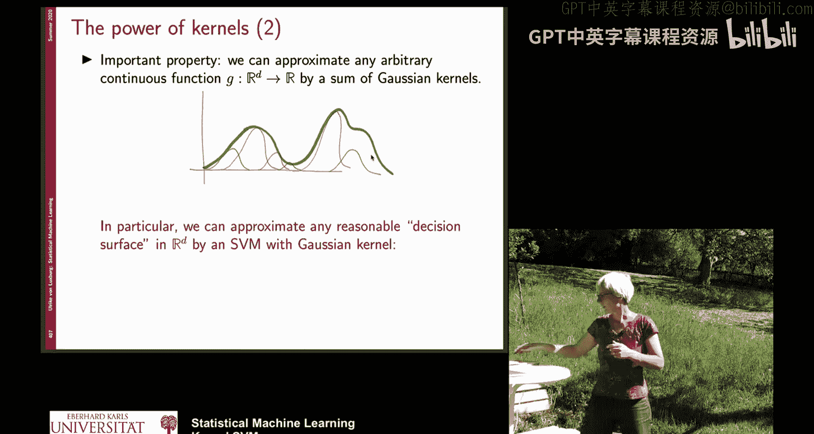
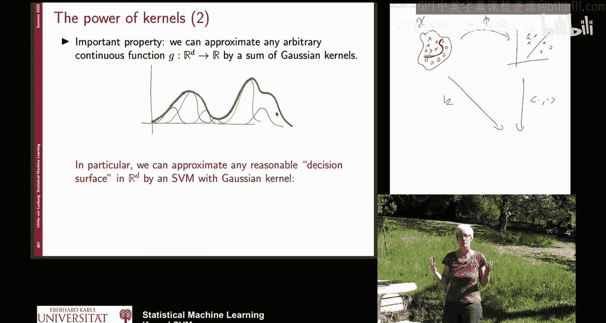
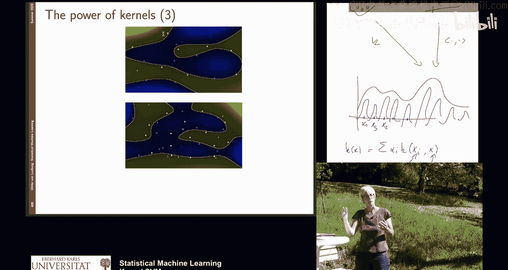
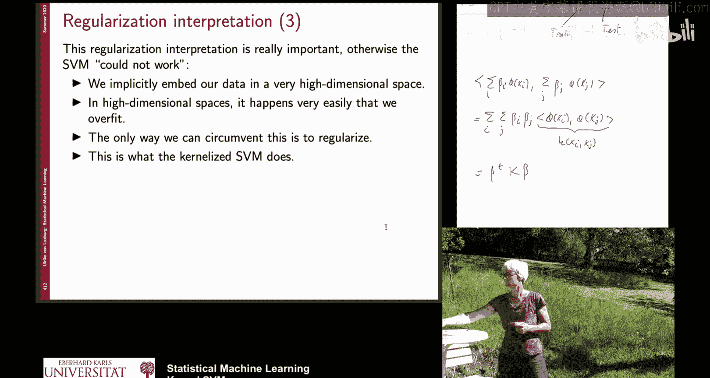
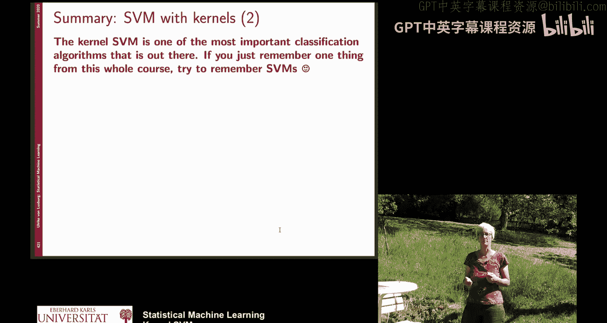

# 概率和统计机器学习：20：核支持向量机 🧠

在本节课中，我们将学习如何将核方法应用到支持向量机中，从而构建出强大的非线性分类器。我们将从回顾核方法的基本概念开始，逐步推导核化支持向量机的形式，并探讨其成功的原因与局限性。

## 核化算法框架回顾

上一讲我们介绍了核的定义、性质以及再生核希尔伯特空间的理论基础。本节中，我们将把这个框架应用到第一个具体算法——支持向量机上。

核化一个算法的核心步骤如下：
1.  首先，将算法在线性空间中以线性形式写出，确保其中只涉及数据点之间的内积。
2.  然后，用核函数替换这些内积。
3.  最终，算法便在上一讲定义的再生核希尔伯特空间中运行。

## 从对偶问题出发

现在，让我们看看这在支持向量机中是如何实现的。我们从支持向量机的对偶问题开始。回想一下，在推导支持向量机时，我们首先从最大化超平面与训练点之间间隔的几何动机出发，将其写成一个二次优化问题，然后利用拉格朗日方法推导出所谓的对偶问题。

这个对偶问题正是我们核化的起点。在这个问题中，训练点影响问题解或进入优化问题的唯一方式是通过内积。我们永远不需要数据点的具体坐标，只需要两个训练点之间的内积。

## 核化支持向量机

核化意味着，每当我们在优化问题的表达式中遇到像 `x_i · x_j` 这样的两个训练点的内积时，我们简单地用核函数 `k(x_i, x_j)` 来替换它。

以下是核化后的支持向量机对偶问题。给定输入训练点 `(x_i, y_i), i=1...n` 以及核函数 `k`，优化问题如下：

**优化问题：**
```
maximize ∑_{i=1}^n α_i - (1/2) ∑_{i=1}^n ∑_{j=1}^n α_i α_j y_i y_j k(x_i, x_j)
subject to 0 ≤ α_i ≤ C, i=1...n
           ∑_{i=1}^n α_i y_i = 0
```

我们只需将核函数代入即可。这就是核化支持向量机问题。我们可以求解这个问题，得到对偶变量 `α`。



选择何种核函数取决于具体应用。核函数旨在编码数据点之间的某种相似性。如果你的数据在欧几里得空间中，可以简单地使用高斯核；如果你想对社交网络中的人进行分类，可以使用图核等。选择适合你应用的核函数。

## 计算新测试点的预测结果



一旦我们求解了优化问题，就需要能够计算新测试点的预测结果。回想一下，在推导对偶问题后，我们得到了原始变量 `w` 和 `b` 的表达式，我们需要它们来计算支持向量机对新测试点的解。

原始权重向量 `w` 的公式为：
```
w = ∑_{i=1}^n α_i y_i φ(x_i)
```
其中 `α_i` 是我们在对偶优化问题中找到的对偶变量，`φ(x_i)` 是将数据点映射到特征空间的映射函数。

偏移参数 `b` 的计算稍复杂一些。首先需要找到一个数据点 `j`，满足条件 `0 < α_j < C`，然后通过以下公式计算：
```
b = y_j - ∑_{i=1}^n α_i y_i k(x_i, x_j)
```

那么，对于一个新测试点 `x`，其预测标签由超平面方程给出：
```
f(x) = sign( ∑_{i=1}^n α_i y_i k(x_i, x) + b )
```

现在，我们可以用核语言来表达这一切，即将所有出现内积的地方替换为核函数。例如，在上面的求和项中，`∑ α_i y_i φ(x_i) · φ(x)` 被替换为 `∑ α_i y_i k(x_i, x)`。这样，一旦求解了对偶问题得到 `α_i`，并且知道核函数，就可以计算新测试点的标签。这通常是实践中使用支持向量机的方式。

## 核方法的威力：以高斯核为例



为什么核方法如此强大？正是这种方法使得支持向量机取得了巨大成功，并推动了整个机器学习领域的突破。

为了解释这一点，让我们看一个具体的例子：高斯核。核支持向量机的决策函数具有以下形式：
```
f(x) = ∑_{i=1}^n α_i y_i k(x_i, x) + b
```
如果 `k` 是高斯核，那么这就是高斯函数的线性组合。

所有我们可以学习的函数都具有这种形式。现在，为什么这会成功？如果你考虑原始空间中的任意连续函数（这里以一维情况为例），一个数学事实是：你可以用高斯函数的线性组合来逼近任何连续函数。这意味着，无论你的原始空间中的决策面多么复杂，你都可以用高斯核来逼近它。

回想一下我们之前画的图：我们有一个复杂的数据空间 `X`，数据点分布其中。我们希望通过一个非线性函数来分类这些点。核方法通过映射到高维特征空间，希望在这个空间里数据是线性可分的。然后，我们通过核函数来计算这个特征空间中的内积。

这个在特征空间中的线性函数（红色线），在原始输入空间中，可以通过高斯函数的和来近似。

## 参数选择与过拟合

当然，这取决于参数的选择，特别是核参数 `σ`（高斯核的宽度）。`σ` 非常大时，高斯函数非常宽，你可能无法用少数几个高斯函数来近似复杂函数，这会导致**欠拟合**（高偏差）。`σ` 非常小时，高斯函数非常窄，原则上如果有足够多这样的函数，可以近似任何东西，但这可能导致**过拟合**。

需要注意的是，我们绘制的高斯函数通常以训练点为中心，因为我们的解 `k(x, x_i)` 的形式是围绕训练点 `x_i` 的。因此，`σ` 的选择决定了我们想要考虑的函数有多精细。较大的 `σ` 产生更平滑、变化较小的决策面；较小的 `σ` 可以产生非常复杂的决策面。

## 通用性与正则化的重要性

像高斯核这样的核被称为**通用核**，因为它们具有这样的性质：可以用此类核的线性组合以任意精度逼近任何连续函数。高斯核就是这样一个通用核，这是它如此强大的原因。

当然，这种通用性也意味着我们原则上处于一个巨大的函数空间中，因为我们可以逼近任何连续函数。这意味着，如果我们不进行正则化，可能会容易过拟合，因为我们的函数空间是所有连续函数，这可能太大了。



因此，我们的算法进行正则化就更加重要。在支持向量机中，正则化是通过间隔间接实现的。回想一下在线性SVM的原问题中，我们想要最大化间隔，而间隔的大小本质上给出了优化问题中的正则化项（即 `||w||^2`）。

在核化版本中，损失函数没有改变（仍然是合页损失），但正则化项改变了。正则化现在发生在特征空间（再生核希尔伯特空间）中，正则化项是该空间中的范数 `||w||_H`，而不是原始空间的范数。

这个正则化项可以具体写出来。因为 `w` 是特征映射的线性组合，`w = ∑ β_i φ(x_i)`，所以：
```
||w||_H^2 = ∑_i ∑_j β_i β_j φ(x_i)·φ(x_j) = ∑_i ∑_j β_i β_j k(x_i, x_j)
```
用矩阵形式表示，就是 `β^T K β`，其中 `K` 是核矩阵。所以，我们在希尔伯特空间中的正则化项是 `β^T K β`。

直观理解这个正则化项在几何上意味着什么比较困难。一种思考方式是：这个机制限制了我们从中选取解的函数空间，这个项越小，我们选取解的函数空间就越小，这就是正则化能给出有用结果的原因。如果没有这个正则化，支持向量机将无法工作，因为函数空间太大，会导致严重的过拟合。

## 实践应用步骤

现在，假设你想在实践中应用支持向量机，应该如何进行？以下是基本步骤：

1.  **选择核函数**：拥有训练数据后，你需要想出一个核函数。如果你的数据在 `R^d` 中，可以从高斯核开始，然后需要确定核宽度 `σ`。如果数据不是欧几里得的，你可能需要设计自己的核函数（例如图核）。
2.  **训练SVM**：通常你会使用工具箱来训练SVM。
3.  **参数调优**：非常重要的一步是确保通过交叉验证来设置参数。你有一个正则化参数 `C`（权衡正则化项和经验风险），如果使用高斯核还有核宽度 `σ`。大多数核都有此类参数，需要通过交叉验证手动设置。
4.  **数据预处理**：在实际应用SVM之前，通常还需要进行许多其他步骤，如数据清洗、归一化、去除异常值、降维等。

这里列出的是直接将SVM应用于数据的基本方法。

## 关于从原问题核化的思考

一个有趣的问题是：为什么我们实际上从对偶版本开始？我们不能直接从原问题推导核化算法吗？原支持向量机问题如下：

**原问题：**
```
minimize (1/2)||w||^2 + C ∑_{i=1}^n ξ_i
subject to y_i (w·φ(x_i) + b) ≥ 1 - ξ_i, i=1...n
           ξ_i ≥ 0, i=1...n
```

这里已经涉及了特征映射 `φ`。你可能会想为此问题推导一个核化版本。

初步看来，似乎不能直接核化，因为我们需要计算 `w` 和 `φ(x_i)` 的内积，而 `w` 生活在特征空间中，通常不是某个训练点的简单映射，而是一个复杂的线性组合。除非我们再次调用**表示定理**。

表示定理告诉我们，如果优化问题具有某种形式（如上面的原问题），那么解向量 `w` 总可以写成输入点的线性组合。一旦我们利用这个定理，就可以将 `w` 表示为 `∑ β_i φ(x_i)`，然后代入原问题。这样，`w·φ(x_j)` 就变成了 `∑ β_i φ(x_i)·φ(x_j)`，又只需要训练点之间的内积，从而可以用核函数替换。对于 `||w||^2` 项，同样可以替换。因此，从这个意义上讲，如果你愿意，也可以核化支持向量机的原问题。

## 支持向量机的成功与现状

为什么支持向量机如此成功或广为人知？我们需要回到它们被发明的20世纪90年代。在那个时代，模式识别还是一个相对年轻的领域。在支持向量机之前，人们经常使用神经网络（老式的神经网络）。当时需要大量精力来设计网络架构，并使用反向传播进行优化，但由于计算能力有限且缺乏如今深度学习中的许多技巧，神经网络通常只有专家才能用好。

支持向量机的出现改变了这一点。它们非常简单：通常只有两个参数 `C` 和 `σ`。你将其输入，它是一个凸优化问题，总能找到全局最优解，不需要像神经网络那样担心陷入局部最优、需要多次重启和大量调参。你只需“按下按钮”，就能得到一个解。这使得即使是机器学习非专家的应用领域研究者（如生物信息学）也能使用并获得相当好的结果。

从概念上讲，支持向量机也很有吸引力。你可以证明它在什么条件下有效，可以推导泛化误差界，研究核的性质（如通用性），并给出数学证明（例如，支持向量机是通用一致的）。这对于理论研究者也很有吸引力。

如今，经常有人问：既然有了深度网络，为什么我们还需要支持向量机？答案是：有时确实如此。深度网络非常强大，拥有大量计算资源和已知技巧，在许多领域（特别是与语音和图像相关的）表现出色。然而，神经网络需要大量数据。例如，在生物信息学的科学应用中，你可能只有20个患者的基因数据，试图分类他们是否患有癌症。只有20个训练点，你甚至无法开始训练一个有数百万参数的神经网络。在这种情况下，支持向量机仍然是一个非常重要的工具。

此外，从理论角度看，神经网络还远未被真正理解。例如，神经网络通常被训练到严重过拟合（零训练误差），而这从我们课程开始的理论来看显然是严重的过拟合。直到最近，理论界才有初步结果开始解释为什么这仍然有效、为什么它仍然能泛化。神经网络还有许多其他特性（如对抗样本的鲁棒性问题）也不尽如人意。对于安全关键型应用（例如飞机控制），目前很难想象有人会用深度神经网络来编写控制程序，因为我们不完全信任它，不知道它的行为方式，没有任何理论保证。对于关键应用，你需要知道你在做什么。相比之下，支持向量机的行为更易于理解。

底线是：支持向量机、深度网络以及其他算法（如概率方法）都有其擅长解决的问题集。理解不能用深度网络解决世界上所有问题是非常重要的，这也是为什么需要学习统计学习和概率学习这门课的原因。

## 总结

本节课中，我们一起学习了核支持向量机。

*   **核心思想**：我们被给予空间中的数据点和一个核函数（在许多应用中，设计核函数是关键步骤）。通过**核技巧**，我们将数据点嵌入到抽象的特征空间中。
*   **归纳原理**：其背后的原理仍然是追求**大间隔**，即使在希尔伯特空间中也是如此。
*   **优化**：最终我们得到一个凸优化问题，非常易于求解，并能达到全局最优。
*   **正则化解释**：从正则化角度看待，它对应于最小化合页损失，并以特征空间中的范数作为正则化项。



如果要从本讲中记住一件事，那就是：将支持向量机作为你解决分类问题的主要示例。这是在神经网络和概率模型之外，最常用的分类算法之一。如果你的数据中包含某种信号，支持向量机很可能成功解决你的问题。