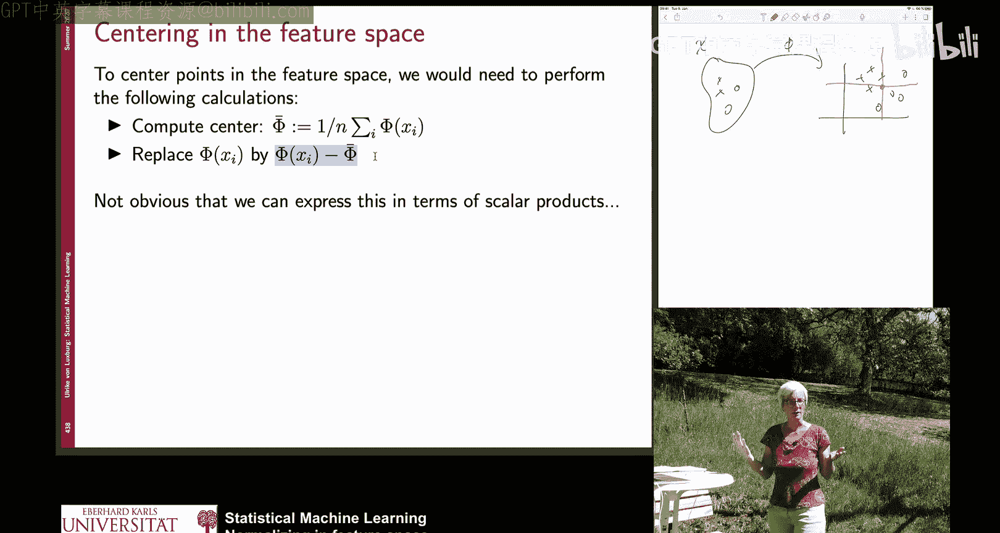
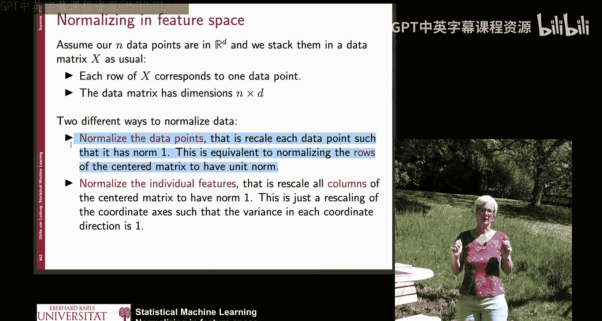
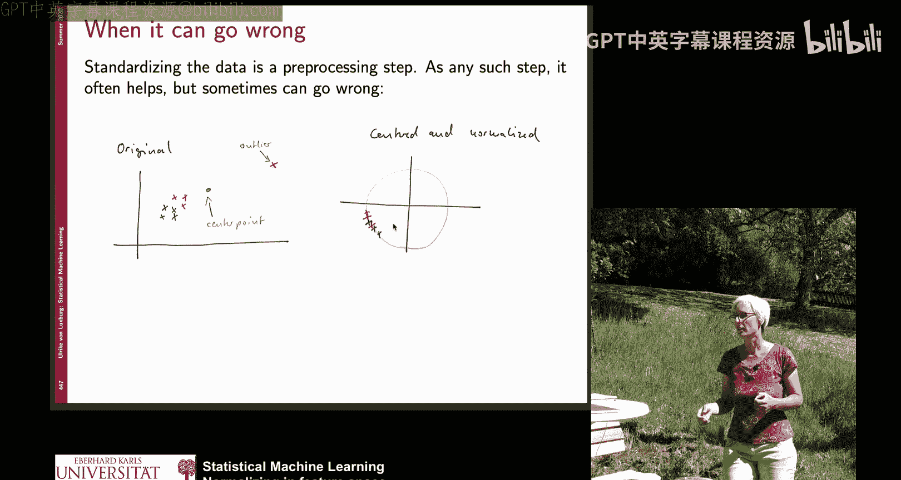

# 22：如何在特征空间中进行中心化和归一化

在本节课中，我们将学习核方法中一个关键但非直观的操作：如何在隐式的高维特征空间中对数据进行中心化和归一化处理。我们将看到，尽管无法直接访问特征坐标，但通过巧妙的核技巧，我们仍然可以实现这些数据预处理步骤。

## 概述

上一节我们介绍了核方法的基本原理和几种核化算法。本节中，我们来看看一个重要的实际问题：如何在特征空间中对数据进行中心化和归一化。这通常是数据预处理的标准步骤，但在核方法中，由于我们无法直接看到特征坐标，实现起来并非显而易见。

## 特征空间中的中心化

首先，我们考虑中心化。在显式特征空间中，中心化意味着计算所有数据点的均值（中心点），然后将每个数据点减去这个中心点，使数据分布以原点为中心。

在核方法中，我们只有数据点之间的核（内积）值，而没有特征坐标。因此，直接计算中心点坐标似乎是不可能的。

然而，我们可以通过纯核运算来推导中心化后的核矩阵。假设我们有一个原始核函数 **K(x_i, x_j) = <Φ(x_i), Φ(x_j)>**。我们希望得到中心化后数据点 **Φ̃(x_i) = Φ(x_i) - (1/n) Σ_k Φ(x_k)** 之间的核。

通过代数推导，中心化后的核 **K̃(x_i, x_j)** 可以表示为：

**K̃(x_i, x_j) = K(x_i, x_j) - (1/n) Σ_r K(x_i, x_r) - (1/n) Σ_s K(x_s, x_j) + (1/n²) Σ_{r,s} K(x_r, x_s)**

这个公式的妙处在于，它完全由原始核矩阵 **K** 的元素计算得出，不需要知道任何特征坐标 **Φ(x)**。因此，我们可以在不知道特征映射的情况下，模拟出数据在特征空间中被中心化后的效果。

在矩阵表示中，如果 **K** 是原始核矩阵，**1_n** 是一个所有元素都为 **1/n** 的 **n×n** 矩阵，那么中心化后的核矩阵 **K̃** 为：

**K̃ = K - 1_n K - K 1_n + 1_n K 1_n**

我们可以验证，这个矩阵的每个元素 **K̃_{ij}** 都对应上述公式的计算结果。

## 特征空间中的归一化

接下来，我们讨论归一化。归一化通常有两种含义：

1.  **特征归一化**：使每个特征维度（列）的方差为1（或其他值）。这需要知道每个特征的具体坐标，因此在纯核方法中**无法实现**。
2.  **数据点归一化**：使每个数据点向量（行）的范数为1。这相当于将所有数据点投影到单位超球面上。这种方法**可以在核方法中实现**。

数据点归一化通常在数据已中心化的基础上进行。对于一个中心化后的数据点 **Φ(x)**，我们希望将其归一化为单位向量 **Φ̂(x) = Φ(x) / ||Φ(x)||**。

那么，归一化后数据点之间的内积（即新的核函数）为：

**K̂(x_i, x_j) = <Φ̂(x_i), Φ̂(x_j)> = <Φ(x_i), Φ(x_j)> / (||Φ(x_i)|| ||Φ(x_j)||)**

由于 **||Φ(x)|| = √<Φ(x), Φ(x)> = √K(x, x)**，我们可以将上述公式完全用原始核函数表示：

**K̂(x_i, x_j) = K(x_i, x_j) / √(K(x_i, x_i) K(x_j, x_j))**

这样，我们就得到了一个归一化后的核函数，使用它进行计算，效果等同于先将所有数据点映射到特征空间，然后将其归一化到单位球面上。

## 中心化与归一化的效果与注意事项

以下是中心化和两种归一化效果的直观对比：

*   **原始数据**：数据点以其原始坐标分布。
*   **中心化数据**：数据整体被平移，使得坐标原点位于数据的中心（均值点）。这改变了坐标系，但不改变点之间的相对位置。
*   **特征归一化（核方法中不可行）**：调整每个坐标轴的尺度，使得数据在每个维度上的方差相同（例如都为1）。这可以改变数据的形状（例如，使一个方向上的拉伸与另一个方向相同）。
*   **数据点归一化（核方法中可行）**：将每个数据点单独缩放，使其位于一个以原点为中心的单位球面上。此时，点之间的角度信息得以保留，而距离信息被丢弃。

**重要提示**：数据点归一化并不总是有益的。例如，当一个数据集中存在远离主群体的离群点时，中心化过程会使均值严重偏向离群点。随后进行的数据点归一化，可能会将原本可分离的不同类数据点挤压到单位球面上非常接近的区域，从而破坏数据的可分性，导致分类器（如SVM）性能下降。

因此，在实践中，是否应用这些预处理步骤需要通过交叉验证来评估。比较使用原始核、仅中心化核、以及中心化加归一化核的模型性能，选择效果最佳的一种。

## 总结

本节课我们一起学习了如何在核方法的框架下对数据进行中心化和归一化。

*   我们证明了，尽管无法访问特征坐标，但可以通过纯核运算推导出**中心化后的核矩阵**。
*   我们区分了两种归一化：**特征归一化**（不可行）和**数据点归一化**（可行），并推导了数据点归一化后的核函数公式。
*   我们认识到，这些预处理操作（尤其是数据点归一化）是一把双刃剑，可能提升也可能损害模型性能，因此必须通过**交叉验证**进行谨慎评估。

掌握这些技巧，使我们能够在享受核方法带来的非线性能力的同时，也能进行必要的数据标准化处理。