# 23a：随机森林之构建决策树 🌲

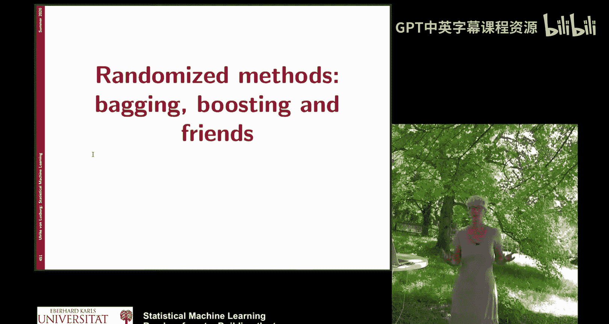

在本节课中，我们将学习一系列分类和回归算法。这些算法主要源于统计学原理，而非传统的机器学习社区，但它们非常成功且基于简单的思想。我们将从随机森林开始，并探讨其背后的核心概念：集成方法、自助法（Bootstrap）和装袋法（Bagging）。

## 集成方法概述

上一节我们提到了算法的统计学背景。本节中，我们来看看集成方法的核心思想。

在集成方法中，我们不只训练一个分类器来完成特定任务，而是训练多个分类器，并且以略有不同的方式训练它们。例如，我们可以在训练集的不同部分训练多个分类器，或者使用不同的特征子集，甚至训练不同类型的分类算法（如决策树、K近邻或神经网络）。

我们知道每个分类器都有其优缺点。集成方法的理念是，如果我们能结合这些方法，例如通过多数投票等方式，那么最终得到的结果可能比任何一个单独分类器的结果都要好。

从高层次来看，这就是集成方法的思想。它指的是这样一个研究领域：你拥有一组分类器（或回归函数等）的集合，然后将它们组合起来，以产生一个全新的、希望是更好的问题解决方案。

## 统计学背景：自助法与装袋法

集成方法的统计学背景可能源于自助法和装袋法。我们已经见过一个类似的例子：交叉验证方法。

在交叉验证中，我们想要估计一个特定的量——测试误差。我们通过从训练集中抽取随机子集（即进行随机划分）来多次重复这个过程，最终取平均值，希望这样得到的估计比仅进行一次划分得到的估计更好。

### 自助法简介

考虑一个标准的统计设定：你有一个来自某个空间的样本点。假设你对一个参数（例如总体均值）感兴趣，并且有一个估计量能产生该参数的估计值 $\hat{\theta}$。

现在，你想知道这个估计量的分布，例如，为了获得估计值的置信区间。如果你知道样本点的分布，有时可以解析地计算出估计量 $\hat{\theta}$ 的分布。但如果你对训练点的分布一无所知，这就无法实现。

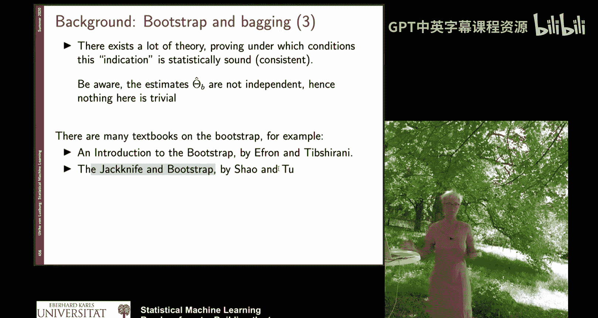

自助法的做法如下：
1.  从原始训练样本中抽取一个包含 $M$ 个点的子样本（可放回或不放回抽样）。
2.  在这个子样本上计算你感兴趣的参数的估计值。
3.  重复此过程 $B$ 次，最终得到 $B$ 个参数估计值 $\hat{\theta}_1, ..., \hat{\theta}_B$。
4.  观察这些估计值的分布，这可以为你提供关于置信区间大小的指示。

自助法背后的理论很复杂，因为从同一样本中抽取的子样本并非独立，它们会大量重叠。统计文献中有大量研究在何种情况下这种方法仍然能产生一致的估计。

### 装袋法：自助聚合

装袋法是自助法在机器学习中的直接应用。其名称“Bagging”是“Bootstrap Aggregation”的缩写。

与自助法类似，你有一个原始样本，并希望估计某个参数。你生成 $B$ 个自助样本，在每个样本上计算估计值 $\hat{\theta}$，得到 $B$ 个不同的版本。

此时，你可能并不关心置信区间或估计量的分布，而只想知道最终的估计值。最简单的方法是取这些估计值的平均值：$\hat{\theta}_{bag} = \frac{1}{B} \sum_{b=1}^{B} \hat{\theta}_b$。

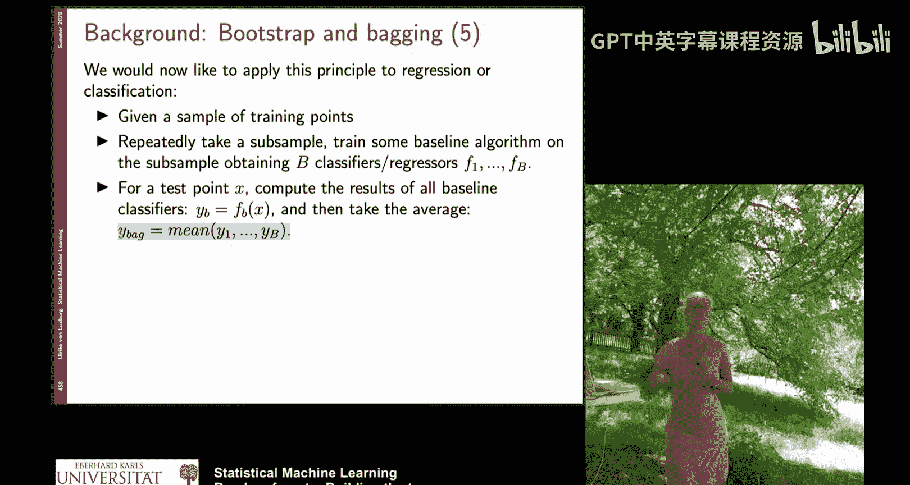

你可能会问，既然可以直接在原始样本上计算一个估计值，为什么需要这个自助过程？关键在于，装袋法可以产生一个方差远小于直接在完整样本上进行单次估计的估计量。

直观理解如下：如果这些估计值 $\hat{\theta}_b$ 是独立的（实际上它们并非独立，但先如此假设），并且每个的方差都是 $\sigma^2$，那么组合估计量的方差将是 $\sigma^2 / B$，方差减小了 $B$ 倍。

实际上，这些估计值并非独立，而是存在相关性 $\rho$。计算后可以发现，装袋后估计量的方差为：
$$\text{Var}(\hat{\theta}_{bag}) = \rho \sigma^2 + \frac{1-\rho}{B} \sigma^2$$
*   当 $\rho = 0$（独立）时，方差为 $\sigma^2 / B$，方差大幅降低。
*   当 $\rho = 1$（完全相关）时，方差变回 $\sigma^2$，即原始估计量的方差。

因此，如果相关性小，装袋法能显著降低方差；即使相关性不小，在最坏情况下你也只是回到了原始估计量的方差，并无损失。

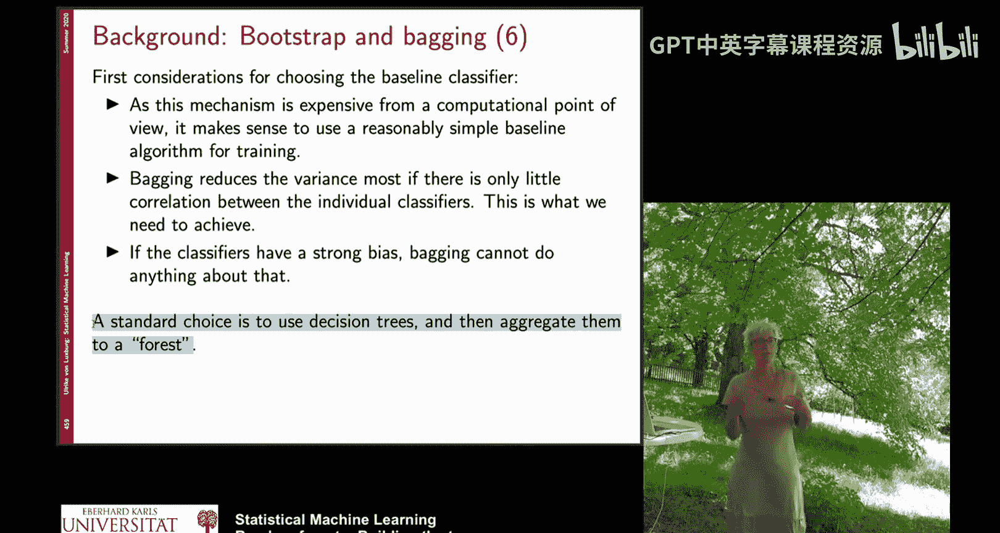

## 应用于分类与回归

现在，我们将这个原理应用于分类或回归问题。

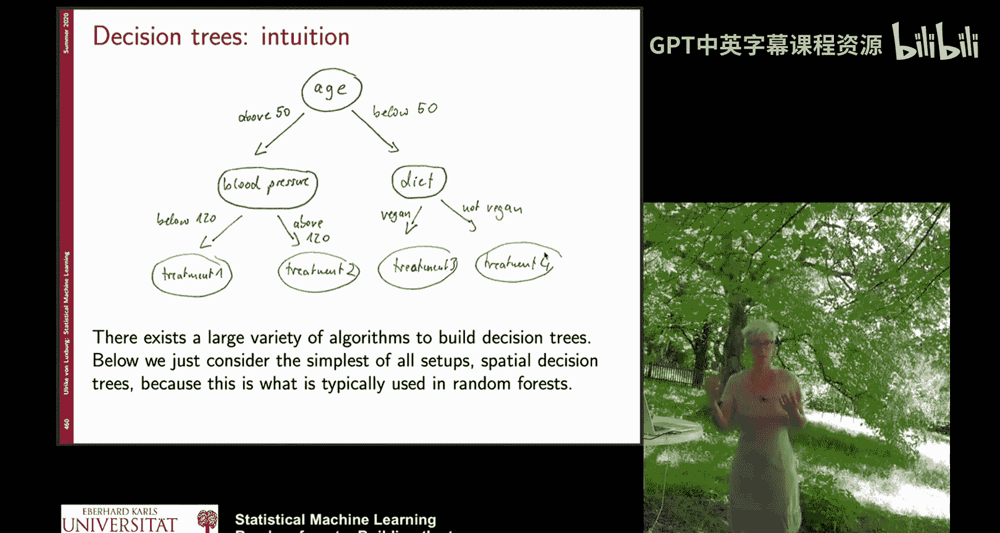

具体做法是：给定一组训练点，我们反复从中抽取子样本，并基于每个子样本训练一个分类器或回归函数（称为“基学习器”）。然后，对于一个测试点 $x$，我们计算每个基学习器给出的结果，并简单地取平均值，这个平均值就是我们的“装袋”分类器/回归器的预测结果。

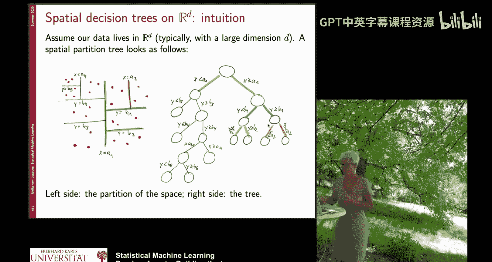

关于基学习器的选择，有以下几点考虑：
*   **计算成本**：装袋法需要训练模型 $B$ 次，如果 $B$ 很大，计算量会很大。因此，最好使用训练速度较快的简单算法作为基学习器，例如K近邻、决策树等。
*   **独立性**：为了最大程度地降低方差，我们希望这些基学习器尽可能相互独立。
*   **偏差**：装袋法主要是为了减少方差，它无法改变基学习器本身的偏差。如果基方法是有偏的，那么装袋后的结果仍然有偏。

在接下来的课程中，我们将看到的标准选择是使用**决策树**作为基算法，因为它们简单，并且有潜力通过设计使它们彼此更加独立。

## 决策树基础

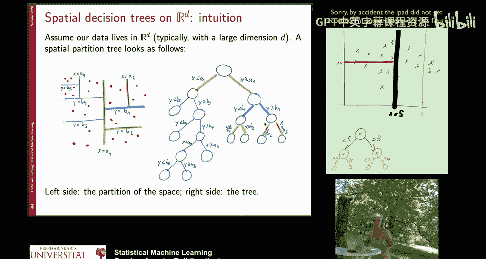

让我们从决策树开始简要介绍。决策树的直观思想是：每个数据点（例如病人）由一组特征描述。决策树通过一系列基于特征的判断（“问题”）来引导你得到一个最终结论（例如，应该采用治疗方案A还是B）。

例如，首先查看病人的年龄：如果大于50岁，走一个分支；如果小于50岁，走另一个分支。对于老年分支，下一步可能检查血压；对于年轻分支，下一步可能检查饮食习惯，以此类推。通常，重要的变量出现在树的顶部，次要的变量出现在底部。

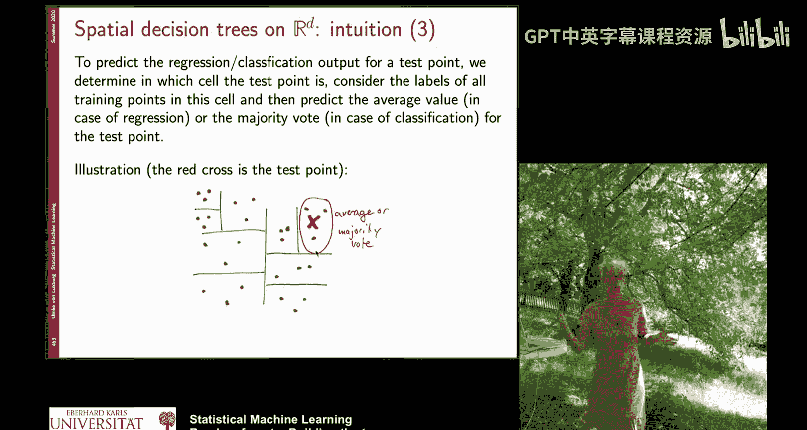

构建决策树的方法有无数种。在随机森林中，我们将使用一种特定的类型：**空间划分决策树**。

## 空间划分决策树

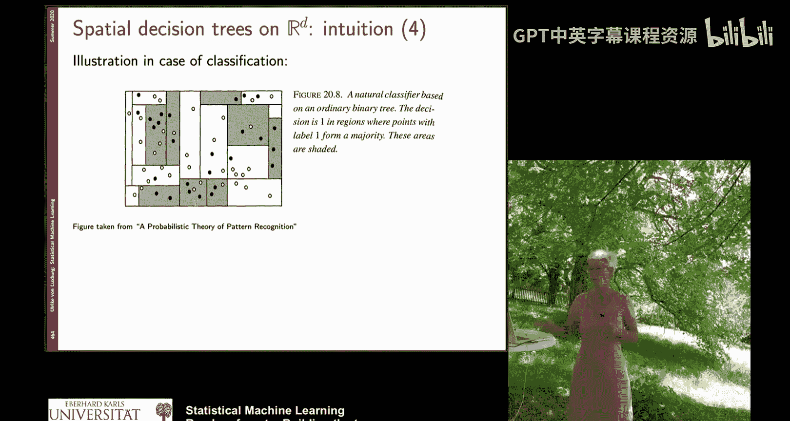

空间划分决策树类似于k-d树。它是一种将数据空间最终分割成不同单元格的树结构。

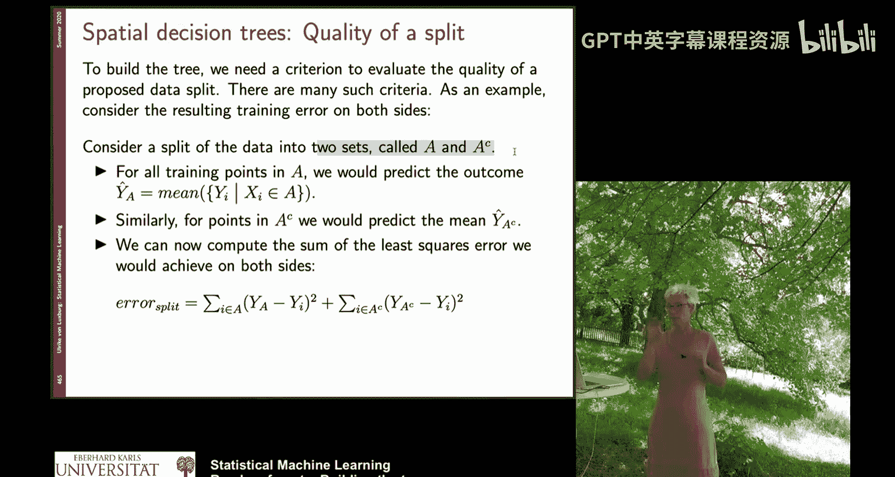

其工作原理如下：假设我们有一个数据集。我们被允许考虑的所有划分都是平行于某个坐标轴的。例如在二维空间，我们可以进行垂直或水平划分。

构建过程是递归的：
1.  在每一步，你需要选择一个维度进行划分，并决定在该维度上的最佳分割点。
2.  你持续划分，直到每个单元格只包含预先设定的少量数据点（例如10个）为止。

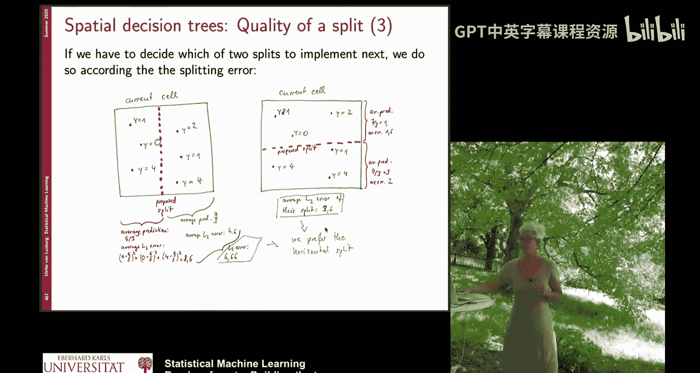

如何使用构建好的树进行预测？对于一个测试点，你从树根开始，根据该点的坐标值（例如，x坐标是否小于5）决定向左还是向右分支，直到到达一个叶节点（即一个最终的单元格）。对于该测试点的预测，就是基于落入该叶节点的所有训练点的标签进行决策（分类时取多数票，回归时取平均值）。

## 确定划分标准

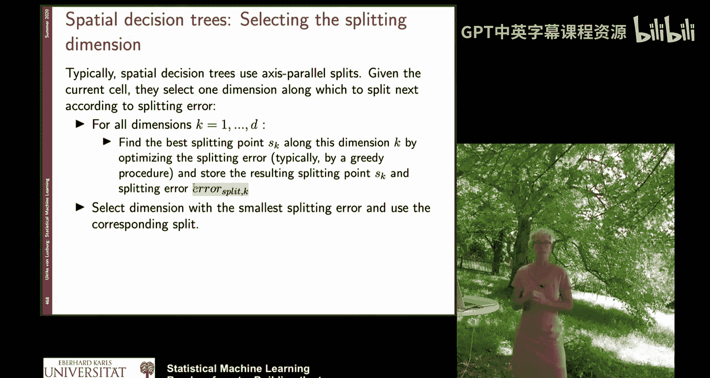

构建树时，我们需要确定如何选择划分的维度和位置。文献中有许多标准，一个直观的方法是评估每个候选划分可能产生的训练误差。

具体做法是：考虑一个将数据分成两部分的划分。假设我们进行此次划分，然后分别在左右两部分计算预测值（例如，该部分内训练点标签的平均值），并计算这两部分上的训练误差（例如L2误差）之和。我们评估不同的候选划分（不同维度、不同分割点），选择那个能产生最小训练误差总和的划分。

通常，这是一个贪心过程：对所有维度进行循环，对每个固定维度，评估不同的分割点并选择最好的，然后比较所有维度上最好的那个划分，最终使用全局最优的划分。

## 树的深度与一致性

另一个需要考虑的是树的深度，即你向下划分多少层。通常的做法是固定一个“叶节点最小样本数”，即你希望每个叶节点中包含的数据点数量。

文献中有两种重要的模式：
1.  **浅树**：没有太多层。叶节点中的点数应随着总数据点数 $n$ 的增长而至少缓慢增长（例如 $\log n$）。这样构建的树具有统计一致性，因为单元格的直径会缩小，同时每个单元格内的数据点数量在增加。
2.  **深树**：训练直到每个叶节点只剩下常数个点（极端情况下为1个点）。单独看，这样的一棵树不是一致的估计量（类似于1-最近邻，方差不会趋于0）。但是，**在随机森林中，人们经常观察到使用深树会得到更好的结果**。

为什么深树在随机森林中有效？几何解释是：虽然单棵深树的单元格非常小（可能只包含一个点），但当你将许多这样的树叠加组合时，对于一个给定的测试点，它会被许多不同形状的单元格所覆盖。平均来看，参与预测的训练点数量又变多了，从而整个集成模型可以再次变得一致。

## 决策树的优势与扩展

关于空间划分决策树的最后几点说明：
*   **可解释性**：决策树具有很好的可解释性。你可以追溯从根到叶的路径，理解做出某个决策所依据的特征和阈值（例如，“血压低于120且年龄约50岁的病人归入此类”）。
*   **特征重要性**：有许多方法可以计算在决策树或随机森林中各个特征的重要性，这是一个活跃的研究领域。
*   **其他类型**：除了空间划分树，还有很多其他类型的决策树，例如非常流行的C4.5算法，它使用信息论度量（如信息增益）来选择划分，将最重要的变量放在树的顶部。

本节课中，我们一起学习了随机森林的基础构件——决策树，特别是空间划分决策树的原理、构建方法以及深度选择的影响。我们还了解了集成方法背后的核心思想：通过结合多个略有不同的模型（基学习器）来降低预测方差，从而可能获得比单一模型更好的性能。这为下一节深入探讨如何将许多决策树组合成随机森林奠定了基础。