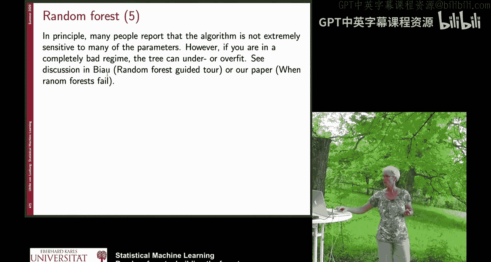
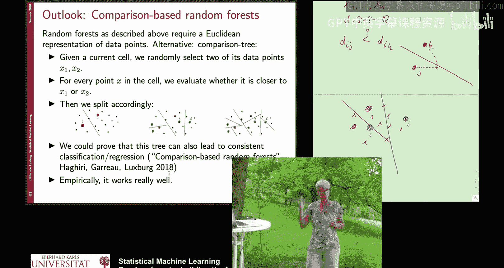
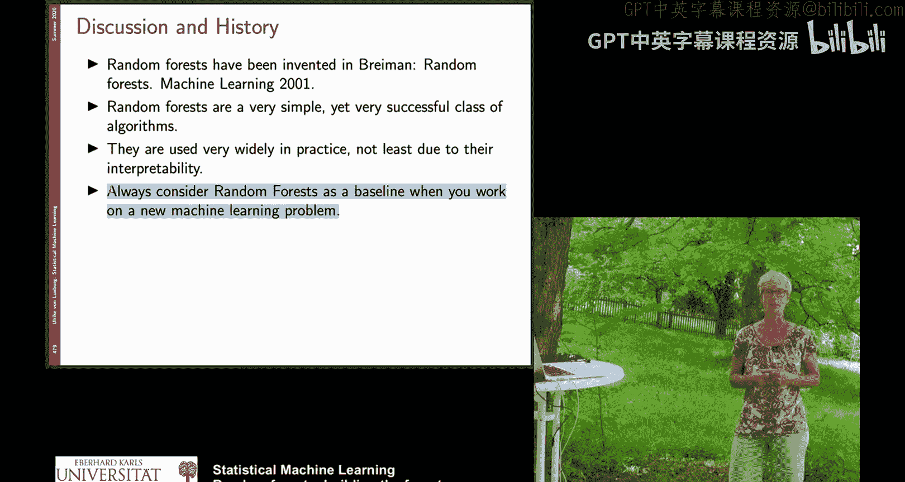

# 概率和统计机器学习：23b：构建随机森林 🌲

在本节课中，我们将学习如何将上一节介绍的单个空间决策树，通过集成学习中的Bagging（自助聚合）方法，组合成一个强大的模型——随机森林。我们将详细讲解其构建过程、关键参数，并探讨其理论性质。

---

## 概述

上一节我们介绍了空间决策树的基本原理。本节中，我们将看看如何利用Bagging思想，将许多棵决策树组合起来，构建所谓的“随机森林”。随机森林的核心在于引入随机性来构建多棵不同的树，并通过集成它们的预测结果来提高模型的泛化能力和稳定性。

---

## 随机森林的构建算法

以下是构建随机森林的一个标准算法框架，源自《统计学习基础》一书。我们的数据点位于 **R^P** 空间，其中 **P** 是特征维度。

随机森林有几个关键参数，我们将在代码中逐一介绍。

以下是构建过程的核心步骤：

1.  **设定树的数量**：我们有一个从 `b = 1` 到 `B` 的循环，其中 `B` 是我们计划构建的树的总数。
2.  **生成自助样本**：在每次循环中，我们首先从原始训练数据中抽取一个大小为 `N` 的自助样本。通常，我们采用有放回抽样，这意味着同一个数据点可能被多次选中。
3.  **生长单棵树**：基于这个自助样本，我们生长一棵随机树 `T_b`。我们递归地分割节点，直到每个叶节点包含的数据点数量达到预设的最小值 `n_min`。
4.  **随机选择特征进行分割**：在每个需要分割的节点上，我们从全部 **P** 个特征中随机选择 **m** 个特征子集。然后，仅在这 **m** 个特征中寻找最佳的分割点（例如，基于基尼不纯度或信息增益等准则）。
5.  **生成森林**：重复上述步骤 `B` 次，我们就得到了一个由 `B` 棵随机树组成的森林。每棵树的随机性体现在：1）基于不同的自助样本；2）在每个节点基于随机的特征子集进行分割。

---

## 如何进行预测

在预测阶段，对于一个新数据点 **x**，随机森林会综合所有树的预测结果。

具体步骤如下：

1.  **获取单棵树预测**：将测试点 **x** 输入每一棵树 `T_b`。从根节点开始，根据每个节点的分割规则，将 **x** “路由”到对应的叶节点。
    *   对于**分类任务**，该叶节点中训练样本的多数类即为这棵树的预测结果。
    *   对于**回归任务**，该叶节点中训练样本目标值的平均值即为这棵树的预测结果。
2.  **集成所有预测**：收集所有 `B` 棵树的预测结果。
    *   对于**分类任务**，采用**投票法**，选择得票最多的类别作为最终预测。
    *   对于**回归任务**，采用**平均法**，计算所有树预测值的均值作为最终预测。

公式化表示为：
*   **分类**：`最终预测 = mode( T_1(x), T_2(x), ..., T_B(x) )`
*   **回归**：`最终预测 = (1/B) * Σ_{b=1}^{B} T_b(x)`

---

## 关键参数与调优建议

随机森林主要有四个参数，但好消息是，与SVM等模型相比，它对参数的选择通常不那么敏感。以下是一些经验法则：

*   **自助样本大小 `N`**：通常设置为与原始训练集大小相当，采用有放回抽样。也可以尝试设为原始大小的2/3。
*   **每次分割考虑的特征数 `m`**：这是一个关键参数。经验上常设置为总特征数 **P** 的 **1/3**，即 `m ≈ P/3`。这个值通常效果很好，无需过多调整。
*   **树的数量 `B`**：应尽可能大，只要在计算和存储资源允许的范围内。树的数量越多，模型的方差降低效果越好，预测越稳定。
*   **叶节点最小样本数 `n_min`**：这控制树的深度。`n_min` 小则树深（可能过拟合），`n_min` 大则树浅（可能欠拟合）。通常可以尝试 `log(n)` 到 `1` 之间的值，`1` 对应完全生长的树。

总体而言，随机森林对这些参数具有相当的鲁棒性。然而，极端的选择（如树太浅或树太少）仍会导致模型性能下降。

---

## 理论性质：一致性探讨

从理论角度看，一个重要问题是随机森林是否具有**一致性**，即随着训练样本无限增多，其预测能否收敛到真实的最优函数。

主要结论如下：

1.  **单棵决策树**：如果树不是太深，确保每个叶节点区域的直径趋于0，同时每个叶节点内的样本数趋于无穷，那么单棵树可以是一致的。
2.  **随机森林（平凡情况）**：如果森林中的每一棵树都是一致的，那么整个森林显然也是一致的。但这没有解释为何需要集成多棵树。
3.  **随机森林（有趣情况）**：**随机森林可以是一致的，即使其中的每一棵单棵树都不是一致的。** 这是随机森林强大之处的核心理论体现。

**直观解释**：考虑训练非常深的树，每片叶子里只有一个样本。这样的单棵树方差极高，是不一致的。但是，当我们集成许多棵这样的深树时，对于同一个测试点，不同的树会将其与训练集中**不同的**单个样本关联起来。虽然每棵树只用一个样本做预测，但集成了成百上千棵树后，参与预测的实际上是训练集中一个较大的、围绕测试点的邻域内的许多样本。如果这个“邻域”的直径能随着样本增多而缩小到0，同时参与预测的样本数却趋于无穷，那么集成模型就能恢复一致性。

目前，对于实践中使用的、基于优化分割准则的随机森林，其一致性的严格证明仍然是活跃的研究领域。

---

## 扩展：基于比较的随机森林

我们研究组近期的工作将随机森林的思想推广到了更一般的场景。考虑一种情况：你的数据并非欧氏空间中的向量，你只能获得数据点之间的**相对比较**信息，例如“点A更接近点B还是点C？”

基于此，我们可以构建**基于比较的随机森林**：

1.  **构建分割**：在每个树节点，随机选择两个数据点作为“枢轴点”。
2.  **提出问题**：对于节点内的所有其他数据点，询问：“你离第一个枢轴点更近，还是离第二个枢轴点更近？”
3.  **根据答案分割**：根据答案将数据点划分到左子树或右子树。这相当于在隐含的距离空间中构造了一个分割超平面（垂直于两枢轴点连线的中垂面）。
4.  **递归构建**：在子节点上重复此过程。

这种方法不再需要特征向量和轴平行分割，仅依赖于两两点之间的相对距离比较。我们已证明，在标准条件下，这种基于比较的随机森林同样具有一致性。在欧氏数据上，其经验性能与标准随机森林相当，但它的适用性更广，可用于仅有相似性比较信息的数据。

---

## 总结与历史讨论

本节课中，我们一起学习了随机森林的构建方法。我们从回顾Bagging和决策树开始，详细阐述了随机森林的算法步骤、预测方式以及关键参数的选择。我们还探讨了其理论一致性的核心观点，并简要介绍了一种更广义的基于比较的随机森林。

随机森林由统计学家Leo Breiman在2001年提出，相对而言是一个“年轻”的算法。如今，它已成为机器学习中标准的基线算法之一，因其以下优点而广受欢迎：
*   **易于使用**：通常无需繁琐的参数调优。
*   **性能强大**：在众多任务上表现优异。
*   **提供洞见**：可以评估特征重要性。
*   **鲁棒性好**：对异常值和数据尺度不敏感。

因此，**在处理分类或回归问题时，随机森林应始终作为一个重要的基线算法予以考虑**。它能够快速提供一个性能不错的解决方案，并帮助你对数据建立初步的直觉。在许多实际应用中，随机森林的表现已经足够好，无需寻求更复杂的模型。