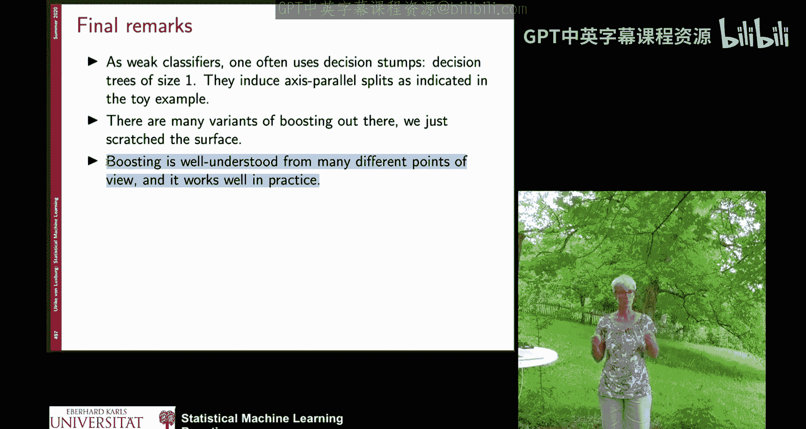

# 24：Boosting 🚀

在本节课中，我们将要学习一种称为Boosting的学习范式。这是一种通过组合多个弱学习器来构建一个强学习器的集成学习方法。我们将探讨其核心思想、算法流程、理论保证以及实践应用。

## 概述

Boosting是一种统计启发的学习范式，其核心思想是组合同一算法的多个版本，以期通过这种组合来改善最终结果。这与随机森林等集成方法不同，Boosting不通过随机化数据或特征来生成多样性，而是通过为训练数据点分配不同的权重，并迭代地训练弱学习器，最终将它们组合成一个强学习器。

## 强学习器与弱学习器

上一节我们介绍了Boosting的基本目标。本节中，我们来看看其背后的核心哲学：强学习器与弱学习器的概念。

*   **强学习器**：这是我们最终希望得到的算法。它能够在有限的训练数据上学习到一个分类器，该分类器的误差非常小。直观地说，强学习器是一个能够以任意小的误差ε逼近真实解的算法。
*   **弱学习器**：这是指那些性能仅比随机猜测略好的算法。例如，在一个类别平衡的分类问题中，随机猜测的准确率是0.5。一个弱学习器的准确率可能是0.5 + ε，其中ε是一个很小的正数。

Boosting要解决的核心问题是：**给定一个弱学习器，能否通过组合多个这样的弱学习器，最终得到一个强学习器？** 答案是肯定的，而实现这一点的算法就是Boosting。

## Boosting算法流程

理解了强学习器和弱学习器的概念后，本节我们来看看Boosting的具体算法是如何运作的。

Boosting算法（以AdaBoost为例）在T轮中迭代进行。在每一轮中，它基于当前的数据权重训练一个弱学习器，然后根据该弱学习器的表现更新数据点的权重，使得被错误分类的点在下一轮获得更高的关注度。最终，算法输出所有弱学习器的加权组合作为最终假设。

以下是AdaBoost算法的伪代码步骤：

1.  **输入**：训练集 S = {(x₁, y₁), ..., (xₘ, yₘ)}，弱学习器 WL，迭代轮数 T。
2.  **初始化权重**：对于每个训练点 i，设置初始权重 D₁(i) = 1/m。
3.  **For t = 1 to T**：
    *   使用当前权重分布 D_t 训练弱学习器，得到假设 h_t。
    *   计算 h_t 的加权误差：ε_t = Σ_{i=1}^{m} D_t(i) * [y_i ≠ h_t(x_i)]。
    *   计算该轮假设的权重：w_t = 0.5 * ln((1 - ε_t) / ε_t)。
    *   更新数据点权重：对于每个 i，D_{t+1}(i) = (D_t(i) * exp(-w_t * y_i * h_t(x_i))) / Z_t，其中 Z_t 是归一化因子，确保所有权重之和为1。
4.  **输出最终假设**：H(x) = sign( Σ_{t=1}^{T} w_t * h_t(x) )。

## 算法直观理解与示例

上一节我们介绍了算法的形式化步骤。本节中，我们通过一个具体的例子来直观理解Boosting是如何工作的。

假设我们有一个二维数据集，包含正例（+）和负例（-）。弱学习器是平行于坐标轴的决策树桩（单层决策树）。

*   **第一轮**：所有数据点权重相同。弱学习器产生一个分类边界（例如一条垂直线），它正确分类了大部分点，但错误分类了三个点（被圈出）。算法增加这三个错误分类点的权重。
*   **第二轮**：权重更新后，被错误分类的点显得更大（权重更高）。弱学习器在新的权重分布下训练，产生另一个分类边界（例如一条水平线）。它可能又错误分类了另外几个点（同样是之前难以分类的）。算法再次更新权重，增加新错误点的权重，同时降低正确分类点的权重。
*   **第三轮**：权重进一步调整。弱学习器训练后产生第三个分类边界。
*   **最终组合**：将三轮得到的三个弱分类器进行加权投票（权重 w_t 反映了该轮分类器的可靠性），得到一个复杂的非线性决策边界。在这个例子中，最终的组合分类器能够正确分类所有训练点。

这个例子展示了Boosting如何通过关注“困难”样本，并组合简单的决策规则，来构建一个强大的分类器。

## 理论保证：训练误差界

看到Boosting在示例中有效后，我们自然会问：它在理论上是否可靠？本节我们探讨其关于训练误差的理论保证。

有一个重要定理保证了AdaBoost的训练误差会快速下降：

**定理**：假设在AdaBoost的每一轮迭代t中，弱学习器都返回一个假设h_t，其加权分类误差 ε_t < 1/2 - γ（其中γ > 0）。那么，经过T轮迭代后，最终假设H的训练误差满足：
LS(H) ≤ exp(-2 γ² T)

**这个结论的意义**：
*   只要弱学习器在每一轮的表现都稳定地比随机猜测好一点（误差小于1/2），那么最终分类器的训练误差就会以**指数级速度**下降。
*   迭代轮数T越大，训练误差的上界就越小。这从理论上解释了Boosting如何将弱学习器提升为强学习器（至少在训练集上）。

**证明思路（简述）**：
1.  定义一个辅助变量 Z_T = Σ_{i=1}^{m} exp(-y_i F_T(x_i))，其中 F_T 是最终加权组合函数。可以证明，01训练误差 L_S(H) ≤ Z_T。
2.  通过巧妙的 telescoping product（叠乘分解），将 Z_T 表示为 Z_T = Π_{t=1}^{T} (Z_t / Z_{t-1})。
3.  核心步骤是证明每一轮的比值 Z_t / Z_{t-1} ≤ √(4 ε_t (1-ε_t))。
4.  利用条件 ε_t ≤ 1/2 - γ，可以推导出 √(4 ε_t (1-ε_t)) ≤ exp(-2 γ²)。
5.  因此，Z_T ≤ (exp(-2 γ²))^T = exp(-2 γ² T)，从而定理得证。

这个证明优雅地展示了算法设计（权重更新公式 w_t = 0.5 * ln((1-ε_t)/ε_t)）与理论保证之间的内在联系。

## 实践考量与总结

上一节我们看到了Boosting强大的理论保证。本节中，我们来看看它在实践中的应用和一些重要注意事项。

**实践要点**：
*   **弱学习器的选择**：常用的弱学习器是**决策树桩**（深度为1的决策树），它简单、快速，并且能产生可解释的规则。理论上，任何能处理加权样本且性能略优于随机猜测的算法都可作为弱学习器。
*   **泛化能力**：上述定理只针对训练误差。在实践中，Boosting也表现出良好的泛化能力。其泛化误差的理论分析通常涉及**间隔理论**和**函数类复杂度**，相关结果可以在专门文献中找到。过度增加迭代轮数T可能导致过拟合，因此T常作为一个需要通过验证集调节的超参数。
*   **与随机森林对比**：
    *   **随机森林**：通过自助采样和随机特征子集引入多样性，各基学习器独立训练，最终进行平等投票。
    *   **Boosting**：使用全部数据但赋予不同权重，基学习器顺序训练，每个都试图修正前一个的错误，最终进行加权投票。
*   **优点**：理论清晰、实践效果好、对于许多问题可以作为强大的基准模型。最终模型是简单模型的加权和，具有一定的可解释性。
*   **扩展**：AdaBoost是Boosting家族的基础算法，后续发展出了如Gradient Boosting、XGBoost、LightGBM等更强大的变体，它们在效率和性能上做了诸多优化。

**总结**：
本节课我们一起学习了Boosting集成学习方法。我们从强学习器和弱学习器的概念出发，详细讲解了AdaBoost算法的流程、直观工作原理以及其训练误差指数下降的理论保证。Boosting通过迭代地调整数据权重，迫使弱学习器专注于之前被错误分类的样本，并将这些弱学习器的结果进行加权组合，从而构建出一个强大的最终模型。该算法在理论和实践上都得到了充分验证，是机器学习工具箱中一个重要且有效的工具。