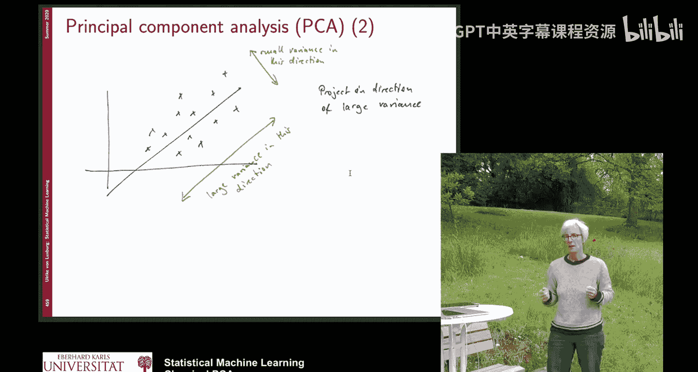
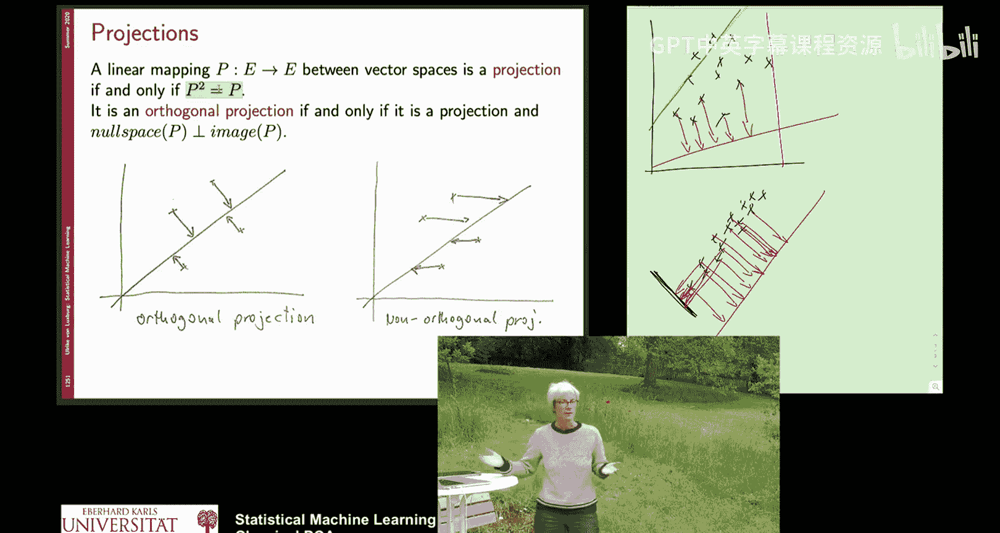
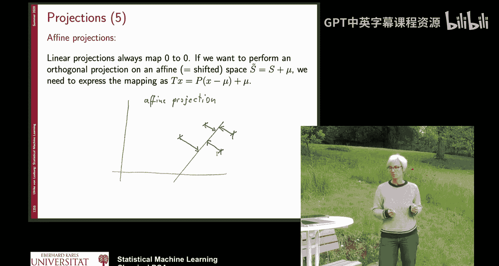
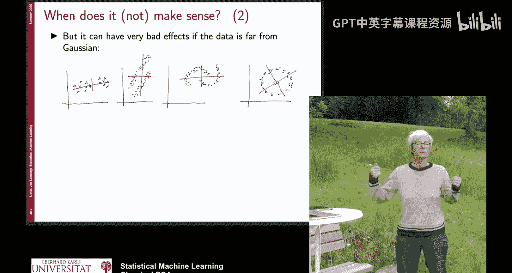

# 25：主成分分析 (PCA) 🧮

在本节课中，我们将要学习一种经典的数据分析算法——主成分分析。这是一种非常古老且在各个学科领域广泛使用的算法，是降维的标准工具。我们将了解其经典版本的工作原理，并在后续课程中探讨其核化版本。

## 目标与基本思想 🎯

主成分分析的目标是什么？我们面对的数据通常存在于一个高维的欧几里得空间中。这里的“高维”意味着维度超出了算法或我们自身能够轻松处理的范围。

PCA的目标是将数据投影到一个更低维度的空间中。希望通过这种降维，我们不会丢失太多关于数据的信息，同时能在低维空间中工作，这通常可以减少过拟合并降低计算需求。

我们用以下符号表示：
*   **D**：原始高维空间的维度。
*   **L**：我们希望投影到的低维空间的维度（L < D）。

## 核心思想与投影方向的选择 🤔

PCA的核心思想是什么？让我们看一个从二维降到一维的简单例子。

假设我们有一个二维数据集，它在空间中呈“拉长”的形状。我们希望将其投影到一条一维的直线上，因为我们可能认为数据中存在噪声，仅用一个维度就足以描述其主要结构。

那么，应该选择哪条直线进行投影呢？有很多可能性。例如，我们可以投影到这条红线、这条蓝线，或者这条绿线上。

问题是：哪条线是最好的投影方向？

PCA的想法是，我们应该以这样一种方式投影：尽可能多地保留数据的信息。直观地说，我们希望投影后数据的**方差**尽可能大。因为方差大的方向通常包含了数据中最重要的变化模式。

在上图中，如果我们将数据投影到**蓝线**方向，数据点会沿着该方向展开，保留了大部分结构。如果投影到**红线**方向，许多数据点会重叠在一起，导致信息大量丢失。

因此，PCA的目标是：**找到投影方向，使得投影后数据的方差最大化**。

## 投影的数学定义 📐

为了正式讨论投影，我们需要一个向量空间。投影是一个线性映射 **P**，它将空间 **E** 中的点映射回 **E** 自身。我们称 **P** 是一个投影，如果满足 **P² = P**。直观上，这意味着将投影应用两次与只应用一次的结果相同，因为点已经被“固定”在低维子空间上了。

我们通常关心的是**正交投影**。在正交投影中，投影向量与目标子空间是垂直的。形式上，一个投影被称为正交的，如果其零空间与像空间正交。

理解PCA时，有两种重要的视角：
*   **视角1**：投影后，我们仍然将点视为原始高维空间中的元素。点位于低维子空间上，但其坐标表示仍在 **Rᴰ** 中。
*   **视角2**：投影后，我们只关心点在低维子空间中的坐标，完全抛弃了其他维度。点现在位于 **Rᴸ** 中。

在机器学习中，视角2通常是我们进行数据处理的目标，因为我们希望直接在低维表示上工作。但视角1有时有助于理解数据在降维后于原始空间中的形态。

## 投影的数学表达 🧮

让我们从数学上形式化这两种视角。假设我们想投影到一个一维子空间，该空间由向量 **a** 张成。

*   **视角2（到低维空间）**：投影是从 **Rᴰ** 到 **R** 的映射。点 **x** 的投影坐标是标量积 **aᵀx**。
*   **扩展到L维**：对于一个L维子空间，我们有一个由标准正交基向量 **v₁, ..., vₗ** 组成的矩阵 **V**（每列是一个基向量）。投影映射 **Rᴰ → Rᴸ** 定义为：**y = Vᵀx**。
*   **视角1（仍在原始空间）**：投影矩阵 **P** 定义为 **P = VVᵀ**。点 **x** 被映射到 **Px**，这个点仍在 **Rᴰ** 中，但位于由 **V** 的列张成的子空间上。

**注意**：在应用PCA之前，我们通常先对数据进行**中心化**处理，即确保数据的均值为零。这样我们只需处理线性投影，而无需考虑仿射偏移。

## PCA的推导：最大化方差 🚀

现在我们从形式化的角度推导PCA。给定中心化的数据点（均值为0）和目标维度 **L**，我们希望找到一个投影（到一个仿射子空间 **S**），使得投影点的方差最大化。通过中心化，我们可以专注于线性子空间。

首先考虑 **L = 1** 的情况，即投影到一条直线上。我们需要找到方向向量 **a**。

优化问题是：
**最大化** 投影后数据的方差。
**约束条件**：**aᵀa = 1**（只关心方向，不关心长度）。

投影后点 **xᵢ** 的坐标是 **aᵀxᵢ**。对于中心化数据，方差是这些坐标平方的平均值。因此，目标函数为：
**最大化 (1/n) Σᵢ (aᵀxᵢ)² = aᵀ [(1/n) Σᵢ xᵢxᵢᵀ] a = aᵀC a**
其中 **C = (1/n) XᵀX** 是数据的**协方差矩阵**（**X** 是数据矩阵，行为数据点）。

因此，问题简化为：
**最大化 aᵀC a**
**约束条件 aᵀa = 1**

这是一个带约束的优化问题，可以用拉格朗日乘子法求解。构造拉格朗日函数：
**L(a, λ) = aᵀC a - λ (aᵀa - 1)**

对 **a** 求导并令其为零：
**2C a - 2λ a = 0 ⇒ C a = λ a**

这个方程告诉我们，最优解 **a** 必须是协方差矩阵 **C** 的一个**特征向量**，对应的特征值为 **λ**。

将 **C a = λ a** 代回目标函数 **aᵀC a**，得到 **aᵀ(λ a) = λ aᵀa = λ**。
因此，**投影后的方差就等于特征值 λ**。

为了最大化方差，我们应该选择与**最大特征值**对应的特征向量。这就是第一主成分。

对于 **L > 1** 的情况，结论可以推广：为了最大化投影后的总方差，我们应该将数据投影到由协方差矩阵 **C** 的**前 L 个最大特征值所对应的特征向量**张成的子空间上。这些特征向量被称为**主方向**或**主成分**。

## PCA算法步骤 📝

以下是PCA算法的伪代码总结：

1.  **输入**：数据点 **x₁, ..., xₙ ∈ Rᴰ**，目标维度 **L**。
2.  **中心化数据**：计算均值 **μ = (1/n) Σᵢ xᵢ**，令 **x̃ᵢ = xᵢ - μ**。
3.  **计算协方差矩阵**：**C = (1/n) X̃ᵀX̃**，其中 **X̃** 是中心化后的数据矩阵。
4.  **特征分解**：计算 **C** 的特征值和特征向量：**C = V Λ Vᵀ**。**V** 的列是特征向量，**Λ** 是对角特征值矩阵。
5.  **选择主成分**：将特征值从大到小排序，并相应排列特征向量。取前 **L** 个特征向量组成矩阵 **V_L**。
6.  **投影（视角2 - 低维坐标）**：计算低维表示 **yᵢ = V_Lᵀ x̃ᵢ ∈ Rᴸ**。
7.  **（可选）投影（视角1 - 原始空间重建）**：计算投影矩阵 **P = V_L V_Lᵀ**，重建点为 **x̂ᵢ = P x̃ᵢ + μ**（注意加回均值）。

## 实例与应用演示 🖼️

PCA可以应用于各种数据。例如，在USPS手写数字数据集（16x16像素图像，维度256）上：
*   计算出的前几个特征向量（“特征数字”）图像显示了数据中的主要变化模式（如圆形、笔画等）。
*   用不同数量的主成分重建数字“6”时，可以看到：
    *   用1个主成分：几乎无法识别。
    *   用3个主成分：略有形状，但无法辨认。
    *   用10个主成分：隐约可猜。
    *   用50个主成分：重建效果很好，与原始图像差异很小。
    *   用256个主成分：完全重建。

另一个著名例子是“特征脸”（Eigenfaces），即对人脸图像数据集应用PCA得到的前几个主成分。

## 如何选择维度 L？ 📊

选择投影维度 **L** 是一个关键问题。有几种方法：

1.  **特征值谱（Scree Plot）**：绘制协方差矩阵的特征值（按降序排列）。通常存在一个“拐点”，之后特征值变得很小且平缓。可以选择拐点之前的维度数。这些微小特征值对应的方向可能主要是噪声。
2.  **方差解释率**：投影到 **L** 维子空间后保留的方差比例为：**(Σ_{i=1}^L λ_i) / (Σ_{i=1}^D λ_i)**。可以设定一个阈值（如95%），选择使保留方差比例超过该阈值的最小 **L**。
3.  **重构误差**：可以证明，平均重构误差（视角1中点与投影点的距离平方和）等于被丢弃的特征值之和：**Σ_{i=L+1}^D λ_i**。通过分析特征值尾部，可以估计误差。
4.  **实践中的方法**：在机器学习流程中，**L** 通常被视为一个超参数。通过**交叉验证**来评估不同 **L** 值对最终任务（如分类精度）的影响，从而选择最优的 **L**。降维有时能通过去除噪声提升性能，有时也可能丢失有用信息，需要实际验证。

## 另一种推导：最小化重构误差 🔄

除了最大化方差，PCA还有另一种等价的推导方式：**最小化重构误差**。

重构误差是指原始数据点与其在低维子空间上投影点之间的距离（通常用平方距离）。PCA的目标变为：找到一个 **L** 维子空间，使得所有数据点到该子空间的（平方）距离之和最小。

可以证明，这个最小化重构误差的问题，最终导出的解与最大化方差的解完全相同：即选择协方差矩阵的前 **L** 个最大特征值对应的特征向量。

## PCA的注意事项与局限性 ⚠️

在使用PCA时，需要注意以下几点：

*   **全局最优 vs. 局部损失**：PCA优化的是**平均**重构误差或**总**方差。这并不意味着每个单独的数据点重构误差都小。**异常点**（Outliers）可能具有很大的重构误差，并且它们也会严重影响协方差矩阵的计算，从而影响主成分的方向。对于含有大量异常值的数据，PCA可能不适用，需要先进行异常值处理。
*   **线性假设**：PCA是一种**线性**降维方法。它寻找数据的最佳线性子空间。如果数据的固有结构是非线性的（例如同心圆、流形），PCA可能无法发现其低维表示，甚至可能破坏数据结构。
*   **无监督性质**：PCA是一种无监督方法，它不考虑任何类别标签。因此，找到的主成分方向不一定与数据中的类别分离方向一致。在分类任务中，直接使用PCA降维有时可能不利于后续分类。
*   **适用场景**：PCA在数据近似服从高斯分布，且主要方差集中在少数几个方向上时效果最好。对于具有复杂非线性结构或多模态分布的数据，需要考虑非线性降维方法（如核PCA、t-SNE、UMAP等）。

## 总结 📚

本节课我们一起学习了主成分分析这一经典的线性降维技术。

我们首先明确了PCA的目标：将高维数据投影到低维空间，同时尽可能保留数据中的信息（方差）。然后，我们从两个等价的角度推导了PCA：
1.  **最大化投影方差**：通过拉格朗日乘子法，我们推导出最优投影方向是数据协方差矩阵的特征向量，并且应选择特征值最大的前L个特征向量。
2.  **最小化重构误差**：这一角度也导出了相同的解。

我们详细介绍了PCA的算法步骤：中心化、计算协方差矩阵、特征分解、选择主成分、投影。并通过手写数字和人脸数据的例子展示了其应用。

最后，我们讨论了如何选择降维维度L的几种策略，并重点指出了PCA的局限性：它对异常值敏感、本质上是线性方法、且是无监督的。因此，在实际应用中，需要根据数据特性和任务目标谨慎使用PCA，并考虑将其作为更大机器学习流程中的一个预处理步骤，通过交叉验证来评估其有效性。