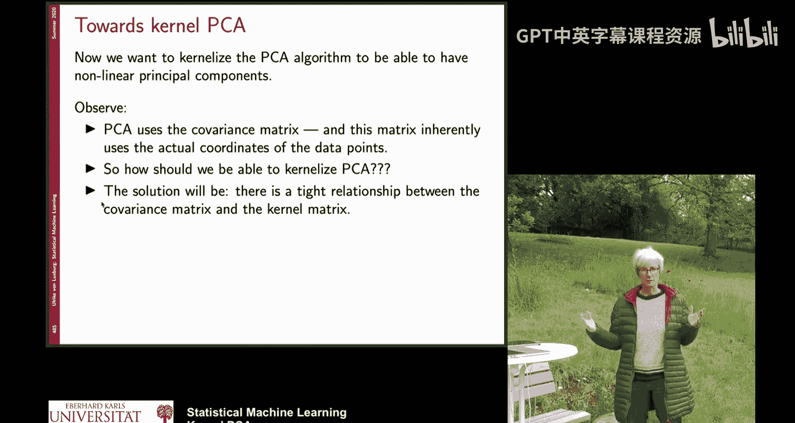
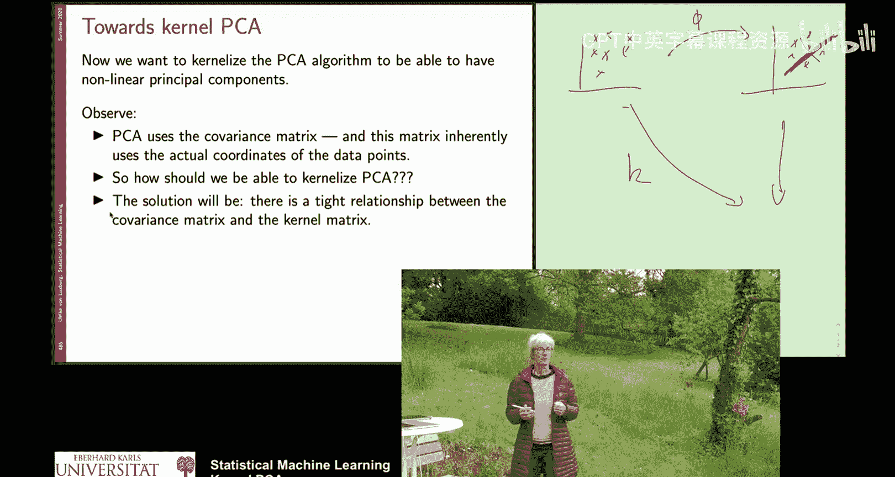
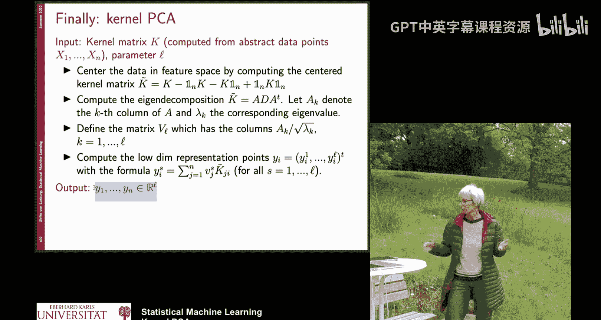
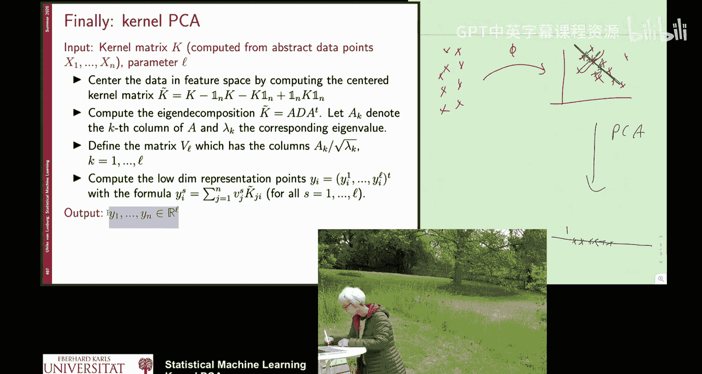
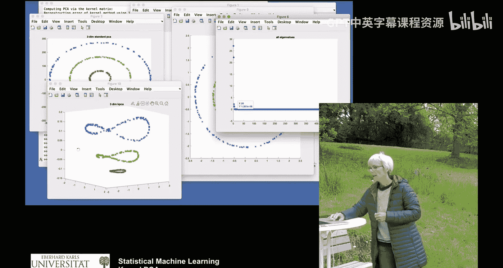
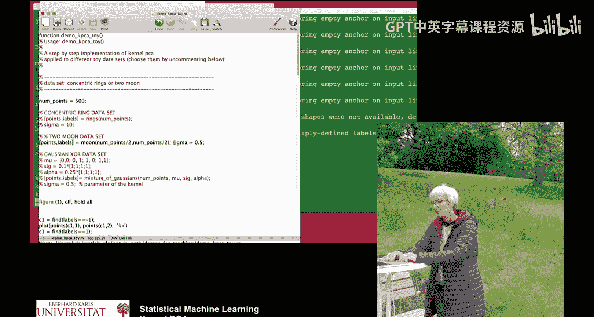
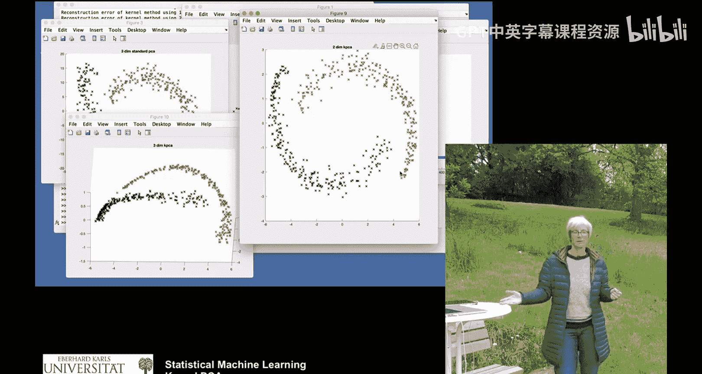
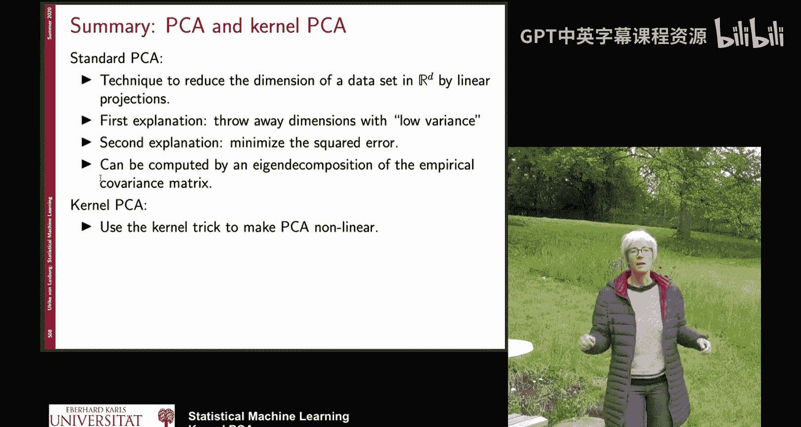

# 概率和统计机器学习：26：核主成分分析 (Kernel PCA) 🧠

在本节课中，我们将要学习如何将经典的主成分分析（PCA）算法“核化”，从而推导出核主成分分析（Kernel PCA）。我们将看到，即使PCA算法看起来严重依赖于数据的坐标表示，我们依然可以通过巧妙的数学转换，仅使用核函数（即数据点之间的相似性度量）来实现降维。

## 回顾：经典PCA与核方法

上一节我们介绍了标准的经典主成分分析（PCA）。本节中，我们来看看如何将其核化。

核PCA听起来可能有点奇怪，因为回想一下核方法的核心思想。我们有一些存在于原始空间（可能不是向量空间）的数据集。核方法通过一个特征映射（通常是隐式定义的），将数据点映射到一个高维的特征空间（一个再生核希尔伯特空间）。然后，我们在这个特征空间中应用线性算法。在这里，这个线性算法就是PCA。我们的目标是找到数据的主方向并投影到这些方向上，可能作为后续学习算法的预处理步骤。

整个核方法的技巧在于，我们希望有一个涉及核函数的“捷径”，使得我们无需显式地经过这个高维特征空间。但PCA算法似乎非常需要访问数据点的坐标，因为它需要计算协方差矩阵（一个包含坐标间相关信息的矩阵）并找到最大方差的方向。令人惊奇的是，确实存在一种方法可以绕过对显式坐标的需求，这正是本节课要揭示的内容。

## 数学基础：协方差矩阵与核矩阵

为了理解其中的技巧，我们需要回顾PCA做了什么，以及协方差矩阵和核矩阵是什么。

假设我们有n个数据点 \( x_1, ..., x_n \)，为简化起见，假设它们位于 \( \mathbb{R}^D \) 中，并且已经中心化（均值为零）。我们将数据点按行排列成数据矩阵 \( \mathbf{X} \)（一个 \( n \times D \) 的矩阵）。

*   **协方差矩阵 \( \mathbf{C} \)**：对于中心化的数据，协方差矩阵由 \( \mathbf{C} = \mathbf{X}^T \mathbf{X} \) 给出。这是一个 \( D \times D \) 的矩阵，其第 \( (k, l) \) 项是数据第 \( k \) 维和第 \( l \) 维之间的协方差。
*   **核矩阵 \( \mathbf{K} \)**：对于线性核，核矩阵由 \( \mathbf{K} = \mathbf{X} \mathbf{X}^T \) 给出。这是一个 \( n \times n \) 的矩阵，其第 \( (i, j) \) 项是数据点 \( x_i \) 和 \( x_j \) 的内积 \( \langle x_i, x_j \rangle \)。

我们注意到，协方差矩阵 \( \mathbf{C} = \mathbf{X}^T \mathbf{X} \) 和核矩阵 \( \mathbf{K} = \mathbf{X} \mathbf{X}^T \) 在形式上非常相似，只是矩阵乘法的顺序相反。这启发我们去思考：\( \mathbf{C} \) 的特征值/特征向量与 \( \mathbf{K} \) 的特征值/特征向量之间是否存在某种关系？这正是核PCA推导的核心。

## 命题1：从核矩阵到协方差矩阵

首先，我们来看如何从核矩阵的特征向量得到协方差矩阵的特征向量。

**命题**：给定中心化的数据点 \( x_1, ..., x_n \in \mathbb{R}^D \)。令 \( \mathbf{K} \) 为线性核矩阵。假设 \( \lambda \) 和 \( \mathbf{a} \) 是 \( \mathbf{K} \) 的一个特征值和对应的特征向量（即 \( \mathbf{K} \mathbf{a} = \lambda \mathbf{a} \)），并且 \( \mathbf{a} \) 是归一化的（\( \|\mathbf{a}\| = 1 \)）。定义向量 \( \mathbf{v} = \mathbf{X}^T \mathbf{a} \)。

如果 \( \mathbf{v} \neq \mathbf{0} \)，那么 \( \mathbf{v} \) 是协方差矩阵 \( \mathbf{C} = \mathbf{X}^T \mathbf{X} \) 的一个特征向量，对应的特征值也是 \( \lambda \)。此外，\( \mathbf{v} \) 的范数为 \( \|\mathbf{v}\| = \sqrt{\lambda} \)。

**证明概要**：
1.  从 \( \mathbf{K} \mathbf{a} = \lambda \mathbf{a} \) 出发，代入 \( \mathbf{K} = \mathbf{X} \mathbf{X}^T \)。
2.  等式两边同时左乘 \( \mathbf{X}^T \)，得到 \( \mathbf{X}^T \mathbf{X} (\mathbf{X}^T \mathbf{a}) = \lambda (\mathbf{X}^T \mathbf{a}) \)。
3.  根据定义，\( \mathbf{C} = \mathbf{X}^T \mathbf{X} \) 且 \( \mathbf{v} = \mathbf{X}^T \mathbf{a} \)，因此上式即为 \( \mathbf{C} \mathbf{v} = \lambda \mathbf{v} \)。
4.  范数的计算：\( \|\mathbf{v}\|^2 = \mathbf{v}^T \mathbf{v} = \mathbf{a}^T \mathbf{X} \mathbf{X}^T \mathbf{a} = \mathbf{a}^T \mathbf{K} \mathbf{a} = \mathbf{a}^T (\lambda \mathbf{a}) = \lambda \|\mathbf{a}\|^2 = \lambda \)。

这个命题告诉我们，可以从核矩阵的特征向量“生成”协方差矩阵的特征向量。

## 命题2：从协方差矩阵到核矩阵

接下来，我们需要反方向的关系，因为PCA算法原本需要的是协方差矩阵的特征向量。

**命题**：给定中心化的数据点 \( x_1, ..., x_n \in \mathbb{R}^D \)。令 \( \mathbf{C} = \mathbf{X}^T \mathbf{X} \) 为协方差矩阵。假设 \( \lambda \) 和 \( \mathbf{v} \) 是 \( \mathbf{C} \) 的一个非零特征值和对应的特征向量（即 \( \mathbf{C} \mathbf{v} = \lambda \mathbf{v} \)）。定义向量 \( \mathbf{a} = \frac{1}{\lambda} \mathbf{X} \mathbf{v} \)。

那么，\( \mathbf{a} \) 是核矩阵 \( \mathbf{K} = \mathbf{X} \mathbf{X}^T \) 的一个特征向量，对应的特征值也是 \( \lambda \)（即 \( \mathbf{K} \mathbf{a} = \lambda \mathbf{a} \)）。

**证明思路**：
1.  从 \( \mathbf{C} \mathbf{v} = \lambda \mathbf{v} \) 出发，代入 \( \mathbf{C} = \mathbf{X}^T \mathbf{X} \)。
2.  可以证明，协方差矩阵的非零特征向量 \( \mathbf{v} \) 可以表示为输入数据点的线性组合：\( \mathbf{v} = \sum_{i=1}^n a_i x_i \)，其中系数 \( a_i \) 来自上面定义的向量 \( \mathbf{a} \)。
3.  通过将特征值方程与数据点 \( x_s \) 做内积等操作，最终可以推导出 \( \mathbf{K} \mathbf{a} = \lambda \mathbf{a} \)。

这两个命题共同建立了协方差矩阵与核矩阵之间特征系统的桥梁。一个自然的疑问是：协方差矩阵是 \( D \times D \) 的（最多有 \( D \) 个特征向量），而核矩阵是 \( n \times n \) 的（最多有 \( n \) 个特征向量），数量如何匹配？关键在于，对于中心化的数据，协方差矩阵的秩最多为 \( \min(n, D) \)，而核矩阵的秩也相同。非零特征值的数量由数据的有效维度决定，两者是一致的。

## 算法推导：从特征向量到投影

基于以上命题，我们可以设计算法。假设我们想计算协方差矩阵 \( \mathbf{C} \) 的前 \( L \) 个特征向量。

一个直接的方法是：
1.  计算线性核矩阵 \( \mathbf{K} \) 及其前 \( L \) 个特征对 \( (\lambda_k, \mathbf{a}_k) \)，并确保 \( \mathbf{a}_k \) 是归一化的（\( \|\mathbf{a}_k\| = 1 \)）。
2.  对于每个 \( k \)，计算向量 \( \mathbf{v}_k = \frac{1}{\sqrt{\lambda_k}} \mathbf{X}^T \mathbf{a}_k \)。根据命题1，这就是 \( \mathbf{C} \) 的归一化特征向量（范数为1）。

**但是**，注意计算 \( \mathbf{v}_k \) 时仍然需要原始数据坐标 \( \mathbf{X} \)。如果我们想在特征空间中进行，就需要特征空间的坐标，这违背了核方法的初衷。

关键在于，在实际的PCA应用中，我们通常不需要显式地得到特征向量 \( \mathbf{v}_k \) 本身，我们只需要用它们来**投影**数据点。而投影计算可以巧妙地用核函数表示。

考虑将一个数据点 \( x \)（可以是训练集或新点）投影到特征向量 \( \mathbf{v}_k \) 上：
\[
\text{投影坐标} = \mathbf{v}_k^T x = \left( \frac{1}{\sqrt{\lambda_k}} \mathbf{X}^T \mathbf{a}_k \right)^T x = \frac{1}{\sqrt{\lambda_k}} \mathbf{a}_k^T \mathbf{X} x = \frac{1}{\sqrt{\lambda_k}} \sum_{i=1}^n a_{k,i} \langle x_i, x \rangle
\]
这里，\( a_{k,i} \) 是向量 \( \mathbf{a}_k \) 的第 \( i \) 个分量。我们看到，投影坐标的计算只依赖于核函数（内积）\( \langle x_i, x \rangle \) 以及从核矩阵特征分解中得到的系数 \( a_{k,i} \) 和 \( \lambda_k \)。我们完全不需要知道 \( \mathbf{v}_k \) 或 \( x \) 在特征空间中的显式坐标！

## 核PCA算法 🚀

现在，我们可以给出完整的核PCA算法。输入是核矩阵 \( \mathbf{K} \)（基于任意核函数 \( k(\cdot, \cdot) \) 计算）和想要降维到的目标维度 \( L \)。

以下是算法步骤：

1.  **中心化核矩阵**：由于我们的推导假设数据在特征空间中是中心化的，我们需要对核矩阵进行中心化处理。这可以通过一个“中心化矩阵”来实现：\( \tilde{\mathbf{K}} = \mathbf{K} - \mathbf{1}_n \mathbf{K} - \mathbf{K} \mathbf{1}_n + \mathbf{1}_n \mathbf{K} \mathbf{1}_n \)，其中 \( \mathbf{1}_n \) 是元素全为 \( 1/n \) 的 \( n \times n \) 矩阵。
2.  **特征分解**：对中心化后的核矩阵 \( \tilde{\mathbf{K}} \) 进行特征分解，得到前 \( L \) 个最大的特征值 \( \lambda_1 \geq \lambda_2 \geq ... \geq \lambda_L \) 及其对应的归一化特征向量 \( \mathbf{a}_1, ..., \mathbf{a}_L \)（满足 \( \|\mathbf{a}_k\| = 1 \)）。
3.  **归一化特征向量**：为了后续投影计算，我们需要对特征向量进行缩放。定义矩阵 \( \mathbf{V}_L \)，其第 \( k \) 列为 \( \mathbf{a}_k / \sqrt{\lambda_k} \)。
4.  **计算降维表示**：对于任意一个数据点 \( x \)（包括训练集中的点 \( x_j \) 或新点），其降维到 \( L \) 维的表示 \( z \in \mathbb{R}^L \) 的第 \( s \) 个分量计算如下：
    \[
    z_s = \sum_{i=1}^n \frac{a_{s,i}}{\sqrt{\lambda_s}} k(x_i, x)
    \]
    对于训练集本身，这等价于计算 \( \mathbf{Z} = \tilde{\mathbf{K}} \mathbf{V}_L \)。

输出就是数据点在新的 \( L \) 维空间中的坐标 \( \mathbf{Z} \)。

## 几何直观与演示

核PCA的几何过程可以理解为：
1.  通过核函数隐式地将原始数据映射到一个非常高维（甚至是无限维）的特征空间。
2.  在这个高维特征空间中，数据可能呈现出更简单的结构（例如，线性可分）。
3.  在高维空间中进行PCA，找到主要的变化方向。
4.  将数据投影到这些主方向上，得到低维表示。

通过Matlab演示，我们可以看到核PCA在一些非线性数据集上的神奇效果：
*   **同心圆数据集**：使用高斯核的核PCA可以将二维的同心圆映射到三维空间，使得不同半径的圆在第三维上分离开，这在原始二维空间或线性PCA中是无法实现的。
*   **双螺旋/半月形数据集**：核PCA可以将其映射到三维空间，形成一个“鞍形”或“展开”的结构，使得原本非线性可分的数据变得（近似）线性可分，便于后续分类。
*   **高斯XOR数据集**：核PCA也能找到有效的表示。

这些演示表明，通过选择合适的核函数（如高斯核）及其参数（如带宽 \( \sigma \)），核PCA可以作为一种强大的非线性降维和特征提取工具。参数的选择会影响结果，通常需要通过实验来调整。

## 历史与总结 📚

*   **经典PCA**：由Karl Pearson等人于1901年左右提出，是统计学和数据科学中最基础、最广泛使用的工具之一。
*   **核PCA**：由Bernhard Schölkopf、Alexander Smola和Klaus-Robert Müller等人于1999年提出，是核方法浪潮中的重要成果，展示了将线性算法核化的强大能力。

本节课中我们一起学习了核主成分分析。我们首先回顾了经典PCA与核方法的基本思想。然后，通过建立协方差矩阵与核矩阵特征系统之间的数学联系（两个关键命题），我们推导出了核PCA的可行性。接着，我们详细阐述了如何仅利用核矩阵来计算数据在特征空间主成分上的投影，从而形成了完整的核PCA算法。最后，通过几何直观和实例演示，我们看到了核PCA如何通过非线性映射揭示数据的内在结构。核PCA不仅是一个实用的非线性降维工具，也是理解核化技巧的经典范例。