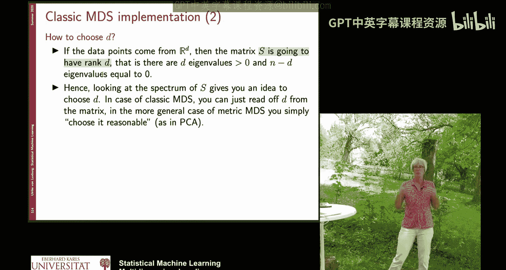
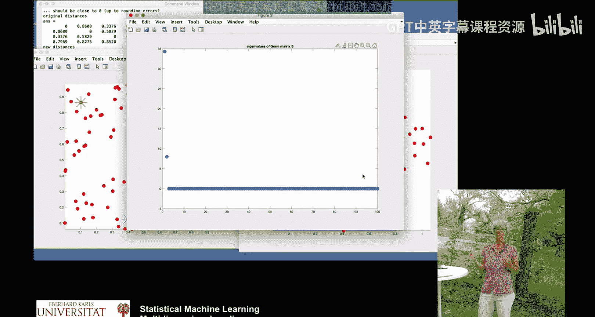
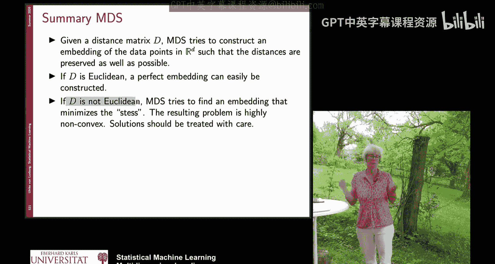
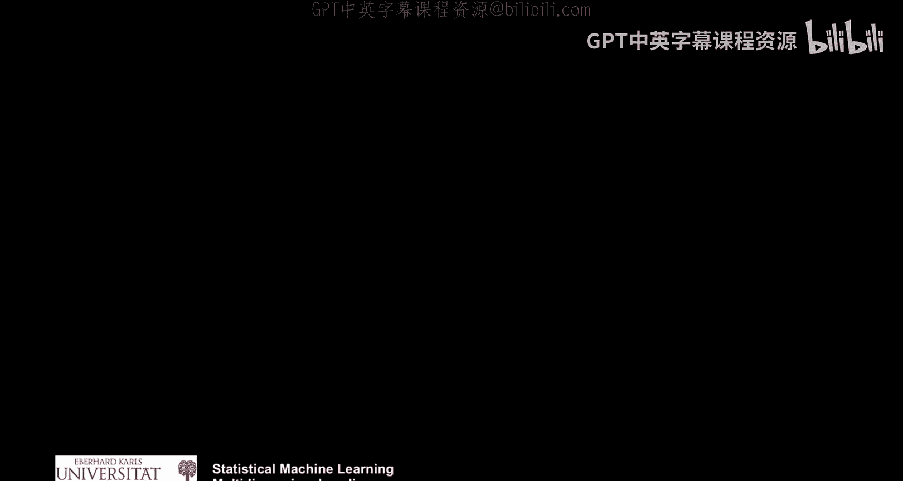

# 27：多维缩放（MDS）🔍

在本节课中，我们将要学习一种经典的嵌入算法——多维缩放。我们将了解什么是嵌入问题，为什么它有用，并详细学习经典多维缩放的数学原理和实现步骤。

## 什么是嵌入问题？🤔

上一节我们介绍了课程主题，本节中我们来看看什么是嵌入问题。

考虑以下场景：你有一些抽象对象，例如分子或文本。你有一种方法来测量这些对象之间的距离。例如，你可以测量两个分子之间的距离，并得到一个数值。现在，假设你拥有所有这些对象之间的成对距离。你可以将这些距离堆叠成一个矩阵，称为距离矩阵。

现在的问题是：如果有人只给你这个距离矩阵，你能在欧几里得空间 **R^D** 中找到一组点，使得这些点之间的距离与你给定的抽象对象之间的距离完全一致吗？

形式上，给定抽象对象 **X_1, ..., X_n** 和距离函数 **d(i, j)**，我们希望找到一个嵌入映射 **φ**，将对象映射到 **R^D** 中，使得对于所有 **i, j**，有：
**||φ(X_i) - φ(X_j)|| = d(i, j)**
这样的问题被称为度量嵌入问题。

## 问题总是有解吗？❓

在深入解决方案之前，我们先思考一下：这个嵌入问题总是有解吗？解是唯一的吗？

以下是两个关键点：
1.  如果数据点本身来自一个欧几里得空间，那么存在一个完美的嵌入（例如，原始的点配置本身）。
2.  如果距离矩阵是任意的一般距离矩阵，通常我们无法找到一个完美的解，但可能可以找到一个近似解。

关于唯一性，问题通常没有唯一解。因为如果我们有一个嵌入，将所有的点平移或旋转，点之间的距离不会改变。因此，所有通过等距变换（平移、旋转、反射）相关联的嵌入都是等价的解。

## 为什么嵌入问题有用？💡

在探讨如何解决问题之前，我们先了解一下为什么嵌入问题在实际数据分析中是有用的。

以下是几个主要的应用场景：
*   **可视化**：这是使用度量嵌入最常见的原因之一。专家们希望将高维或抽象的数据（如分子）映射到2D或3D空间，以便直观地观察数据的结构、聚类和关系。
*   **为算法准备数据**：许多数据分析算法（如主成分分析PCA）要求输入数据是欧几里得空间的向量。如果原始数据是抽象对象（如分子），嵌入可以为其提供一个欧几里得表示。
*   **降维**：有时数据隐含在一个低维流形中，但显式表示维度很高。嵌入可以帮助我们发现并利用这个低维本质结构。

当然，使用嵌入也可能带来问题。如果原始数据的度量结构不是欧几里得的，嵌入必然会引入一些失真。在应用时需要权衡利弊。

## 多维缩放算法家族 📚

存在许多不同的嵌入算法。本节课我们主要关注**多维缩放**这一算法家族。它主要分为三类：
1.  **经典多维缩放**：假设距离矩阵是欧几里得的，目标是完美恢复点配置。
2.  **度量多维缩放**：处理更一般的距离矩阵，目标是找到一个尽可能保留给定距离结构的嵌入。
3.  **非度量多维缩放**：仅知道距离之间的比较关系（如A比B更接近C），而非具体距离值，目标是找到一个满足这些不等式关系的嵌入。

我们将从**经典多维缩放**开始，它的数学原理出奇地简洁。

## 经典多维缩放：数学推导 🧮

我们假设给定的距离矩阵 **D** 是一个欧几里得距离矩阵，即存在某个欧几里得空间中的点集，其距离构成了矩阵 **D**。我们的目标是恢复这些点。

核心技巧是将距离矩阵重新表述为格拉姆矩阵（内积矩阵）。

**第一步：用距离表示内积**
在欧几里得空间中，两点间距离的平方可以展开为：
**d(i, j)^2 = ||x_i - x_j||^2 = (x_i - x_j)^T (x_i - x_j) = x_i^T x_i + x_j^T x_j - 2 x_i^T x_j**
重新排列上式，我们可以解出内积 **x_i^T x_j**：
**x_i^T x_j = (1/2) * (x_i^T x_i + x_j^T x_j - d(i, j)^2)**

**第二步：选择坐标原点**
上式仍然包含 **x_i^T x_i** 项，即点 **x_i** 到原点的距离平方。由于我们可以自由选择坐标系的原点而不改变点间距离，一个简便的做法是**将第一个数据点设为原点**，即令 **x_1 = 0**。
此时，**x_i^T x_i** 变成了 **x_i** 到 **x_1** 的距离平方，即 **d(i, 1)^2**。
因此，内积可以完全用已知距离表示：
**s_{ij} = x_i^T x_j = (1/2) * (d(i, 1)^2 + d(j, 1)^2 - d(i, j)^2)**
对所有 **i, j** 计算此式，我们就得到了格拉姆矩阵 **S**，其中 **S_{ij} = s_{ij}**。

**第三步：从格拉姆矩阵恢复点坐标**
格拉姆矩阵 **S** 是一个半正定矩阵，可以分解为：
**S = X X^T**
其中 **X** 是一个 **n × d** 的矩阵，它的第 **i** 行就是我们寻找的数据点 **x_i** 在 **d** 维空间中的坐标。
为了找到 **X**，我们对 **S** 进行特征值分解：
**S = V Λ V^T**
这里 **V** 是特征向量矩阵，**Λ** 是对角特征值矩阵。
然后我们定义：
**X = V √Λ**
这样得到的 **X** 满足 **S = X X^T**。矩阵 **X** 的每一行对应一个数据点的坐标。

**第四步：确定嵌入维度 d**
如果原始数据确实来自 **d** 维欧几里得空间，那么格拉姆矩阵 **S** 的秩就是 **d**，即只有 **d** 个非零特征值。
在实践中，我们通常绘制特征值谱，选择显著大于零的前 **d** 个特征值。对应的，我们取 **V** 的前 **d** 列（记为 **V_d**）和 **Λ** 的前 **d** 个特征值（记为 **Λ_d**），计算：
**X_d = V_d √(Λ_d)**
这样得到的 **X_d** 是一个 **n × d** 的矩阵，即 **d** 维嵌入结果。如果是为了可视化，通常选择 **d=2** 或 **d=3**。

## 算法总结与演示 📝

以下是经典多维缩放算法的步骤总结：

1.  **输入**：欧几里得距离矩阵 **D**（**n × n**）。
2.  **计算格拉姆矩阵**：选择第一个点为原点，对所有 **i, j** 计算：
    **S_{ij} = (1/2) * (D_{i1}^2 + D_{j1}^2 - D_{ij}^2)**
3.  **特征值分解**：对矩阵 **S** 进行特征值分解，得到 **S = V Λ V^T**。
4.  **选择维度**：根据特征值谱选择目标维度 **d**。
5.  **构造坐标矩阵**：取前 **d** 个特征向量 **V_d** 和前 **d** 个特征值 **Λ_d**，计算嵌入坐标：
    **X = V_d * √(Λ_d)**
6.  **输出**：矩阵 **X** 的每一行是原始对象在 **d** 维空间中的坐标。

在一个简单的演示中，我们从二维空间随机生成一些点，计算其距离矩阵，然后应用经典MDS算法。结果得到的嵌入点图与原始点图在旋转和平移意义下是完全一致的，并且特征值谱清晰地显示只有两个非零特征值，揭示了数据的本征维度为2。

## 度量与非度量MDS 🔄

当距离矩阵不是严格欧几里得时，我们使用**度量多维缩放**。其核心思想是定义一个**应力函数**来衡量嵌入的误差，然后通过优化（如梯度下降）最小化这个应力函数。

一个常见的应力函数是：
**Stress = √[ Σ_{i≠j} (d_{ij} - ||x_i - x_j||)^2 / Σ_{i≠j} d_{ij}^2 ]**
其中 **d_{ij}** 是原始距离，**||x_i - x_j||** 是嵌入后的距离。优化这个非凸函数可能只能找到局部最优解，并且存在固有的近似误差。

**非度量多维缩放**处理的情况更特殊：我们只知道距离之间的排序比较（例如“对象A与B的距离小于对象A与C的距离”），而不知道具体的距离值。这种定性信息在某些场景（如人类主观评估）中更容易获得。其目标是找到一个嵌入，使得距离的顺序关系尽可能得到保持。

## 理论背景与总结 🏁

多维缩放算法历史悠久，经典MDS和基于应力函数的度量MDS可追溯到20世纪50-60年代。

在理论计算机科学中，对于嵌入问题有深入的研究，例如：
*   **Bourgain定理**：任何n点度量空间都可以嵌入到欧几里得空间，且失真度最多为 **O(log n)**。
*   **Johnson-Lindenstrauss引理**：高维欧几里得空间中的点集可以嵌入到低维空间，同时很好地保持点对距离。

**本节课总结**
本节课我们一起学习了多维缩放。我们首先定义了嵌入问题：根据给定的对象间距离矩阵，在欧几里得空间中寻找一组点，使其距离与给定距离一致。我们分析了问题并非总有完美解。然后，我们详细推导了经典多维缩放算法的数学原理，它通过将距离矩阵转换为格拉姆矩阵并进行特征值分解来获得点的坐标。我们还简要介绍了度量MDS（通过优化应力函数）和非度量MDS（处理距离比较信息）的概念。最后，我们了解了该领域的一些理论结果。多维缩放是一种强大的工具，可用于数据可视化、降维和为后续算法准备数据，但使用时需注意其可能引入的失真。