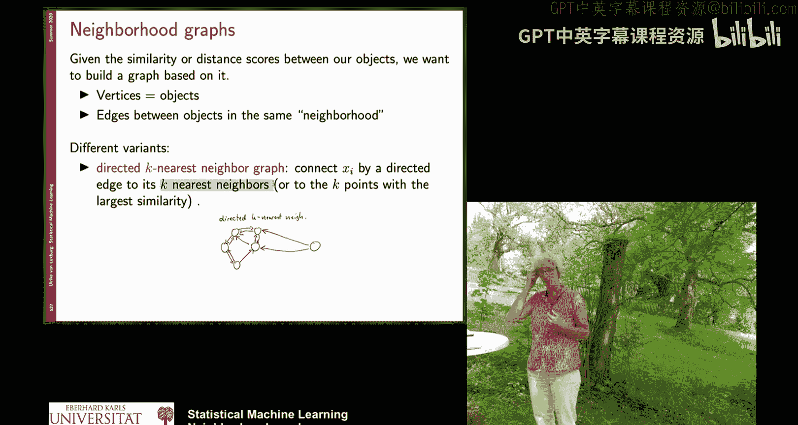
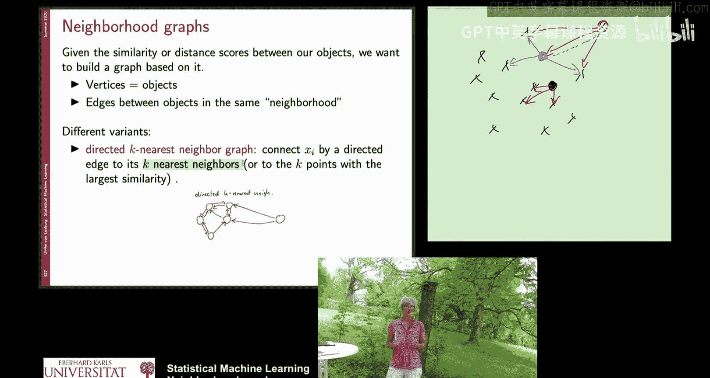
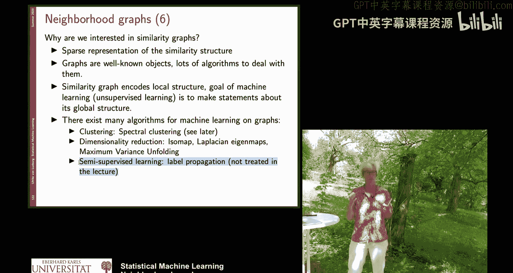

# 图宾根大学《概率和统计机器学习》：Part 29：邻域图 🕸️

在本节课中，我们将学习如何将数据表示为图（或网络），并了解构建邻域图的标准方法。邻域图是一种将数据点之间的相似性关系编码为图结构的有效方式，是许多图机器学习算法的基础。

## 从数据到图

在机器学习中，存在一个庞大的子领域，专门处理基于图的机器学习算法。其核心思想是将数据以图或网络的形式表示，然后在这个图结构上运行算法来分析数据。

通常有两种不同的场景。第一种场景是数据本身已经具有有趣的图结构。例如，如果我们想对社交网络中的用户进行推断，而数据是Facebook的好友关系图，那么我们已经有了一个图：用户是图中的顶点，好友关系是图中的边。

然而，在许多研究领域中，数据本身并没有这种天然的图结构。但我们可以轻松地构建一个图。这就是本节课要简要介绍的**邻域图**，它是构建图的标准方法之一。

## 邻域图的核心概念

现在，我们来看看邻域图。邻域图粗略地试图编码以下概念：图中的顶点就是我们的数据对象。例如，如果要对分子进行推断，顶点就是分子；如果要对文本进行推断，顶点就是文本；如果要对人进行推断，顶点就是人。

在机器学习的标准记法中，顶点通常就是我们所说的数据点 **Xi**。我们希望在图中编码哪些对象彼此相似，并通过边连接那些非常相似的对象。这样得到的图有时被称为**相似图**。

幻灯片上展示了这一点：图中的顶点始终是我们感兴趣的对象，而边则表示对象是否处于相同的“邻域”或彼此相似。

接下来的问题是：我们如何衡量点是否在同一邻域或彼此相似？这可以通过以下几种方式实现。

## K近邻图

首先，我们可以构建所谓的**有向K近邻图**。其定义如下：我们希望将数据点 **Xi** 通过一条有向边连接到它的 **K** 个最近邻。这里 **K** 是一个参数。我们简单地将每个点连接到它的K个邻居。

请看示意图。这里有一些生活在欧几里得平面中的数据点。如果我想构建一个有向3近邻图，并从标记的大点开始，我需要找出它的三个最近邻，并插入有向边。例如，第一个邻居、第二个邻居和第三个邻居，我们用红色边表示。

我们对图中的所有顶点都执行此操作，然后得到一个有向图，称为有向K近邻图。

需要注意的是，有时边可能只存在于一个方向，而不存在于另一个方向。例如，在数据集中添加一个离群点。这个点的三个最近邻可能是另外三个点，因此存在从这个离群点指向它们的边。但是，如果我们看其中一个蓝色点的最近邻，可能并不包括那个离群点。因此，从蓝色点到那个红色离群点就没有有向边。这是因为一个顶点可能是离群点，它指向正常顶点的边可能很长，但被它指向的顶点本身有更近的邻居，所以边不会双向存在。

## 从有向图到无向图

在许多机器学习应用中，使用有向图非常不便，因为我们经常需要查看邻接矩阵、图拉普拉斯矩阵或其他与图相关的矩阵，并进行特征分解。为此，我们首先希望矩阵是对称的，而有向图的邻接矩阵不是对称的。

因此，如果我们有一个有向图，但希望将其转换为无向图，主要有两种方法：
1.  忽略方向，只要两个顶点之间至少有一个方向的箭头，就放置一条无向边。
2.  只有当原始图中两个方向都有箭头时，才放置一条无向边。

以下是这两种方法的公式化定义。

### 标准K近邻图

第一种方法是构建**标准K近邻图**。做法是：在 **Xi** 和 **Xj** 之间放置一条边，如果**至少**满足以下条件之一：**Xi** 在 **Xj** 的K近邻中，**或者** **Xj** 在 **Xi** 的K近邻中。这意味着，只要两个顶点之间至少有一个方向的箭头，就简单地放置一条无向边。这本质上是忽略了有向图中的边方向，从而得到一个无向图。这是机器学习中最广泛使用的图。

### 互K近邻图

另一种选择是构建**互K近邻图**。这里的关键区别在于使用“**且**”而不是“或”。要判断顶点 **Xi** 和 **Xj** 之间是否存在无向边，需要检查**两个**条件是否都成立：**Xi** 有一条指向 **Xj** 的有向边，**并且** **Xj** 有一条指向 **Xi** 的有向边。只有当两个条件都为真时，才放置无向边。

从定义中可以明显看出，互无向图中的边集始终是标准无向图中边集的子集，反之则不成立。

## Epsilon近邻图

除了K近邻图，还存在另一种图概念，通常称为 **Epsilon近邻图**。它更简单：如果两点之间的距离小于某个阈值 **ε**，则将每个点连接到其他所有点。

为了感受这些图的实际工作原理，这里有一个示例图。我们有一些从R2中随机抽取的蓝色数据点。图中显示了不同无向图的边。

*   **左侧**是K=5时的标准K近邻图。可以看到，该图倾向于良好连接。
*   **右侧**是相同K值下的互K近邻图。可以看到边少得多，并且图可能不连通，存在一些孤立的点或小簇。这是因为，如果一个点是离群点，它可能有边指向其他点，但其他点可能没有边指回它，导致它在互近邻图中被孤立。
*   如果增加K值（例如K=10），互近邻图的连通性会提高，但可能仍然存在离群点。
*   图中也展示了Epsilon图。Epsilon图存在类似互K近邻图的问题：如果存在离群点，且选择的 **ε** 不够大，图可能不连通；如果为了使图连通而选择非常大的 **ε**，那么在高密度区域内，几乎每个点都会连接到其他所有点，从而失去图的结构信息。

因此，从这张幻灯片得出的结论是：如果你要从数据构建无向图，**应始终使用标准K近邻图**。

## 边权重

到目前为止，我们看到的所有图都没有边权重，是**无权图**。但在许多应用中，为图添加边权重可能很有意义。

以标准K近邻图为例，图中有些边较长，有些边较短。我们可能希望将边的“长度”信息传达给算法，这可以通过边权重来实现。

**重要的是，边权重应编码相似性，而不是距离。** 在无权图中，邻接矩阵的条目是1（有边）或0（无边）。引入相似性权重时，我们希望边对应高值，而没有边或信息量不大的长边对应低值。

对于欧几里得数据，典型的选择是在边上使用**高斯核**作为边权重。本质上，通过高斯核计算两个顶点之间的相似性，并选择一个合适的核宽度 **σ**。这个 **σ** 的选择应使得一个点与大约10-15个邻居相似，但确保图中相距很远的点（例如左上角和右下角的点）不相似。

通过使用带相似性权重的K近邻图，可以向算法传达比无权图更多的信息。

**切勿使用距离作为权重**，因为这破坏了邻域图背后的逻辑。两个非常接近的点距离近乎零，但它们在图中应有边（权重应为高相似性值），这两者不匹配。

对于Epsilon图，通常不使用边权重，因为 **ε** 本身已经包含了某种距离信息。在Epsilon图中，所有边的长度大致都在 **ε** 以内，因此区分长边和短边的意义不大。

## 为何使用图表示数据？

将数据表示为图有许多原因，以下列举几点：

1.  **稀疏表示相似性结构**：对于大规模数据（如十亿用户），存储完整的距离矩阵（十亿乘十亿）是不可能的。图只编码相近对象之间的相似性，而忽略相距甚远的对象，这非常高效。在机器学习中，通常只有相似或邻近对象之间的信息才是真正重要的（例如在分类问题中）。
2.  **算法便利性**：计算机科学领域对图有深入研究，存在大量成熟的图算法。使用图可以方便地表达对象之间的关系。
3.  **强调局部结构**：许多任务（如分类）只关心局部邻域，而不关心空间中遥远部分发生的情况。K近邻图或Epsilon图恰好编码了这种局部邻域信息。

基于图的机器学习方法应用广泛，例如：
*   **聚类**：谱聚类这一著名的聚类算法完全基于图。
*   **降维**：许多降维技术（如下一讲将讨论的等距映射）基于图结构。
*   **半监督学习**：许多算法（如标准的标签传播算法）使用这种基于图的框架。

## 总结

本节课我们一起学习了邻域图。我们首先了解了将数据表示为图的基本动机。然后，详细探讨了构建邻域图的几种主要方法：有向K近邻图、标准（无向）K近邻图、互K近邻图以及Epsilon近邻图。我们通过比较得出结论，**标准K近邻图**通常是实践中的首选。此外，我们还讨论了为图添加**相似性边权重**（如高斯核）以增强信息表达的重要性。最后，我们总结了使用图表示数据在稀疏性、算法便利性和捕捉局部结构方面的优势，并列举了其在聚类、降维等任务中的应用。掌握邻域图的构建是理解后续众多图机器学习算法的基础。