# 概率和统计机器学习：32：聚类简介 🧩

在本节课中，我们将要学习数据聚类这一领域。聚类是无监督学习中最重要的领域之一，其目标是在没有标签信息的数据中发现内在的组别结构。我们将概述什么是聚类问题、不同类型的聚类问题，并在后续课程中讨论解决这些问题的各种算法。

## 什么是数据聚类？🔍

上一节我们介绍了聚类的基本概念，本节中我们来看看其具体定义和目标。

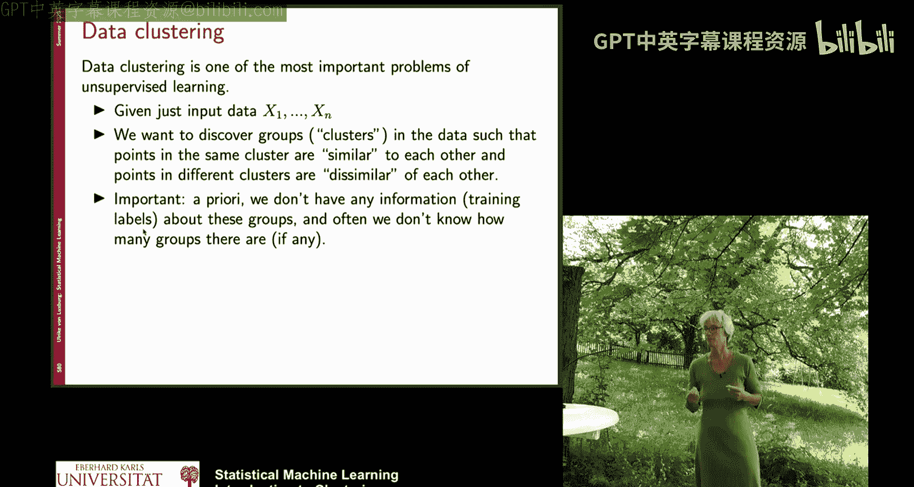

在数据聚类中，我们通常给定一组数据点 `x1, x2, ..., xn`，但不像监督学习那样拥有任何标签信息。聚类的目标是**在没有外部指导的情况下，发现数据中自然存在的组别**。

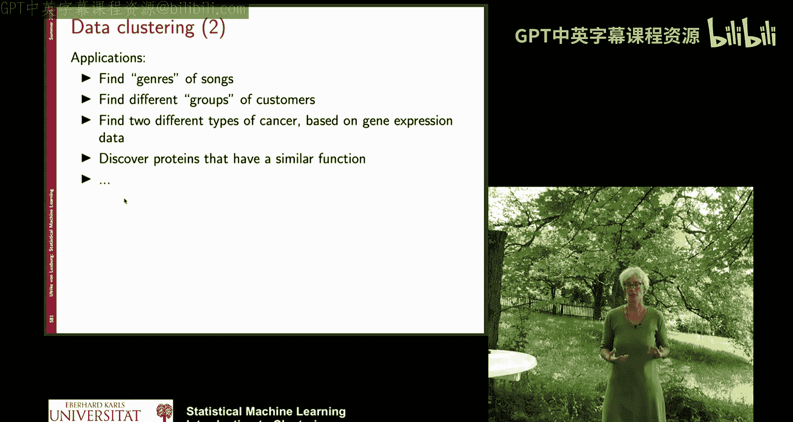

例如，你可能希望发现某种疾病的不同亚型、识别不同类型的客户，或者区分不同的鸟类物种。你总是假设数据中存在一些“组”，组内的数据点彼此之间比组间的数据点更为相似，而算法需要自行发现这些组。

## 聚类的应用场景 📊

以下是聚类算法的一些典型应用场景：

*   **歌曲流派分类**：在推荐系统中，将歌曲分类到不同的流派。
*   **客户细分**：发现不同类型的客户群体。
*   **癌症分型**：基于基因表达数据区分不同类型的癌症。
*   **蛋白质功能发现**：发现具有相似功能的蛋白质。

## 聚类的两大目的 🎯

聚类主要服务于两个目的，它们在性质和评估方式上非常不同。

### 1. 探索性数据分析

许多人提到聚类时首先想到的就是这个目的。例如，研究蛋白质时，你怀疑存在某些功能群组但不完全确定。聚类算法可以告诉你哪些蛋白质看起来相似，可能具有相同功能。作为专家，你可以验证算法找出的这组蛋白质是否确实功能相似，并可能发现一个你之前未考虑过的新蛋白质（比如第11号），它可能与你已知的其他蛋白质功能相似。

这被称为**探索性数据分析**：你需要一个工具，能够以某种方式向人类呈现数据，使你能够开始观察数据并形成关于数据的假设。这通常与可视化相结合，通过将数据以组的形式呈现，帮助你看出哪些点属于一起，哪些点彼此不同。

### 2. 数据压缩

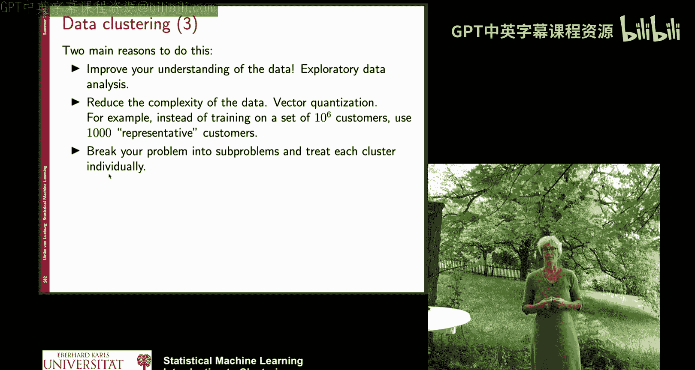

出于统计或计算原因，你可能希望压缩数据。例如：
*   **分组分析**：针对不同类型的癌症，你希望完全分开处理，对每种类型运行独立的分析。
*   **代表性抽样**：如果你有数百万客户，但只能运行一个处理1000个客户的复杂算法。你可以随机抽样，但这可能漏掉某些重要的小群体。更好的方法是先运行聚类算法找出所有子群，然后从每个客户群中选取几个代表（极端情况下每个群只选一个），再在这些代表上运行你的算法。

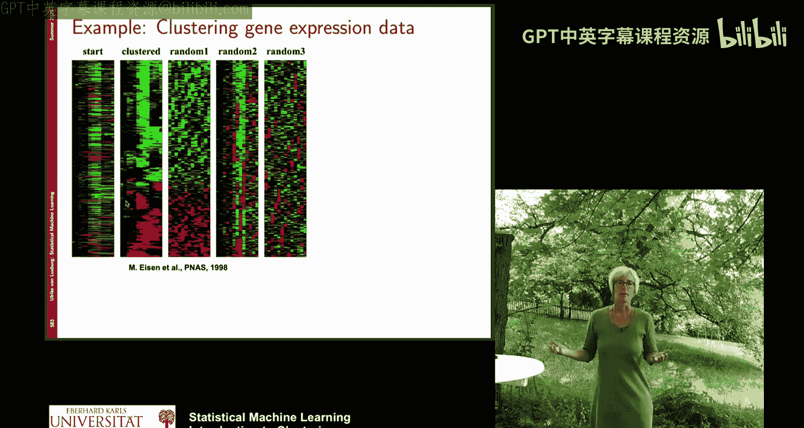

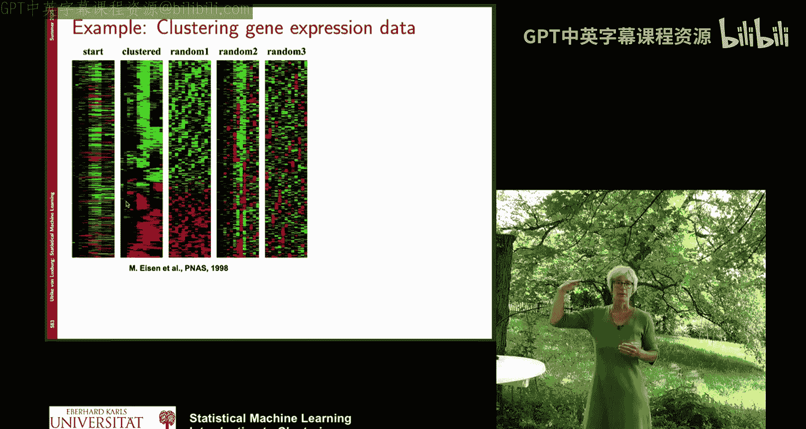

在数据压缩场景中，评估算法参数相对容易。例如，先选取客户代表运行分类算法，然后检查准确率，甚至可以使用交叉验证来设置聚类算法的参数。

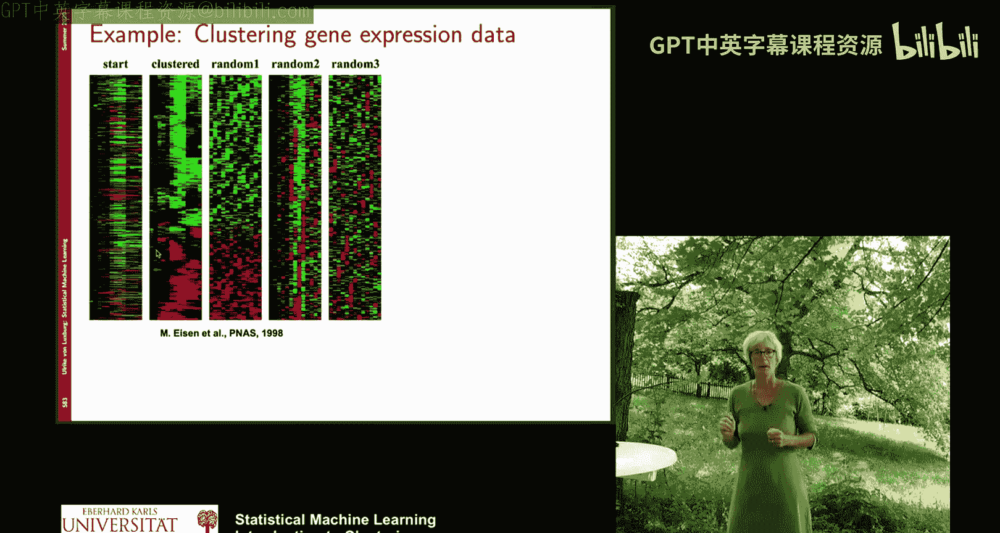

然而，在探索性数据分析场景中，评估聚类质量通常非常困难。要进行妥善评估，可能需要让人类专家参与模拟研究，判断哪种聚类更好，或者验证哪种假设更可能成立，这非常复杂。这也是聚类领域有些难以捉摸的原因之一——虽然有大量理论分析，但并没有一个放之四海而皆准的“最佳”标准。

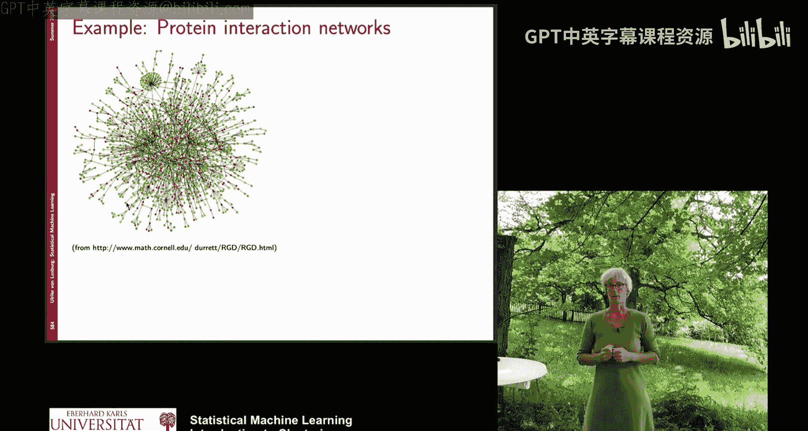

## 聚类算法实例展示 🖼️

以下是几个聚类算法的应用实例：

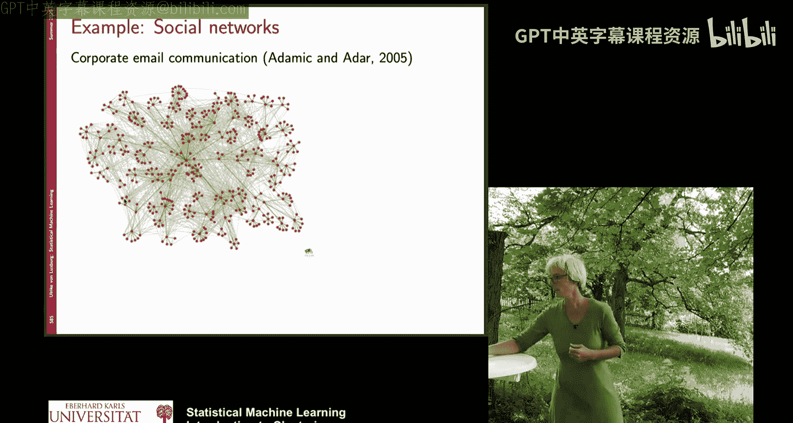

*   **基因表达数据聚类**：数据集中，行对应不同的基因，列对应基因的不同测量值。目标是根据基因在特定条件下的活跃程度对基因进行聚类。
*   **蛋白质相互作用网络聚类**：网络中的顶点是蛋白质，如果两个蛋白质倾向于相互作用，则它们之间存在边。目标是找到功能子群，即将图分割成不同的部分，使得不同部分之间的连接很少，而同一部分内部的连接很多。
*   **公司邮件通信分析**：分析公司内部人员之间的邮件流量，可以发现经常互相发送邮件的群体（如项目团队），甚至可能发现团队内部沟通不畅的问题。
*   **图像分割**：例如，将图像的前景与背景分离，或者找出图像中的不同物体（如苹果、馅饼、钱包、汽车）。

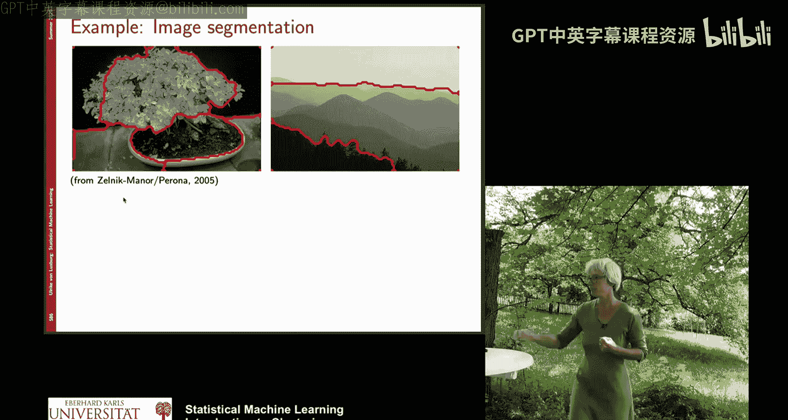

## 扁平聚类与层次聚类 🌳

之前提到的例子（如寻找两类客户或两类癌症）属于**扁平聚类**。在这种方法中，我们假设存在一个“正确”的聚类数量 `K`，然后尽可能好地将数据空间划分成这 `K` 个簇。

然而，还存在完全不同的聚类问题，即**层次聚类**。它认为数据无法仅用一个特定的聚类来描述，而是存在一个演化的层次结构。

例如，在哺乳动物遗传距离的树状图中，最精细的分辨率在右侧，显示了猫、家鼠、大鼠和负鼠等不同物种。其中一些物种属于更大的类别，例如大鼠和家鼠比较相似，它们共同构成了啮齿动物分支。此外，还有灵长类动物等分支。你可以得到一个从粗略到精细的完整层次结构。

另一个应用是文本主题分类：例如，有关于体育和政治的文本。在政治内部，可能有德国政治和外交政治；在体育内部，可能有足球、网球等。这样就形成了一个从粗粒度到细粒度的完整主题层次，这就是层次聚类。

## 聚类的典型方法与挑战 ⚙️

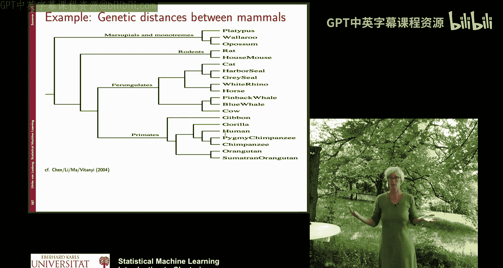

在非常高的层面上，解决聚类问题的典型方法如下：

你需要定义什么是“簇”。一种常见的思路是：**属于同一簇的点，其距离应该非常小；而属于不同簇的点，其距离应该很大**。或者也可以用相似性来表述：同一簇中的蛋白质应该非常相似，而不同簇中的蛋白质应该彼此不相似。

许多聚类算法需要定义一个可以优化的目标函数。机器学习最终几乎总是解决一个优化问题，聚类也是如此。我们定义一个优化准则，例如：
*   我们希望**簇内点的平均距离**很小，因为希望同一簇内的点紧密聚集。
*   我们希望**簇间点的平均距离**很大，因为希望不同簇彼此远离。

然后可以构建一个目标函数，例如将**簇间平均距离**除以**簇内平均距离**，并最大化这个比值（或最小化其倒数）。

当然，这种方法存在几个大问题：

1.  **目标函数的选择**：根据选择的目标函数不同，你会得到非常不同的聚类结果。需要记住，聚类目标函数只是你真正想做的事情的一个代理。并没有一个“最佳”的聚类目标函数，根据你的问题，可能某个目标函数比另一个稍好一些，但其中也存在很多任意性。是使用上述表达式，还是使用它的平方，或是其他度量？有无数种选择，并且通常不存在一个“最好”的选择。
2.  **优化难度**：与这些目标函数相关的另一个问题是，它们通常是**NP难**的，非凸且形状任意。聚类最终试图解决的是一个离散划分问题。例如，如果你想找到两个簇并有一个目标函数，你可以尝试所有将 `n` 个点分成两簇的不同方式，但存在 `2^n` 种可能性。对于许多算法和目标函数来说，没有有效的方法可以避免遍历这些指数级多的划分，因此运行时间是指数级的。

对于许多算法，通常有两种应对策略：
*   直接尝试最小化目标函数，最终陷入局部最优，并希望这个局部最优对于你的应用来说“足够好”。
*   寻找一个松弛形式，解决某个更容易的相关问题。

在实践中，这两种方法都有应用。

## 总结 📝

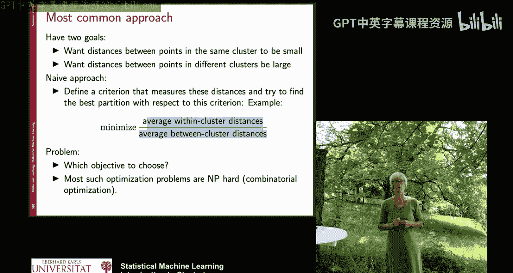

本节课中我们一起学习了数据聚类的基础知识。我们了解到，聚类是无监督学习中的核心领域，旨在发现无标签数据中的内在分组结构。我们探讨了聚类的两大主要目的：探索性数据分析和数据压缩，并了解了它们在评估上的差异。我们还看到了聚类在基因分析、网络研究、商业和图像处理等多个领域的应用实例。最后，我们区分了扁平聚类和层次聚类，并讨论了通过定义和优化目标函数来解决聚类问题的通用方法及其面临的挑战（如目标函数选择的任意性和优化问题的NP难性质）。在接下来的课程中，我们将深入探讨各种具体的聚类算法。