# 33：K-means聚类 🧮

在本节课中，我们将要学习第一个聚类算法：K-means算法。这是一个非常经典且应用广泛的算法，虽然原理简单，但常被用作性能基准。我们将从标准K-means算法开始，了解其目标、工作原理、优缺点以及一些变体。

## 算法目标与参数

上一节我们介绍了聚类的基本概念，本节中我们来看看K-means算法的具体目标。

我们被给定一组存在于欧几里得空间 **R^d** 中的 **n** 个数据点。我们希望将它们分成 **K** 个不同的簇。**K** 是一个需要提供给算法的参数。这个参数通常不容易设定，但有时也并非至关重要。目前我们假设我们知道要寻找多少个簇，例如10个，这个数字就是 **K**。

该算法的进行方式是，我们希望为每个簇构建一个代表，这个代表本质上是该簇的中心。这些中心在下文中被称为 **M_1** 到 **M_K**（M代表均值）。为了找到这些中心，我们观察一个特定的成本函数。

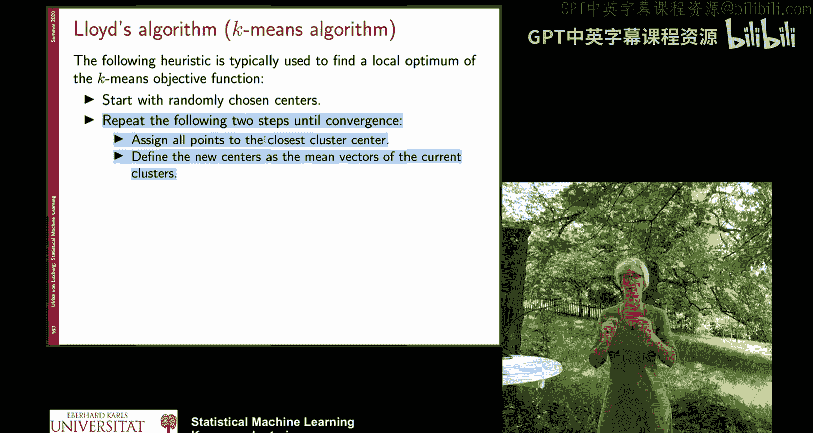

我们观察每个特定的簇（簇的索引在此求和中用小写 **k** 表示，求和从 **k=1** 运行到大写的 **K**，即簇的数量）。我们查看它的均值 **M_k**，然后对于所有属于该特定簇 **C_k** 的点 **i**，我们测量该点与簇均值之间的平方距离。然后我们对所有这些平方距离求和，这就是成本函数。

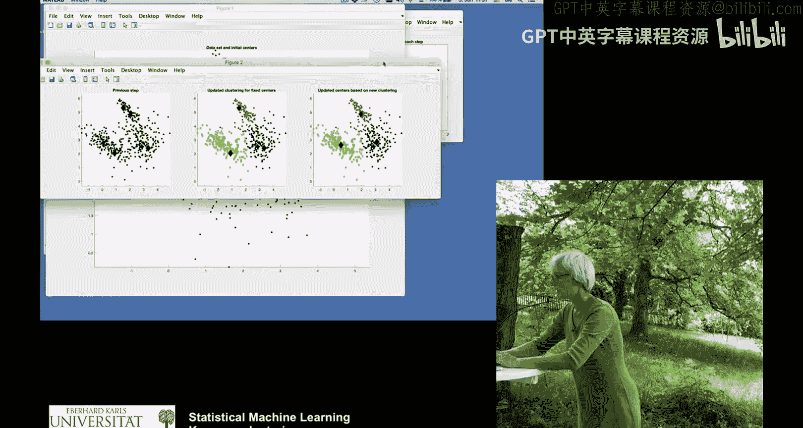

我们的想法是希望最小化这个成本函数，既包括簇的均值，更重要的是包括点到簇的分配。最终我们希望实现的是，将我们的空间划分为 **K** 个组，使得这个全局目标函数尽可能小。

## 算法流程与演示

上一节我们介绍了算法的目标函数，本节中我们来看看如何通过迭代来优化它。

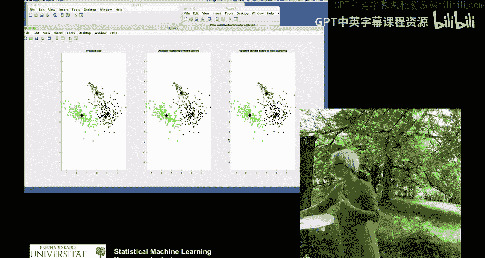

通常用于最小化此目标函数的算法是Lloyd算法。这是一个非常古老的启发式算法，旨在尽可能优化我们刚才看到的目标准则。

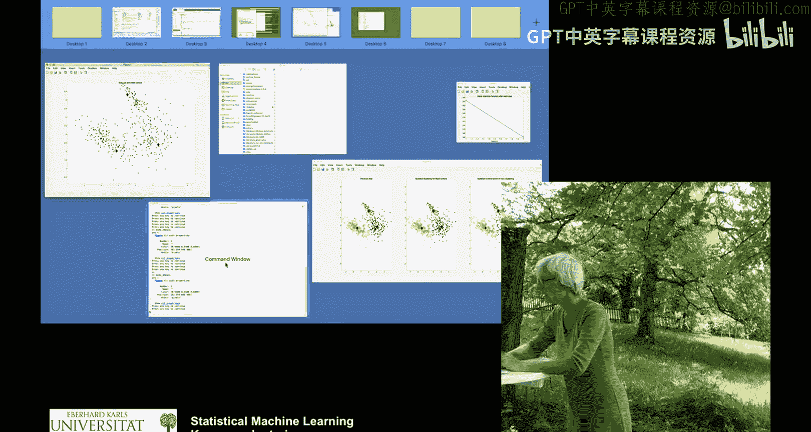

它的工作原理如下。我们通常从一组初始中心开始，例如，简单地从数据集中随机选择 **K** 个点。然后我们重复两个步骤直到收敛：
1.  给定当前的中心，为数据集中的每个点检查哪个中心是当前所有中心中最近的，并将每个点分配给最近的中心。
2.  一旦我们有了分组，我们就重新分配中心，将中心移动到这些组的均值位置。

以下是算法步骤的简要说明：
*   **初始化**：随机选择 K 个数据点作为初始簇中心。
*   **循环直到收敛**：
    1.  **分配步骤**：将每个数据点分配给距离最近的簇中心。
    2.  **更新步骤**：将每个簇的中心重新计算为该簇所有点的均值。

让我们通过一个简单的演示来理解。我们首先看到一个初始数据集，它可能具有或多或少的清晰簇结构。我们有三个初始中心，用红色的菱形标记，它们是从现有数据集中随机选择的数据点。

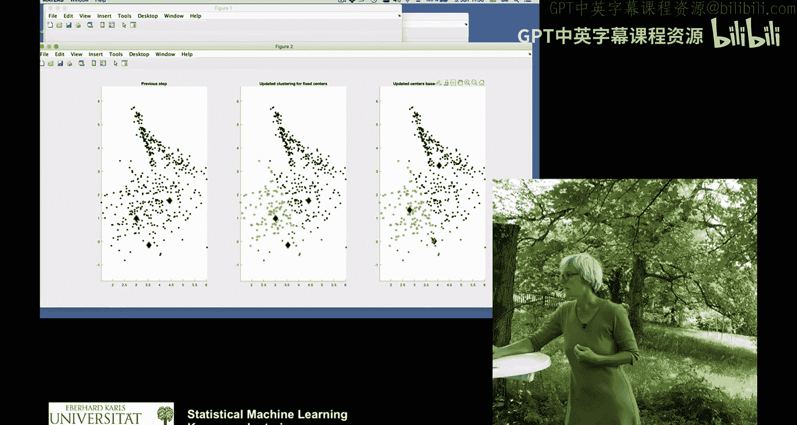

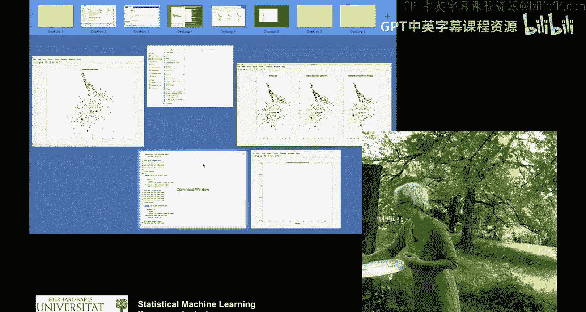

在左侧面板中，我们总是看到算法当前或上一步的结果，在这个案例中是初始步骤。现在我们总是执行两个步骤。首先，中心是固定的，我们将每个数据点分配给其最近的中心。在中间面板中，对于每个菱形中心，我们分配点。例如，所有绿色的点是离这个中心最近的，红色的点是离那个中心最近的，黑色的点是离另一个中心最近的。这是while循环的第一步。

第二步是，我们现在可以重新分配数据的中心。例如，在黑色类中，中心从之前的位置移动了一点，新的中心就是所有黑点的均值。绿色点的新中心是所有绿点的均值，红色点的新中心是所有红点的均值。这是while循环的一次迭代，现在我们继续。

我们执行更多步骤。再次，这里你总是看到上一步的情况和下一步的情况。现在又到了更新簇分配的步骤，即点的颜色。我们检查例如，在这个图像中这个黑点，在之前的图像中它是黑色的，在这个图像中它变成了红色，因为它现在离红色簇中心比离黑色簇中心更近，所以它改变了颜色。因此，从左图到中图，我们根据谁离哪个中心最近来改变点的颜色，然后从中图到右图，我们再次稍微移动中心，使它们真正成为特定类的均值。

然后我们继续。我们可以看到，这已经非常接近收敛了。我们可以再继续几次，然后算法就收敛了。在y轴上，我有一个不同的图，这是每一步之后目标函数的值。我们可以看到，开始时并不好，它下降得很快，在这里我们已经几乎看不到图中发生任何变化，而且目标函数基本上已经收敛，在这里它最终收敛了，算法达到了一个局部最优并停止。

让我们尝试在另一个数据集上再次运行算法，也许初始化不像这里那么好。在这个模拟中，我只是随机生成数据点。这里我们有一个特定的例子。如果你看这个数据集，你可能会说有两个簇，也许上面这里有一组，然后下面这里有另一组。同样，我们在开始时选择了三个随机中心，它们现在都恰好位于图的底部区域。

现在我们运行K-means步骤。我们在这里看到的是我们的初始数据集。在中间，我们看到点对这个初始数据集的分配。这里我们只有几个红点，它们是离底部这个中心最近的，然后是一些更多的绿点，它们离这个中心更近，然后我们有黑点，它目前拥有大多数点。因此，从左到右，我们基本上只是将颜色分配给数据点，然后从中到右，我们需要移动簇的中心，现在我们看到一些事情发生，特别是在黑色簇中，中心显然不是所有黑数据点的中心，如果你计算所有黑数据点的中心，它位于这里，这就是我们现在在右侧看到的情况。类似地，在底部和绿色部分，类的中心移动了一点，但不多。

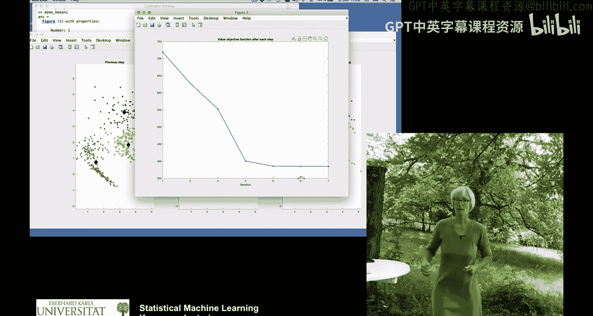

现在让我们进行算法的另一次迭代。左侧是之前我们有的分配。现在，我们重新分配颜色。我们现在看到绿色延伸到这里，红色延伸到这里，仅仅因为这些数据点，由于黑色簇的中心向上移动了很多，所以这些处于绿色和黑色边界的数据点现在倾向于被分配给绿色，因此发生了变化。然后，我们再次开始移动簇中心，从中到右，我们迭代这个步骤，我只需让它运行几次，直到算法收敛。我只需要继续按按钮让它继续。它收敛得有点慢。现在，它已经收敛了。也许我们先看看结果，这是聚类算法的最终结果。

如果你让我将这个数据集分成三个簇，我不确定这是否真的是你真正想找到的，但这就是K-means算法在这里找到的结果。也许还需要说，这个数据结构并没有清晰的簇结构，那么算法找到哪种结果通常取决于算法本身，有时有用，有时不那么有用。这就是聚类的难点。但无论如何，这是我们得到的结果。至少，分离这个密集的黑色组是有意义的，这也是我一开始猜到的，然后剩下的组被分成两部分，事情就是这样发生的。

如果你再看目标函数的值，我们现在看到它用了更多步骤，将近20步才收敛，但它确实收敛了。通常情况总是这样，开始时聚类质量有相当陡峭的提高，目标函数变得越来越小，然后在最后逐渐趋于平缓，可能总有一两个点被移动，中心只移动一点点，需要一点时间才能收敛，但它总是收敛。

我们再做一个K-means的演示。我尝试找一个我认为在某些方面有用的例子。这个不是有用的。这个可能至少是一个有趣的例子，可以看到发生了什么。在左侧，我们再次看到原始数据集，用三个中心初始化，因为我们告诉算法要找三个中心。我们看到第一次分配，一半的数据分配给红色中心，然后一些点给黑色，一些给绿色。在下一步，簇中心被移动，也许我们现在简单地快速浏览一下，看看它最终是如何收敛的。

那么它找到的最终结果，至少从我的角度来看是有意义的，如果你让我找三个类，它找到了这个红色组、绿色组和剩下的黑色组。所以这似乎有道理。再看目标函数，它是单调递减的，用了七步。这就是K-means算法的本质。

## 算法形式化描述与性质

上一节我们通过演示直观了解了算法流程，本节中我们来看看其形式化描述和理论性质。

这是形式化的K-means算法，如果你用伪代码写出来。我们数据的输入由欧几里得空间 **R^d** 中的 **n** 个点和我们想要找到的簇的数量 **K** 组成，**K** 是一个输入参数。我们随机初始化第一组中心。我们稍后会讨论如何做到这一点，但简单地说，我们随机选择 **K** 个数据点。

然后我们有一个while循环，一直运行直到收敛。在while循环中，我们有两个步骤：将数据点分配给最近的簇中心（这总是从左图到中图，我们改变数据点的颜色），标准如果你正式写下来是这个，但我想这很清楚，对于每个数据点，你检查它是更接近簇中心 **M_k** 还是更接近 **M_l**，然后你将它分配给最近的那个。一旦分配完毕，你重新计算数据，通过在每个簇中简单地计算该簇中数据的均值来得到新的簇中心，然后迭代直到收敛，然后根据你的喜好输出簇本身或簇中心。

当你设计一个算法，它有一个while循环并且说“直到收敛”，你总是需要问自己，它是否总是终止，或者它可能无限运行？在这种情况下，它总是终止，证明简洁而优雅。陈述是：给定任何空间 **R^d** 中的有限点集 **n**，那么K-means算法在有限次迭代后终止。

证明概要如下：在while循环的每次迭代中，目标函数严格减小，所以它变得越来越小，它不能增加。如果你记得在演示中，我们也总是看到它是单调递减的。这里的陈述是，这总是发生。这不仅仅是巧合，我们碰巧有这些好例子，而是总是发生。并且它是严格减小的，所以不能说保持不变，它总是需要减小。然后我们只有有限多个可以检查的划分。我们有 **n** 个数据点，如果我们有 **K** 个类，原则上可能有 **K^n** 个划分。最迟在我们看过所有这些不同的划分之后，算法就不可能再继续了。因为当然，要增加，它需要在while循环的每次迭代中选择一个不同的划分，关键是现在我们不可能说，我们现在有某个特定的划分，我们迭代几步，然后又回到这个完全相同的划分，这不可能发生。因为在每一步，目标函数都必须严格减小，因为它不能保持不变，也不能再次增加，所以它不可能从这里开始减小，然后突然回到之前一个更大的值。所以每个划分最多被访问一次。我们只有有限多个划分，所以算法必须终止。

这当然只是一个证明概要，如果你想，你可以尝试正式地完善它，这并不难，但你需要做一些工作，特别是第一步，证明目标函数确实减小，但这并不困难。

现在，第一个问题是，如果你有一个算法，它是否终止？我们已经看到答案：是的。第二个问题是，当它终止时，解有多好？我一开始就暗示过，许多聚类问题是NP难的，我们稍后会看到K-means也是其中之一。所以原则上，我们可能会陷入困境。我的意思是，我们收敛到一个局部最优。但这个局部最优可能非常非常糟糕。对于这个局部最优离全局最优有多远，没有任何保证，我们无法给出任何保证。我有一个非常简单的例子来说明这一点。

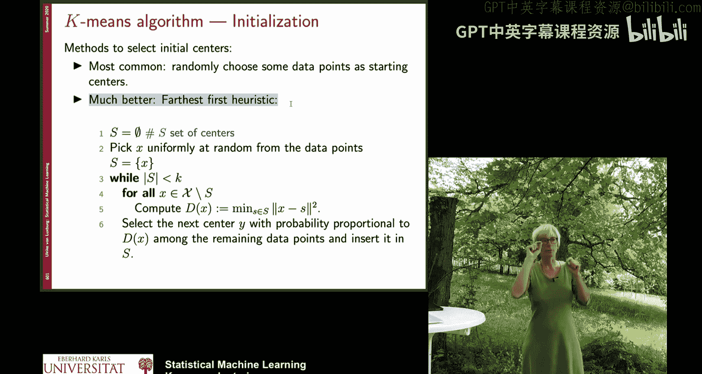

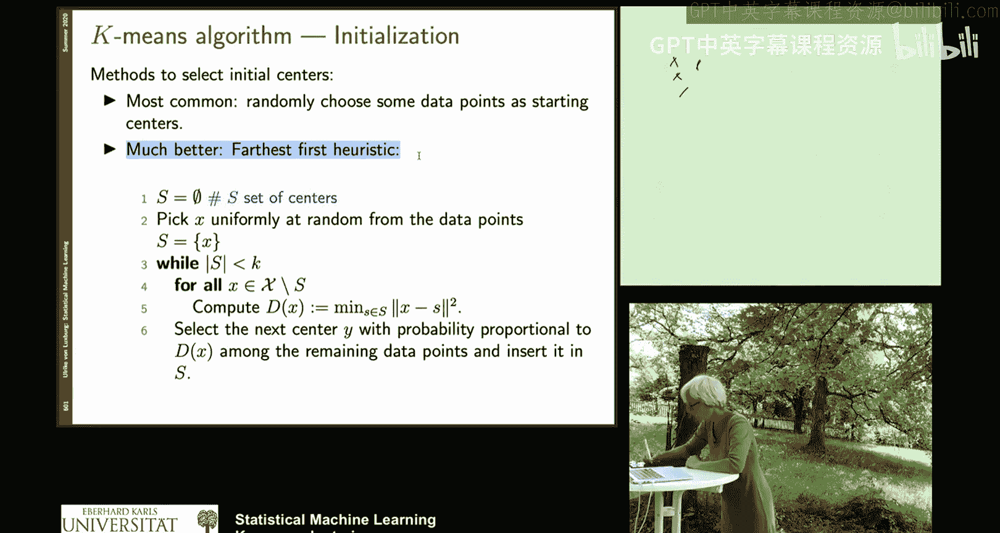

这是一个玩具例子，但它说明了一个观点。我们只有四个点位于实线上，所以我们的数据是一个一维数据集，包含点 **x1, x2, x3, x4**。这些点之间的距离，如图中所示，简单地命名为 **A, B, C**。现在，根据我如何初始化数据点，可能会发生不同的事情。假设我想找到三个簇。假设我通过随机选择数据点来初始化，我碰巧选择了这三个蓝色的数据点。这就是我所说的初始化1。现在会发生的是，算法在一步内收敛到一个解，其中点 **x1** 和 **x2** 各自保持自己的簇，然后 **x3** 和 **x4** 被分配到一个联合簇中。现在，这个特定聚类的目标函数是：这里 **x1** 和 **x2**，它们不会产生任何误差，因为点与簇均值之间的距离是0。这里，点产生一个小误差，正好是 **(C/2)^2** 乘以2，因为我们有两个点，每个点距离簇中心 **C/2**，然后我们平方距离，但我们有两个点，所以目标函数的值是这个。

现在，假设我们采用不同的初始化，这个初始化2，我们有初始簇中心 **x1, x3, x4**。然后我们收敛到一个不同的解，现在点 **x1** 和 **x2** 被分配到同一个簇，目标函数的值现在是 **A^2/2**。当然，如果你想构造一个任意糟糕的例子，你可以通过选择大的 **A** 和小的 **C** 来玩弄 **C** 和 **A**，这个因子可以如你所愿地糟糕。

所以，你可以看到，K-means算法根据初始化的不同，会陷入不同的局部最优。它们可能离全局最优任意远。所以没有任何保证。

## 初始化策略与改进

上一节我们看到初始化对结果影响巨大，本节中我们来看看一些常见的初始化策略和改进方法。

就像许多局部搜索算法一样，它本质上是一种启发式方法。也许不是真正的局部搜索启发式，但你可以这么说。也许有些人会这样称呼它，也许有些人不会。无论如何，它是一种试图找到良好最优解的启发式方法。许多这样的启发式方法总是依赖于初始化有多好。

在这种特定情况下，有两种非常常见的方法来初始化你的数据（你的簇中心）：要么你随机选择数据点作为簇中心，这是大多数工具箱也做的标准做法；然后有一种好得多的方法，称为“最远优先”启发式方法。

它的工作原理如下。你先随机选择一个数据点。现在你查看所有其他数据点，并计算所有其他数据点到你已经拥有的那个点的距离。然后你根据距离成比例地选择下一个簇中心。因为你想实现的目标，也许我在这里画个图，这样更容易理解。

假设我们有一些数据点。现在假设我们想要聚类我们的数据点，我们选择第一个初始中心，比如我们选择这个红色的点。现在我们想要实现的是，在初始化中，空间被合理地覆盖得比较好，我们不希望所有中心都位于同一个角落。所以我们现在想做的是，红点位于左上角，那么也许我们应该选择下一个点，它应该位于数据集的右下角。我们做的是，计算所有其他数据点到红点的距离。然后根据你的实现，你要么选择距离你已经拥有的点最远的数据点，也许是这个点。或者有时你也随机选择，然后你随机选择另一个数据点作为新的簇中心，但你增加这些点距离越远的概率。这些选项都是可能的。

一旦你找到了两个簇中心，也许我试着擦掉这些红线。现在我们有这两个簇中心。现在再次，要选择第三个簇中心，你现在计算所有点到你已经拥有的这两个点的距离。所以你要计算。比如说，如果你想知道这个点是否是一个好的新簇中心，你计算这个点到你已经有的簇中心的距离，然后取这两个距离中的最小值，并使其尽可能大。

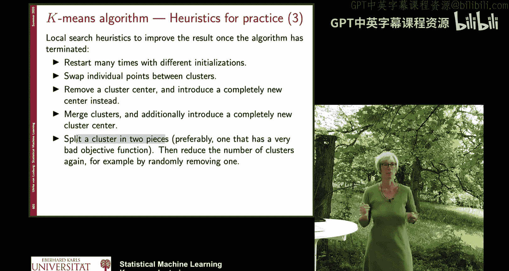

这就是我们在这张幻灯片上看到的，如果你现在看幻灯片。所以，**S** 将是我们想要拥有的初始中心集合，我们用一个特定的数据点初始化它，只要我们还 **没有K** 个中心，我们就按如下方式进行：对于每个还不是中心的数据点 **x**，我们计算 **x** 到集合 **S** 的距离，这基本上是最小值。对于所有像你计算 **x** 到所有其他 **s** 的距离，你取最小值，这就是 **x** 到集合 **S** 的距离。现在你以与这个距离成比例的概率选择下一个中心。

如果你想使用一个好的初始化，这通常是你应该使用的。事实上，如果你采用这种启发式方法，得到的算法通常被称为 **K-means++** 算法，并且它具有相当强的近似保证。事实上，这在大约10年前被证明，参考文献稍后会在幻灯片中给出。

还有更多选择中心的方法，你也可以说通过使用不同的聚类算法来初始化，或者也许你有一些背景知识，已经告诉你数据中已经有10个类，你还想再找5个，那么当然你要做的是，对于你已经有的前10个簇，你会选择它们的中心作为你的初始中心，然后选择5个更多，并让算法运行。所以如果你有先验知识，你当然可以通过初始化你的数据（你的簇）来利用它。

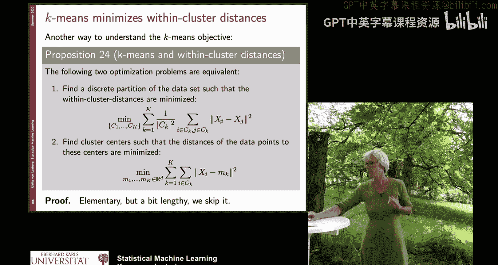

由于它是一种局部搜索启发式方法，并且如此强烈地依赖于初始化，你通常要做的是将算法重新启动几次，比如10次、20次，使用不同的初始中心，然后在得到的所有结果中，选择成本函数最小的那个。这是标准程序。当你使用工具箱时，你还需要检查这是否隐式发生，或者你是否需要显式地做，如果工具箱没有隐式地做，你应该总是这样做，至少重复10次，我的意思是你不需要重复一千次，但说10次，这通常更好。

## 算法细节与变体

上一节我们讨论了初始化和重启，本节中我们来看看算法的一些细节和重要变体。

有一些细节现在不那么重要，但我仍然想提一下。在算法过程中，可能会发生一个中心失去其所有数据点的情况。例如，在重新分配数据点的步骤中，可能有一个中心，该中心不是一个数据点，因为记住，一步之后，中心实际上是数据的均值，所以它并不像一个实际的数据点，它只是空间中的一个点，可能发生所有曾经属于这个特定中心的点在下一步被分配给其他人，那么这个簇就是空的。现在，你要么可以接受你拥有的簇比你希望的少一些的事实，要么可以尝试，我的意思是，通过随机选择一个新的数据点并说这是一个新的中心点来创建一个新簇，然后你继续运行算法，你可以重新启动你的算法。我的意思是，有数百万种启发式方法可以使用，事实上并不那么重要，我认为最常见的是简单地将一个新的数据点重新分配为簇中心，然后再继续。

与所有搜索启发式方法一样，你当然可以尝试进行一些后处理以进一步改进结果。正如我所说，你可以非常频繁地重新启动，一旦你有了最终结果，你也可以开始查看相邻的簇并交换单个点，看看是否能改善你的结果。你也可以完全移除一个簇，引入一个新的数据点作为簇中心，并让算法继续运行，希望能找到更好的结果，你可以合并簇并引入一个全新的簇中心，所以有数百万种事情可以做，你可以将一个簇分成几部分。所有这些启发式方法，我认为对于K-means来说并不特别常见，通常你只是重新启动几次，然后对你得到的结果感到满意。

我有一张幻灯片，也给你一个关于K-means算法的略微不同的视角。我介绍它的方式是，我说我们有这个迭代过程，通过它我们尝试重新分配簇中心，然后我们想要解决的全局目标函数是这个最小化到簇中心距离的成本函数。就是底部这个。

也存在一个不同的表述，更符合我在聚类介绍中所说的，我常说通常你做的是查看点与簇之间的簇内距离和簇间距离，你说簇内距离应该小，簇间距离应该大。现在你可以看到，在K-means的特殊情况下，问题可以用簇内距离来表述。也就是说，你可以说：考虑找到数据的一个划分的问题，使得簇内距离最小化。簇内距离本质上是同一簇内所有点之间的平方距离。

命题说：优化这个第一个目标函数的问题（你说你想找到一个划分，最小化这个平方欧几里得范数下的簇内距离）等价于我们开始时的问题，即找到这些簇中心并最小化到簇中心的距离。证明，我没有在幻灯片上。它真的很基础，只是对不同表达式进行变换。我想每个人都应该能做到，但有点冗长，需要一两页才能从第一个表述到第二个。我想强调的是，在这一点上，这并不完全明显，因为在第一个表述中，我们与簇中心无关。至少乍一看，通过找到这些类中心，这确实是这里发生的事情，这似乎是合理的，但并不完全明显。

特别是，也许转到下一张幻灯片，从这个关于簇均值的表述中，我们可以看到K-means算法产生的是一个Voronoi划分。Voronoi划分就像你在这张图片上看到的，黄点是簇中心。然后簇边界是分段线性的。因为在这个簇均值表述中，对于每个点，你检查这个点是离这个中心更近还是离另一个中心更近？因此，两个簇之间的分隔线在这里是一条线，或者在更高维空间中是一个超平面，它是一个线性分离面。像这样的东西被称为Voronoi图。从簇均值的表述来看，这很明显会发生。但从这个表述来看并不明显，因为原则上，你也可以想出其他几何对象，这些对象可能甚至能找到比簇均值更好的划分。

但正如命题所说，情况并非如此。现在，看这张图，这也告诉你一些关于算法局限性的信息，所以你需要，我的意思是，优点和缺点。我认为我甚至在下一张幻灯片上有它。

这样做的一个优点是所有簇边界都是线性的，你已经在脑海中开始思考为什么这可能是一个优点，我稍后会揭示一点。但我想你可能已经能猜到了。另一件事是，你对K-means算法构建的簇的形状有了一些直觉。也就是说，它们是这种凸对象。我回到图上。它们总是凸的，因为Voronoi划分总是有像这个划分中的所有单元都是凸的。这也告诉你，也许你能解决哪种聚类问题，以及哪种问题你可能无法解决。

这里我有几个例子。例如，如果我们有三个，比如说，很好地分开。我们用三个中心初始化K-means，那么K-means有相当高的可能性会找到正确的簇。如果我们有一个像这里这样的数据集，我们用两个中心初始化，K-means永远不会成功，因为你可能，我的意思是，在这个图中，它应该是两个新月形数据集，但你可能希望这个新月是一个簇，那个新月是另一个簇，这不会发生。因为这些形状不是凸形状。类似地，在这里，在左下图中，如果你想在这个数据集中找到两个簇，它通常会分割这些非常长的细长簇，并试图使其更紧凑。像这里的这些环，它会再次以完全任意的方式分割，你可能不会得到结果，至少也许这是你想找到的，你现在可以辩论这个数据集的好聚类是什么，以及是否存在一个好的聚类。但简单来说，这就是K-means在这个数据集中可能会找到的。这种几何直觉有助于解释你的结果是否真的是你想找到的，或者是否可能完全不是你想要的。

我已经说过，从计算复杂度的角度来看，优化K-means启发式方法是NP难的。现在在理论计算机科学中，你可以开始辩论我真正想在这个陈述中输入的所有变量是什么，例如，你可以说也许它更容易，比如如果我有K和任意值，也许很难，但也许如果我只想找两个簇，就没那么难，这不是真的，它很难，也许如果我在二维空间中更容易，例如，由于某些几何原因，事情发生得更好，情况也并非如此。所以无论你看到问题的哪种变体，它都将是NP难的。

有一件事让我困惑了很长时间，直到我理解它。这有点奇怪，因为有几何结果表明，只有多项式数量的不同Voronoi划分，比如如果我给你d维空间中的n个点，原则上可以从n个点构造出的Voronoi划分只有多项式数量，并且是点数的多项式。所以你可能会想，为什么算法可能是指数级的，如果只有多项式多种可能性需要我查看。是的，原则上，如果你能以某种有效的方式枚举所有这些多项式数量的Voronoi划分，那么查看所有这些多项式数量的Voronoi划分并简单地计算它们的成本并找到最小的那个的算法当然是简单的多项式。这里的诀窍是，不存在任何有效的算法可以让你枚举所有这些多项式数量的Voronoi划分。这是我花了一段时间才真正理解它意味着什么的事情，所以你可能也想考虑一下，想想这到底意味着什么，为什么一个问题即使只有多项式多种可能的解决方案，也可能是NP难的。

所以如果你想看这里，我的意思是，有数百万篇参考文献，这里有一篇，例如，即使你有，嗯，这是平面K-means问题，我认为他们指的是二维K-means问题，那仍然是NP难的，这篇论文中也有很多参考文献。

还有另一个复杂性概念，我只想在这里提一下，但我也觉得很有趣。那就是平滑复杂性。现在如果你考虑计算复杂性，我希望你们都知道有一个NP难问题的定义，对吧？你查看最坏情况的实例，并想说在最坏情况下，不存在多项式时间算法。现在，如果你做这些证明，并且如果你对理论计算机科学有点了解，经常发现一个问题具有非多项式的最坏情况复杂性，你经常做的是构造一个问题的实例。这个实例非常难解决，并且你可以证明原则上，你不能用有效的算法解决它。通常这些手工构造的实例是非常对称的东西。例如，对于K-means，你可以说我取一个等距的圆上的点，然后我试图找到最好的聚类，但不知何故它不存在，或者不，对于K-means来说这是一个不好的例子，但无论如何，我的意思是，通常你有这些非常手工设计的问题，这些问题通常非常对称，以使问题极其困难。

现在在理论计算机科学中，人们长期以来一直在思考是否有其他更适应现实情况的计算复杂性概念，因为外面有很多问题，最著名的是解决，嗯，所以这是第一个。Cook定理证明的NP难问题，大约在1970年被证明，这是第一个被证明是NP难的问题，但在实践中，人们可以在非常非常多的点上解决实例，所以不知何故，这种最坏情况的复杂性并不能反映在实践中，通常在典型例子中它相当快。现在有很多方法可以让你摆脱这个陷阱，你可以说我只考虑平均情况复杂性，这在某些情况下很好。例如，在快速排序中，你有一个算法，其平均情况复杂性非常好，还有其他算法。所以，平均复杂性试图或向你展示，至少在最坏情况和平均情况之间存在一些差异。

但也有一个不同的概念，这是我很喜欢的一个，那就是平滑复杂性。平滑复杂性本质上直观地说如下。假设你在外面有一些数据点。你可以构造一个应该很难的例子。但现在我们只看这个例子的复杂性，如果我被允许用某个epsilon值摆动所有参数。例如，如果你想找一个聚类问题。有人给你一组点，但现在你被允许用某个epsilon摆动它们，然后应用算法。然后你检查，比如，在我应用了这个epsilon摆动之后，这个算法的复杂性是什么？现在的诀窍是，这种epsilon摆动通常会打破对称性，突然使之前困难的问题变得容易。我们认为这是看待复杂性的好主意的原因是，我们说，嗯，在实践中，如果我给某人一个数据集，当然，没有手工构造的对称性，总是有测量误差等等。所以想法是，如果我查看来自某个实际应用的数据，这种摆动，嗯，无论如何已经在后台发生了。如果现在复杂性非常好，那么我可以非常确定，我在外面看到的所有问题的复杂性都很好。

这个概念被称为平滑复杂性，因为我们有这个epsilon平滑。它首先被应用于线性规划，我认为，人们证明线性规划原则上是NP难的，但平滑复杂性是多项式的，这是第一个可以展示为什么线性规划（应该是NP难的）但到处都在使用，我们也已经在使用它，以及为什么这实际上在实践中有效的证明之一。

好的，这是对幻灯片上一行内容的长篇介绍。现在你可以证明的是，K-means算法确实具有多项式平滑复杂性。这在2009年被证明，大约10年前，在FOCS（计算机科学基础会议）上，这是理论计算机科学两个非常好的会议之一，FOCS和STOC。

另一个从理论计算机科学角度来看有趣的结果几乎同时出现，2007年出现在SODA（离散算法研讨会）上，这是算法方面最好的会议之一。这个结果是存在一个常数因子近似。所以如果我们在理论计算机科学和计算复杂性中，我的意思是，我们可以查看最坏情况的复杂性，并问它是否是NP难的。然后如果它是难的，我们也可以问，嗯，也许找到最好的全局最优解很困难，但也许找到一个近似解并不那么困难。给出对这个最优解的近似保证，然后高效地解决问题。

这可以被证明适用于K-means，得到的算法是K-means++，我已经提到过它。所以本质上，他们证明的是，你考虑用于初始化的最远优先规则。然后你可以证明，你找到的期望目标值（在这种初始化的期望上）最多比最优解差一个 **log K** 的因子。在许多应用中，**K** 通常被视为常数，所以我们可以被视为常数。因此，我们对解有一个常数因子近似，这意味着该算法以高概率或至少以期望找到其目标函数仅比最佳目标函数或你能找到的最佳解差一个常数因子的解。

## 算法变体与总结

上一节我们讨论了算法的理论性质，本节中我们来看看其他重要的变体并对K-means进行总结。

K-means算法还有许多其他变体，你可能想知道的最重要的一个叫做K-medoids。这是在你使用的数据不是存在于欧几里得空间，而是存在于更一般的度量空间中时使用的。也许你可能想考虑一下。如果你想在任意度量空间而不是欧几里得空间中应用K-means，有什么困难？也许甚至暂停视频一分钟，试着思考一下，如果我只有点和点之间的距离，但它们没有任何欧几里得表示，为什么应用K-means很困难？我希望你已经看到了。所以问题是，K-means有两个步骤，分配数据点很简单，但然后计算数据集的均值当然是你只能在向量空间中做的事情，你可以在度量空间中计算点的均值，这个对象可能不存在，甚至可能没有一个点在你认为这个均值应该在的位置。所以通常你做的变体叫做K-medoids。

所以你只允许中心是数据点，在开始时你像以前一样随机初始化，选择中心，然后重新分配簇点，现在在你需要移动簇均值的步骤中，你尝试将其移动到簇中最好的数据点，所以不是计算数据的均值，而是说对于簇中的所有点，如果我计算簇中所有其他点到这个点的距离，平方并求和，哪个点给出最好的值，然后这就是你计算的下一个簇中心。

其他变体包括加权K-means，你为单个数据点设置权重，例如，因为你认为某些数据点比其他数据点更重要。它们存在一个K-means的常见版本，我们不会在讲座中讨论它，也许我们会在作业中讨论。我的意思是，如果你愿意，你也可以阅读这篇论文，这是在2004年发表的，当时所有这些算法都很流行。今天仍然在使用，也是一个相当流行的算法。

然后是所谓的软K-means，如果你不想要一个为每个点确定性地说明，嗯，你在这个簇，你在另一个簇的分配。你也可以尝试生成一个软输出，它说，嗯，以某种可能性，比如0.8，我认为这个点在这个簇中，但有一个小的可能性0.2，这个点在另一个簇中，这被称为软聚类。你也可以用K-means做到这一点。

最后，还有。所谓的EM算法，期望最大化算法。这是K-means的广义版本。或者也许应该说，K-means是EM算法的简化版本，它使高斯混合模型拟合数据，也有这种迭代，你有期望和最大化，在一步中你尝试最大化数据的似然，在期望步骤中你做这种取期望，然后你像在K-means中一样再次迭代。这也是一个你可能想看的算法，或者也许你已经在其他讲座中见过它了。

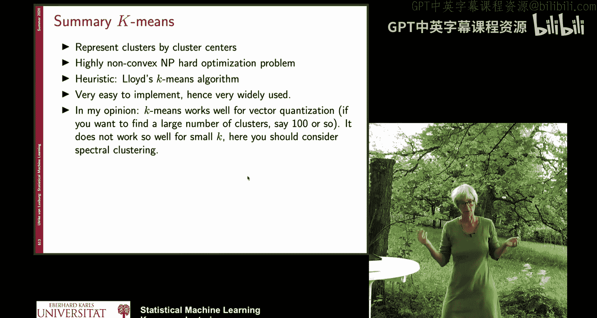

那么关于K-means算法的总结是什么？你将簇表示为数据中心。你写下目标函数，它本质上编码了每个人离簇中心有多远。这导致了一个非凸的、难以处理的优化问题，通常是NP难解决的。存在一个简单的启发式方法来解决它，称为Lloyd算法。有许多许多变体，但原始版本通常效果相当好。这个算法真的非常容易实现，并且使用非常广泛。也许是我的个人观点，所以K-means作为基线可能很好。总的来说，并且，如果你处于这种想要找到许多簇的环境中，例如，找到你的数据的代表，那么它效果很好。例如，你有一百万客户，你想找到1000个代表性客户。那么K=1000。在这样设置中，簇边界到底在哪里，哪个客户离哪个更近，可能不那么重要，你只是想以某种均匀间隔的距离找到某种空间覆盖，K-means将实现这一点。通常，如果你为少量簇做某事，特别是如果簇的数量可能不是凸的，就像我们在前几张幻灯片上看到的那些图像，那里有这种新月形物体，对于这类应用，我认为K-means通常过于简单，你当然可以将其作为基线运行，但然后你应该转向更可靠的方法，这些方法更专门用于任意形状的小簇，例如我们稍后将在本讲座中看到的谱聚类。