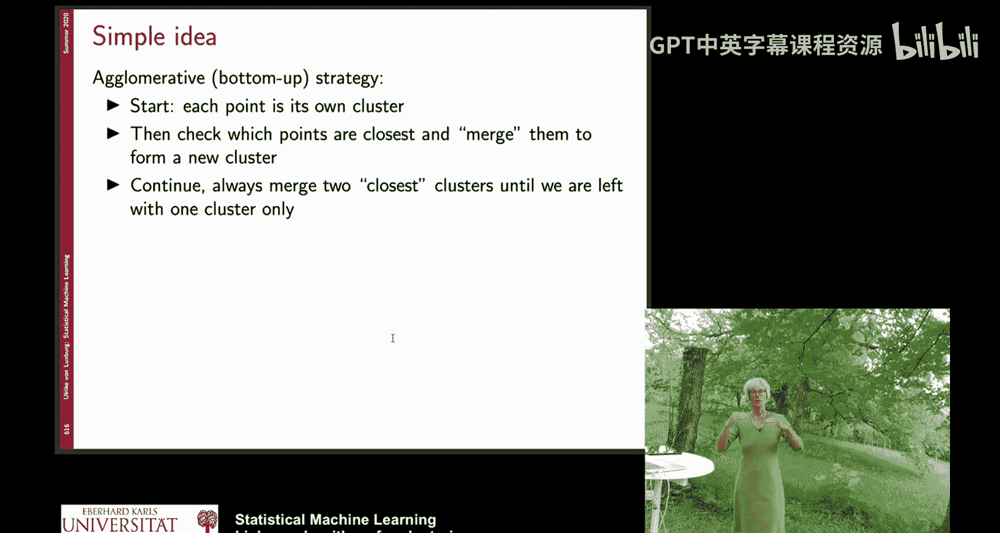
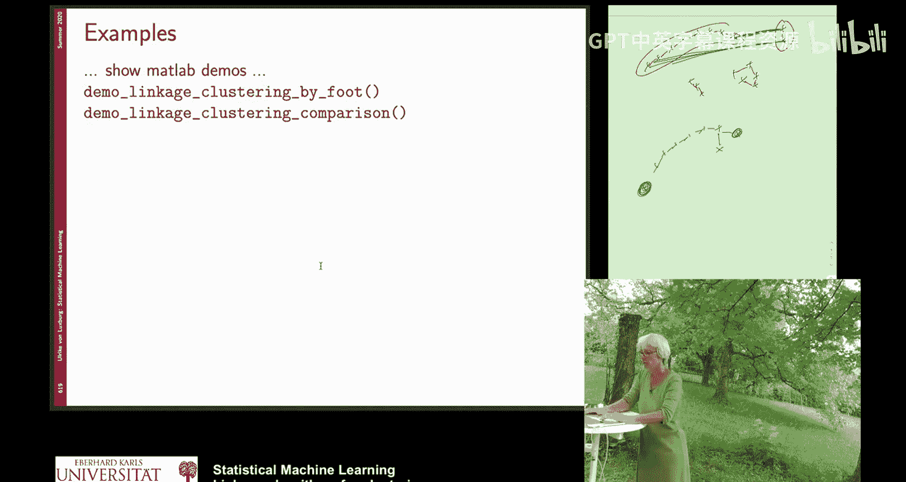
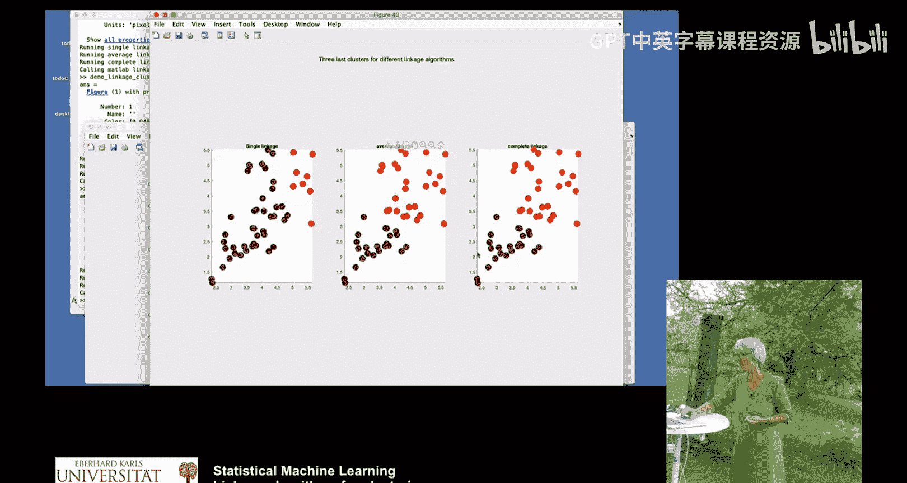
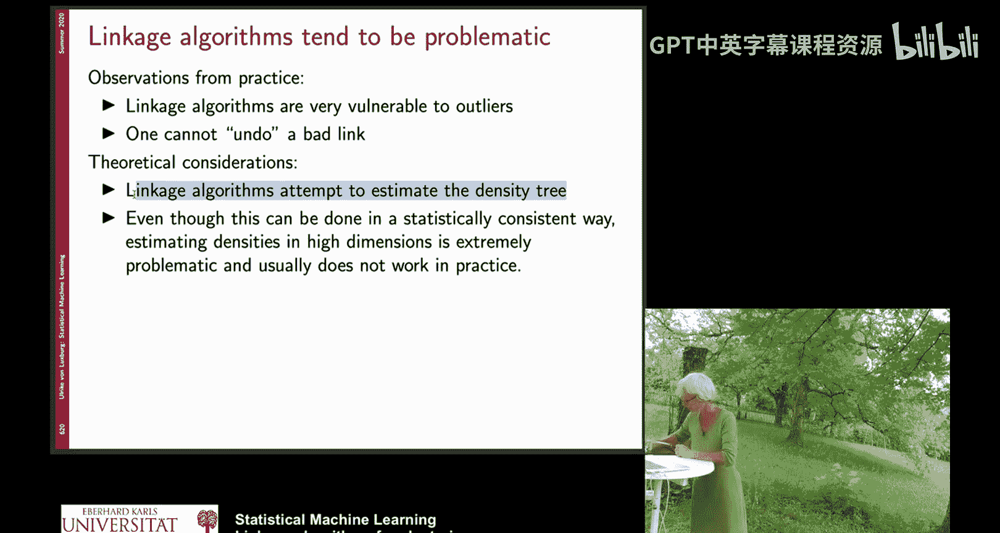
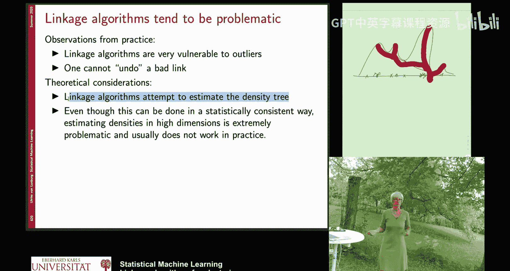
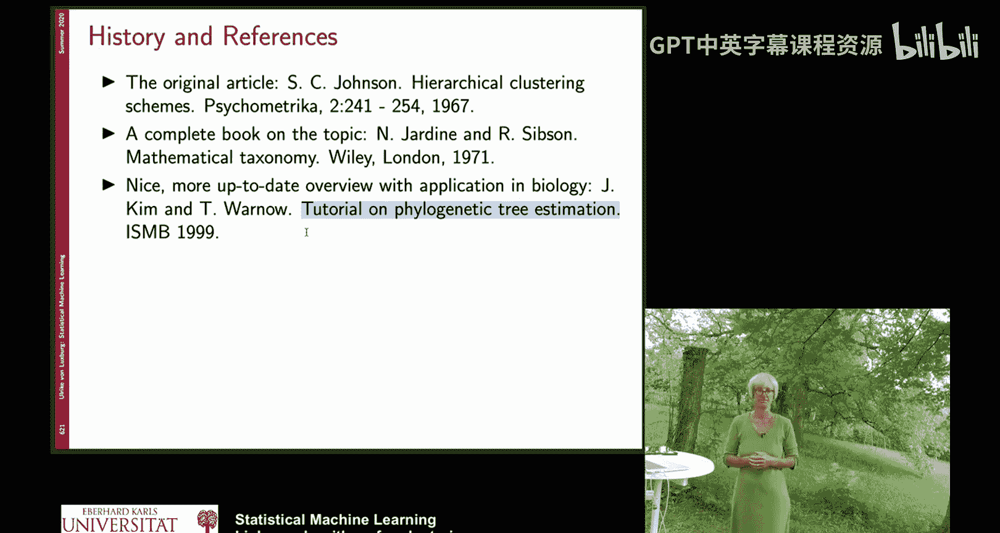

# 概率和统计机器学习：34：层次聚类的连接算法 🌳

## 概述
在本节课中，我们将要学习层次聚类算法，特别是连接算法家族。我们将了解它们如何构建一个嵌套的聚类层次结构，而不是像K均值那样产生一个固定数量的“扁平”聚类。

上一节我们介绍了K均值算法，它是一种产生扁平聚类的简单算法。本节中我们来看看另一类算法，它们旨在解决层次聚类的问题。

## 层次聚类的目标 🎯
层次聚类的目标是生成一个类似树状图的层次结构。树状图通常从上到下阅读，它由一系列嵌套的聚类组成。较小的聚类可以合并形成较大的聚类。

例如，在一个动物数据集中，最细的粒度可能是每个物种（如大鼠、家鼠）作为自己的聚类。然后可以将它们合并，形成更大的聚类，如啮齿动物。树状图中连接线的长度试图指示不同物种从总聚类中分离出来的时间点。

## 连接算法简介 🔗
解决层次聚类问题的标准策略是连接算法家族。它们遵循一个非常简单、自底向上的聚合策略。

算法从一个状态开始，其中每个数据点都是自己的聚类。然后，算法持续合并最接近的聚类，直到所有点最终合并成一个大的聚类。

为了说明这个过程，假设我们有一个包含八个点的简单数据集。最简单的算法是单连接算法。在初始状态，每个点是一个聚类。单连接算法会找到距离最近的两个点（或聚类）并将它们合并。在下一次迭代中，它再次检查当前所有聚类，并合并距离最近的两个。这个过程持续进行，直到所有点合并为一个聚类。

## 定义聚类间的距离 📏
要形式化地描述算法，需要定义一个关键概念：两个不同聚类之间的距离。有三种流行的定义方式。

以下是三种主要的距离定义方式：

1.  **单连接距离**：计算两个聚类中所有点对之间的距离，并取最小值。
    *   **公式**：`d_single(C1, C2) = min_{x in C1, y in C2} d(x, y)`
2.  **完全连接距离**：计算两个聚类中所有点对之间的距离，并取最大值。
    *   **公式**：`d_complete(C1, C2) = max_{x in C1, y in C2} d(x, y)`
3.  **平均连接距离**：计算两个聚类中所有点对之间的距离，并取平均值。
    *   **公式**：`d_average(C1, C2) = mean_{x in C1, y in C2} d(x, y)`

## 连接算法流程 📝
连接算法的输入是一个数据点之间的距离矩阵，以及一个用于计算聚类间距离的函数（如上述三种之一）。

算法流程如下：
1.  **初始化**：将每个数据点初始化为一个单独的聚类。
2.  **循环合并**：当聚类数量大于1时，重复以下步骤：
    a.  在所有当前聚类中，找到距离最近的两个聚类（使用定义的距离函数）。
    b.  将这两个聚类合并为一个新的聚类。
3.  **输出**：输出整个合并过程中产生的层次结构（树状图）。

## 算法间的直观差异 🤔
单连接和完全连接算法在行为上有直观的差异。

单连接算法倾向于产生细长的链状聚类，因为它只关心两个聚类间最近的点。即使两个聚类主体相距较远，只要存在一对非常接近的点，它们就可能被较早地合并。

完全连接算法则倾向于产生更紧凑、更球状的聚类，因为它考虑的是两个聚类间最远的点。这使得它更抗拒将离群点或松散连接的子聚类过早地合并进来。

平均连接算法的行为介于两者之间。

## 实践观察与局限性 ⚠️
从实践和演示中我们可以观察到连接算法的一些特点和局限性。

连接算法，尤其是单连接算法，对离群点非常敏感。此外，这些算法是启发式的，且合并操作不可撤销。一旦两个聚类被合并，即使后续发现这不是最优选择，也无法撤销。

从理论角度看，连接算法试图估计所谓的“密度树”。密度树是连接概率密度函数众数的一种树结构。然而，在实践中，估计密度本身就很困难，尤其是在高维空间中，这导致单连接算法在高维数据中表现不佳，容易受到各种效应的影响。

## 历史背景与总结 📚
单连接及其相关算法历史悠久。有趣的是，它们与最小生成树算法密切相关，单连接算法实际上会生成一个最小生成树。

总结一下，本节课我们一起学习了层次聚类中的连接算法。我们了解了其自底向上的聚合流程，定义了三种计算聚类间距离的方法（单连接、完全连接、平均连接），并通过直观比较和演示观察了它们的行为差异。最后，我们讨论了这些算法在实践中的局限性，如其对离群点的敏感性和在高维数据中的挑战。尽管这些算法简单且常用，但了解其优缺点对于在实际应用中选择合适的聚类方法至关重要。