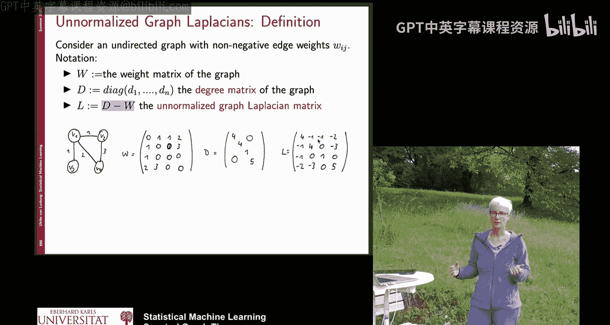
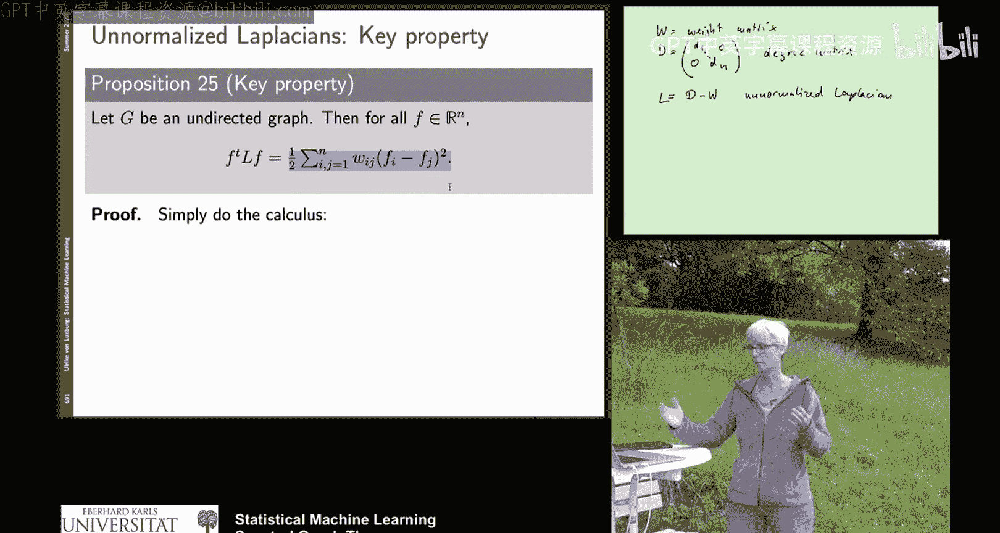

# 35：谱图理论

在本节课中，我们将要学习谱图理论的基础知识。谱图理论是理解现代聚类算法（如谱聚类）的关键数学工具。我们将从图拉普拉斯矩阵的定义和性质开始，逐步探索其谱（特征值和特征向量）如何揭示图的结构特性，特别是连通分量和聚类结构。

## 图拉普拉斯矩阵的定义

上一节我们介绍了谱图理论的目标，本节中我们来看看其核心工具——图拉普拉斯矩阵。首先，我们考虑一个无向图，其边权重非负。以下是定义该矩阵所需的几个基本矩阵。

*   **权重矩阵 W**：也称为邻接矩阵，其元素 `W_ij` 表示顶点 `i` 和 `j` 之间的边权重。若无边，则 `W_ij = 0`。通常假设没有自环，即对角线元素为0。
*   **度矩阵 D**：这是一个对角矩阵。对于顶点 `i`，其度 `d_i` 定义为与其相连的所有边的权重之和，即 `d_i = Σ_j W_ij`。度矩阵 `D` 的对角线元素即为各顶点的度，非对角线元素为0。

基于以上两个矩阵，我们定义**非归一化图拉普拉斯矩阵 L**：
`L = D - W`

这个矩阵是对称的，并且其对角线元素是顶点的度，非对角线元素 `(i, j)` 是 `-W_ij`。

## 图拉普拉斯的关键性质

定义了图拉普拉斯矩阵后，我们来看看它的一个核心代数性质，这个性质是后续所有分析的基础。

对于任意向量 `f ∈ R^n`（其中 `n` 是图的顶点数），图拉普拉斯矩阵的二次型可以表示为：
`f^T L f = (1/2) * Σ_{i,j=1}^n W_ij (f_i - f_j)^2`

**证明概要**：
1.  根据定义 `L = D - W`，代入二次型：`f^T L f = f^T D f - f^T W f`。
2.  展开第一项：`f^T D f = Σ_i d_i f_i^2`。
3.  展开第二项：`f^T W f = Σ_{i,j} W_ij f_i f_j`。
4.  利用度 `d_i = Σ_j W_ij`，将第一项重写为 `(1/2) Σ_i d_i f_i^2 + (1/2) Σ_j d_j f_j^2`。
5.  合并所有项，得到 `(1/2) Σ_{i,j} W_ij (f_i^2 - 2f_i f_j + f_j^2)`。
6.  化简即得 `(1/2) Σ_{i,j} W_ij (f_i - f_j)^2`。

这个性质非常重要，因为它将矩阵的代数运算与图上函数的几何变化联系了起来。我们可以将向量 `f` 视为定义在图顶点上的一个函数（`f_i` 是顶点 `i` 的函数值）。那么，`f^T L f` 的值就度量了函数 `f` 在图上沿着边变化的“平滑度”。当相连顶点间的函数值差异很大时，该项值就大；当函数在紧密连接的顶点集上取值相近时，该项值就小。这也解释了为何称 `L` 为“拉普拉斯”矩阵，因为它在离散图上起到了连续空间中拉普拉斯算子（度量函数变化率）的作用。

## 图拉普拉斯的谱性质

理解了关键性质后，我们进一步探索图拉普拉斯矩阵的特征值和特征向量（即其“谱”）所具有的性质。

对于一个无向、边权非负的图，其非归一化图拉普拉斯矩阵 `L` 具有以下性质：
1.  `L` 是对称半正定矩阵。
2.  `L` 的最小特征值是 0，对应的特征向量是常数向量 `1`（所有元素为1）。
3.  所有特征值都是非负实数，可以按递增顺序排列：`0 = λ_1 ≤ λ_2 ≤ ... ≤ λ_n`。

**简要说明**：
*   对称性源于图是无向的。
*   半正定性由关键性质直接得出，因为 `(1/2) Σ W_ij (f_i - f_j)^2 ≥ 0`。
*   将常数向量 `1` 代入 `L * 1`，利用 `D*1` 得到度向量，`W*1` 也得到度向量，相减即为0，故 `1` 是特征值0对应的特征向量。
*   由于矩阵半正定，所有特征值 ≥ 0，而我们已经找到一个0特征值，所以最小特征值为0。

## 谱与图连通分量的关系

图拉普拉斯最引人注目的性质之一，是其谱与图的几何结构（连通分量）直接相关。

设图 `G` 有 `k` 个连通分量，则：
1.  图拉普拉斯矩阵 `L` 的特征值 0 的**几何重数**（即对应特征空间的维数）等于 `k`。
2.  特征值 0 的特征空间由一组基张成，这组基中的每个向量都是某个连通分量的**指示向量**。即，对于第 `m` 个连通分量，其指示向量在属于该分量的顶点处取值为1，在其他顶点处取值为0。

**证明思路（归纳法）**：
*   **基础情况 (k=1)**：图是连通的。假设 `f` 是特征值0的特征向量，即 `Lf = 0`。根据关键性质，`f^T L f = 0` 意味着对所有边 `(i, j)`，要么 `W_ij = 0`（无边），要么 `f_i = f_j`。由于图连通，所有顶点通过路径相连，因此所有 `f_i` 必须相等。故特征空间是一维的，由常数向量张成，这也等价于该连通分量的指示向量（归一化后）。
*   **归纳步骤 (k>1)**：图由 `k` 个互不连通的子图（连通分量）组成。此时，邻接矩阵 `W` 和度矩阵 `D`（以及 `L`）都具有分块对角形式。每个对角块对应一个连通分量的拉普拉斯矩阵 `L_m`。根据基础情况，每个 `L_m` 有一个特征值0，对应特征向量是该分量的常数向量。在整个矩阵 `L` 中，这些特征向量“拼接”起来（在其他块位置补0），就形成了 `k` 个线性无关的、特征值为0的特征向量，它们正是各连通分量的指示向量。

**重要启示**：理论上，通过计算图拉普拉斯矩阵的特征值和特征向量，我们可以：
*   通过特征值0的重数知道图中有多少个连通分量。
*   通过特征值0对应的特征向量（的某种基）直接读出哪些顶点属于同一个连通分量。

这为基于谱方法的聚类（谱聚类）提供了核心思想：即使图不是完全断开，而是存在“近似连通分量”（即簇），其特征向量也能近似地揭示这种结构。

## 归一化图拉普拉斯

在实际应用中，特别是谱聚类中，经常使用归一化版本的图拉普拉斯矩阵，以消除顶点度分布不均的影响。主要有两种形式：

1.  **对称归一化图拉普拉斯**：
    `L_sym = D^{-1/2} L D^{-1/2} = I - D^{-1/2} W D^{-1/2}`
    其中 `D^{-1/2}` 是对角矩阵，其第 `i` 个对角元素为 `1/√(d_i)`。

2.  **随机游走归一化图拉普拉斯**：
    `L_rw = D^{-1} L = I - D^{-1} W`
    矩阵 `D^{-1} W` 可以解释为图上随机游走的转移概率矩阵。

这两种归一化拉普拉斯具有与非归一化版本类似的性质：
*   它们共享相同的非零特征值。若 `λ` 是 `L_rw` 的特征值，对应特征向量为 `u`，则 `λ` 也是 `L_sym` 的特征值，对应特征向量为 `D^{1/2} u`。
*   对于连通图，`L_rw` 的最小特征值是0，对应特征向量是常数向量 `1`。`L_sym` 的最小特征值也是0，对应特征向量是 `D^{1/2} * 1`。
*   特征值0的重数同样等于图的连通分量数，其特征空间也由各连通分量的指示向量（对于 `L_rw`）或其变换（对于 `L_sym`）张成。

## Cheeger 常数与谱的联系

为了更深入地理解谱如何反映聚类结构，我们引入一个纯几何的量——Cheeger常数（或等周常数），它衡量了将一个图“切开”成两部分的最佳代价。

对于图的一个顶点子集 `S`，定义：
*   **体积 vol(S)**：`S` 中所有顶点的度之和，`vol(S) = Σ_{i∈S} d_i`。它衡量了集合 `S` 的“大小”。
*   **割 cut(S)**：连接 `S` 与其补集 `S^c` 的所有边的权重之和，`cut(S) = Σ_{i∈S, j∈S^c} W_ij`。它衡量了将 `S` 从图中分离出去的“代价”。

**集合 S 的 Cheeger 常数** 定义为：
`h(S) = cut(S) / min(vol(S), vol(S^c))`

**图的 Cheeger 常数** `h_G` 是所有可能子集 `S` 中 `h(S)` 的最小值：
`h_G = min_{S ⊂ V} h(S)`

**直观理解**：`h_G` 小的图，意味着存在一种划分，使得分割开的两个部分内部连接紧密（体积大），但彼此之间连接稀疏（割小）。这正是“聚类结构好”的体现。

Cheeger 常数与图拉普拉斯的第二小特征值 `λ_2`（对于连通图，`λ_1=0`，`λ_2 > 0`）有深刻联系，这由 **Cheeger 不等式** 描述：

对于连通的无向图，有：
`λ_2 / 2 ≤ h_G ≤ √(2 * λ_2)`

**意义**：
*   这个不等式在 `λ_2` 和 `h_G` 之间建立了双向约束。
*   它表明，一个图的 `λ_2` 小，当且仅当其 Cheeger 常数 `h_G` 小。
*   因此，**第二小特征值 `λ_2` 的大小可以作为图是否存在明显聚类结构的一个谱标志**：`λ_2` 很小，意味着图容易地被分成两个内部连接良好、彼此连接较少的子图（即有一个“好”的割）。这为谱聚类算法（下节课内容）提供了理论依据：寻找拉普拉斯矩阵的前几个特征向量，就近似于在寻找使 Cheeger 割最优的指示向量。

**证明思路（上界部分）**：
利用瑞利商原理，`λ_2` 可以表示为一个优化问题的最小值。通过巧妙地构造一个与最优 Cheeger 割 `S*` 相关的测试向量（类似于 `S*` 的指示向量），并将其代入瑞利商，可以证明得到的值不大于 `2h_G`，从而得出 `λ_2 ≤ 2h_G`。下界的证明更为复杂，但思想类似。

## 总结

本节课中我们一起学习了谱图理论的基础知识。我们从定义非归一化和归一化的图拉普拉斯矩阵开始，揭示了其关键二次型性质，该性质将代数运算与图上函数变化的平滑度联系起来。我们深入探讨了图拉普拉斯谱的基本性质，并发现了其最核心的结论：特征值0的重数等于图的连通分量数，且对应的特征空间能直接给出各分量的指示信息。最后，我们通过引入 Cheeger 常数及其与第二小特征值 `λ_2` 的不等式关系，建立了图的几何聚类结构与谱特性之间的深刻联系，这为理解谱聚类算法的工作原理奠定了坚实的理论基础。