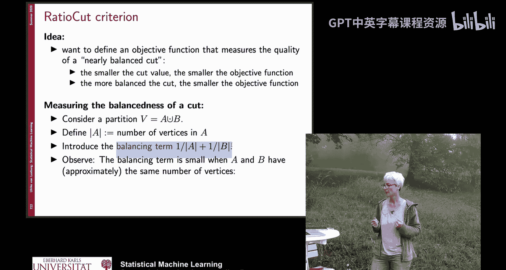
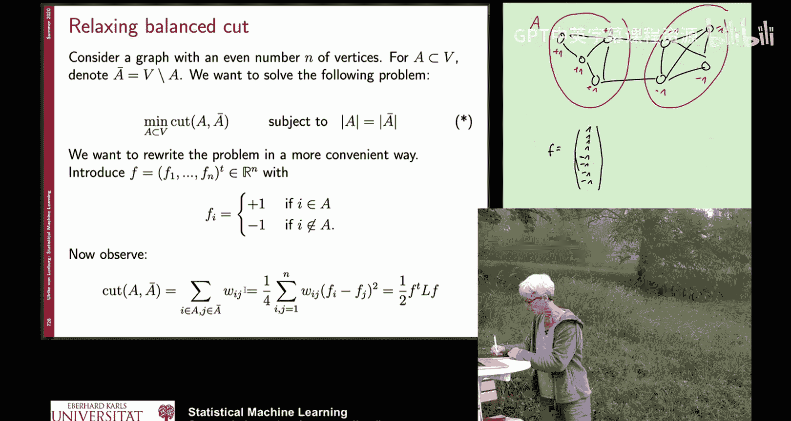
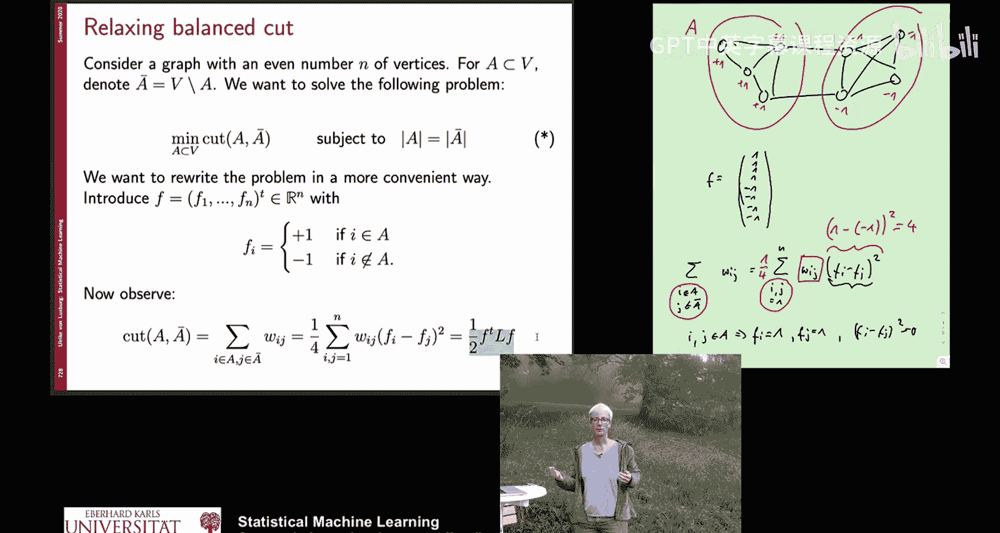
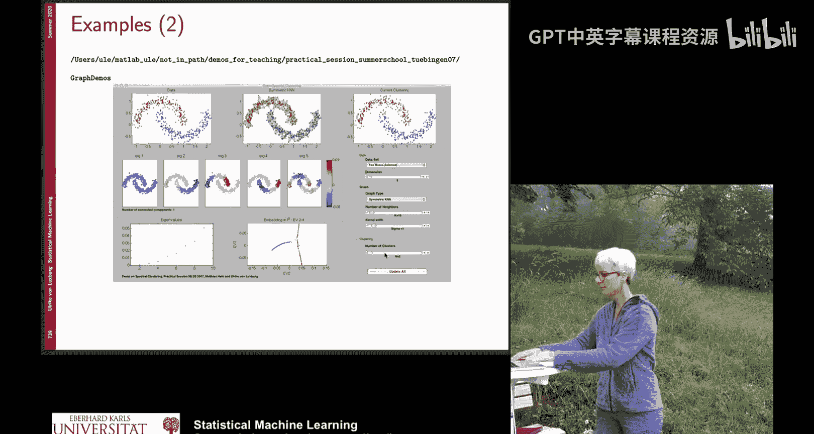
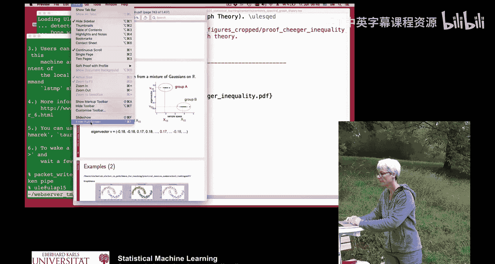
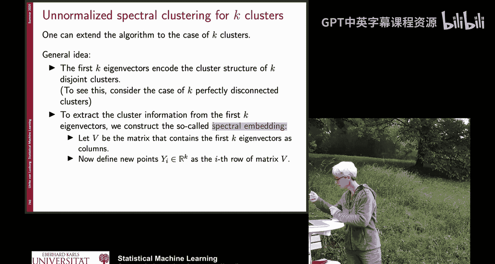
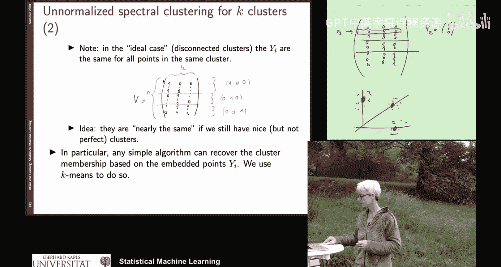
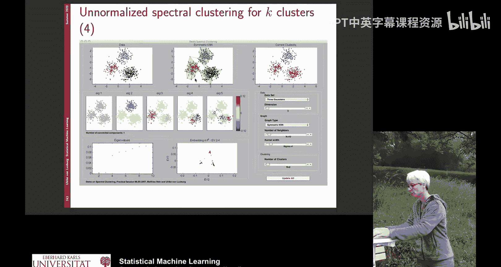
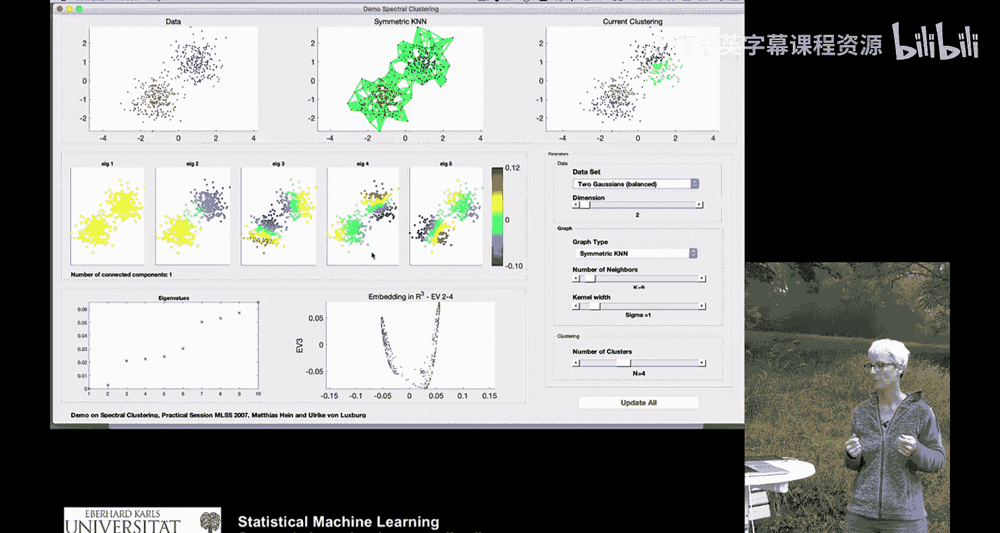
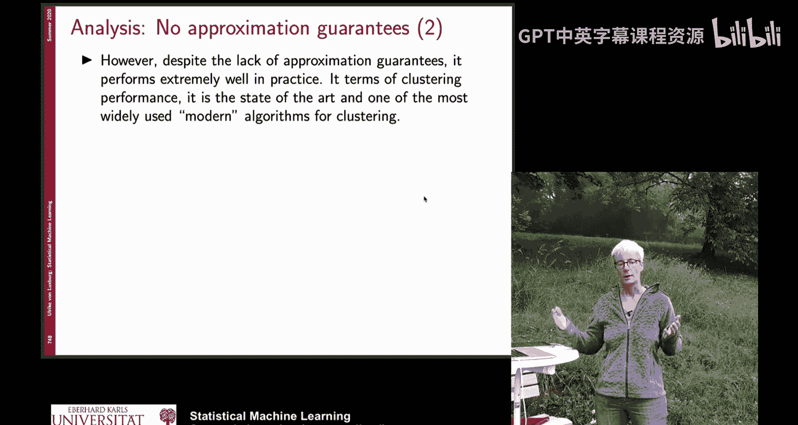

# 36：谱聚类（非归一化情况）🔍

在本节课中，我们将要学习一种现代聚类算法——谱聚类。谱聚类可用于对图进行聚类，以发现图中的强连接子集或社区。我们将从直观理解开始，逐步推导其数学原理和算法步骤，并最终理解其为何在实践中表现良好。

## 概述 🌐

谱聚类是一种基于图论的聚类方法。其核心思想是：如果数据点自然地形成一个图（例如社交网络），或者我们可以通过相似度函数构建一个图（例如K近邻图），那么一个好的聚类应该对应于图中的一个“切割”，这个切割满足两个条件：1）被切割的边（即连接不同簇的边）尽可能少；2）切割后形成的两个子图（簇）大小相对平衡。本节课我们将重点介绍谱聚类的基础版本——非归一化谱聚类。

## 从最小割到平衡割 ✂️

上一节我们介绍了谱聚类的目标。本节中我们来看看实现这一目标的最初思路及其局限性。

计算机科学家首先想到的可能是**最小割**问题：在图论中，找到一个切割，使得被切断的边数（或边权重之和）最小。最小割问题有高效的（多项式时间）算法。

然而，最小割存在一个严重问题：它倾向于将图中一个孤立的点或一个非常小的子图与其余部分分开，而不是找到我们期望的、规模合理的簇。如下图所示，最小割（绿色虚线）会切掉一个单独的点，而不是我们期望的将图分成两个较大子图的红色切割。

因此，我们需要寻找一个能同时考虑**切割大小**和**簇的平衡性**的准则。

## 定义目标：比率割 📏

为了克服最小割的缺陷，我们引入一个平衡项。假设我们将图的顶点集 \( V \) 划分为两个不相交的子集 \( A \) 和 \( B \)（即 \( A \cup B = V, A \cap B = \emptyset \)）。

*   **切割准则**：衡量被切断的边的数量或权重之和。
    \[
    \text{Cut}(A, B) = \sum_{i \in A, j \in B} w_{ij}
    \]
    其中 \( w_{ij} \) 是顶点 \( i \) 和 \( j \) 之间的边权重（对于无权图，\( w_{ij} \in \{0, 1\} \)）。

*   **平衡准则**：衡量两个子集的大小是否均衡。我们使用**比率割**中定义的平衡项：
    \[
    \text{Balance}(A, B) = \frac{1}{|A|} + \frac{1}{|B|}
    \]
    其中 \( |A| \) 表示集合 \( A \) 中顶点的数量。可以证明，当 \( |A| = |B| \) 时，这个值最小；当其中一个集合非常小时，这个值会变得很大。

我们将这两个准则结合起来，定义**比率割**目标函数：
\[
\text{RatioCut}(A, B) = \text{Cut}(A, B) \cdot \left( \frac{1}{|A|} + \frac{1}{|B|} \right)
\]
我们的目标是找到划分 \( A, B \)，使得 \( \text{RatioCut}(A, B) \) 最小化。这个目标同时鼓励小的切割和平衡的簇大小。

然而，最小化比率割是一个NP难问题，无法高效求解。这就需要我们寻找一种近似的、可高效计算的解决方案。

## 谱聚类的推导：从离散到连续 🧮

上一节我们定义了理想但难解的目标。本节中我们来看看如何通过巧妙的数学变换和松弛，得到一个可高效求解的近似算法。

首先，我们考虑一个简化情况：寻找一个完美平衡的切割（即 \( |A| = |B| \)）。我们引入一个**簇指示向量** \( \mathbf{f} = (f_1, ..., f_n)^T \in \mathbb{R}^n \)，其定义如下：
\[
f_i = \begin{cases}
+1, & \text{如果顶点 } i \in A \\
-1, & \text{如果顶点 } i \in B
\end{cases}
\]

一个关键的观察是，**切割大小可以用图拉普拉斯矩阵来表示**。回忆上一讲的内容，对于无向图，其（非归一化）图拉普拉斯矩阵定义为 \( L = D - W \)，其中 \( W \) 是邻接矩阵，\( D \) 是对角度矩阵（\( D_{ii} = \sum_j w_{ij} \)）。可以证明：
\[
\text{Cut}(A, B) = \frac{1}{4} \sum_{i,j} w_{ij} (f_i - f_j)^2 = \frac{1}{2} \mathbf{f}^T L \mathbf{f}
\]
此外，完美平衡的条件（\( |A| = |B| \)）等价于指示向量各元素之和为零：\( \sum_i f_i = 0 \)。

因此，最小化完美平衡割的问题可以重写为：
\[
\min_{\mathbf{f}} \mathbf{f}^T L \mathbf{f} \quad \text{满足} \quad f_i \in \{+1, -1\}, \quad \sum_i f_i = 0
\]
这仍然是一个NP难问题，因为约束 \( f_i \in \{+1, -1\} \) 是离散的。

现在，我们进行关键的**松弛**步骤：我们放宽这个离散约束，允许 \( f_i \) 取任意实数值。为了避免平凡解（例如 \( \mathbf{f} = \mathbf{0} \)），我们同时要求向量具有单位范数（\( \|\mathbf{f}\| = 1 \)）。松弛后的问题变为：
\[
\min_{\mathbf{f}} \mathbf{f}^T L \mathbf{f} \quad \text{满足} \quad \sum_i f_i = 0, \quad \|\mathbf{f}\| = 1
\]
条件 \( \sum_i f_i = 0 \) 等价于要求 \( \mathbf{f} \) 与全1向量 \( \mathbf{1} \) 正交（即 \( \mathbf{f}^T \mathbf{1} = 0 \)）。

根据**瑞利商原理**，在约束 \( \|\mathbf{f}\|=1 \) 且 \( \mathbf{f} \perp \mathbf{1} \) 下，最小化 \( \mathbf{f}^T L \mathbf{f} \) 的解 \( \mathbf{f}^* \) 正是图拉普拉斯矩阵 \( L \) 的**第二小特征值对应的特征向量**（因为最小的特征值总是0，对应的特征向量是 \( \mathbf{1} \)）。

最后，为了从连续解回到离散的簇分配，我们简单地检查松弛解 \( \mathbf{f}^* \) 各个分量的符号：
\[
\text{簇分配: } \begin{cases}
\text{若 } f_i^* > 0, & \text{则顶点 } i \in A \\
\text{若 } f_i^* < 0, & \text{则顶点 } i \in B
\end{cases}
\]

**重要说明**：上述推导始于完美平衡割，但可以证明，完全相同的算法（取 \( L \) 的第二小特征向量并按符号划分）也是原始比率割目标的一个松弛解。因此，这个算法被称为**非归一化谱聚类**。

## 算法步骤与示例 🚀

上一节我们完成了理论推导。本节中我们来看看具体的算法步骤，并通过示例直观理解其工作原理。

非归一化谱聚类（用于两个簇）的算法步骤如下：

1.  **输入**：相似度矩阵或图的邻接矩阵 \( W \)。
2.  **计算图拉普拉斯矩阵**：\( L = D - W \)，其中 \( D \) 是对角度矩阵。
3.  **计算特征向量**：计算 \( L \) 的第二小特征值对应的特征向量 \( \mathbf{f} \)。
4.  **生成簇**：根据 \( \mathbf{f} \) 各分量的符号进行划分。
    *   若 \( f_i > 0 \)，则将顶点 \( i \) 归入簇 \( A \)。
    *   若 \( f_i < 0 \)，则将顶点 \( i \) 归入簇 \( B \)。

**直观理解**：在理想情况下（例如两个完全分离的簇），第二小特征向量在同一个簇内的所有顶点上取值相同（例如全正或全负），在不同簇间取值符号相反。因此，按符号划分能完美恢复聚类。在实际数据中，特征向量能近似保持这一性质，从而得到良好的聚类结果。

## 扩展到多个簇 🔢

到目前为止，我们只讨论了如何找到两个簇。本节中我们来看看如何将谱聚类推广到寻找 \( k \) 个簇。

思路是使用多个特征向量，而不仅仅是第二个。具体步骤如下：

1.  **输入**：相似度矩阵 \( W \)，簇的数量 \( k \)。
2.  **计算图拉普拉斯矩阵**：\( L = D - W \)。
3.  **计算特征向量**：计算 \( L \) 的前 \( k \) 个最小特征值对应的特征向量 \( \mathbf{v}_1, \mathbf{v}_2, ..., \mathbf{v}_k \)（忽略第一个全1向量 \( \mathbf{v}_1 \)）。
4.  **构建特征向量矩阵**：将这些特征向量作为列，形成一个 \( n \times k \) 的矩阵 \( V \)：
    \[
    V = [\mathbf{v}_2, \mathbf{v}_3, ..., \mathbf{v}_{k+1}] \in \mathbb{R}^{n \times k}
    \]
5.  **谱嵌入**：将矩阵 \( V \) 的每一行 \( \mathbf{y}_i \in \mathbb{R}^k \) 视为原始顶点 \( i \) 在新的 \( k \) 维空间（称为谱嵌入空间）中的表示。
6.  **在嵌入空间中进行聚类**：对新的数据点 \( \{ \mathbf{y}_i \}_{i=1}^n \) 运行标准的 \( k \)-均值算法，得到最终的 \( k \) 个簇。

**原理**：在理想情况下（图由 \( k \) 个互不连接的组件构成），前 \( k \) 个特征向量正好是各个组件的指示向量。此时，属于同一个组件的所有顶点在谱嵌入空间中的坐标完全相同（例如都是 \( (1,0,0,...,0) \)），不同组件的顶点坐标不同。因此，在嵌入空间中，数据点会形成 \( k \) 个紧密的团块，即使简单的 \( k \)-均值算法也能轻松将其分开。对于真实数据，这种结构虽然不完美，但通常仍能保持，使得后续聚类变得容易。

## 总结与回顾 🎯

本节课我们一起学习了非归一化谱聚类。我们从图聚类的直观目标出发，指出了最小割算法的缺陷，并引入了结合切割大小与簇平衡性的比率割目标。由于该目标直接优化是NP难的，我们通过引入簇指示向量、利用图拉普拉斯矩阵的性质，并对离散约束进行松弛，将其转化为一个求解矩阵特征向量的问题。最终得到的算法简洁而强大：通过计算图拉普拉斯矩阵的特征向量，并将数据点嵌入到由这些特征向量张成的空间中，再使用 \( k \)-均值完成聚类。

谱聚类的优势在于它能发现非凸形状的簇，并且通常对初始化和数据分布不敏感。尽管存在理论上的反例表明松弛解可能不是最优解，但在实践中，谱聚类通常能产生非常出色的聚类结果。在下一讲中，我们将探讨谱聚类的其他变体，如归一化谱聚类，它们在某些情况下可能具有更好的性质。