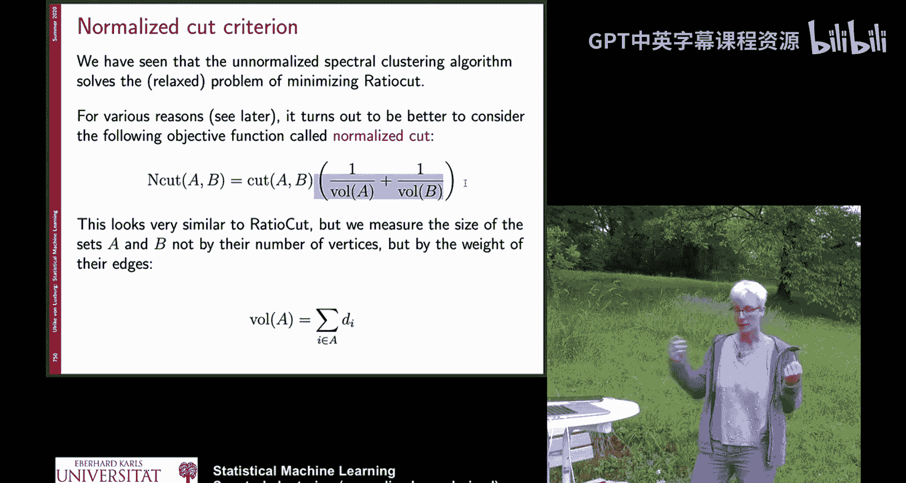
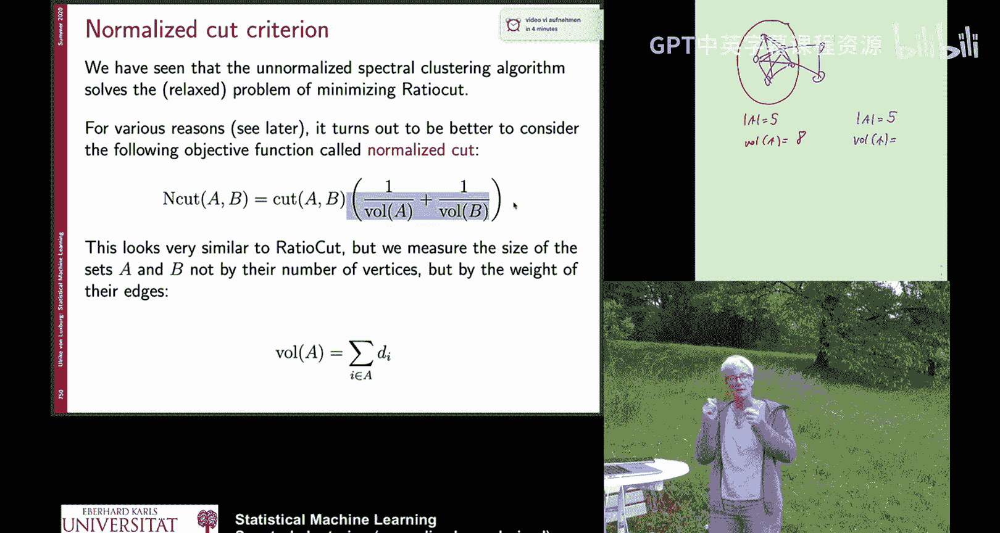
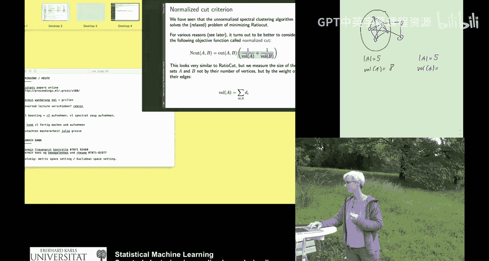
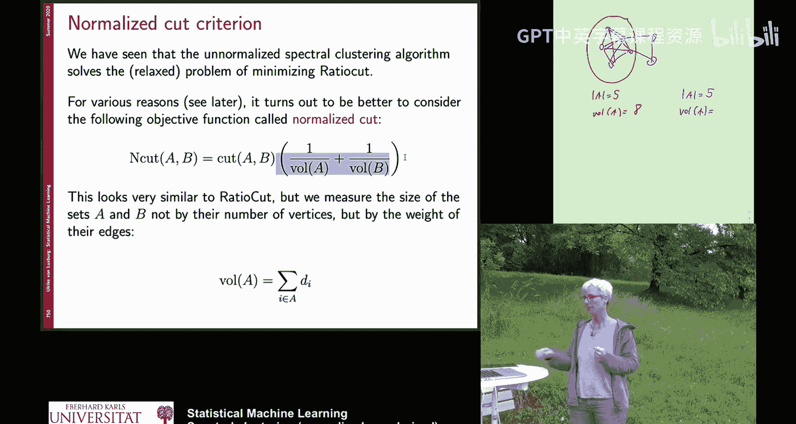
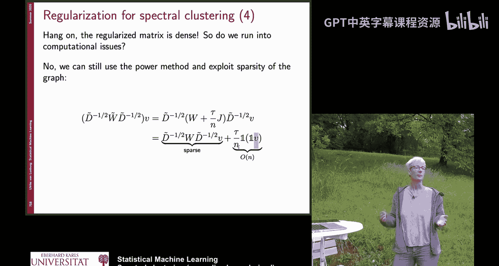

# 37：谱聚类（归一化与正则化）🎯

在本节课中，我们将要学习谱聚类的归一化版本和正则化版本。上一节我们介绍了未归一化的谱聚类，本节中我们来看看如何通过归一化和正则化来改进算法，使其在实践中表现更优、更稳定。



## 概述

谱聚类的核心目标是将图划分为平衡的簇。上一讲我们考虑了未归一化的谱聚类版本，它基于**Ratio Cut**准则，旨在寻找一个**割（cut）**较小且两个簇**大小（size）**大致平衡的划分。其中，簇的大小定义为簇内顶点的数量。

## 归一化谱聚类

现在，我们将探讨另一种称为**归一化谱聚类**的变体。它之所以被称为“归一化”，是因为它最终会使用图的**归一化拉普拉斯矩阵**。实际上，出于理论上的诸多优势，在实践中应始终使用归一化版本。







### 归一化割准则

在上一讲中，我们使用**Ratio Cut**准则推导了未归一化谱聚类。现在，我们定义一个略有不同的准则来讨论簇的平衡性，称为**归一化割（Normalized Cut）**。

以下是归一化割准则的定义：

**归一化割（Normalized Cut）** 定义为：
```
NCut(A, B) = cut(A, B) * (1/vol(A) + 1/vol(B))
```
其中：
*   `cut(A, B)` 衡量簇A和簇B之间边的数量或权重，我们希望它小。
*   `vol(A)` 是簇A的**体积（volume）**，定义为簇A中所有顶点的度之和。公式为：
    ```
    vol(A) = Σ_{i∈A} d_i = Σ_{i∈A} Σ_{j∈V} w_{ij}
    ```
    它衡量了与簇A相关的所有边的总权重。

与Ratio Cut使用顶点数量不同，归一化割使用簇的体积来衡量其大小。体积考虑了簇内部的连接紧密程度：一个内部连接更紧密的簇会拥有更大的体积。这通常能更好地反映我们对“簇”的直观理解。

### 算法推导与实现

与未归一化情况类似，我们可以通过松弛法将最小化归一化割的问题转化为一个特征值问题。推导过程非常相似，只是公式更长。

最终，我们会得到**随机游走拉普拉斯矩阵**的特征向量。具体步骤如下：

1.  **输入**：图的权重（或邻接）矩阵 `W`。
2.  **计算度矩阵** `D`，其中 `D_{ii} = Σ_j w_{ij}`。
3.  **计算对称归一化拉普拉斯矩阵** `L_sym = I - D^{-1/2} W D^{-1/2}`。
4.  **计算** `L_sym` 的**前k个最小特征值对应的特征向量**（k为期望的簇数）。
5.  **关键转换**：将这些特征向量转换为随机游走拉普拉斯矩阵的特征向量。转换公式为：将 `L_sym` 的每个特征向量 `v` 乘以 `D^{-1/2}`，即 `u = D^{-1/2} v`。
6.  **构建谱嵌入**：将这些转换后的特征向量作为列，构成矩阵 `U`。数据点 `i` 的嵌入是矩阵 `U` 的第 `i` 行。
7.  **聚类**：在嵌入空间中对这些行向量运行K-means算法，得到最终的簇划分。

**注意**：许多论文和实现会省略第5步的转换，直接使用 `L_sym` 的特征向量。但从理论上看，这不是最佳选择，因为它不会得到理想的指示向量形式。建议进行此转换。

### 为何选择归一化版本？

关于哪种谱聚类算法更好，曾有过长期讨论。从学习理论的角度可以证明，未归一化谱聚类在数据点增多时，可能收敛到我们不希望的平凡解。而归一化版本则没有这个问题，它至少具备收敛到正确解的潜力。因此，在实践中应优先使用归一化谱聚类。

## 正则化谱聚类

现在，我们转向谱聚类的最后一个主题：**正则化谱聚类**。当图的度分布非常不平衡时（例如社交网络中少数节点拥有极高连接度），标准谱聚类算法可能倾向于识别离群点而非平衡的划分。

### 正则化方法

一个简单而有效的解决方案是向图的拉普拉斯矩阵引入一个**正则化项**。具体操作如下：

我们不直接使用原始邻接矩阵 `W`，而是使用一个正则化后的矩阵 `Ŵ`：
```
Ŵ = W + (τ / n) * J
```
其中：
*   `τ` 是一个小的正则化参数。
*   `J` 是一个所有元素都为1的矩阵。
*   `n` 是顶点数。

然后，基于这个新的矩阵 `Ŵ` 计算其对应的度矩阵 `Ď` 和拉普拉斯矩阵（可以是未归一化或归一化版本）。

### 正则化的效果与高效计算

理论证明，这种正则化能显著提高算法的稳定性，减少其对离群点或“悬挂集”的敏感性，从而更可能发现数据中真实的、平衡的簇结构。

然而，`Ŵ` 矩阵是稠密的，即使 `W` 原本是稀疏的，这会给大规模计算带来挑战。幸运的是，我们可以利用矩阵的特殊结构来高效计算。例如，在计算归一化拉普拉斯矩阵与向量的乘积时，可以将其分解为稀疏矩阵运算和一个可解析处理的偏移项之和，从而避免显式构造稠密矩阵。



## 总结与历史回顾

本节课中我们一起学习了谱聚类的归一化与正则化版本。

*   **归一化谱聚类**使用归一化割准则和归一化拉普拉斯矩阵，相比未归一化版本具有更好的理论性质和实际效果。
*   **正则化谱聚类**通过向邻接矩阵添加一个常数项来进行正则化，能有效处理度分布不平衡的图，提高聚类稳定性，并且存在高效的计算方法。

谱聚类的思想早在1970年代就被发现，但在2000年代初由几篇关键论文（如Shi & Malik, Meila & Shi, Ng et al.）独立推动后才变得非常流行。它能够发现任意形状的簇，是现代聚类算法中至关重要的一员。即使其基本原理已较为成熟，该领域至今仍非常活跃，在计算与统计的权衡等方面持续产生新的研究。

**实践建议**：
1.  优先使用**归一化谱聚类**。
2.  在处理真实世界数据（尤其是度分布不平衡的图）时，考虑使用**正则化谱聚类**。
3.  精心构建相似性图（例如K近邻图）并选择合适的参数，这对谱聚类的成功至关重要。