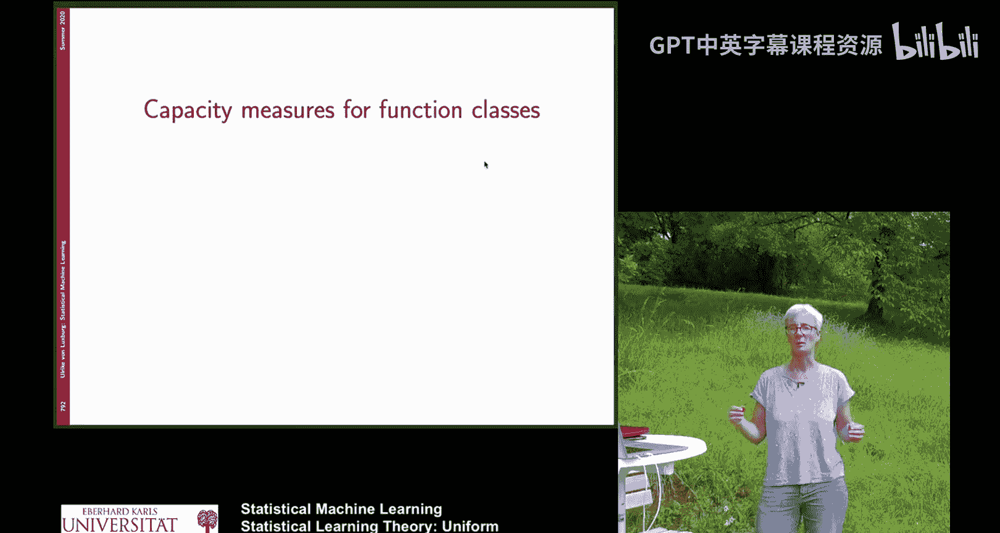

# 38：统计学习理论——收敛性与一致性 📚

在本节课中，我们将开始学习一个新的章节：统计学习理论。我们将探讨机器学习算法的理论基础，特别是关于算法收敛性和一致性的核心概念。我们将重点关注二元分类问题，并理解在何种条件下，算法能够从有限的数据中学习到接近最优的模型。

---

## 统计学习理论概述 🎯

统计学习理论旨在回答关于机器学习算法的一些根本性问题。这类似于计算机科学中关于可计算性和计算复杂性的研究。在统计学习理论中，我们关心：

*   哪些学习任务在原则上是可解的？
*   哪些假设是算法成功所必需的？
*   如何量化算法的性能保证？
*   特别是在关键应用（如医疗或自动驾驶）中，我们如何评估算法出错的概率？

与统计学类似，我们希望为基于随机数据得出的结论提供置信度保证。然而，机器学习中的保证通常不如传统统计学中的那么强，因为我们通常对数据分布做出更少的假设。更少的假设意味着需要考虑更多潜在情况，因此我们的保证也相应减弱。

最终，许多理论保证是**一致性**陈述，其形式通常是：随着样本数量 `n` 趋于无穷大，算法学习到的模型风险将收敛于最优风险。我们或许还能讨论收敛速度，但通常无法像统计学那样给出“在95%概率下此结论正确”的强保证。

尽管如此，学习理论至关重要，因为它揭示了机器学习算法的构建原则、算法成功的原因以及可能导致算法失效的因素。

---

## 二元分类的基本框架 🔍

上一节我们介绍了统计学习理论的目标。本节中，我们来看看其标准框架，重点关注二元分类问题。

我们假设训练数据是从某个未知的潜在概率分布 `P` 中独立同分布（IID）采样得到的。目标是学习一个确定性函数 `f`，它接收输入点并预测正确的标签（+1 或 -1）。我们通过损失函数来衡量成功与否，并关注**期望损失**（或风险），即在整个数据空间上的平均损失。

在分类理论中，我们通常关注 **0-1 损失函数**，它直接衡量分类是否正确：
`L(f(x), y) = 0 if f(x) = y else 1`

以下是该框架的几个关键假设：

1.  **不对数据分布 `P` 做假设**：这是与许多统计学方法的核心区别。我们不假设数据服从正态分布等特定形式，因为现实数据（如图像像素、客户数据）的分布通常未知且复杂。这种“无分布”的哲学确保了理论保证适用于广泛的实际情况。
2.  **学习目标是确定性函数**：尽管真实世界的标签可能不是输入的确定性函数（例如，身高1.7米的人可能是男性或女性），但我们学习的模型 `f` 会对每个输入给出一个确定的预测。
3.  **数据是独立同分布（IID）的**：这是一个非常强的假设。在实践中，数据可能随时间变化（如垃圾邮件分布）或具有顺序依赖性（如不同时段的客户）。尽管如此，IID 假设为我们提供了一个理论基线，有助于理解算法成功所需的最基本条件。
4.  **分布 `P` 在训练时是未知的**：这正是机器学习的核心挑战。

在这个框架下，我们定义几个重要概念：
*   `f*`：**贝叶斯最优分类器**，即在已知分布 `P` 的情况下能达到最小可能风险的分类器。这是我们学习的终极目标，但它是未知的。
*   `f_F`：在给定函数类 `F` 中，针对分布 `P` 能达到最小风险的**最优函数**。
*   `f_n`：学习算法在观测了 `n` 个数据点后所选择的函数。

---

## 一致性定义 📐

上一节我们建立了学习问题的基本框架。本节中，我们来定义衡量算法成功与否的核心概念：一致性。

一致性描述了当训练样本量增加时，算法性能的渐近行为。以下是三种重要的一致性定义：

1.  **关于函数类 `F` 和分布 `P` 的一致性**：如果算法选择的函数 `f_n` 的真实风险 `R(f_n)` 依概率收敛到函数类 `F` 中的最优风险 `R(f_F)`，则称该算法是一致的。用公式表示为：
    `∀ε > 0, P( |R(f_n) - R(f_F)| > ε ) → 0 as n → ∞`
    这种一致性主要关注**估计误差**，即由于使用有限样本而非整个分布所带来的误差。

2.  **贝叶斯一致性**：如果算法选择的函数 `f_n` 的真实风险 `R(f_n)` 依概率收敛到贝叶斯最优风险 `R(f*)`，则称该算法是贝叶斯一致的。公式为：
    `∀ε > 0, P( |R(f_n) - R(f*)| > ε ) → 0 as n → ∞`
    这同时考虑了估计误差和**近似误差**（即函数类 `F` 本身与贝叶斯最优分类器之间的差距）。

3.  **普遍一致性**：如果算法对**所有可能**的概率分布 `P` 都具有上述的一致性（或贝叶斯一致性），则称之为普遍一致。这是我们最期望的性质，因为我们并不知道真实的数据分布。

---

## 经验风险最小化与收敛问题 ⚙️

上一节我们定义了一致性。本节中，我们来看看实现学习的具体算法及其面临的挑战。

许多学习理论结果关注的经验风险最小化（ERM）算法。其思想是，在给定函数类 `F` 中，选择在训练集上损失（即经验风险 `R_n(f)`）最小的函数 `f_n`：
`f_n = argmin_{f ∈ F} R_n(f)`

我们希望 `f_n` 的真实风险 `R(f_n)` 也能很小。一个自然的想法是借助**大数定律**：对于任意**固定的**函数 `f`，其经验风险 `R_n(f)` 会随着样本量增加而收敛到真实风险 `R(f)`。这可以通过霍夫丁不等式等浓度不等式来严格证明。

然而，关键问题在于：对于**依赖于数据**而选出的函数 `f_n`，大数定律是否仍然保证 `R_n(f_n)` 收敛到 `R(f_n)`？**答案是否定的**。

以下是一个反例：
*   数据空间：`X = [0, 1]`， 真实规则：`x < 0.5` 则 `y = -1`，否则 `y = +1`。
*   数据从 `[0,1]` 上的均匀分布中采样。
*   定义算法：对于训练集中出现过的点，直接输出其训练标签；对于其他点，一律预测为 `-1`。
*   结果：该函数的经验风险 `R_n(f_n) = 0`（完美拟合训练集），但其真实风险 `R(f_n) = 0.5`（对一半的测试集分类错误），且不随 `n` 增大而改变。

问题根源在于，当函数 `f_n` 本身依赖于所有训练数据时，用于计算经验风险的损失值就不再是相互独立的随机变量，因此大数定律的条件被破坏。

---

## 一致性的关键：一致收敛 ✅

上一节我们看到，简单地应用大数定律不足以保证学习算法的成功。本节中，我们引入解决该问题的核心概念：**一致收敛**。

为了确保算法选择的函数 `f_n` 的性能可靠，我们需要一个更强的条件：对于函数类 `F` 中的**所有**函数，其经验风险都必须同时、一致地接近其真实风险。即，我们希望以下事件发生的概率很高：
`sup_{f ∈ F} | R_n(f) - R(f) | ≤ ε`
其中 `sup` 表示上确界。这意味着在整个函数类 `F` 上，经验风险与真实风险之间的最大偏差被控制在 `ε` 以内。

如果一致收敛成立，那么无论学习算法最终选择了 `F` 中的哪个函数 `f_n`，我们都能保证其经验风险 `R_n(f_n)` 是其真实风险 `R(f_n)` 的良好估计。进而，通过最小化经验风险选出的函数，其真实风险也会很小。

回到之前的反例，可以验证该反例中的函数类（一个包含所有可能“查找表”函数的巨大集合）**不满足**一致收敛条件。这给了我们希望：一致收敛可能正是我们需要的正确框架。

我们正式定义：如果对于任意 `ε > 0`，都有
`P( sup_{f ∈ F} | R_n(f) - R(f) | > ε ) → 0 as n → ∞`
则称大数定律在函数类 `F` 上**一致成立**。

---

## 一致收敛与一致性的关系 🔗

上一节我们定义了一致收敛。本节中，我们来探讨它与算法一致性之间的深刻联系。

首先，**一致收敛是经验风险最小化算法具有一致性的充分条件**。具体来说，如果一致收敛成立，那么对于 ERM 算法选择的函数 `f_n`，其真实风险 `R(f_n)` 接近最优风险 `R(f_F)` 的概率可以被一致收敛的概率所控制。证明思路是利用三角不等式，将我们关心的风险差 `R(f_n) - R(f_F)`，分解并放缩为两个形如 `|R(f) - R_n(f)|` 的项之和，而这两项都可以被一致收敛的上确界所控制。

更重要的一个结果是，一致收敛**同时也是必要条件**。这是一个由 Vapnik 和 Chervonenkis 在 1971 年证明的深层定理。该定理表明，对于任意函数类 `F`，经验风险最小化算法具有一致性的**充要条件**就是一致收敛成立。

这一定理将算法性能的保证问题，转化为了对函数类 `F` 本身性质（即是否满足一致收敛）的研究。然而，直接验证或计算 `sup_{f ∈ F} | R_n(f) - R(f) |` 的收敛性通常非常困难。

因此，接下来的核心问题是：**如何判断一个给定的函数类 `F`（例如，支持向量机所用的函数类）是否满足一致收敛？** 答案是研究函数类的**容量度量**。这将是下一讲的主要内容。

---

## 总结 📝

本节课我们一起学习了统计学习理论中关于收敛性与一致性的基础知识。

我们首先了解了统计学习理论的目标，即从理论上分析机器学习算法的可学习性、所需假设和性能保证。接着，我们回顾了监督学习（特别是二元分类）的标准框架及其核心假设，其中最重要的包括不对数据分布做先验假设，以及数据独立同分布的假设。

我们定义了三种一致性：关于函数类的一致性、贝叶斯一致性和普遍一致性，它们描述了算法在样本量趋于无穷时的渐近性能。

然后，我们指出了经验风险最小化算法面临的核心挑战：对于数据依赖的函数，大数定律并不直接保证其经验风险是真实风险的良好估计。我们通过一个反例说明了这一点。

为了解决这个问题，我们引入了**一致收敛**的概念。它要求整个函数类中所有函数的经验风险都一致地逼近其真实风险。我们证明了，一致收敛是经验风险最小化算法取得一致性的**充分必要条件**（Vapnik-Chervonenkis 定理）。

最后，我们指出，为了将理论应用于实践，需要工具来刻画函数类的复杂程度，以判断其是否满足一致收敛。这引出了对函数类**容量度量**（如 VC 维、Rademacher 复杂度等）的研究，这将是后续课程的重点。