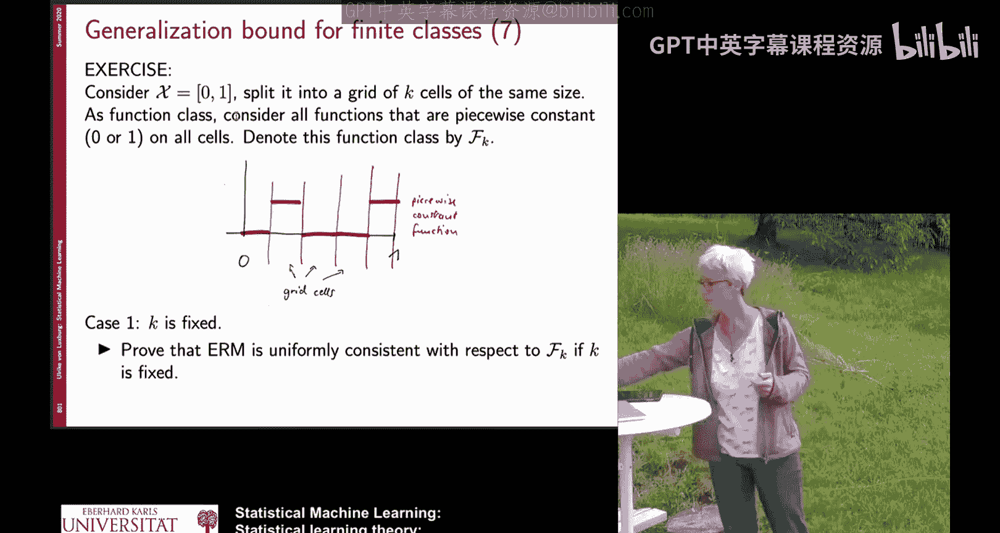
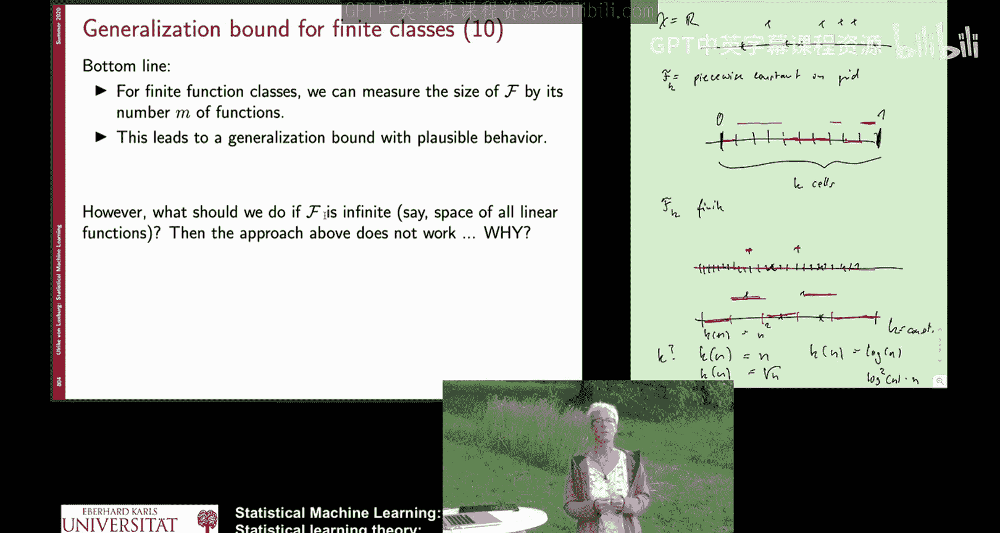

# 概率和统计机器学习：第39章：有限函数类的统计学习理论 📊

在本节课中，我们将要学习如何为有限函数类证明一致大数定律。我们将从一个直观的数学推导开始，理解如何将单个函数的集中不等式推广到整个函数类，并最终得到一个可用于指导学习算法设计的泛化界。

## 概述

上一节我们介绍了，为了证明一个分类算法是一致的，我们需要证明一致大数定律。该定律表明，对于给定函数类中的所有函数，当样本量 `n` 趋于无穷时，真实风险与在特定样本上测量的经验风险之间的偏差会趋于0。然而，上一节末尾的表达式看起来相当复杂。本节中，我们来看看如何证明这样的定律。我们将从有限函数类（即函数类中只有有限个函数）的情况开始。

## 从单个函数到有限函数类

以下是证明的核心思路：我们无法将标准大数定律直接应用于依赖于数据选择的函数（如经验风险最小化选择的函数）。为了规避这个问题，我们转而考虑函数类中所有函数偏差的上确界。

我们首先回顾一个已知的工具：霍夫丁不等式。对于任何**不依赖于数据**的固定函数 `f`，其经验风险 `R_emp(f)` 与真实风险 `R(f)` 的偏差可以被概率性地界定。

**霍夫丁不等式**：
`P(|R_emp(f) - R(f)| > ε) ≤ 2 * exp(-2nε²)`

这个界限很好，因为它随着样本量 `n` 以指数速度衰减。然而，问题在于我们不能直接将这个界限应用于基于样本数据选择的函数 `f_n`。

现在，我们考虑一个有限函数类 `F`，它包含 `M` 个函数，记作 `{f1, f2, ..., fM}`。我们想要界定的是最坏情况下的偏差概率：

`P( sup_{f ∈ F} |R_emp(f) - R(f)| > ε )`

以下是推导这个界限的步骤：

1.  **用有限和表示上确界**：由于函数类只有 `M` 个元素，上确界等价于遍历所有函数的最大偏差。
    `sup_{f ∈ F} ... = max_{i=1,...,M} ...`

2.  **将“最大值”转化为逻辑“或”**：最大值超过 `ε`，意味着至少有一个函数的偏差超过 `ε`。这可以用逻辑“或”运算来表示。
    `P( max_i |...| > ε ) = P( ∪_{i=1}^M { |..._i| > ε } )`

3.  **应用并界（Union Bound）**：一组事件并集的概率小于等于这些事件概率之和。这是一个宽松但始终成立的界限。
    `P( ∪_{i=1}^M A_i ) ≤ Σ_{i=1}^M P(A_i)`
    将其应用于我们的情况，得到：
    `P( sup_{f ∈ F} |R_emp(f) - R(f)| > ε ) ≤ Σ_{i=1}^M P( |R_emp(f_i) - R(f_i)| > ε )`

4.  **对每一项应用霍夫丁不等式**：现在，求和中的每一项 `P( |R_emp(f_i) - R(f_i)| > ε )` 都涉及一个**固定的、独立于数据的**函数 `f_i`。因此，我们可以对每一项应用霍夫丁不等式。
    `Σ_{i=1}^M P(...) ≤ Σ_{i=1}^M 2 * exp(-2nε²) = 2M * exp(-2nε²)`

至此，我们得到了有限函数类的关键概率界限。

## 泛化界定理及其解释

将上述概率界限重新表述，我们得到以下定理。

**定理（有限函数类的泛化界）**：
假设函数类 `F` 是有限的，包含 `M` 个函数。对于任意 `δ ∈ (0, 1)` 和任意 `ε > 0`，有以下结论成立：
以至少 `1 - δ` 的概率，对于 `F` 中的所有函数 `f`，其真实风险 `R(f)` 满足：
`R(f) ≤ R_emp(f) + √( (log(2M) + log(1/δ)) / (2n) )`

这个定理的另一种等价形式（通过设定 `δ = 2M exp(-2nε²)` 并反解 `ε` 得到）更常用：它以高概率 (`1-δ`) 保证了所有函数的真实风险都被其经验风险加上一个偏差项所界定。

让我们来解析这个偏差项 `√( (log(2M) + log(1/δ)) / (2n) )`：

*   **容量项 `log(2M)`**：这衡量了函数类的复杂度或“大小”。即使函数数量 `M` 很大，由于其对数形式，这项的增长也被控制得很慢。这直观地告诉我们，只要函数类的规模没有指数级地超过数据量，我们就可以控制过拟合。
*   **置信项 `log(1/δ)`**：这反映了我们想要的置信水平。如果我们希望结论更可靠（即 `δ` 更小），那么偏差界限就会变宽，这是合理的——为了涵盖更极端的小概率事件，我们需要更保守的估计。
*   **样本量 `n`**：样本量 `n` 出现在分母。随着 `n` 增大，整个偏差项以 `O(1/√n)` 的速度减小，意味着估计越来越精确。

**定理的启示**：
1.  **一致性条件**：为了使偏差项随 `n→∞` 而趋于0（从而获得一致性），我们需要 `(log M)/n → 0`。这意味着函数类的规模 `M` 可以随 `n` 增长，但至多只能以低于指数级的速度增长（例如，多项式增长是允许的）。
2.  **权衡**：定理揭示了模型复杂度（`log M`）、样本量 (`n`) 和置信水平 (`δ`) 之间的经典权衡。更复杂的模型（更大的 `M`）需要更多的数据来达到相同的精度。

## 示例：网格上的分段常数函数

为了具体理解这个定理，我们考虑一个例子。假设数据空间 `X = [0, 1]`，我们在 `[0, 1]` 区间上设置一个均匀的网格，将其分为 `K` 个单元格。

我们的函数类 `F_K` 由所有**在每个网格单元格上为常数（0或1）** 的分段常数函数组成。这是一个有限函数类，因为每个单元格可以独立地取0或1，所以总函数数量 `M = 2^K`。

现在，我们可以应用上述泛化界。偏差项变为：
`√( (log(2 * 2^K) + log(1/δ)) / (2n) ) = √( ( (K+1) * log 2 + log(1/δ) ) / (2n) )`

**一致性分析**：
*   如果网格数 `K` 是**固定常数**，那么当 `n → ∞` 时，偏差项显然趋于0。因此，经验风险最小化在这个函数类上是一致收敛的。
*   如果网格数 `K` 随 `n` **增长**（即 `K = K(n)`），那么为了保持一致性，我们需要偏差项趋于0。这要求 `(K(n) * log 2) / n → 0`，即 `K(n)` 的增长速度必须比 `n` 慢（例如，`K(n) = √n` 或 `K(n) = log n` 是可行的，而 `K(n) = n` 则不行，因为 `(n)/n → 常数 ≠ 0`）。

这个例子很好地展示了如何利用泛化界来指导模型选择：即使我们允许模型复杂度（网格数 `K`）随数据增加而增加，也必须控制其增长速度，才能保证学到的模型能够泛化。

## 总结与展望

本节课中我们一起学习了如何为有限函数类建立统计学习理论的基础。

1.  我们通过**并界**技巧，将针对单个固定函数的霍夫丁不等式，推广到了整个有限函数类。
2.  我们得到了一个关键的**泛化界**，它用经验风险、函数类容量 (`log M`)、样本量 (`n`) 和置信水平 (`δ`) 来界定真实风险。
3.  我们通过一个**分段常数函数**的例子，演示了如何使用这个界来分析学习算法的一致性，并理解模型复杂度与样本量之间的权衡。

然而，这个理论有一个明显的局限：它只适用于**有限**函数类。对于大多数现代机器学习模型（如神经网络、决策树等），其假设空间通常是无限的。直接将 `M` 视为无穷大会导致界限失去意义。

下一节我们将探讨，如何通过**组合数学工具**（如VC维、Rademacher复杂度等）来度量无限函数类的“有效大小”，从而将泛化理论推广到更一般的情况。这些工具将使我们能够证明形式类似但适用范围更广的泛化界限。