# 40：打散系数 📊

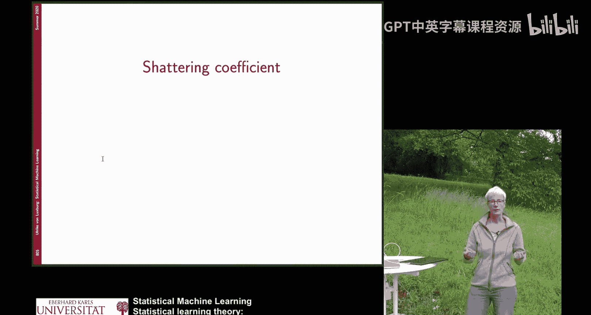

在本节课中，我们将学习统计学习理论中的一个核心概念——**打散系数**。我们将探讨如何利用这个组合度量来评估函数类的“容量”，并推导出无限函数类的泛化误差界。理解打散系数是理解机器学习算法何时能够有效泛化的关键一步。

## 回顾与问题设定

上一节我们介绍了统计学习理论的基本框架，本节中我们来看看如何将其扩展到无限函数类。

我们关注一个使用 **N** 个数据点进行学习的算法，该算法会选择一个函数，记作 **f_N**。我们关心的是这个函数的**真实风险 R(f_N)**，并希望将其与函数类 **F** 中可能的最佳函数 **f*** 的风险进行比较。我们想知道风险偏差 **R(f_N) - R(f*)** 大于某个值 **ε** 的概率。

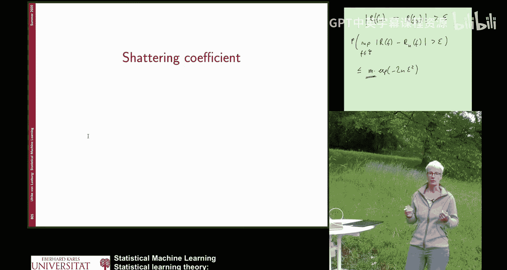

通过一些变换，我们将问题转化为研究**一致收敛**：即对于函数类 **F** 中的所有函数，其经验风险与真实风险之间的最大偏差超过 **ε** 的概率。对于有限函数类（包含 **M** 个函数），我们得到了一个形如 **M * exp(-2nε²)** 的界。这个界表明，函数类的规模 **M** 至关重要。

然而，当函数类包含无限多个函数时，上述证明方法失效。这就需要引入新的概念——打散系数。

## 打散系数的定义

打散系数是一个组合度量，用于衡量一个函数类在有限样本上的“表达能力”或“容量”。

假设我们有一个包含 **n** 个点的样本 **{x₁, ..., xₙ}**，以及一个函数类 **F**。我们首先定义函数类在样本上的限制：

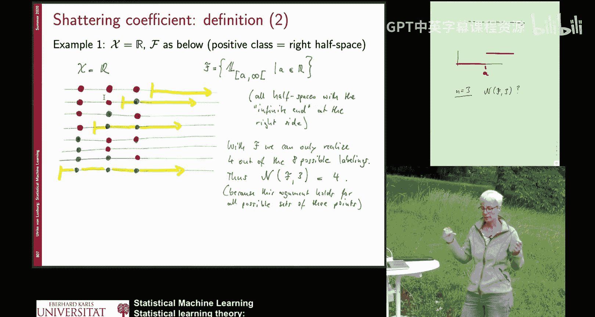

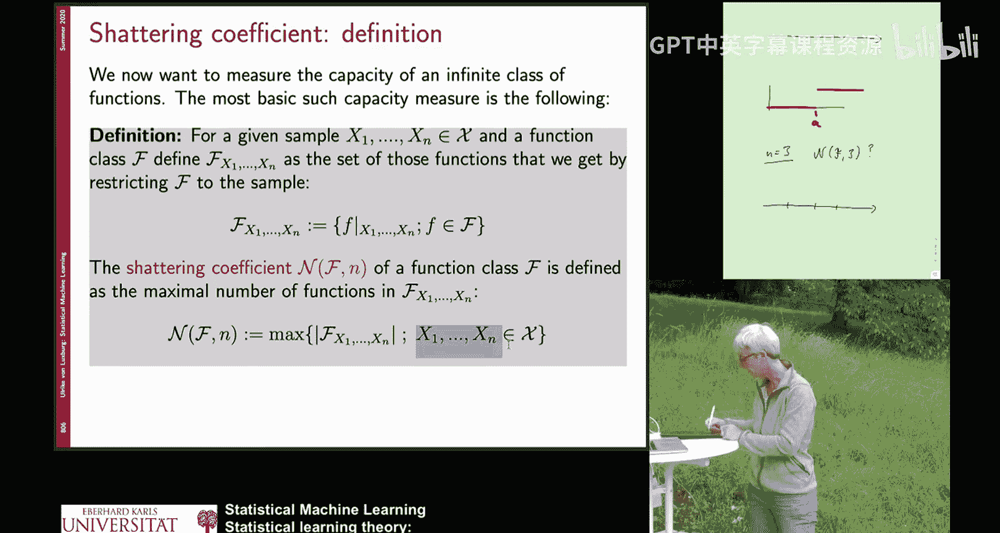

**F|_{x₁,...,xₙ} = { (f(x₁), ..., f(xₙ)) | f ∈ F }**

这个集合包含了所有函数在这个有限样本上可能产生的标签组合（例如，在二分类中为 -1/+1 或 0/1 的序列）。由于只有 **n** 个点，每个点有两种标签，所以最多有 **2ⁿ** 种可能的标签组合。

**打散系数 N(F, n)** 定义为：对于**任意**大小为 **n** 的样本，函数类 **F** 所能实现的**不同**标签组合的最大数量。它衡量的是函数类在 **n** 个点上“打散”（即实现所有可能标签组合）的能力。

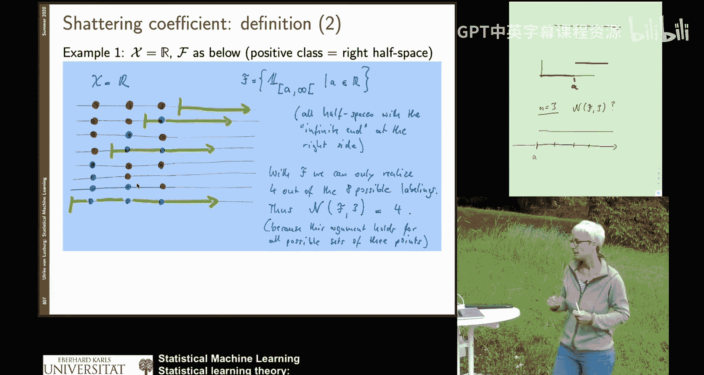

## 打散系数示例

以下是几个计算打散系数的简单例子，以帮助理解。

### 示例1：一维阶跃函数
*   **数据空间**: 实数轴 ℝ
*   **函数类 F**: 所有从 0 跳变到 1 的阶跃函数，形式为 **f(x) = I(x ≥ a)**，其中 **a ∈ ℝ**。
*   **目标**: 计算 **N(F, 3)**。

我们考虑任意三个数据点。通过移动跳变点 **a**，我们可以实现部分标签组合，但无法实现“0, 1, 0”这样的模式（因为阶跃函数只能从0变到1一次）。对所有8种可能的标签组合进行枚举后，发现只有4种可以被实现。

因此，**N(F, 3) = 4**。

### 示例2：二维线性分类器（正半平面）
*   **数据空间**: 二维平面 ℝ²
*   **函数类 F**: 所有将平面分为上下两部分的直线，下半部分标记为0，上半部分标记为1。
*   **目标**: 估计 **N(F, 5)**。

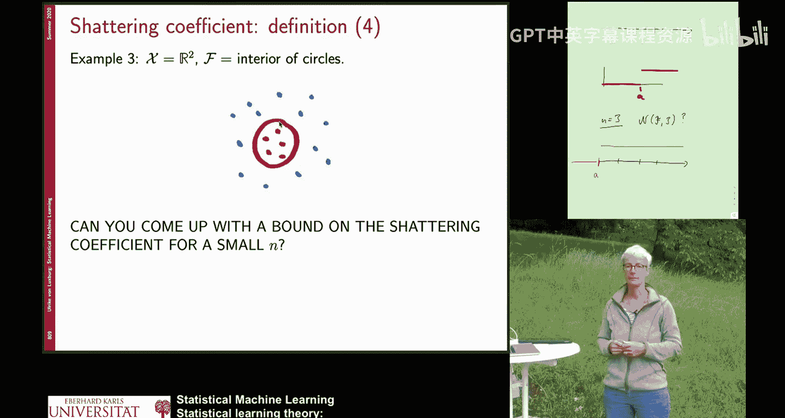

通过尝试不同的5个点集，我们发现：
*   在某些点集配置下（如所有点几乎共线），只能实现少数几种标签。
*   存在一种点集配置（例如，5个点处于“一般位置”，没有三点共线），我们可以实现多达6种不同的标签组合。
*   可以证明，对于任意5个点，无法实现超过6种标签组合。

因此，**N(F, 5) = 6**。

### 示例3：二维圆形分类器
*   **数据空间**: 二维平面 ℝ²
*   **函数类 F**: 所有圆，圆内为一类，圆外为另一类。
*   **目标**: 思考 **N(F, n)** 如何随 **n** 增长。

这个例子更复杂，但思路相同：寻找一个 **n** 个点的配置，使得通过调整圆心的位置和半径，能够实现尽可能多的标签组合。这个最大数量就是 **N(F, n)**。

## 基于打散系数的泛化界

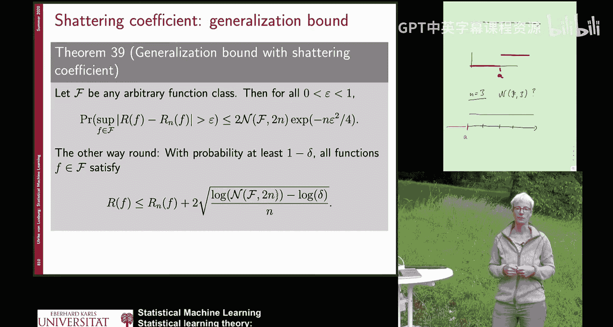

引入打散系数的目的是为了得到无限函数类的泛化误差界。以下是核心定理：

**定理**：设 **F** 为任意函数类，对于任意 **ε > 0**，有以下概率界：
```
P( sup_{f ∈ F} |R(f) - R_n(f)| > ε ) ≤ 2 * N(F, 2n) * exp(-nε²/4)
```
其中 **R(f)** 是真实风险，**R_n(f)** 是基于 **n** 个样本的经验风险。

这个界在形式上与有限函数类的界（**M * exp(...)**）非常相似，只是将函数数量 **M** 替换为了打散系数 **N(F, 2n)**。这直观上是合理的，因为打散系数衡量了在 **2n** 个点（源于后续证明中的“影子样本”技巧）上，函数类表现出的有效函数数量。

更常用的等价形式是：以至少 **1 - δ** 的概率，对于所有 **f ∈ F**，有：
```
R(f) ≤ R_n(f) + √( (2 log(2N(F, 2n)) + log(2/δ)) / n )
```

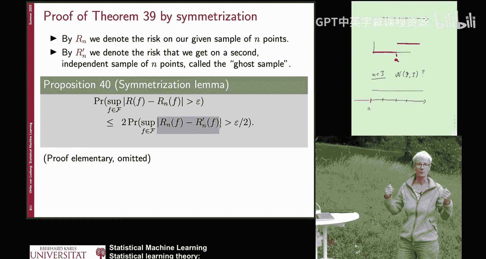

## 证明思路与影子样本技巧

证明的关键在于处理真实风险 **R(f)**，它依赖于整个数据分布，难以直接分析。我们采用**对称化**技巧：

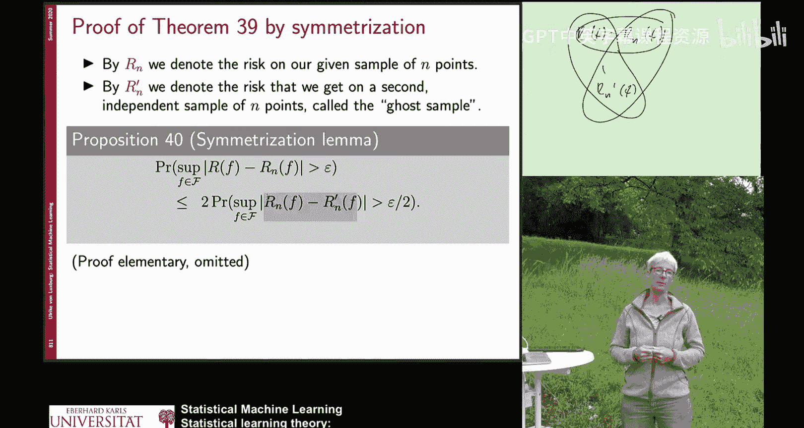

1.  **引入影子样本**：假设我们除了训练样本 **S**（大小为 **n**）外，还有另一个从相同分布中独立抽取的“影子样本” **S‘**（大小也为 **n**）。
2.  **替换风险差**：可以证明，我们关心的风险偏差概率 **P(sup |R(f) - R_n(f)| > ε)** 可以被 **2 * P(sup |R_n'(f) - R_n(f)| > ε/2)** 所界定，其中 **R_n‘** 是在影子样本上计算的经验风险。
3.  **关键观察**：现在，表达式 **sup |R_n'(f) - R_n(f)|** 只依赖于两个有限的点集 **S** 和 **S‘**（共 **2n** 个点）。函数 **f** 在这 **2n** 个点上的取值是有限的，其不同行为的数量正好由打散系数 **N(F, 2n)** 所界定。
4.  **化为有限类问题**：至此，问题被简化为一个在最多 **N(F, 2n)** 个“有效函数”上的有限函数类问题，可以沿用霍夫丁不等式和联合界进行推导，最终得到上述定理中的界。

## 一致收敛与一致性条件

根据之前的学习，我们知道经验风险最小化（ERM）的**一致性**（即当样本数 **n → ∞** 时，学得函数的风险收敛到最优风险）等价于**一致收敛**（即上述定理中的概率上界趋于0）。

观察我们的泛化界，一致收敛成立的条件是：
```
(log N(F, 2n)) / n → 0    (当 n → ∞ 时)
```
这意味着打散系数 **N(F, n)** 的增长速度必须**慢于指数增长**。如果 **N(F, n)** 以 **2ⁿ** 这样的指数速度增长，那么 **log N(F, n) ~ n**，上述条件不满足，我们就无法保证ERM的一致性。这对应了函数类“容量”过大，可能导致严重的过拟合。

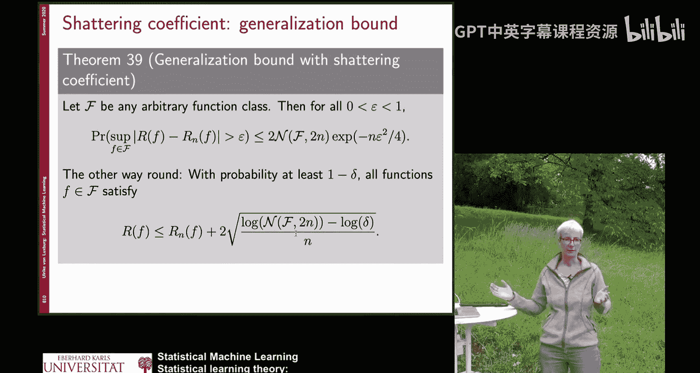

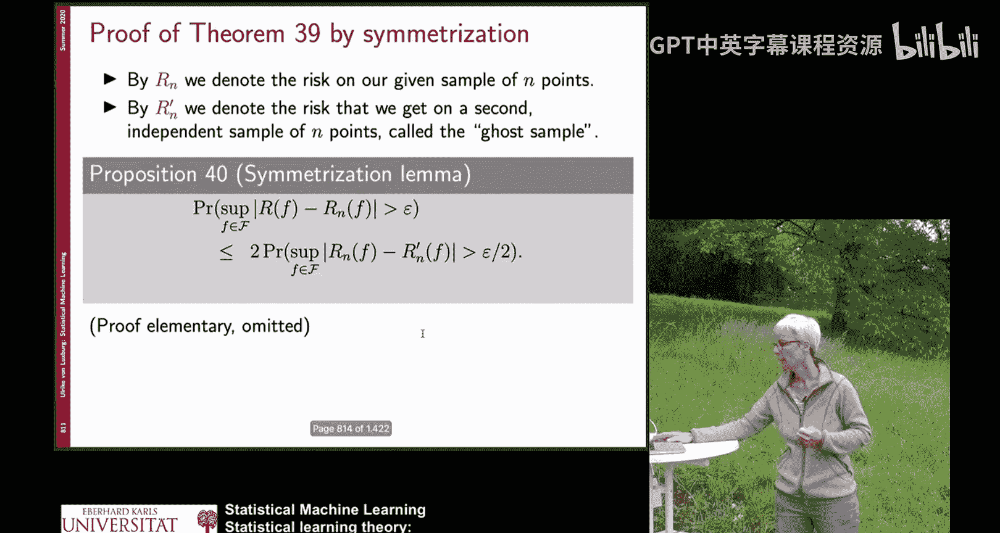

因此，**多项式增长**的打散系数是保证学习过程具有一致性的一个关键条件。

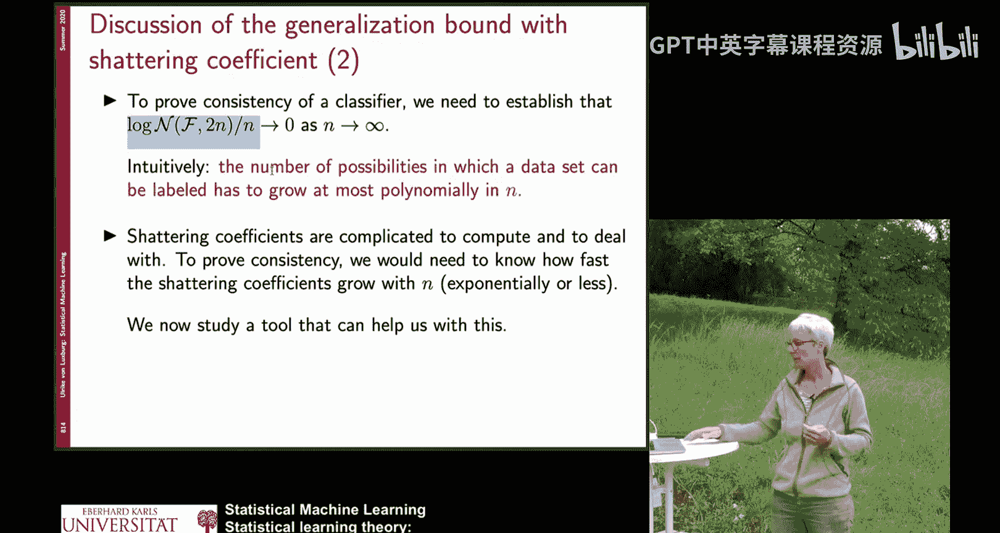

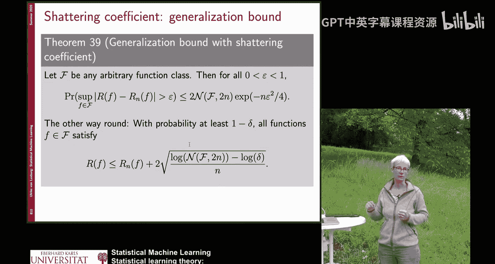

## 总结与展望

本节课中我们一起学习了：
1.  **打散系数 N(F, n)** 的定义：它衡量一个函数类在 **n** 个点上能产生多少种不同的标签模式，是函数类容量的组合度量。
2.  如何通过**对称化技巧**和**影子样本**，将无限函数类的泛化分析问题，转化为受打散系数限制的有限问题。
3.  得到了基于打散系数的**泛化误差界**，该界在形式上与有限函数类的界类似。
4.  推导出保证学习算法**一致性**的条件是 **log N(F, n) / n → 0**，即打散系数需亚指数增长（通常为多项式增长）。

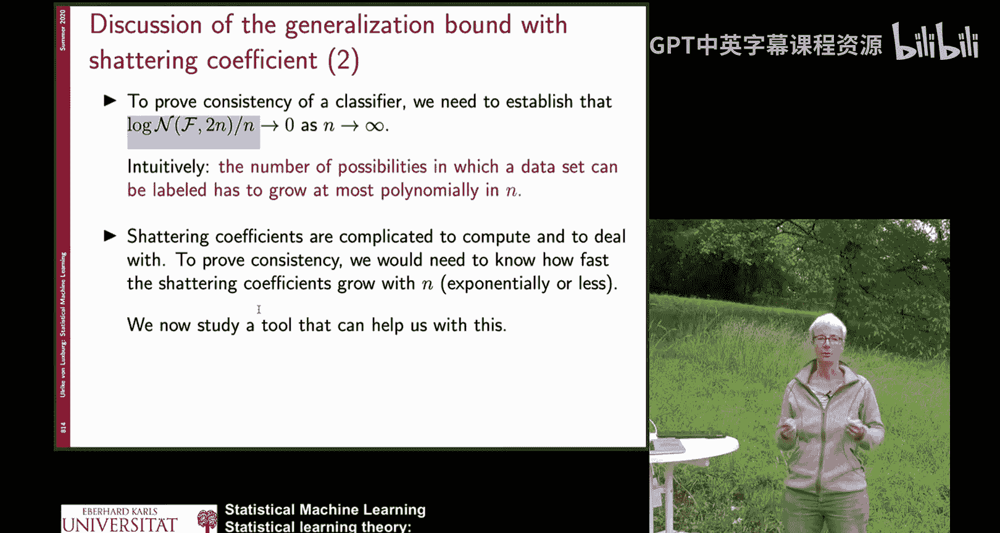

打散系数是一个强大的理论工具，但其主要缺点是对于复杂的函数类往往**难以计算**。我们需要对**所有可能的 n 点配置**考虑其最大可实现标签数。在下一讲中，我们将介绍一个更易于处理和分析的容量概念——**VC维**，它能够为许多实用的函数类给出打散系数的上界，从而更方便地应用于理论分析和推导。