# 41：统计学习理论与VC维 📊

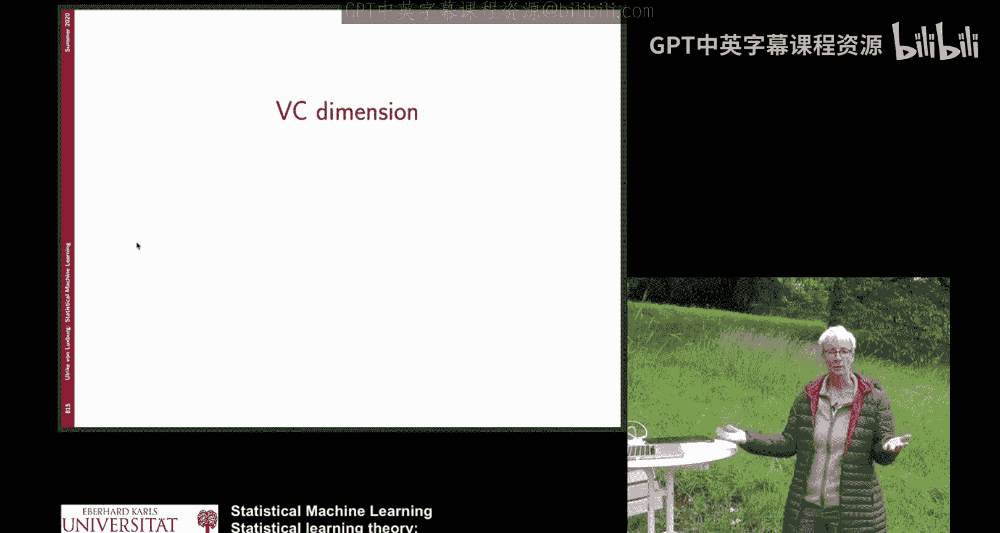

在本节课中，我们将要学习统计学习理论中的一个核心概念——VC维。我们将从定义开始，通过具体例子理解其含义，并最终了解它如何帮助我们推导出泛化误差界，从而保证学习算法的有效性。

## 定义与核心概念

上一节我们介绍了粉碎系数，作为处理无限函数类并改进泛化界的一个工具。然而，粉碎系数通常难以计算。本节中，我们来看看一个不同的工具，它被称为VC维，由Vapnik和Chervonenkis发明。这是另一个组合工具。

我们直接开始定义。给定一个数据空间 **X** 和一个函数类 **F**。我们说一个函数类 **粉碎** 一组数据点，如果这个函数类能够在该组点上实现所有可能的标签分配。

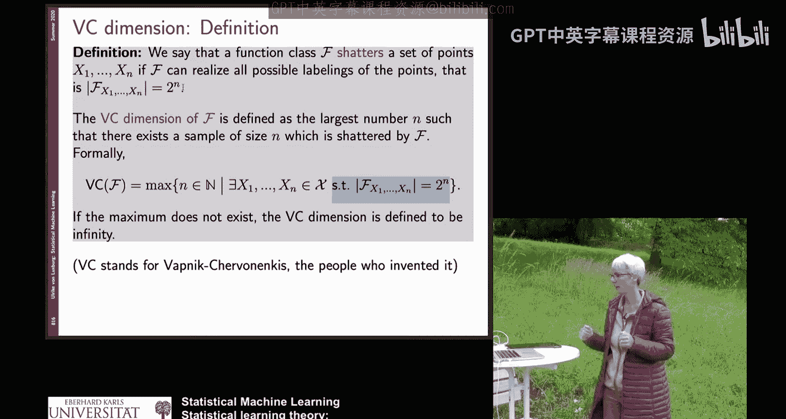

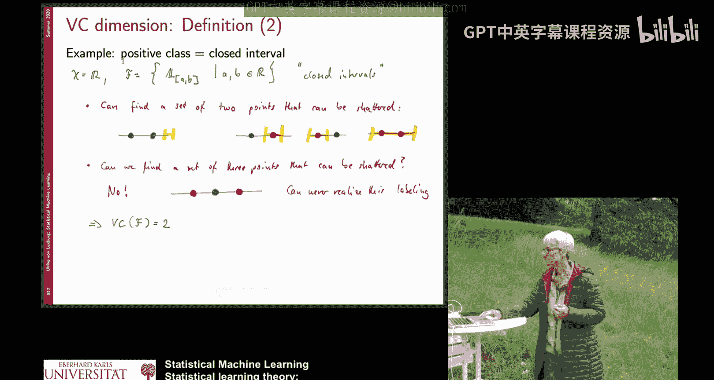

对于一个包含 **n** 个点的数据集，有 **2^n** 种不同的二元标签分配。如果函数类能实现所有这些标签，即当我们观察函数类限制在这些数据点上时，存在所有可能的函数（共 **2^n** 个），那么我们就说该函数类粉碎了这个数据集。

现在，我们定义函数类的VC维。与粉碎系数不同，VC维是一个不依赖于样本数量 **n**，而只依赖于函数类本身的量。

函数类的VC维定义为：**存在一个能被该函数类粉碎的样本的最大数据点数量**。其公式化定义是：

**VC维 = max { n | ∃ 一个包含 n 个点的数据集 S ⊆ X，使得 F 能粉碎 S }**

如果这个最大值不存在，我们就说VC维是无限的。

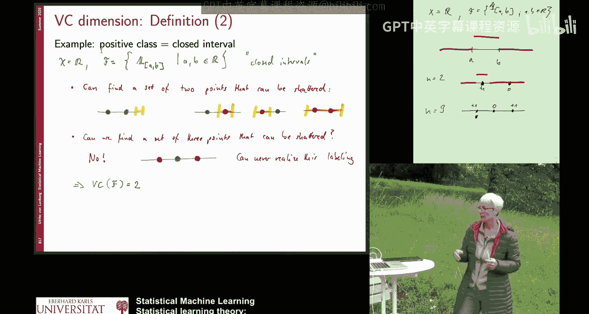

让我们消化一下这个定义，并在脑海中与粉碎系数进行对比。第一个重要区别是，粉碎系数依赖于一个特定的样本大小 **n**，而VC维通过考察不同大小的样本，摆脱了这种依赖。当我们找到一个特定大小的数据集无法再被粉碎时，我们就停止，并找到了VC维。

## 计算VC维的示例

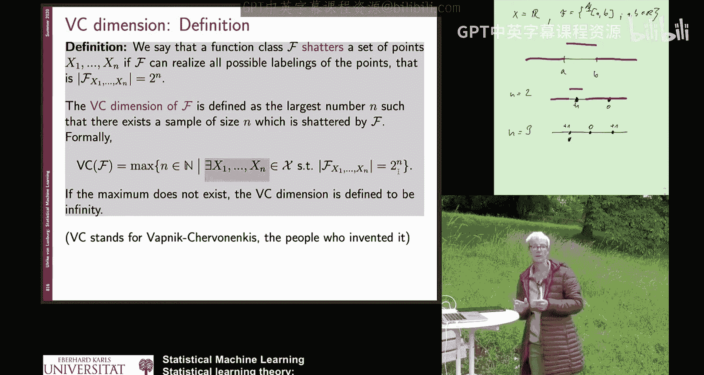

让我们通过一些例子来理解如何计算VC维。

**示例1：实轴上的区间指示函数**

*   **数据空间 X**: 实数轴 ℝ
*   **函数类 F**: 所有闭区间 **[a, b]** 的指示函数（在区间内为1，区间外为0）。

以下是确定其VC维的步骤：
1.  我们从小的点集开始尝试。
2.  **n = 2**: 考虑实数轴上的任意两个点。我们可以通过选择包含或不包含这些点的区间，轻松实现所有四种标签组合（(1,1), (1,0), (0,1), (0,0)）。因此，我们找到了一个能被粉碎的2点数据集，所以VC维 **至少为2**。
3.  **n = 3**: 考虑实数轴上的任意三个点（按顺序排列）。现在存在一种标签组合我们无法实现：中间的点标记为0，两端的点标记为1（即模式 1, 0, 1）。因为任何区间如果要包含两端点，就必须包含中间点。因此，**不存在**一个能被该函数类粉碎的3点数据集。
4.  结论：该函数类的VC维为 **2**。

**示例2：平面上的轴平行矩形**

*   **数据空间 X**: 平面 ℝ²
*   **函数类 F**: 所有轴平行矩形的指示函数（矩形内为1，矩形外为-1）。

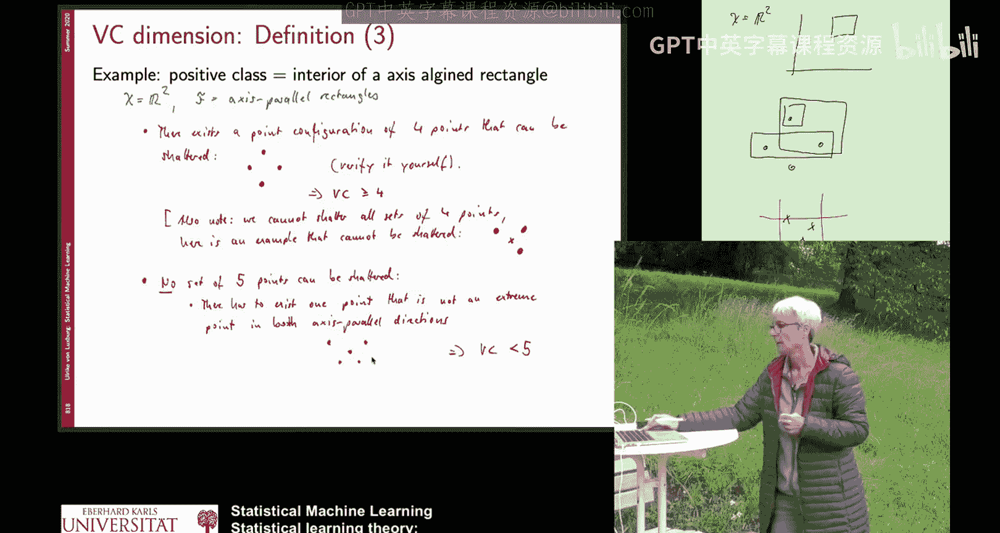

以下是确定其VC维的步骤：
1.  **n = 4**: 我们可以找到一个能被粉碎的4点数据集：例如，四个点分别位于一个矩形的四个角上。通过调整矩形的位置和大小，我们可以实现所有16种标签组合（例如，只包含对角两点、包含相邻三点等）。
2.  **n = 5**: 可以证明，对于**任何**5个点的集合，都无法被轴平行矩形类粉碎。直观上，对于任意5个点，总能找到一个点不是“极端点”（即不是最左、最右、最上或最下的点），而某些标签组合（例如，只给这个内部点标记为1，其他标记为-1）是无法实现的。
3.  结论：该函数类的VC维为 **4**。

**示例3：具有d个顶点的凸多边形**

*   **数据空间 X**: 平面 ℝ²
*   **函数类 F**: 所有具有d个顶点的凸多边形的指示函数。
*   **结论**：该函数类的VC维为 **2d + 1**。证明思路是：将 **2d+1** 个点均匀放在一个圆上，可以构造多边形来实现这些点的任意标签组合（下界）。同时，可以证明 **2d+2** 个点无法被粉碎（上界）。

**示例4：正弦波函数类**

*   **数据空间 X**: 实数轴 ℝ
*   **函数类 F**: 所有形式为 **sin(ωx)** 的函数（通过阈值化得到二元分类）。
*   **结论**：该函数类的VC维是**无限的**。因为对于任意数量的点 **n**，我们都可以选择一个频率足够高的正弦波，使其在这些点上产生任意我们想要的0/1模式。

## 实践中的重要VC维结果

以下是一些在实践中非常重要的函数类的VC维：

1.  **ℝ^d 中的线性分类器（超平面）**：VC维 = **d + 1**。
2.  **具有间隔 ρ 的线性分类器**：如果数据点位于一个半径为 **R** 的球内，则VC维 ≤ **min( d, ⌈R²/ρ²⌉ )**。这表明，**较大的分类间隔对应于较小的VC维**，这是一个好现象，通常意味着更好的泛化能力。

## Sauer-Shelah 引理与泛化界

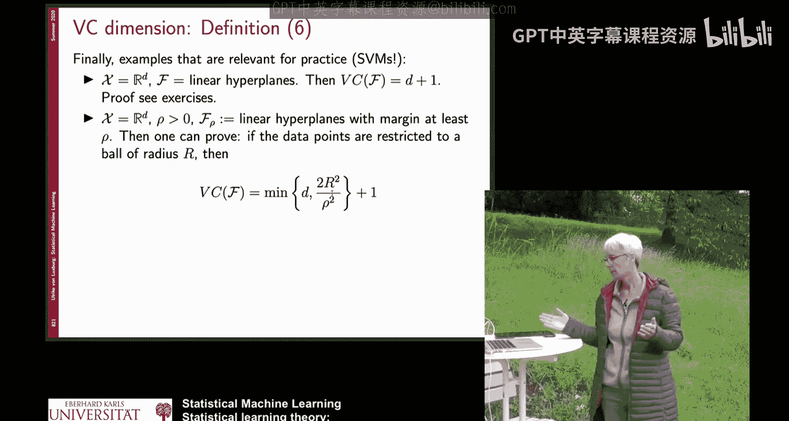

我们为什么要研究VC维？它听起来像一个组合工具，但似乎不能直接用来证明泛化界，因为它并不直接计算函数的数量。

关键在于一个非常深刻且重要的组合引理——**Sauer-Shelah 引理**。

**Sauer-Shelah 引理**：假设一个函数类 **F** 具有有限的VC维 **D**。那么，对于任意大小为 **n** 的样本，其粉碎系数（即函数类在样本上能产生的不同分类结果的数量）满足以下上界：
**粉碎系数 ≤ Σ_{i=0}^{D} C(n, i) ≤ (e * n / D)^D**
其中 **C(n, i)** 是组合数。特别地，当 **n > D** 时，这个上界是 **O(n^D)**，即关于 **n** 是**多项式**增长，而不是指数增长。

这个引理的意义非常重大。它意味着，一旦样本数量 **n** 超过了VC维 **D**，函数类在样本上的表现能力就会从潜在的指数增长急剧转变为多项式增长。

有了这个引理，我们就可以将其代入之前基于粉碎系数的泛化误差界定理中。

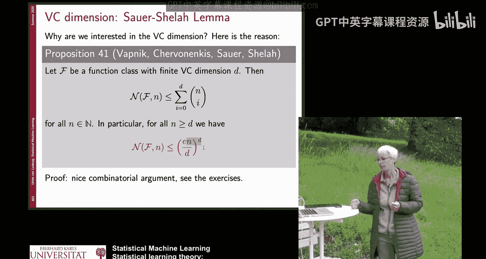

**基于VC维的泛化界**：设 **F** 是一个VC维为 **D** 的函数类。那么，以至少 **1 - δ** 的概率，对于所有 **f ∈ F**，其真实风险 **R(f)** 与经验风险 **R_n(f)** 的偏差满足：
**R(f) ≤ R_n(f) + O( √( (D * log(n/D) + log(1/δ)) / n ) )**

这个结果的核心在于，当VC维 **D** 是有限常数时，随着样本量 **n** 趋于无穷，误差项 **O(√(...)) → 0**。这直接意味着**经验风险最小化（ERM）是（一致）学习的**。

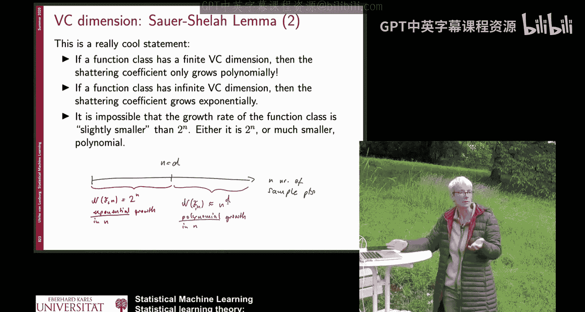

更一般地，可以证明一个函数类**能够**被ERM一致学习，**当且仅当**它的VC维是有限的。这为学习理论提供了一个清晰而优美的刻画。

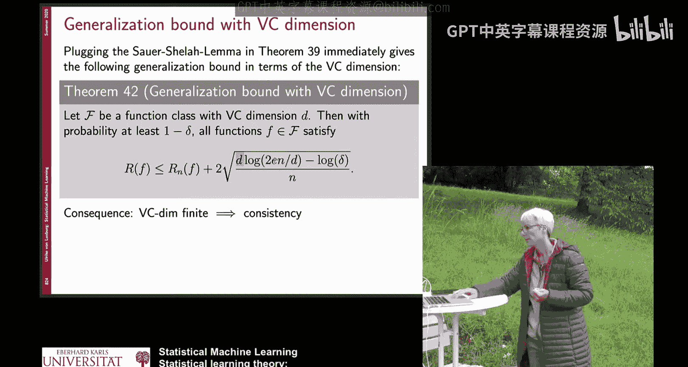

## 样本复杂度估计

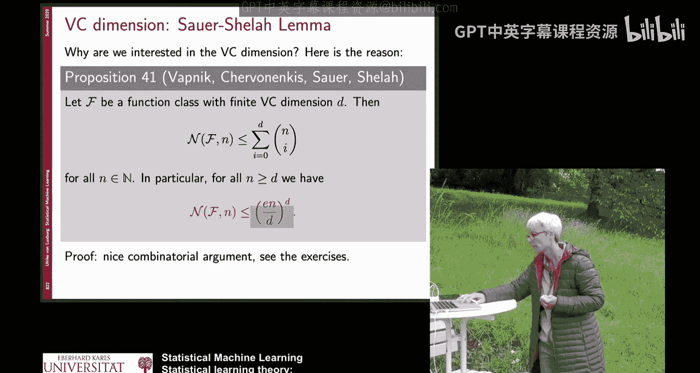

我们经常想知道，为了达到特定的精度 **ε**，需要多少样本。

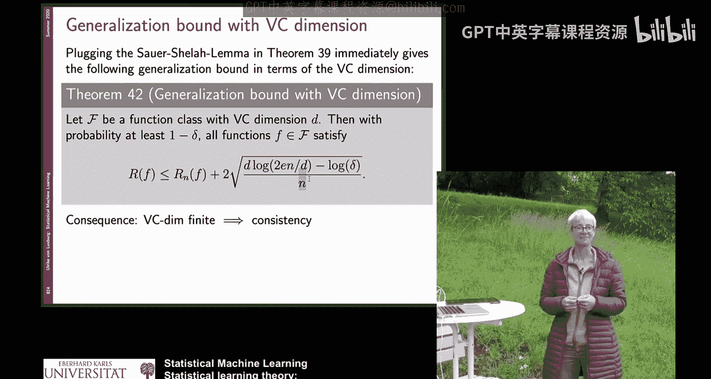

从上面的泛化界出发，如果我们希望误差项小于 **ε**，可以解出所需样本量 **n** 的阶。忽略常数和对数项，我们得到：
**n ~ O( D / ε² )**

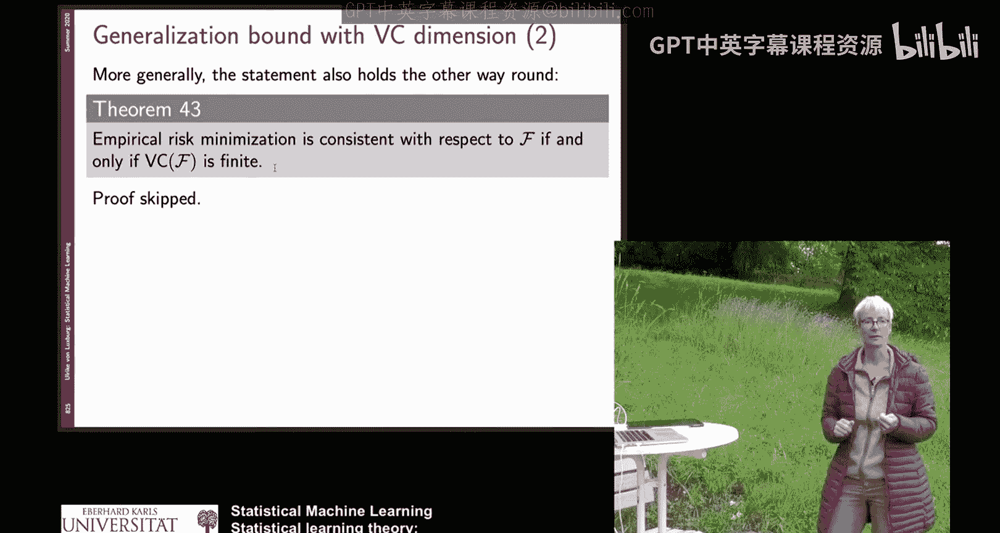

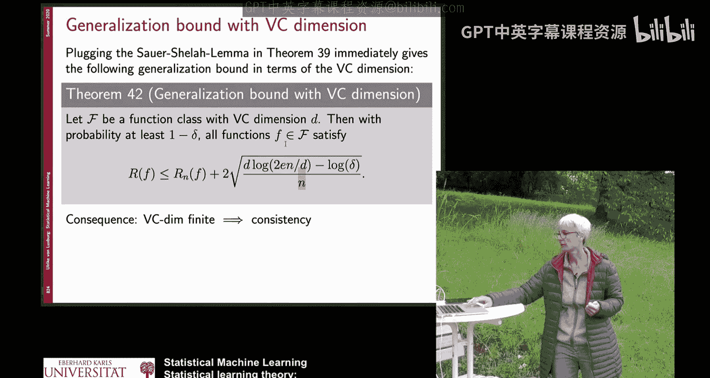

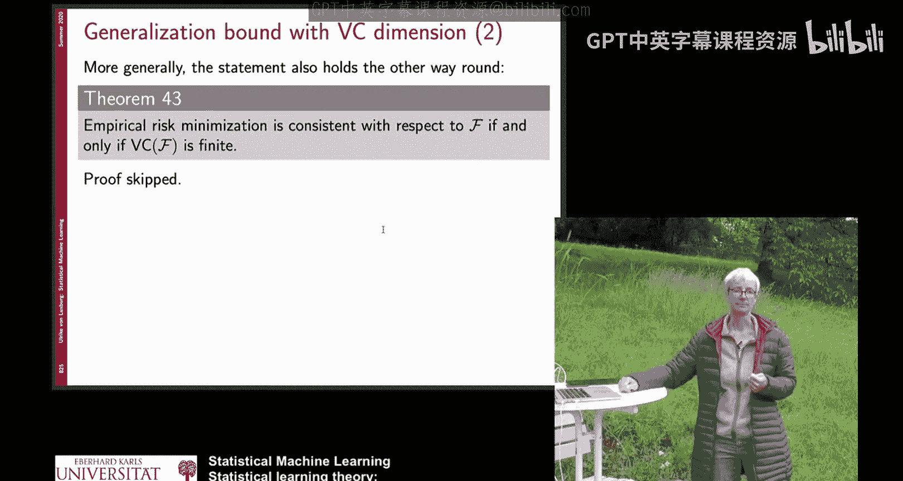

这个估计告诉我们：
1.  所需样本量与VC维 **D** 成**线性**关系。因此，在选择模型复杂度时，VC维是一个重要的考量因素。
2.  所需样本量与期望精度 **ε** 的平方成反比。要获得更高的精度（更小的 ε），需要显著增加样本量。

## 总结

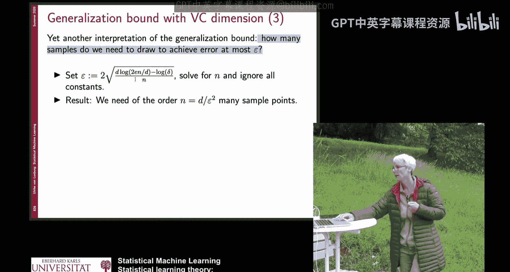

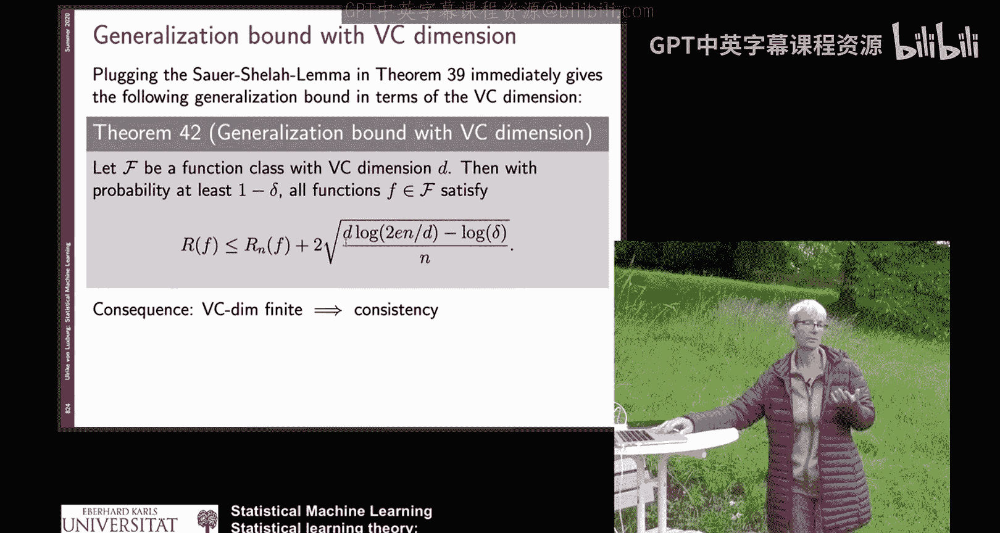

本节课中我们一起学习了VC维这一统计学习理论的核心概念。
*   我们首先定义了**粉碎**和**VC维**，并通过多个例子（如区间、矩形、多边形、正弦波）学会了如何计算或估计一个函数类的VC维。
*   接着，我们了解了**Sauer-Shelah引理**，它揭示了有限VC维的函数类，其表达能力在样本量超过VC维后仅呈多项式增长，这是证明泛化界的关键。
*   然后，我们推导出了**基于VC维的泛化误差界**，并认识到有限VC维是经验风险最小化算法能够成功（一致）学习的充要条件。
*   最后，我们基于泛化界推导了**样本复杂度的简单估计**，即所需样本量大致与VC维成正比，与期望误差的平方成反比。

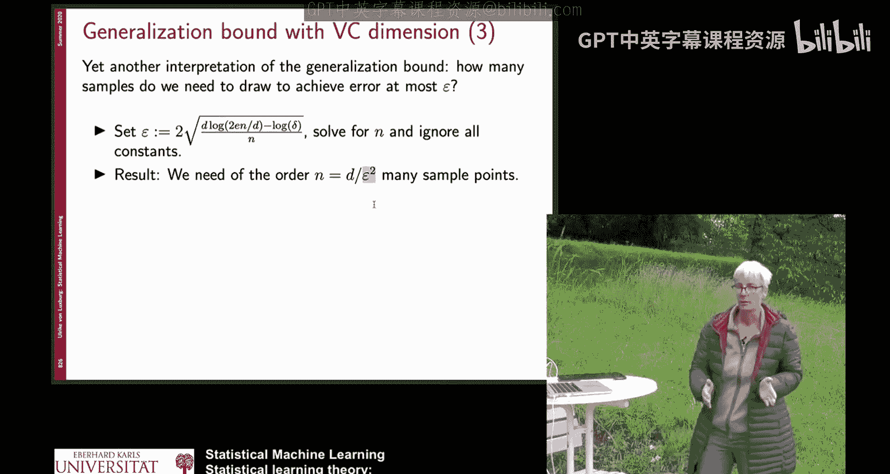

VC维将函数类的复杂性转化为一个单一的数字，为理解机器学习模型的容量和泛化能力提供了强大的理论工具。