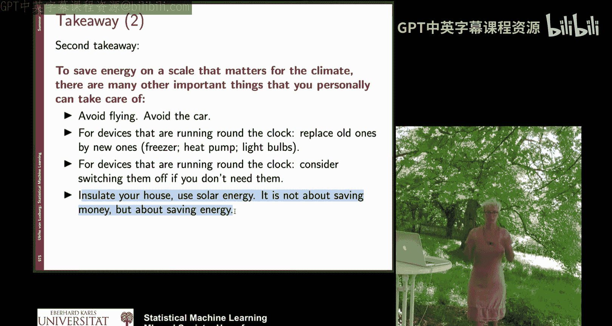

# 50：机器学习与社会的能源足迹 🔋

在本节课中，我们将要学习人工智能，特别是人工智能研究，所消耗的能源。我们将通过具体的数字来理解能源消耗的规模，并将其与日常生活中的其他能源消耗进行比较，以获得直观的感受。课程将首先介绍能源计量单位，然后分析欧洲人均能源足迹，接着探讨家庭设备与计算设备的能耗，最后聚焦于AI研究的能耗及其影响。

---

## 能源计量单位 📏

上一节我们介绍了课程的主题。本节中，我们来看看如何衡量能源消耗。为了理解能源消耗的规模，我们需要一个直观的计量单位。

在物理学中，有两个基本单位：
*   **功率**：衡量能量使用的速率，单位是**瓦特**。公式为：`功率 = 能量 / 时间`。
*   **能量**：衡量总消耗量，单位是**千瓦时**，这通常出现在电费账单上。

为了帮助理解，我们可以用水管来类比：
*   **千瓦时** 相当于从水管中流出的总水量（升）。
*   **瓦特** 相当于水管的粗细，它决定了单位时间内能流过多少水。

为了将所有能源消耗（如汽车、飞机、食物）放在一个可比较的尺度上，我们采用一个特殊的单位：**千瓦时/天**。这个单位的灵感来自于大卫·麦凯的著作《可持续能源——事实与真相》。

这个单位的定义是：假设一个40瓦的老式白炽灯全天24小时开启，它每天消耗的能量大约是1千瓦时。计算如下：
`1000 瓦时 / 24 小时 ≈ 41.7 瓦`。因此，一个40瓦的灯泡全天运行，其功率消耗约为 **1 千瓦时/天**。

通过这个单位，我们可以将各种能耗转化为“相当于全天运行一个多少瓦的设备”，从而获得更直观的感受。

---

## 欧洲人均能源足迹 🏠

了解了计量单位后，本节我们来看看一个普通欧洲人的典型能源消耗构成。以下数据来源于大卫·麦凯的著作，它列出了主要的能源消耗类别及其占比。

以下是各类别的能耗分解（以“千瓦时/天”和等效的“持续运行功率”表示）：
*   **驾车**：假设日均驾驶50公里，约占能源足迹的20%。相当于 **40 千瓦时/天** 或持续运行一台 **1600 瓦** 的设备（如一台大功率电水壶）。
*   **航空旅行**：每年一次洲际航班往返，约占能源足迹的20%。相当于 **30 千瓦时/天** 或持续运行一台 **1200 瓦** 的设备。
*   **食物**：生产我们所吃的食物所需的能源，约占10%。相当于 **15 千瓦时/天** 或持续运行一台 **600 瓦** 的设备。
*   **供暖与制冷**：在欧洲，这是最大的能源消耗项之一，约占37%。相当于 **37 千瓦时/天** 或持续运行一台 **1500 瓦** 的设备。
*   **物品制造**：生产我们消费的所有物品（如电脑、汽车、报纸）所消耗的能源，总计约占30%。

这些是平均值，个人情况会有所不同，但它们提供了能耗数量级的基本概念。

---

## 家庭与计算设备能耗 💻

上一节我们了解了宏观的能源足迹。本节中，我们具体看看家庭中常见设备以及计算设备的能耗，并找出那些容易被忽视但消耗巨大的“能源黑洞”。

以下是常见设备的功率范围及其影响：
*   **冰箱**：旧冰箱功率可达150瓦，新冰箱可低至20瓦。一台150瓦的旧冰箱持续运行，其能耗约占你驾车能耗的10%。
*   **供暖循环泵**：旧泵功率约150瓦且常年在冬季持续运行，非常低效。新型高效泵功率约50瓦。
*   **灯泡**：老式白炽灯功率40-100瓦。新型LED灯功率仅3-15瓦，节能约90%。
*   **卤素射灯**：过去流行的天花板卤素射灯功率可达500瓦，极其耗能，可更换为约30瓦的节能型号。
*   **计算与网络设备**：
    *   LED显示器：约50瓦。
    *   小型电脑（如Mac Mini）：60-85瓦。
    *   WiFi路由器：约10瓦。
*   **手机充电器**：空载时（未连接手机）功耗仅0.012瓦，充电时也不到1瓦。与冰箱等设备相比，其能耗微乎其微。

**关键结论**：真正影响你能源足迹的是那些**24小时不间断运行**的设备。例如：
*   一台60瓦的网页服务器全年不间断运行，消耗约 **1.5 千瓦时/天**，这相当于你食物能耗的10%。
*   一个10瓦的WiFi路由器全年不间断运行，累积的能耗也相当可观。

因此，重要的节能措施是：**不用时请关闭这些设备**（如夜间或离家时关闭WiFi路由器）。相比之下，拔掉手机充电器对个人能源足迹的影响很小。此外，交通（尤其是航空旅行）是最大的能源消耗项之一，一次洲际飞行就可能增加20%的能源足迹。

---

## AI研究的能源消耗 🤖

现在，让我们将焦点转向人工智能研究本身的能源消耗。本节中，我们来估算一下训练AI模型所需的计算能耗。

以下是基于典型硬件和任务的估算：
*   **单GPU功耗**：约300瓦。
*   **单CPU满载功耗**：约100瓦。

**一个计算示例**：假设使用10块GPU训练一个深度神经网络，持续一周。
*   总能耗计算：`10 GPU * 300瓦 * 24小时/天 * 7天 = 504,000 瓦时 = 504 千瓦时`。
*   如果将此能耗分摊到一年中，相当于每天 **1.4 千瓦时**。这大约是一个欧洲人食物能耗的10%。

如果一位研究者进行10周这样的训练，那么其计算能耗将与全年的食物能耗相当。因此，AI研究的计算能耗是**显著**的。

**对AI研究者的建议**：
1.  **负责任地使用计算资源**：在将代码部署到GPU集群进行长期训练前，务必先在小型实例上充分测试和调试。
2.  **先规划，后实验**：盲目尝试所有想法会浪费大量能源。花时间思考实验设计的合理性。
3.  **保持理性的比较**：虽然AI训练耗能，但参加国际会议的航班能耗通常远高于此。例如，飞往美国参加会议的往返航班，其个人能耗占比可能远超数周GPU训练的能耗。这引发了关于减少学术飞行、更多采用线上会议的思考。

**全球视角**：从全球范围看，数字技术的能耗总量巨大。例如（基于2017年估计）：
*   谷歌全球年用电量约为 **6 太瓦时**。
*   比特币挖矿年用电量约为 **20 太瓦时**。
作为对比，德国全年发电量约为 **250 太瓦时**。虽然数字技术的能耗规模显著，但尚未达到国家总发电量的级别。

---

## AI的节能潜力与个人行动 🌱

上一节我们讨论了AI的能耗问题。本节中，我们来看看AI是否也能帮助节能，并总结个人可以采取的有效行动。

AI确实在某些领域具有节能潜力：
*   **智能电网管理**：预测供需，优化电力调度。
*   **精准农业**：优化灌溉、施肥，减少资源浪费。
*   **高效生产**：优化工业生产线，降低能耗。

然而，目前这些应用大多处于愿景或早期阶段，其所能实现的节能规模，与AI及整个数字技术领域当前消耗的能源相比，可能尚未形成平衡。因此，声称“AI耗能但未来能省更多”目前更像是一种说辞，而非已实现的成果。

**本节课的最终总结与个人行动指南**：

本节课中我们一起学习了如何量化并理解能源消耗，特别是AI研究的能耗。主要要点如下：

1.  **AI研究的能耗不容忽视**：计算（GPU训练）和学术旅行（飞行）是两个主要来源。应负责任地使用计算资源，并尽可能减少不必要的飞行，多采用线上会议。
2.  **理解公共讨论的语境**：当公众讨论“AI能耗”时，往往指的是包括视频流媒体、云服务在内的整个数字技术产业的能耗，而不仅仅是AI研究。
3.  **个人可以采取高效节能行动**：关键在于关注**数量级**。最有效的个人行动包括：
    *   **避免飞行**：尤其是长途休闲旅行和可避免的短途学术飞行。
    *   **减少驾车**：在可能的情况下使用公共交通，选择高效的小型车辆。
    *   **更换老旧高耗能设备**：特别是那些24小时运行的设备，如冰箱、灯泡、供暖泵。
    *   **关闭不用的常开设备**：如WiFi路由器、网页服务器。
    *   **投资房屋节能**：良好的隔热、使用太阳能等。这更多是为了地球而非短期经济回报。

希望本课程能帮助你建立起对能源消耗的直观认识，并在研究和生活中做出更明智的决策。