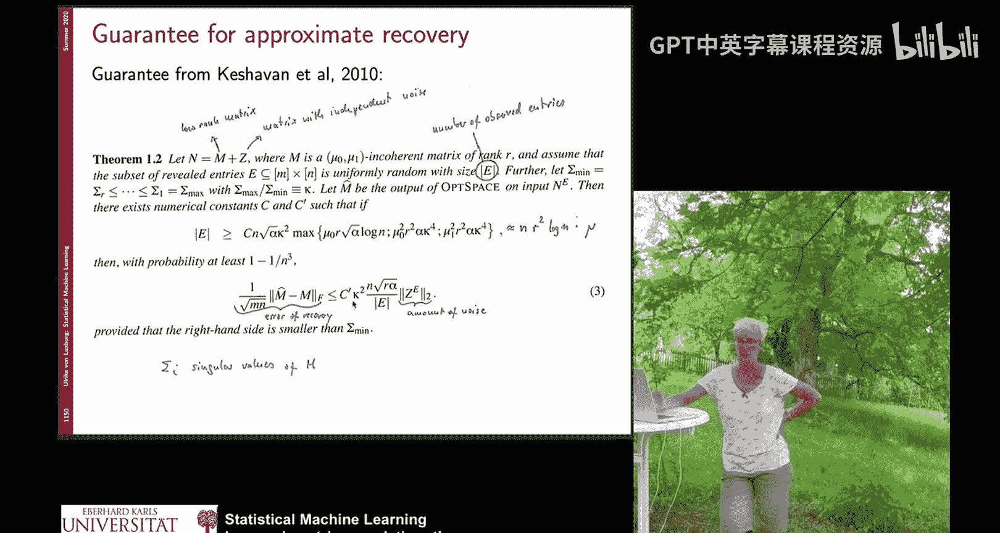
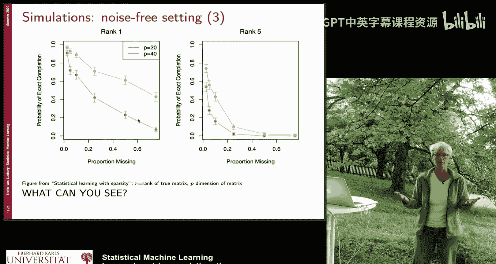
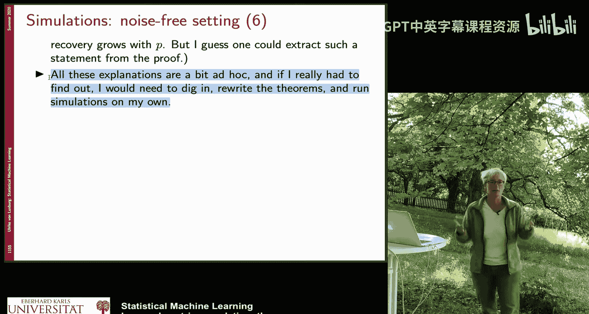
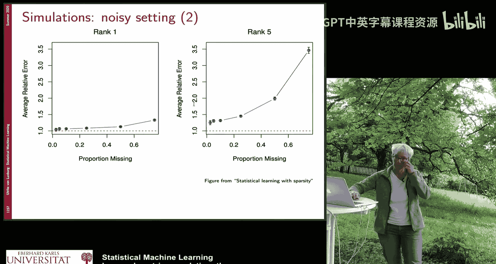

# 52：低秩矩阵补全理论

在本节课中，我们将探讨低秩矩阵补全算法的理论基础。上一节我们介绍了算法的实践表现，本节中我们来看看其背后的理论保证。

## 理论直觉的建立

首先，我们尝试建立一些关于矩阵补全所需观测条目数量的直觉。

考虑一个任意的矩阵 **Z**。为简化起见，假设它是一个方阵，即 **P × P** 矩阵。假设我们均匀随机地观测到这个矩阵的 **n** 个条目。问题是：为了成功（至少近似地）重建这个矩阵，我们大概需要观测多少个条目？

以下是几个需要考虑的基本限制条件：

*   **空行/空列问题**：如果矩阵的某一行或某一列没有任何被观测到的条目，那么我们将无法对该行或列做出任何预测。这就像一个用户没有提供任何评分，或者一部新电影无人观看。
*   **参数数量问题**：假设矩阵是低秩的，秩为 **r**。一个 **P × P** 的秩 **r** 矩阵，本质上可以由 **r** 个向量（例如奇异向量）描述，每个向量有 **P** 个元素。因此，我们需要估计大约 **r × P** 个参数。

基于以上两点，一个合理的直觉是，我们需要观测的条目数量 **n** 至少要与 **P log P**（确保覆盖所有行列）和 **r × P**（估计参数）同阶。

## 相干性条件

然而，仅凭秩和大小不足以完全描述问题的难度。考虑以下极端矩阵：
```
[[1, 0, ..., 0],
 [0, 0, ..., 0],
 ...,
 [0, 0, ..., 0]]
```
这个矩阵的秩为1，看似简单。但如果我们随机采样条目时恰好错过了左上角那个关键的“1”，我们就无法恢复原始矩阵。问题在于，这个矩阵的信息高度集中在少数条目上。

这种现象由“相干性”这一概念来刻画。它衡量了矩阵的奇异向量（或特征向量）与标准基向量的对齐程度。

### 相干性的定义

设 **U** 是 **R^d** 空间的一个子空间，**P_U** 是到该子空间上的投影算子。子空间 **U** 相对于标准基 **{e_i}** 的相干性 **μ(U)** 定义为：
```
μ(U) = (d / dim(U)) * max_i ||P_U(e_i)||^2
```
其中，**dim(U)** 是子空间 **U** 的维度。

**直观理解**：我们计算每个标准基向量投影到子空间 **U** 上的长度，并取最大值。这个值越大，说明子空间越与某个坐标轴对齐，相干性越高，矩阵补全越困难。

### 相干性的例子

*   **高相干性（难）**：上面例子中的单元素矩阵，其相干性为1（最大值）。
*   **低相干性（易）**：所有元素都为1的矩阵，其奇异向量是均匀的，相干性为 **1/P**（最小值）。
*   **随机低秩矩阵**：通过 **Z = U V^T**（其中 **U, V** 是 **P × r** 的随机矩阵）生成的矩阵，通常具有较低的相干性，特别是当秩 **r** 较小时。

**核心结论**：相干性低意味着矩阵的所有条目重要性相当，随机采样效果较好；相干性高意味着信息集中在少数条目，随机采样容易错过关键信息。

## 理论恢复保证

基于相干性等概念，可以推导出严格的矩阵补全理论保证。这些定理通常具有以下形式：



### 精确恢复定理

假设一个 **n1 × n2** 的矩阵 **M** 的秩为 **r**，其行空间和列空间的相干性以常数 **μ0** 为界，且矩阵最大元素值以 **μ1** 为界。若我们均匀随机观测到 **m** 个条目，且 **m** 满足：
```
m ≥ C * (μ0, μ1) * r * max(n1, n2) * log^2(max(n1, n2))
```
那么，通过求解核范数最小化问题（例如软填充算法），能以至少 **1 - n^{-3}** 的高概率唯一且精确地恢复出原始矩阵 **M**。

### 近似恢复定理

在存在噪声（观测值为 **M + 噪声**）的情况下，也有类似的近似恢复定理。若观测条目数 **m** 满足类似条件：
```
m ≥ C * r * (n1 + n2) * log(n1 + n2)
```
则恢复矩阵 **M_hat** 与真实矩阵 **M** 的Frobenius范数误差有上界，且该误差随观测条目数增加而减小。

**定理的启示**：
1.  所需观测条目数 **m** 的量级约为 **r × P × log P**，这与我们最初的直觉一致。
2.  常数 **C** 依赖于相干性 **μ**。相干性越低，常数越小，所需样本越少。
3.  在最优情况下（低相干性、低秩），我们仅需远少于矩阵总元素数 **P^2** 的观测值即可恢复。
4.  在最坏情况下（高相干性），可能需要观测几乎全部元素（量级为 **P^2**），此时矩阵补全失效。

## 数值模拟验证

理论需要实践的检验。我们通过模拟来验证上述理论行为。

### 实验设置



1.  **生成真实矩阵**：创建秩为 **r** 的 **P × P** 随机矩阵 **Z**。常用方法是生成两个 **P × r** 的随机高斯矩阵 **U** 和 **V**，然后令 **Z = U V^T**。
2.  **采样观测值**：从 **Z** 中均匀随机选取一定比例（如20%， 60%）的条目作为观测值。
3.  **矩阵补全**：使用算法（如软填充）从观测值中恢复矩阵 **Z_hat**。
4.  **评估**：
    *   **无噪声精确恢复**：重复实验多次，计算能**精确恢复**（**Z_hat == Z**）的比例。
    *   **有噪声近似恢复**：向 **Z** 添加高斯噪声得到 **Z_noisy**，从 **Z_noisy** 的部分观测中恢复，计算相对误差：`平均误差(||Z_hat - Z_noisy||_F) / 噪声标准差`。

### 模拟结果分析

以下是模拟结果的关键发现：

*   **无噪声精确恢复**：
    *   成功率随缺失比例增加而下降。
    *   成功率随矩阵真实秩 **r** 增加而显著下降（问题变难）。
    *   一个反直觉的现象：对于固定的秩 **r**，矩阵维度 **P** 越大，成功率反而越高。可能的解释是：需要估计的参数为 **rP**，而总信息源（矩阵元素）为 **P^2**，其比值 **r/P** 随着 **P** 增大而减小，意味着每个参数分摊到的信息更多。



*   **有噪声近似恢复**：
    *   恢复误差随缺失比例增加而增加。
    *   恢复误差随矩阵真实秩 **r** 增加而增加。
    *   误差曲线在“最优可能误差”（相对误差≈1）附近变化，当问题变难（高缺失、高秩）时，误差会显著偏离该基准。

## 文献与历史背景

低秩矩阵补全是一个相对年轻的领域：
*   **奠基工作**：Fazel 等人的博士论文将核范数作为秩的凸松弛，是关键的第一步。
*   **理论突破**：Candès, Recht, Tao 等人在2009年前后的一系列 seminal 论文，给出了基于相干性等概念的严格恢复保证。
*   **应用背景**：著名的 Netflix 推荐系统竞赛（2006-2009年）极大地推动了该领域的发展。
*   **总结性著作**：《Statistical Learning with Sparsity》（2015年）等书籍对其进行了系统总结。

## 总结



本节课中我们一起学习了低秩矩阵补全的理论基础。我们首先建立了关于所需观测数量的直觉，然后引入了关键的**相干性**概念来刻画问题的难易程度。基于此，我们介绍了**精确恢复**和**近似恢复**的理论保证定理，其核心结论是：在低相干性和低秩的有利条件下，仅需 **O(rP log P)** 量级的随机观测即可恢复矩阵。最后，我们通过数值模拟验证了理论预测的趋势，并讨论了该领域的历史发展脉络。这些理论不仅优美，也为实际应用提供了坚实的指导。