# 53：压缩感知 📡

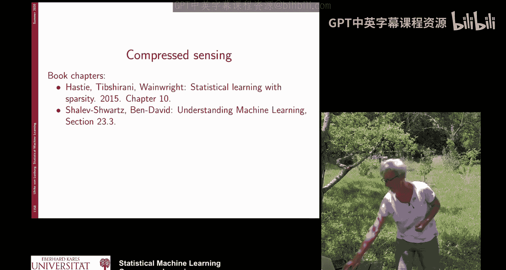

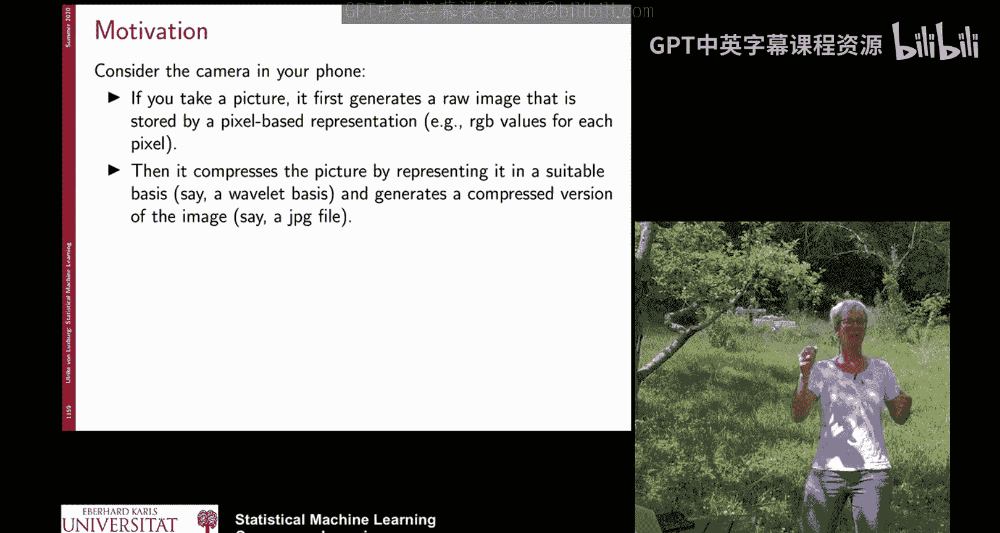

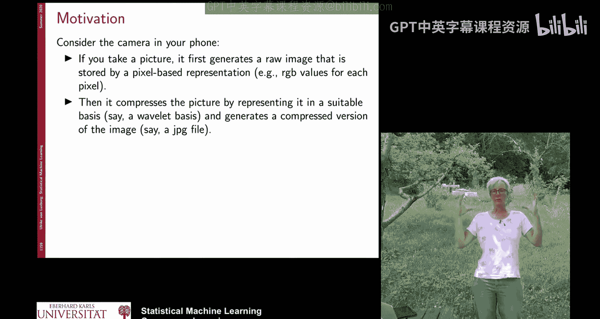

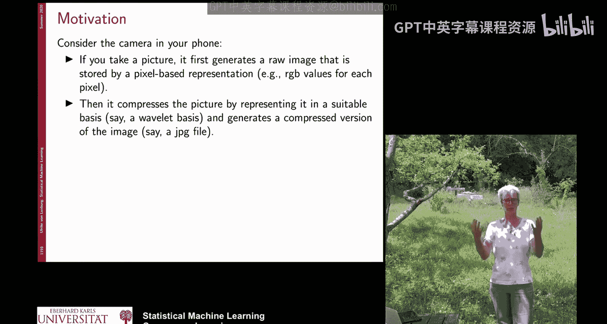

在本节课中，我们将要学习一个非常有趣且实用的概念——压缩感知。我们将探讨它如何让我们用远少于传统方法的数据量来记录和重建信号，例如图像或音频。

## 概述

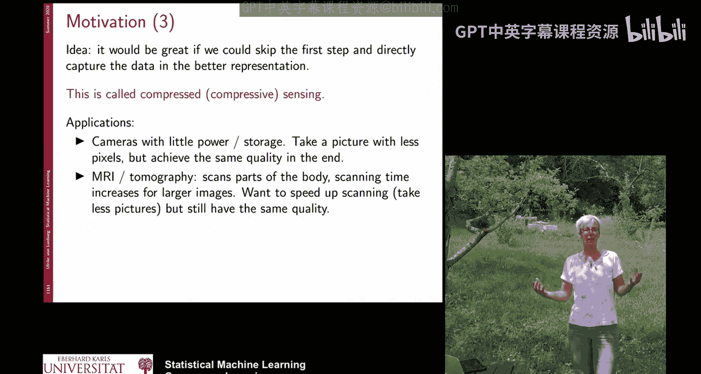

传统的信号采集方式（如手机拍照）会先记录一个高分辨率的原始信号，然后再进行压缩。压缩感知的目标是绕过这个“先记录后压缩”的步骤，直接在采集时就获得信号的压缩版本。这在存储空间有限或采集过程昂贵（如医学核磁共振成像）的场景下具有巨大价值。

## 什么是压缩感知？

现在，考虑你手机中的相机。这类相机通常的工作方式是拥有许多不同的光传感器，每个传感器在图像的特定位置记录某种颜色的光强度。相机会首先以原始格式存储图像，该格式为每个像素值记录该像素中不同光线的数量。

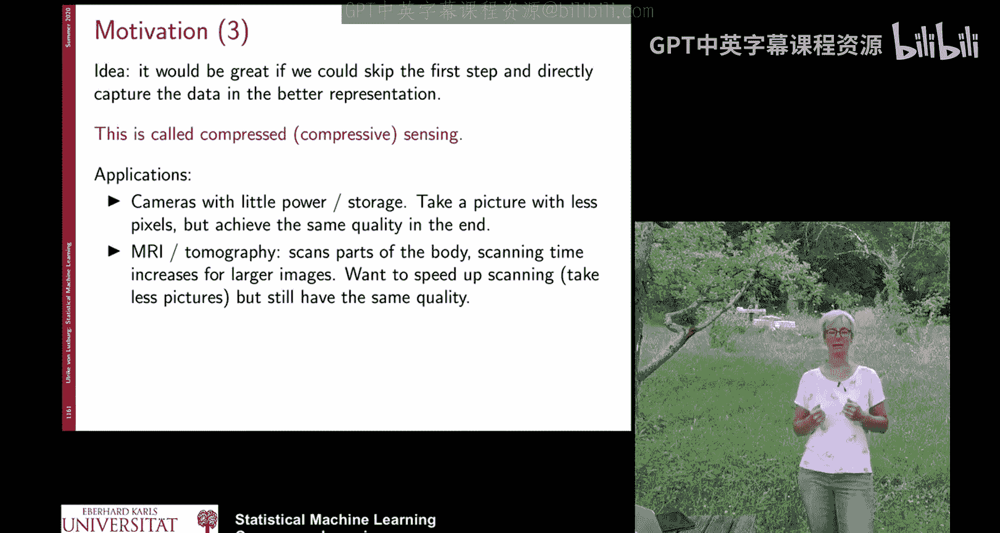

然后，通常作为第二步，你会压缩这些图像，例如将其转换为JPEG文件。你从一个可能是10兆字节的文件开始，最终得到一个500千字节的文件，但观察这两个图像，你几乎看不出它们之间的明显差异。

这里我们有一个例子。在左侧，我们看到一个原始图像。然后我们进行小波压缩（一种特定的图像压缩方式）。在右侧，你看到的是压缩后的同一图像。观察它，你至少从视觉上看不出左右两侧图像之间的巨大差异，然而存储这些图像所需的大小却截然不同。

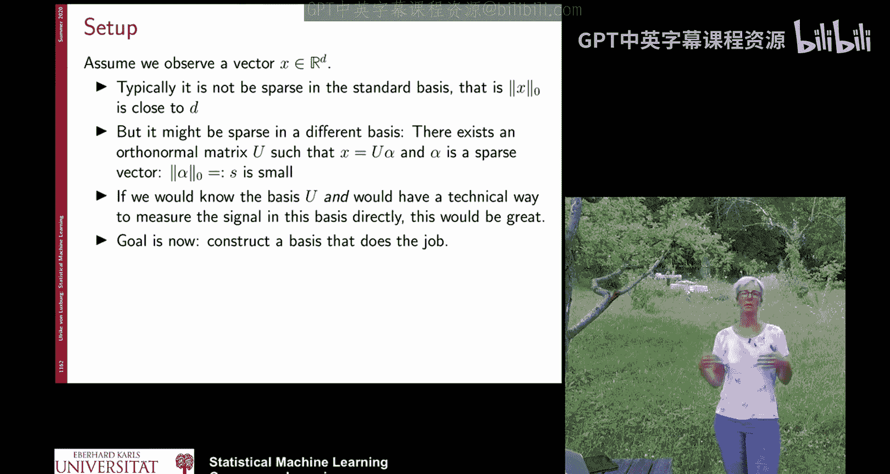

现在的想法是，有时你的记录设备本身没有太多内存。假设在手机的早期，我们没有120GB的存储空间，手机上的存储空间非常小，但你仍然想记录一张图像。当你记录图像时，它很大，但压缩后会更小。因此，真正理想的是我们可以省略“先获取这个大图像，然后再压缩它”的步骤，直接在记录图像时生成这个压缩版本。

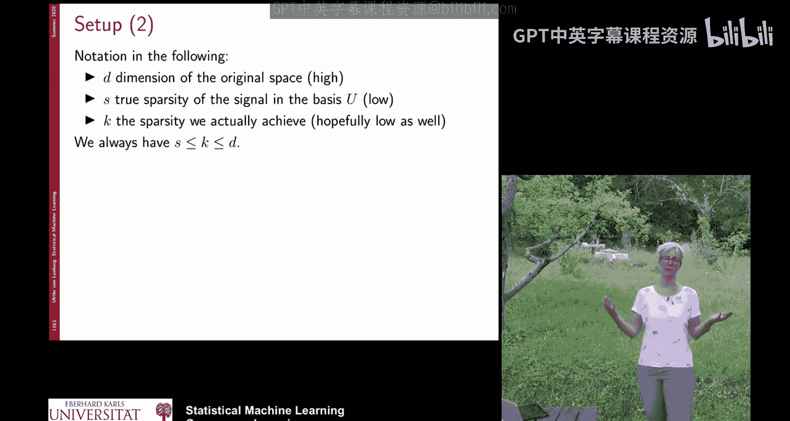

实现这一点的领域被称为**压缩感知**。“感知”意味着我们采集信号，无论是图像信号还是某种音频信号，或其他类型的应用。你想采集一个信号，但希望以一种直接获得压缩版本的方式进行，而不是先获取完整细节。

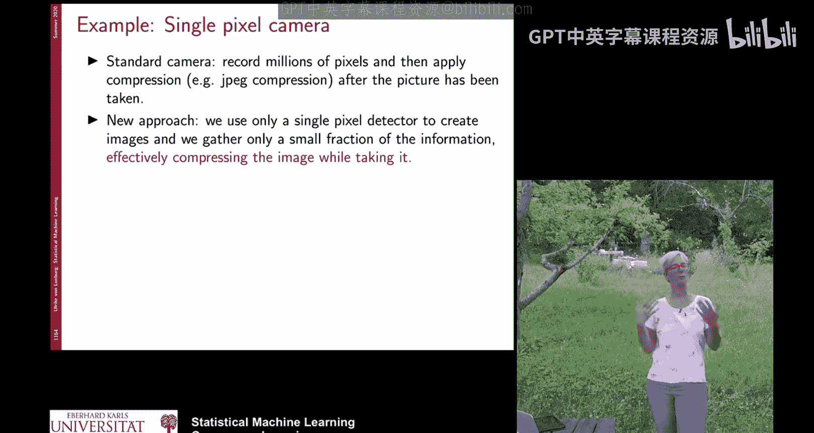

这有很多应用，比如我刚才提到的：你可以有一个存储空间或电量很小的相机，你仍然想存储图像，你无法负担存储一个1000万像素的图像，但你最终仍想获得一张好图像。另一个应用来自医学领域，例如核磁共振成像。其工作方式是将人放入扫描仪，然后核磁共振扫描身体的特定部位。但扫描需要很长时间，因为你需要为不同的切片进行多次扫描，因此扫描一个人可能轻松花费15到20分钟。同样，你最终会得到一个非常庞大的数据文件。如果你能加速这个过程，说“我不需要感知图像的某些方面”，那将非常棒。也许这比以“笨拙”的方式扫描所有内容更快，而是尝试实现一种巧妙的扫描，最终直接得到一个压缩的图像。

## 压缩感知的设定

现在，其设定如下。通常，我们假设我们想要观察一个在 **R^D** 空间中的向量。通常，这个向量也不是稀疏的，比如一张图像。如果我们基于像素编码图像，那么图像本身并不稀疏。它会告诉我们每个特定像素的光强度。

然而，其基本假设是，可能存在一个不同的**基**，在这个基下，我们可以用稀疏的方式表示我们的图像。例如，这可以是一个小波基。因此，如果我们用小波基编码图像，也许我们只需要大约200个小波系数，就可以编码一个原本需要1000万像素的图像。当然，这是一种有损压缩，但可能在视觉上看不出任何损失。

现在的技巧是，当然，如果我们知道数据在其中是稀疏的那个基，我们就知道这个变换，那么技术上我们就可以完成从非稀疏信号到稀疏信号的转换。但通常，如何做到这一点并不明确。特别是，我们希望避免获取这个完整信号的步骤。现在的技巧是，我们想要发明一个基，使得所有稀疏的图像都能以一种有用的方式被压缩。

我们将使用以下符号，并尽量在所有幻灯片中保持一致：
*   **D** 始终是原始空间的维度。
*   **S** 是信号的**稀疏度**。即，在这个有趣的基中，如果你用这个基表示图像，有多少个条目是非零的。
*   **K** 是我们实际希望实现的**测量次数**，希望它也很低。

显然，仅从定义来看，我们总是有 **S ≤ K ≤ D**。

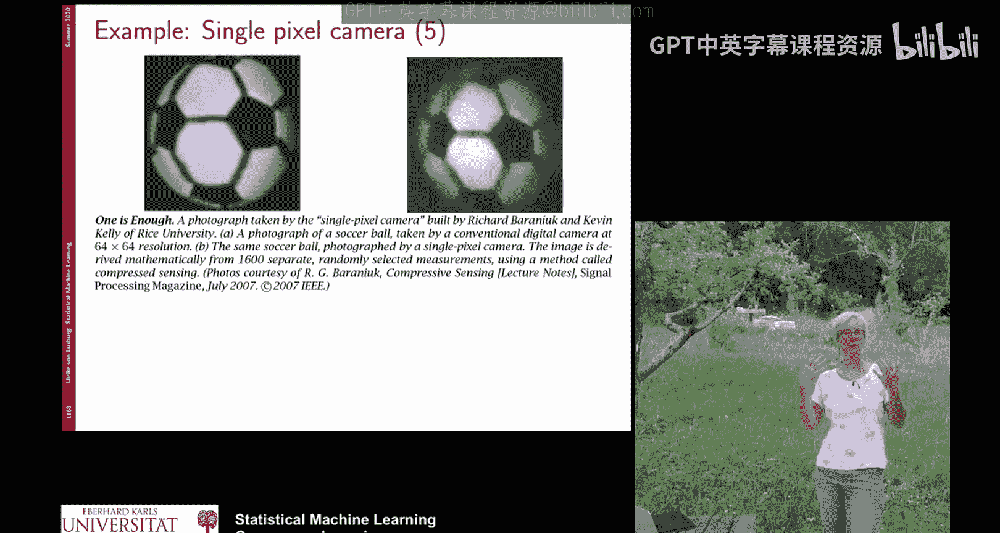

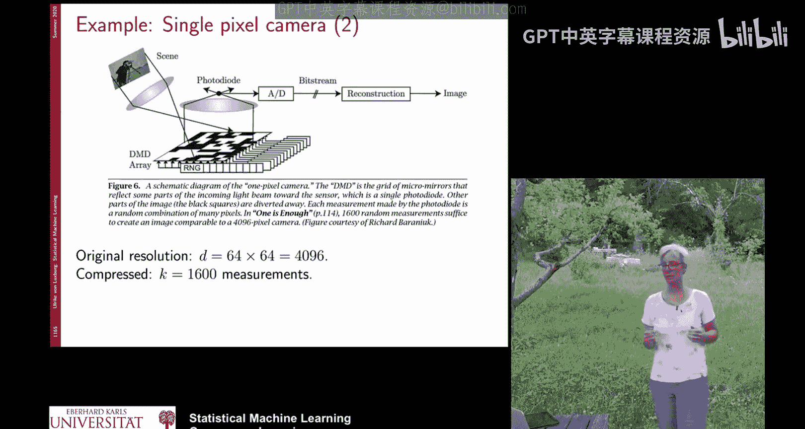

## 单像素相机示例 🎥

在深入理论之前，我想用一个非常酷的例子来说明这在实践中是如何工作的，即**单像素相机**。与记录数百万像素的标准相机不同，然后应用像JPEG这样的压缩算法。现在我们要做的是构建一个每次只能记录一个特定像素的相机。

在每一个时间点，我们只有一个可以记录光量的传感器，但我们想用这种相机感知整个场景。我们不想以将相机移动到场景中所有不同位置并“愚蠢地”记录数百万像素的方式来做，而是希望有一种更高效的方式。

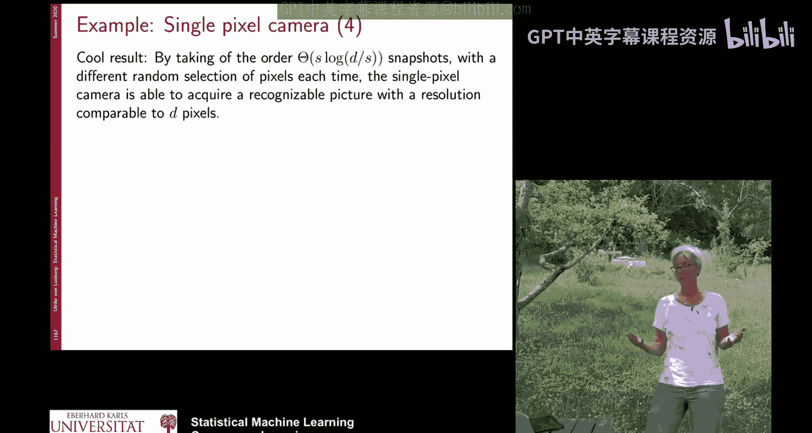

下图展示了它的工作原理。想象一下，在图像的顶部，有一个光电二极管，这是你可以记录的那个像素。在插图的左侧，你看到一个场景，这是我们想要拍照记录的场景。

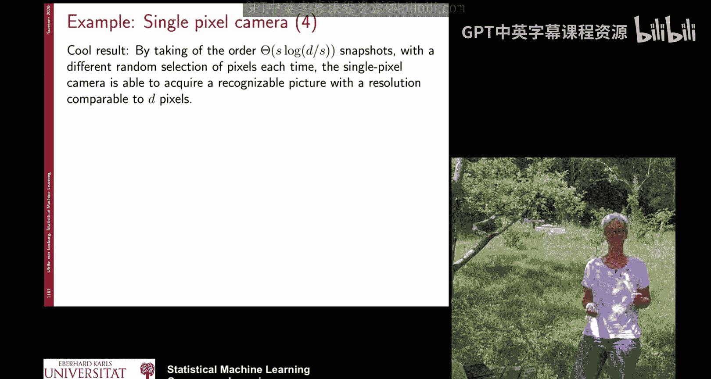

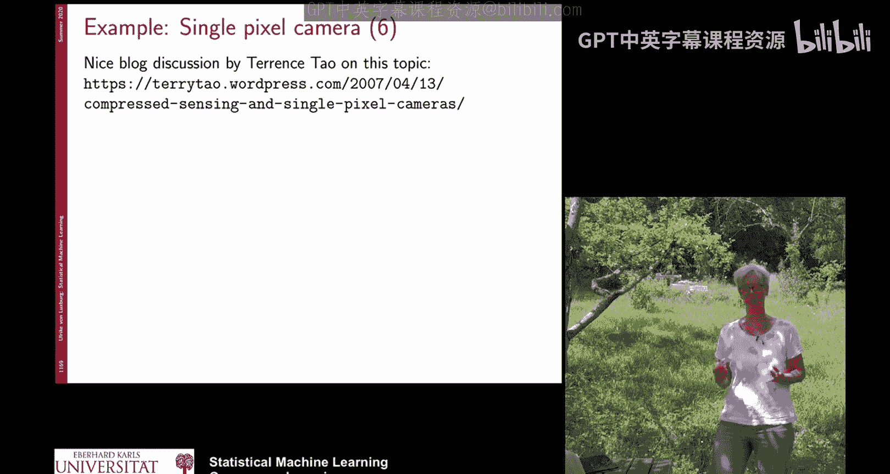

关键部分是这里的阵列。这个阵列是一个由许多微小镜子组成的微型设备。这些镜子可以以某种方式打开或关闭，使得镜子将场景中对应于镜子特定部分的光反射到光电二极管，或者不反射。本质上，在图像中，例如，黑色方块表示镜子是打开的，因此它会将来自场景的任何光反射到光电二极管；而白色部分则不会向光电二极管反射任何光。

现在你看到的是，我们有一个随机的镜子位置组合，其中一些镜子位置被打开，一些被关闭。因此，光电二极管记录到的本质上是来自这些黑色镜子的所有信号的总和。你可以将其视为：你有一个场景，你随机打开和关闭一些像素，然后对已打开的像素的强度求和。这就是你记录的内容。

好的，这是第一次。你首先这样做一次，你有一个固定的镜子布局，对你的场景拍照，你得到一个数值，对应于描述这个图像的一个数字，即这些随机选择的像素的总和。

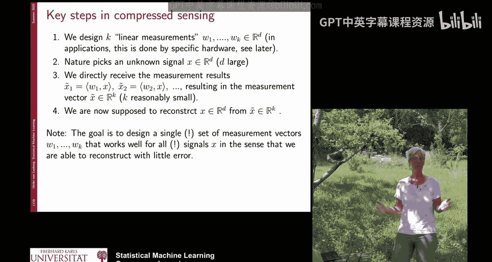

现在，技巧当然是，我们再次这样做。现在我们取一个不同的黑白组合。现在我们选择这些镜子被打开和关闭的不同随机位置。再次，光电二极管记录针对这种特定镜子布局我们获得的总强度。

现在我们重复这个过程多次。现在的问题是，假设我们这样做100次，所以我们有100张“图像”，每张图像对应一个数字。现在的问题是，基于我们记录的这100个数字，我们能否重建原始图像？答案将是肯定的。

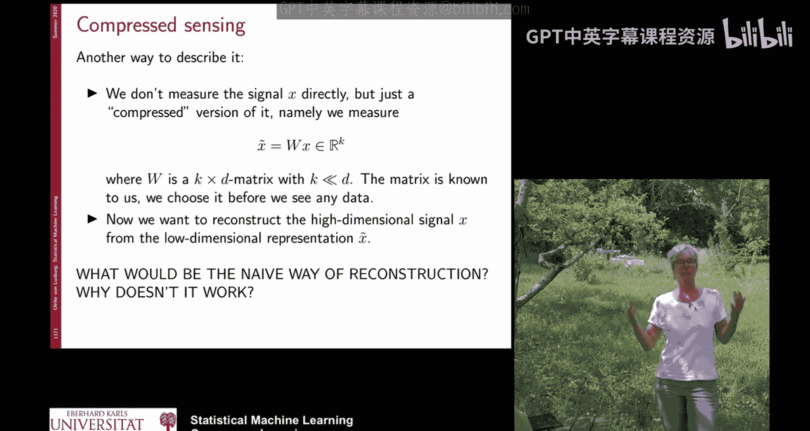

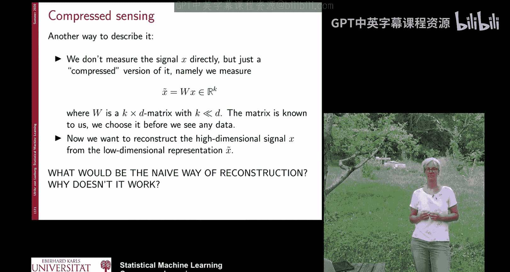

为了给你一些数字，这里图像的分辨率是64x64，由4096个像素组成。在这个我们将要看到的特定例子中，我们选择 **K = 1600**，所以我们进行1600次测量。我们用这些镜子的随机布局重复这个测量过程1600次，然后我们将重建图像。你可以看到，从我们实际进行的1600次测量到原始图像格式，我们节省了大约一半的存储空间。对于这个玩具例子来说，这并不十分令人印象深刻，但我仍然觉得它非常令人印象深刻，因为它是这样的：

在左侧，你有一个64x64像素空间中的原始足球灰度图像。在右侧，你现在可以看到由这个单像素相机拍摄的1600次测量重建的图像。我觉得这非常酷，因为它为许多应用打开了大门，并且它确实有效这一事实也令人着迷和惊讶。

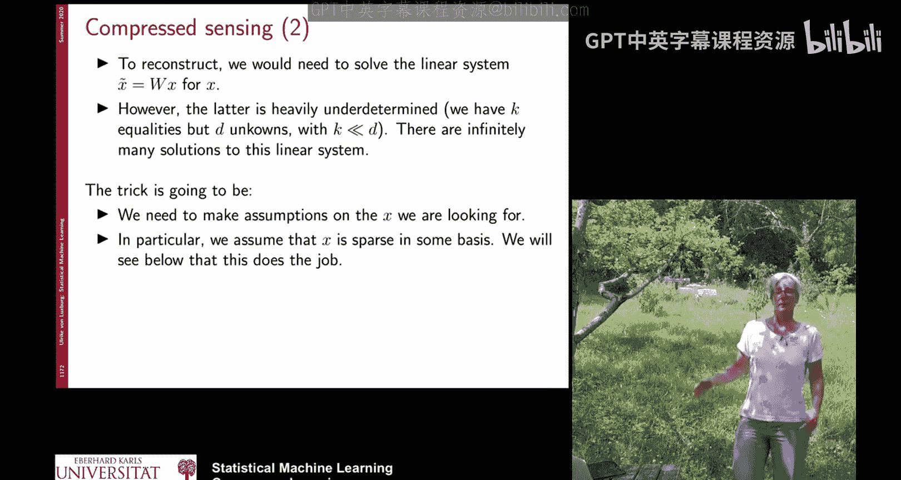

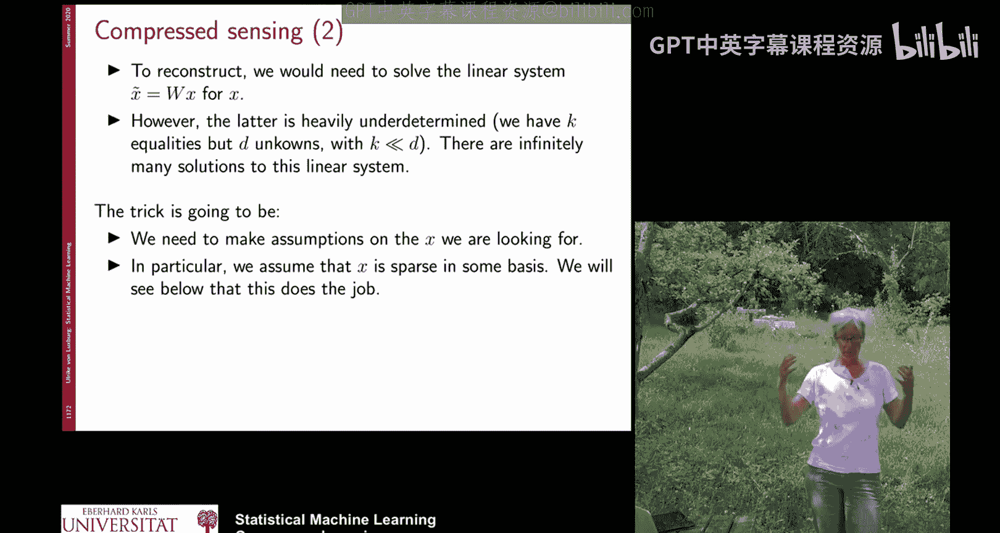

## 工作原理的文字描述

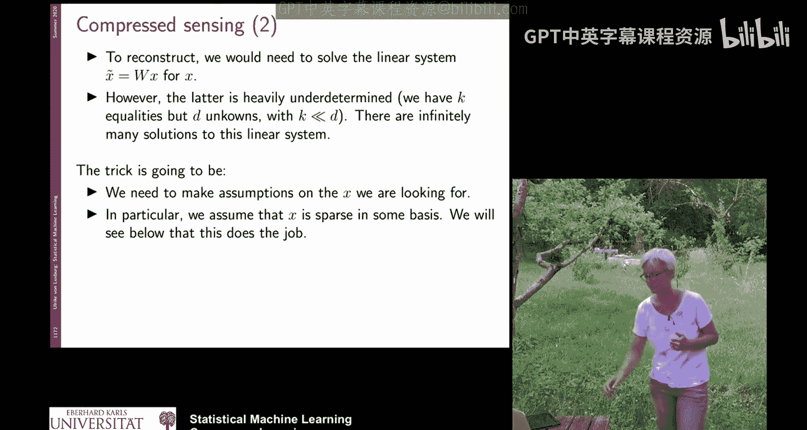

让我们回到文字描述来理解其工作原理。其工作方式是，你有一个细菌大小的微小镜子阵列，用于获取入射光的随机样本。每个镜子可以以两种方式之一倾斜：要么将光反射到光电二极管，要么远离它。因此，光电二极管接收到的光是所有打开的镜子的图像的线性组合，只是一个数字。传感器接收到的光是许多像素的加权平均，即所有被打开的像素。

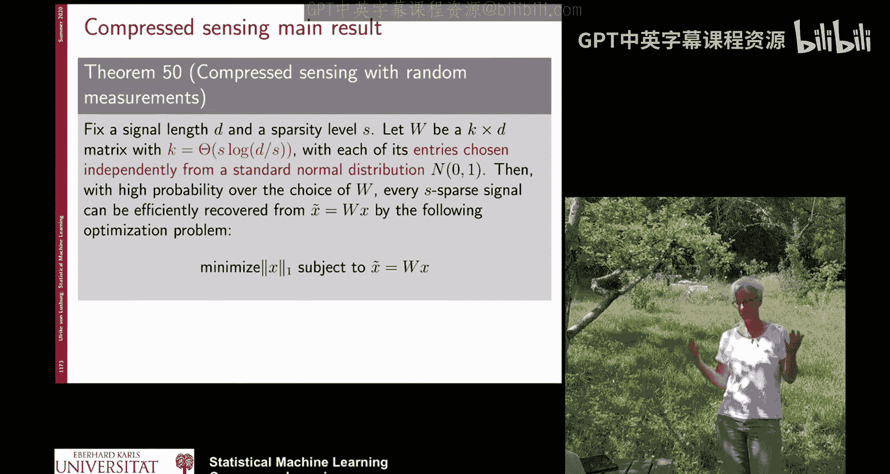

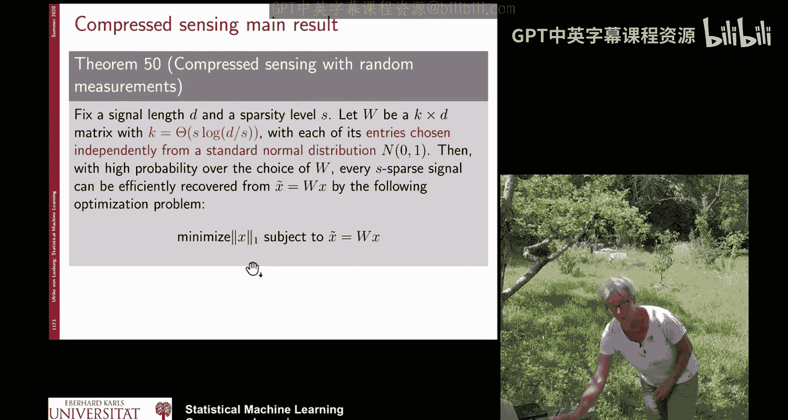

一个镜子配置 **w_i** 产生我们信号的一个线性测量（线性是因为它是像素的线性组合）。现在我们重复这个过程 **K** 次，因此我们得到 **K** 个不同的测量值 **w_1** 到 **w_K**。下一步是我们希望能够重建原始图像。

现在，我们将在本讲座过程中推导的理论结果是：通过采集大约 **S log(D/S)** 次快照（每次快照我们取一个不同的随机镜子选择），单像素相机能够获取一张可识别的图片，其分辨率可与 **D** 像素相媲美。

这里有趣的是，**K** 大约是 **S log(D/S)**。**S** 是我们需要假设可以实现的稀疏度。**log(D/S)** 可能并不大。所以本质上，它几乎是线性的，只比 **S** 大一点点。**S** 是你能实现的最佳稀疏度，这是我们需要代入算法的假设。假设是：我们可以在一个稀疏度为 **S** 的基中表示它。那么，我们只需采集比 **S** 多一点的快照，就可以恢复它。这真的很酷。

## 概念性视角

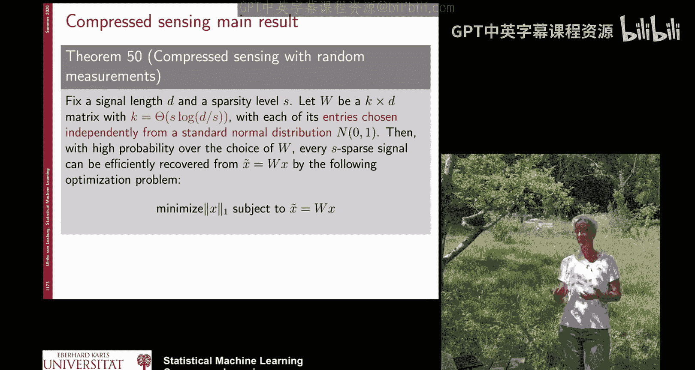

现在让我们从更概念性的角度来看待这个问题。我们将设计 **K** 个不同的线性测量，称为 **w_1** 到 **w_K**。在这个例子中，这是通过特定的硬件完成的，但这就是感知方法。重要的是，我们在看到信号**之前**就构造了这些测量。我们可能先绘制所有镜子的随机布局，但这不是说我们先以某种高分辨率看到图像，然后由巨型计算机告诉我们放置镜子的最佳方式；我们放置镜子一次，然后才看到信号。这很重要。我们想要的是，我们选择 **K** 种不同的布局，但只要满足某些假设，它就应该对所有传入的信号都有效。

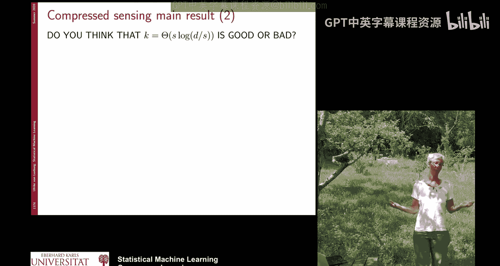

因此，我们首先设计线性测量，然后“自然”在 **R^D** 高维空间中选择一个未知信号 **x**（其中 **D** 很大）。现在我们直接接收测量结果，在幻灯片上称为 **x̃_1** 到 **x̃_K**，这只是原始信号与感知设备的线性组合。这导致 **K** 个测量值，形成一个 **K** 维向量空间中的向量。然后我们应该从我们采集的测量值 **x̃** 中重建原始图像 **x**。正如我在幻灯片末尾所说，目标是设计一组单一的测量向量，使其对所有信号都工作良好，这样无论传入的信号是什么，我们都能很好地重建信号。

## 矩阵表述与核心问题

这是另一种描述方式，现在用矩阵表述。同样，我们有信号 **x**。我们无法直接测量 **x**，但我们可以测量它的压缩版本，这现在被编码到一个矩阵 **W** 中。本质上，我们将所有这些向量 **w_1** 到 **w_K** 堆叠起来，将它们放入一个称为大写 **W** 的矩阵中。因此，我们得到的是一个测量值 **x̃**，它是 **W** 乘以 **x**，现在存在于一个低维空间 **R^K** 中，并且 **K** 远小于 **D**。这个矩阵 **W** 是在我们看到数据之前选择的，所以我们选择矩阵 **W** 一次，然后持续用它来记录数据，然后我们想从这个低维表示中重建高维信号。

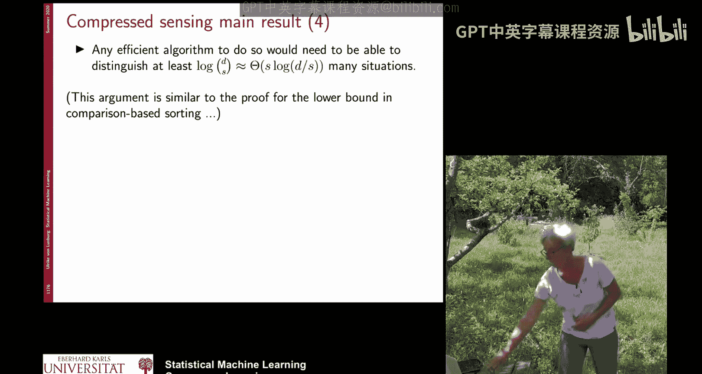

现在这里有一个问题给你。现在我们有了这个方程：**x̃ = Wx**。我们想重建 **x**。那么你认为解决这个问题的自然方法是什么？也许花几分钟思考一下。你会如何解决它？然后可能有什么问题？

也许你已经找到了解决方案。解决这个问题的朴素方法是说：我们有一个线性方程组 **x̃ = Wx**，我们直接解它。我们知道 **x̃**，我们知道 **W**，所以我们解出 **x**。然而，我们将遇到的问题是这个线性系统是完全**欠定**的。我们有 **K** 个方程（即我们进行的测量），但我们有 **D** 个未知数（所有原始变量）。**K** 远小于 **D**。那么这个系统就有很多很多解，无限多个解。我们不知道应该选择哪一个。除非我们做出任何假设，否则我们无法摆脱这个困境。我们有一个线性方程组，它是欠定的，有无穷多个解。如果我们没有任何归纳偏置，不知道选择这些解中的哪一个，那么它将无法工作。

## 归纳偏置：稀疏性假设

现在，有趣且酷的见解是，我们可以选择什么样的归纳偏置来使这件事成功。我们将要做的归纳偏置是：我们正在寻找的信号是**稀疏**的。我们已经看到了许多在矩阵问题上施加归纳偏置的不同方式，例如说矩阵是低秩的。对于一个向量，施加归纳偏置的一种自然方式是：向量是稀疏的，这个向量的大多数条目应该是零。

## 核心定理

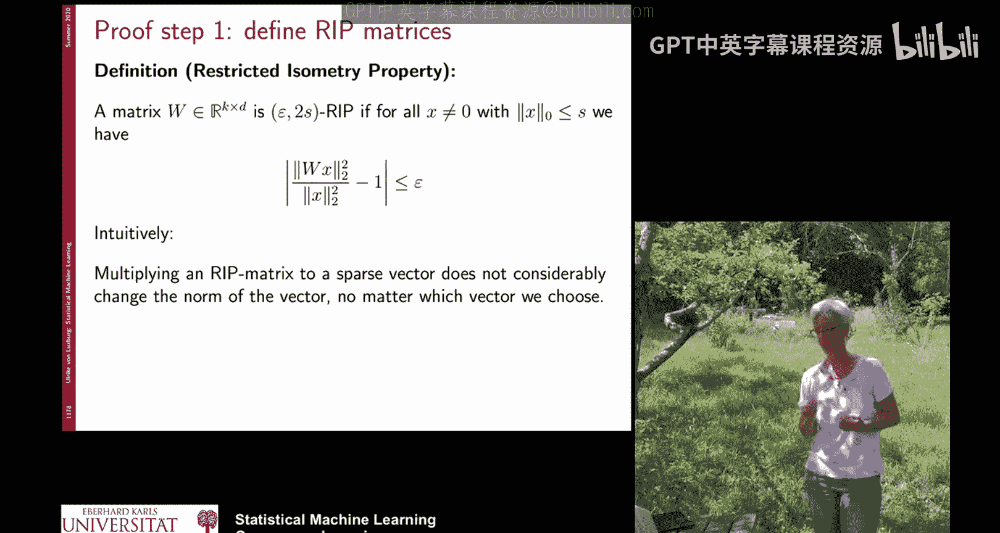

现在，这是我们想要看的第一个定理，我们将在本讲座中推导它。

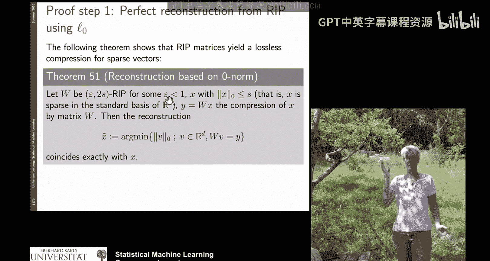

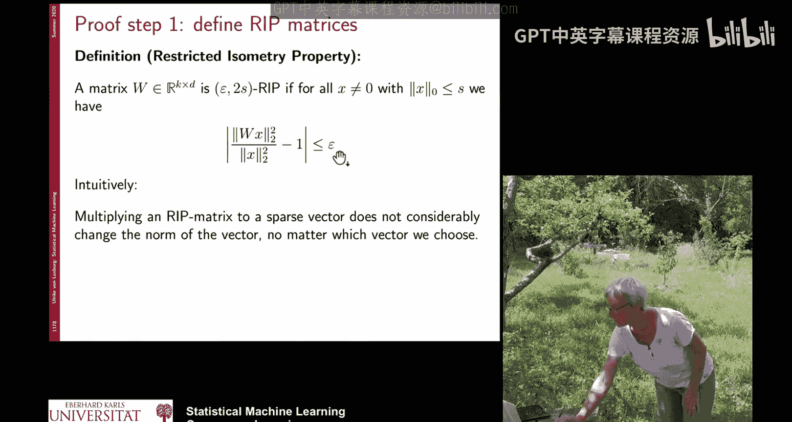

**定理**：固定信号长度 **D**（高维空间的维度）和稀疏度级别 **S**。令 **W** 是一个 **K × D** 矩阵，其中 **K** 选择为我们之前看到的数量级，即 **S log(D/S)**。该矩阵的每个条目都独立地从标准正态分布中选择。那么，在矩阵 **W** 的选择上，以高概率发生以下情况：**每个 S-稀疏的信号都可以从感知方程 x̃ = Wx 中高效地恢复**。我们如何恢复它？我们可以通过求解一个优化问题来恢复它，即最小化 **x** 的 **L1 范数**，并满足线性系统被满足的约束。

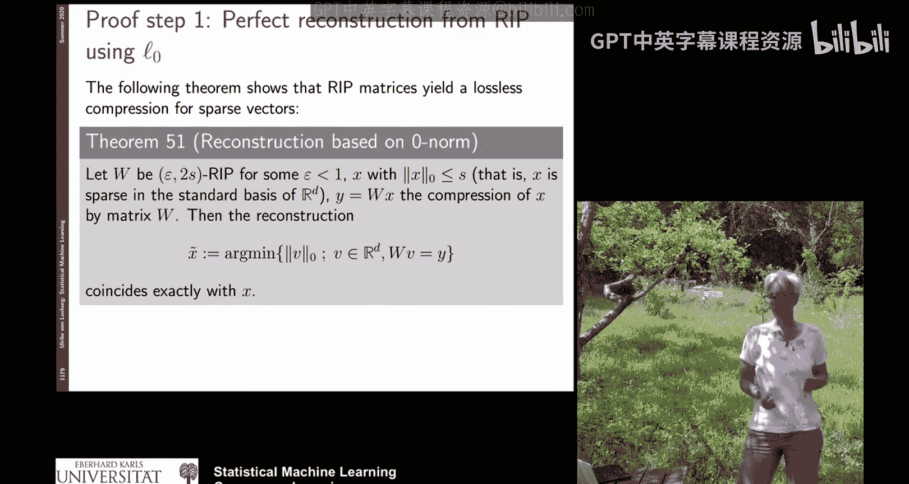

这个定理做出了三个非常有趣的陈述：
1.  **感知矩阵 W**：我们可以将其选择为一个随机矩阵，其中条目独立地从正态分布中抽取。这很好，它应该让你想起我们在之前一节课中看到的东西，即 Johnson-Lindenstrauss 引理。在某种意义上，这个矩阵生成 **K** 个随机投影，而随机投影具有某些良好的数学性质。
2.  **测量次数 K**：我们需要大约 **S log(D/S)** 次感知。这几乎是信号稀疏度 **S** 的线性关系。这很有意义，因为如果你想恢复一个有 **S** 个非零项的向量，你很难想象在不进行至少 **S** 次单独测量的情况下恢复这样的向量。
3.  **重建算法**：一旦我们进行了压缩感知并记录了信号，我们如何重建原始信号？定理说算法是：你只需在满足线性系统的条件下，最小化向量的 **L1 范数**。

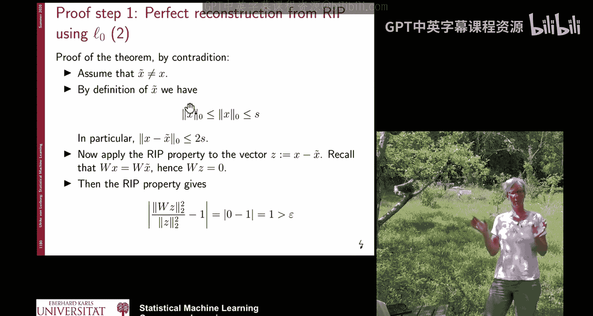

这个定理基本上涵盖了我们想要的一切。现在我想逐步推导这个定理的背景。

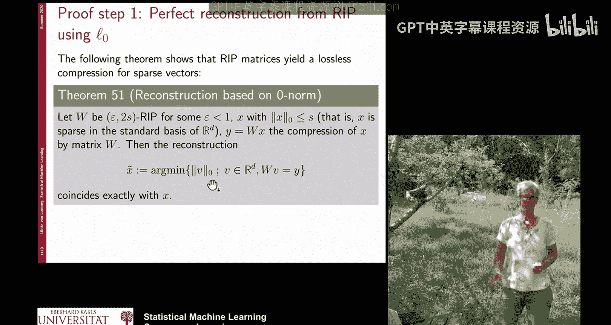

## 为什么是 S log(D/S)？

在深入之前，这里有一个问题：你认为 **S log(D/S)** 好吗？我已经给出了答案，我认为它非常好。让我解释一下原因。

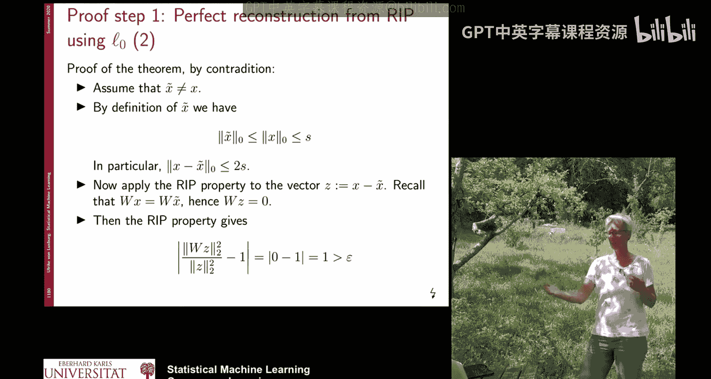

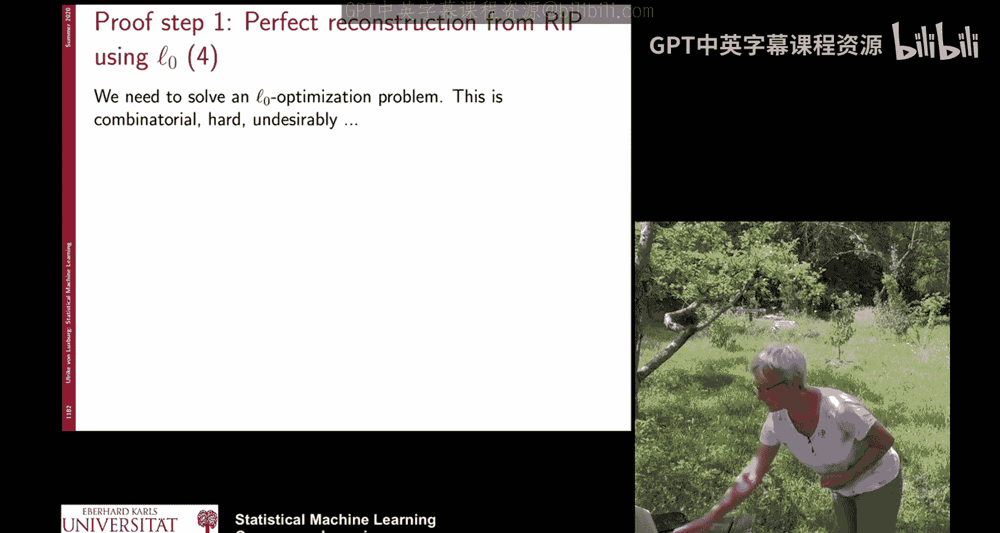

我们正在寻找一个长度为 **D** 的向量，它有 **S** 个非零分量。我们知道非零分量的数量，但我们不知道这些非零分量在哪里。那么，这些分量可能位于多少个不同的子集中？在所有 **D** 个位置中，有 **C(D, S)** 个大小为 **S** 的子集。原则上，要完美解决这个问题，朴素的方法是尝试所有这些 **C(D, S)** 个子集，然后尝试通过让这些子集非零而其他所有都为零来重建。当然，这是朴素的方法。有一个更高效的算法，你可以证明这个算法需要大约 **log C(D, S)** 次尝试。这个参数类似于基于比较的排序的下界论证。最终结果是 **log C(D, S)** 大约是 **S log(D/S)**。这确实是一个有意义的数字。

## 证明的关键步骤

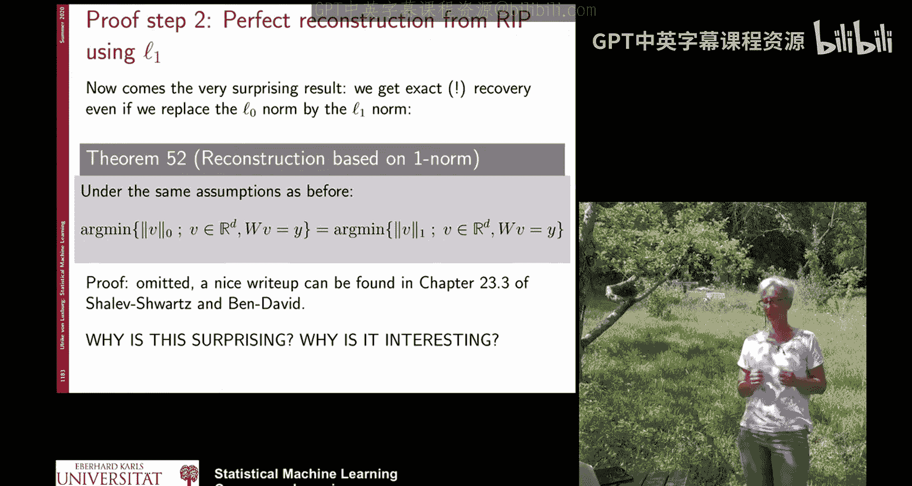

现在，让我们看看证明这个定理的关键步骤是什么。

1.  **第一步**：如果我们选择的矩阵具有某种称为**限制等距性质** 的特性，那么任何 **S-**稀疏向量都可以从其压缩图像中恢复（至少通过一种低效的算法，即最小化 **L0** 范数的算法）。
2.  **第二步**：然后，非常令人惊讶的是，我们可以通过最小化 **L1 范数** 而不是 **L0 范数** 来同样好地做到这一点。**L1 范数** 非常好，这是我们过去已经多次看到的相同论点，例如在 Lasso 中，我们说用 **L1 范数** 约束解决回归问题，而不是用 **L0 范数** 约束。在矩阵补全中，我们说用核范数（迹）代替矩阵的秩。在这种情况下，我们甚至可以证明，从 **L0** 到 **L1**，我们不会丢失任何东西，我们仍然可以找到最优解。这很酷，而且可以证明它是有效的，这令人惊讶。
3.  **第三步**：现在我们说，如果我们有这样一个具有限制等距性质的矩阵 **W**，那么通过最小化 **L1 范数**，我们实际上可以写出一个有效的算法。最后一个隐藏的部分是：我们如何构造这样的矩阵 **W**？答案将是：我们可以简单地使用一个条目从正态分布中抽取的随机矩阵，这将完成这项工作。

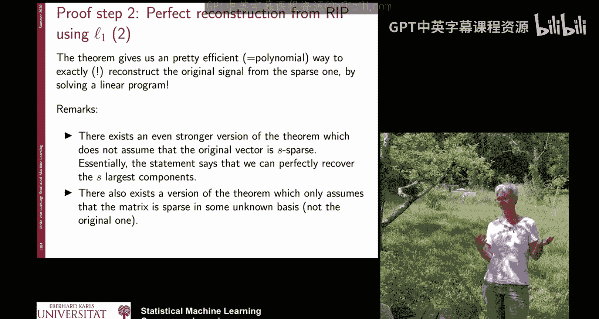

现在让我们深入每个步骤。

### 第一步：限制等距性质

首先，我们想定义这些 RIP 矩阵。

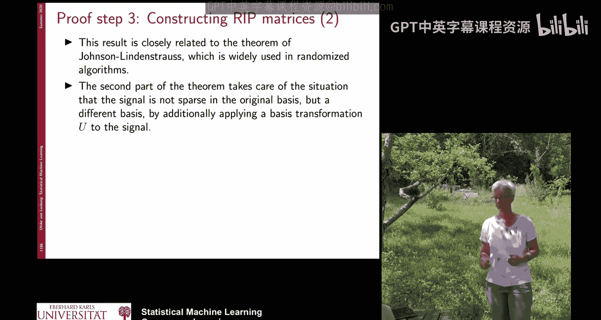

**定义**：一个矩阵 **W** 被称为满足 **ε-2S 限制等距性质**，如果对于所有稀疏度至多为 **S** 的非零向量 **x**，都有：
`(1 - ε) ≤ ||Wx||^2 / ||x||^2 ≤ (1 + ε)`

观察：在理想情况下，你希望 **W** 可能像单位矩阵一样，对你的向量不做任何改变，那么你在这里实现的最佳比率是 1。现在，当我们进行感知时，我们允许从 1 偏离一点，但不超过 **ε**。这需要对所有稀疏度至多为 **S** 的向量都成立。显然，如果我们想将其用于任何向量，这个性质不可能成立。问题是，如果我们限制自己到一个小的向量子集，即稀疏向量，我们能否证明或找到一些满足这个性质的矩阵？直觉是，这有点像 Johnson-Lindenstrauss 引理，当我们对这个向量应用这个矩阵时，这个向量的范数不会改变太多。

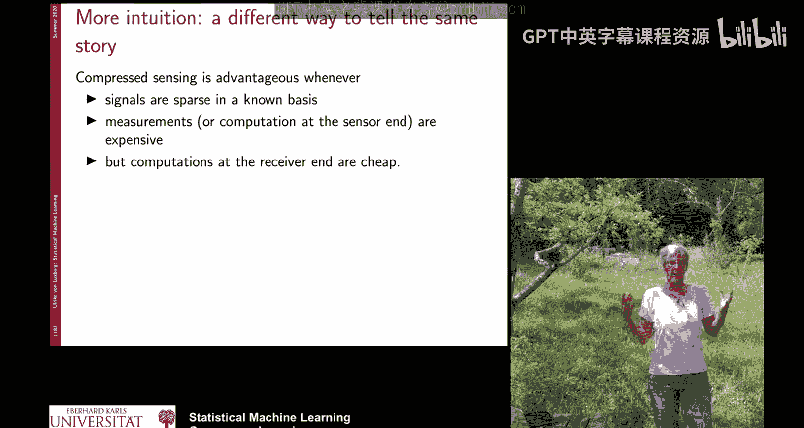

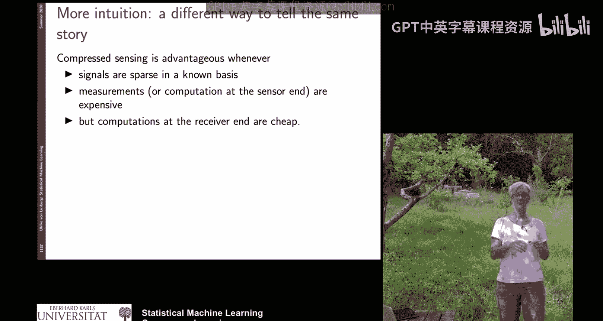

### 第二步：从 L0 到 L1 最小化

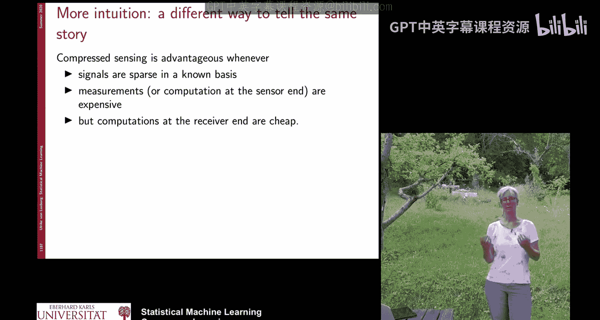

现在我们可以证明的第一个定理是：一旦我们有了这些 RIP 矩阵，那么如果我们能优化 **L0 范数**，我们就可以实现压缩感知。当然，这是一个理论陈述，因为实际上这行不通。但我们还是从一个理论结果开始。

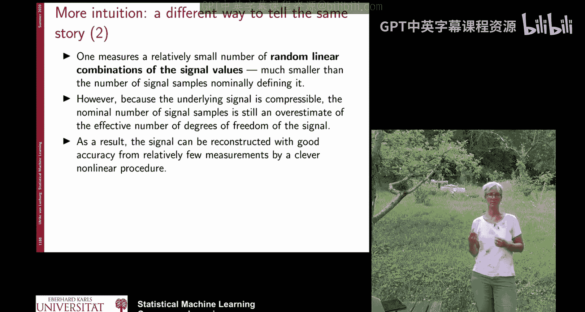

**定理**：假设我们有一个对于某个 **ε < 1** 满足 **ε-2S RIP** 的矩阵。现在我们有一个稀疏度至多为 **S** 的向量 **x**。我们通过取 **Wx** 来压缩这个向量 **x**，最终得到一个向量 **x̃**。现在我们想从 **x̃** 重建向量 **x**。我们通过求解最小化问题来实现：最小化向量的 **L0 范数**，并满足该向量满足线性方程组的约束。那么，从这个算法得到的结果恰好与我们的原始信号 **x** 一致。

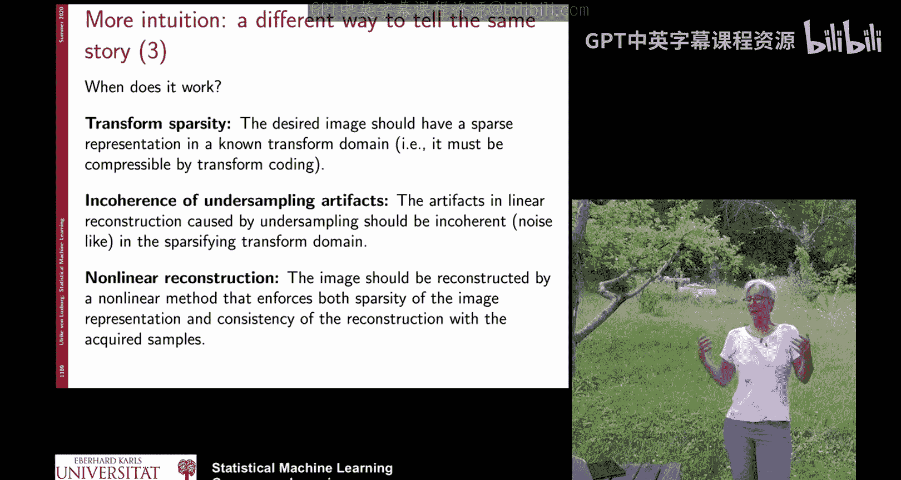

我们可以用反证法证明这个定理。假设重建的向量 **x'** 与原始向量 **x** 不一致。根据 **x'** 的定义，我们知道 **x'** 是在线性系统约束下最小化 **L0 范数** 的向量。当然，原始向量 **x** 满足它。但我们在这个优化问题中找到的向量是那个具有最小 **L0 范数** 的向量。因此，通过这个构造，我们知道这个向量的 **L0 范数** 只能小于或等于真实向量的 **L0 范数**。我们知道真实向量的 **L0 范数** 以 **S** 为界。所以特别地，**x** 和 **x'** 中非零系数的数量之差最多为 **2S**。现在的技巧是，我们将这个 RIP 性质应用于这个差向量 **z = x - x'**。同时观察到 **Wz = 0**，因为两个向量 **x** 和 **x'** 都满足线性系统。现在，通过 RIP 性质，我们得到 `0 = ||Wz||^2`，并且 `(1 - ε) ||z||^2 ≤ ||Wz||^2 ≤ (1 + ε) ||z||^2`。由于 **Wz = 0**，这意味着 `(1 - ε) ||z||^2 ≤ 0`，这要求 `||z||^2 = 0`，因此 **z = 0**，即 **x = x'**。这与假设矛盾。因此，重建是精确的。

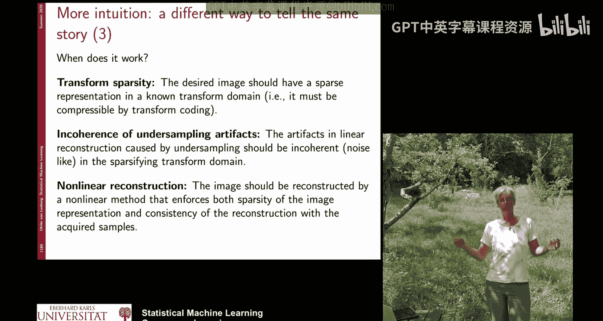

正如我所说，这个定理立即给出了重建向量的第一个算法，但当然，它在实践中不起作用，因为它是一个离散优化问题。下一步将是用 **L1 范数** 代替 **L0 范数**。

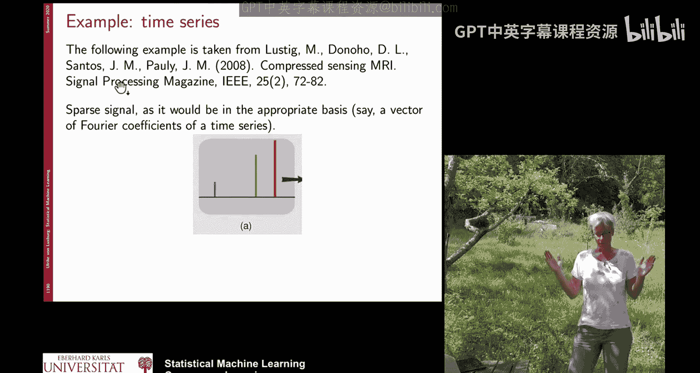

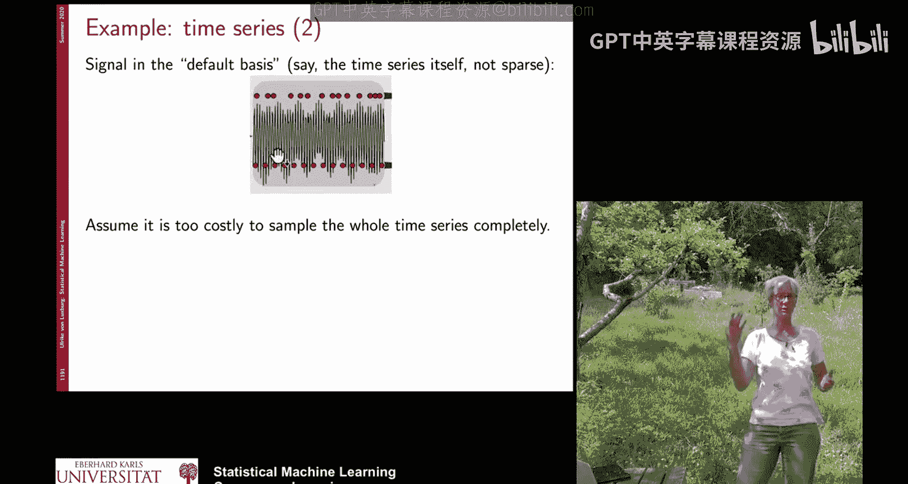

### 第三步：L1 最小化的等价性

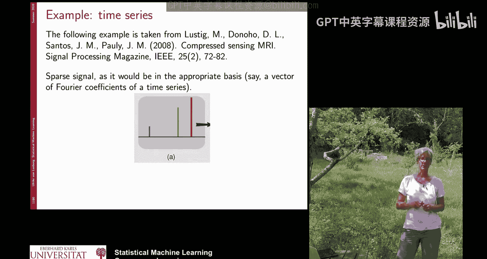

结果，正如我所说，我发现非常令人惊讶和美妙的是，当我们使用 **L1 范数** 而不是 **L0 范数** 时，我们可以得到相同类型的保证。

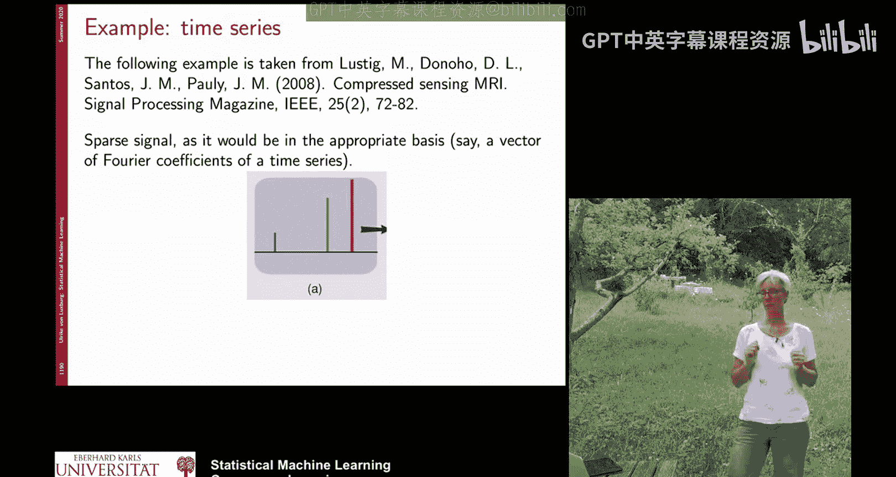

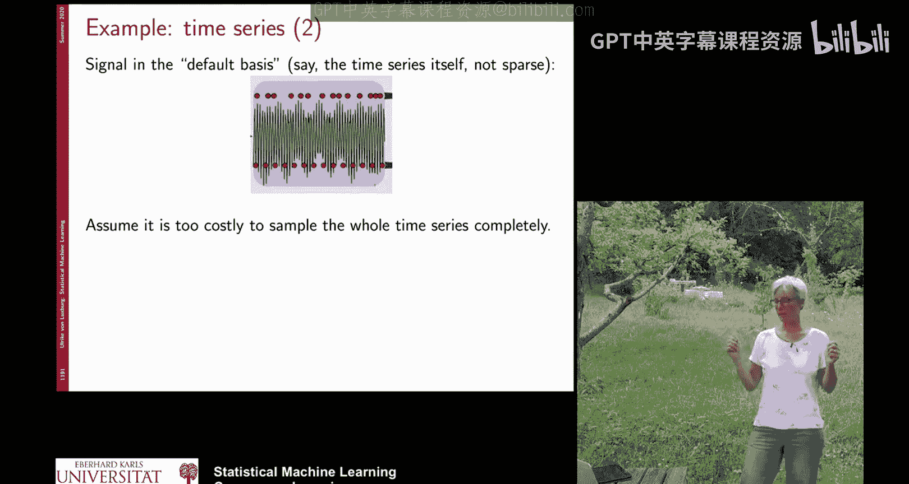

**定理**：在与前一定理相同的假设下，我们现在可以断言，无论我们在这里左侧最小化 **L0 范数** 还是在右侧最小化 **L1 范数**，都没有什么区别，我们将找到优化问题的相同解。这真的很酷。

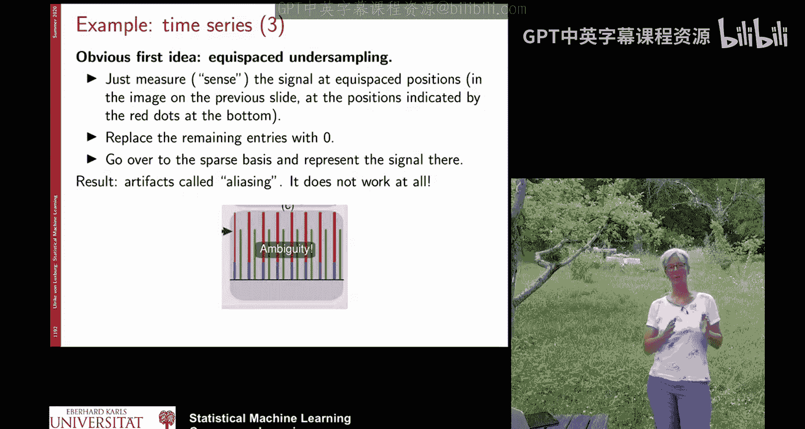

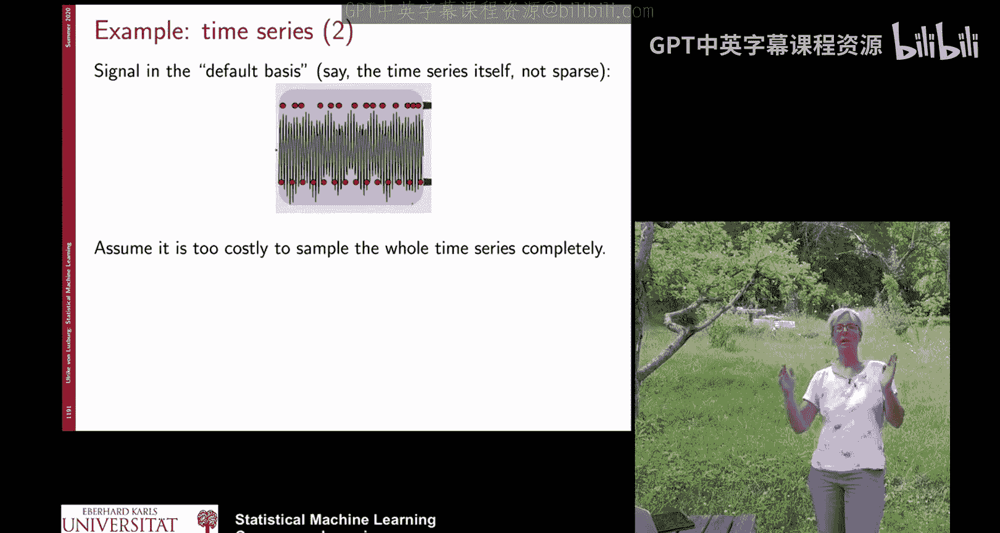

这非常棒，因为现在定理为我们提供了一种相当高效的方法来精确地从压缩感知中重建原始信号，我们需要解决的优化问题是一个线性规划问题。这是我们知道的可以在多项式时间内完成的事情。

### 第四步：构造 RIP 矩阵

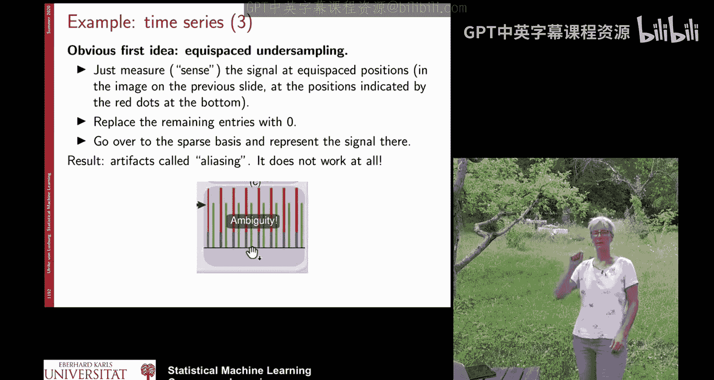

现在我们需要看看如何实际构造这些 RIP 矩阵，答案是随机矩阵具有这种 RIP 性质。

**定理**：令 **S** 为整数，我们有参数 **ε** 和 **δ**。我们选择 **K** 为一个常数乘以我们经常看到的数字，即 **S log(D/S) / ε²**。现在，我们选择 **W** 为 **R^(K×D)** 中的一个矩阵，其中 **K** 按照前面所示选择，每个条目从均值为 0、方差为 1/K 的正态分布中抽取。那么，在随机矩阵的选择上，以至少 **1 - δ** 的概率，这个矩阵是 **ε-S RIP**。需要注意的是，随机性在于矩阵的选择，通常你只做一次。所以你选择矩阵，然后以高概率，你拥有这个性质。

更一般地，如果你使用任何 **D × D** 正交基 **U**（可能执行基变换），那么矩阵 **W·U** 也是 **ε-S RIP**。

## 更多直觉与应用场景

现在让我们尝试建立更多的直觉。压缩感知在信号在某个已知基中稀疏时具有优势。测量是昂贵的，比如在医学领域的 MRI 扫描中。但接收端的计算是廉价的，因为在接收端你需要重建信号。我们寻找的场景是你有一个廉价的传感设备（比如一部低成本手机），你进行这些 **K** 次测量，然后你可以将它们带回实验室，你有足够的时间来解决这个最小化 **L1 范数** 并带有线性约束的优化问题。我们需要确保在最终进行评估的接收端，计算应该是廉价的，或者我们应该有能力解决这个优化问题。

现在的技巧是，每个测量都是信号的一小部分随机线性组合。但因为我们知道底层信号可以被压缩，在这种假设下，我们仍然有足够的测量来重建信号。这是主要的故事。这种重建是通过一个非线性过程工作的，这也许也很重要，因为线性过程行不通，那将只是求解这个欠定的线性系统。所以我们有这个非线性过程，即解决这个优化问题。

## 与香农采样定理的关系

也许听众中有些人知道一些信息论。有一个定理与此相关，如果你知道那个定理，你需要意识到这里发生了什么，即**香农采样定理**。香农是 essentially 发明信息论和该领域许多基本定理的人。

**定理**：如果你有一个时变信号，其频率不超过 **B Hz**，那么可以通过以 **1/(2B)** 秒的规则间隔对信号进行采样来完美重建它。所以我们有 **2B** 个规则间隔的样本。如果我们假设信号中没有高于 **B Hz** 的频率，那么我们可以重建图像。如果我们的信号确实有高于此的频率，那么以这个速率采样就不能唯一地重建它。然后你会观察到这种混叠现象，即有两个不同的信号具有相同的样本，你无法区分它们。

这似乎与我们之前所说的有些矛盾。但是，关键在于：在压缩感知中，我们做出了比香农定理更强的假设。可实现的分辨率不是由我们拥有的最大频率数控制的，而是由信号的信息内容，即信号的稀疏性控制的。这是香农原始定理中没有的假设。如果我们知道在可能发生的 **D** 个频率中，实际上只有 **S** 个发生，那么我们可以从更少的测量中重建信号。也许比较一下：这里我们说我们有 **D** 个频段。如果我们以这个速率采样，那么我们可以重建。现在我们得到的陈述是：如果你知道这些频段中的大多数是空的，我们可以比香农定理给出的更高效地采样。这真的很棒。

## 总结

本节课中，我们一起学习了**压缩感知**。我们了解到，通过假设信号在某个变换域中是稀疏的，并利用随机线性测量，我们可以用远少于传统采样定理要求的测量次数来采集信号。关键在于，重建过程不是简单地求解线性方程，而是通过求解一个 **L1 范数最小化** 的优化问题来实现，这鼓励了解决方案的稀疏性。我们看到了单像素相机等实际应用，并理解了其背后的核心理论支柱：限制等距性质和随机矩阵的优良特性。压缩感知是一个强大且优雅的框架，它在资源受限的传感场景中具有巨大的实用价值。