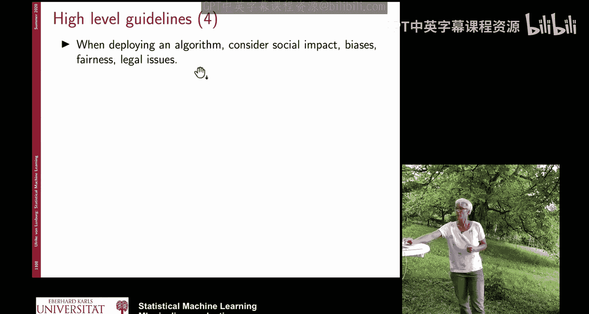

# 图宾根大学《概率和统计机器学习》：Part 55：分类器评估 📊

在本节课中，我们将要学习如何评估机器学习分类器的性能。我们将从最基础的混淆矩阵开始，逐步介绍一系列评估指标，如准确率、精确率、召回率，并深入探讨ROC曲线和AUC等概念。最后，我们将讨论在研究和实践中如何公平、全面地比较不同分类器。

## 混淆矩阵：评估的基石

上一节我们介绍了机器学习流程的各个阶段，本节中我们来看看如何评估分类器的结果。理解分类器性能的第一步是构建混淆矩阵。

混淆矩阵是用于总结分类模型预测结果的表格，特别适用于二分类问题。它将真实类别与预测类别进行交叉对比。

以下是混淆矩阵的四个核心组成部分：

*   **真正例**：样本真实类别为正，且被模型正确预测为正。其数量记为 **TP**。
*   **假负例**：样本真实类别为正，但被模型错误预测为负。其数量记为 **FN**。
*   **真负例**：样本真实类别为负，且被模型正确预测为负。其数量记为 **TN**。
*   **假正例**：样本真实类别为负，但被模型错误预测为正。其数量记为 **FP**。

此外，我们定义：
*   **P** = TP + FN，即所有真实的正例总数。
*   **N** = FP + TN，即所有真实的负例总数。

## 核心评估指标

基于混淆矩阵中的这些数字，我们可以定义多种衡量分类器性能的指标。

以下是几个最常用的评估指标：

*   **错误率**：被错误分类的样本比例。公式为 `(FP + FN) / (P + N)`。这对应我们之前学过的0-1损失。
*   **准确率**：被正确分类的样本比例。它是错误率的反面，公式为 `1 - 错误率` 或 `(TP + TN) / (P + N)`。
*   **真正率 / 灵敏度**：在所有真实正例中，被正确找出的比例。公式为 `TP / P`。
*   **假正率**：在所有真实负例中，被错误预测为正的比例。公式为 `FP / N`。
*   **真负率 / 特异度**：在所有真实负例中，被正确找出的比例。公式为 `TN / N`。

在信息检索等领域，以下两个指标尤为重要：

*   **召回率**：等同于**真正率**，即 `TP / P`。关注的是模型找出正例的能力。
*   **精确率**：在所有被模型预测为正的样本中，真正为正的比例。公式为 `TP / (TP + FP)`。关注的是模型预测结果的准确性。

## ROC曲线与AUC：处理不平衡数据

当数据集中正负样本数量极不平衡时（例如信息检索中相关结果远少于不相关结果），仅靠准确率评估会失效。此时我们需要同时关注真正率和假正率。

ROC曲线（接收者操作特征曲线）是一种强大的可视化工具，它描绘了当分类器的决策阈值变化时，**真正率**与**假正率**之间的权衡关系。

考虑一个依赖于阈值 θ 的分类器，例如一个可移动的超平面。对于从负无穷到正无穷的每一个阈值 θ，我们计算对应的`(假正率， 真正率)`，并在二维平面上描点，连接起来就形成了ROC曲线。

一个理想的分类器，其ROC曲线会紧贴左上角（真正率高，假正率低）。而一个随机猜测的分类器，其ROC曲线是一条从(0,0)到(1,1)的对角线。曲线越靠近左上角，分类器性能越好。

在实践中，不同分类器的ROC曲线可能相互交叉，难以直观判断优劣。于是人们引入了**AUC**指标。

**AUC**是ROC曲线下的面积。它是一个介于0和1之间的标量值，试图用一个数字来概括分类器的整体性能。AUC越大，通常认为分类器平均性能越好。

> 然而，将复杂的ROC曲线形态压缩为单一数字可能会丢失重要信息。例如，如果应用中更关心低假正率区域的性能，那么即使两个分类器的AUC相同，它们的实际价值也可能不同。

## 多分类评估与结果呈现

对于多分类问题，虽然可以扩展上述指标，但解释起来更加复杂。一个更直观的方法是直接查看**混淆矩阵**，分析哪些类别容易被混淆。

在学术论文中，常见的一种做法是使用大型表格，在多个标准数据集上比较不同分类器的平均错误率和标准差，并将最优结果加粗。

> 这种大型表格对人类读者极不友好，难以解读。应优先使用图表来呈现结果。仅在经过长时间思考，确信没有更好的可视化方法时，才考虑使用表格。

## 如何公平地比较分类器？

声称一个分类器“全面优于”另一个分类器通常是值得怀疑的。“没有免费午餐”定理指出，不存在在所有问题上都最优的算法。

因此，科学的比较应侧重于分析分类器的**优缺点和适用场景**。

以下是进行公平比较的一些指导原则：

*   **针对特定任务**：明确分类器要解决的具体问题类型。
*   **多样化测试**：在多种条件下测试（如不同维度、数据量、噪声水平），同时使用模拟数据和真实数据。
*   **公平实现**：以最佳方式实现所有参与比较的分类器，例如使用原作者提供的实现或精心调参，避免因实现差异导致不公平。
*   **使用统计检验**：可考虑使用统计检验（如t检验、置换检验）来评估性能差异的显著性，但需注意其假设前提。
*   **诚实报告**：不仅报告算法表现良好的情况，也应报告其失效的场景，这对实际应用至关重要。

## 超越准确率：全面的评估视角

评估分类器时，不应只局限于准确率。一个全面的评估框架还应考虑以下方面：

*   **计算效率**：模型训练和预测的速度。
*   **存储成本**：模型本身的大小。
*   **易用性**：是否需要专家调参，能否被非专业人士使用。
*   **公平性与社会影响**：模型决策是否存在偏见，及其部署后可能产生的社会伦理影响。

## 实践指南与总结

最后，我们总结一些解决机器学习问题的高级指南：

*   **建立基线**：首先尝试简单的方法（如K近邻），快速建立一个性能基线。
*   **融入先验知识**：思考如何将你对问题的领域知识融入到学习过程中（通过相似性函数、损失函数或概率模型等）。
*   **理解偏差**：审视数据收集带来的采样偏差和算法本身带来的归纳偏差，判断它们是否合适。
*   **批判性评估**：以批判性的眼光彻底评估结果，这是科学精神的核心。
*   **动手实验**：通过大量实验、可视化和调试来理解数据和算法。
*   **避免过度泛化**：在解决问题的中间步骤中，尽量避免去解决一个比最终目标更泛化、更困难的问题。
*   **考虑部署影响**：在部署算法前，充分考虑其社会影响、公平性和法律问题。

本节课中我们一起学习了分类器评估的核心概念与方法。我们从混淆矩阵出发，定义了错误率、准确率、精确率、召回率等关键指标，并深入探讨了用于处理不平衡数据的ROC曲线与AUC。更重要的是，我们认识到评估不应仅限于单一数字，而需从计算、实用、伦理等多角度进行，并且在对分类器进行比较时，应侧重于分析其适用场景与优缺点，而非做出绝对优劣的断言。