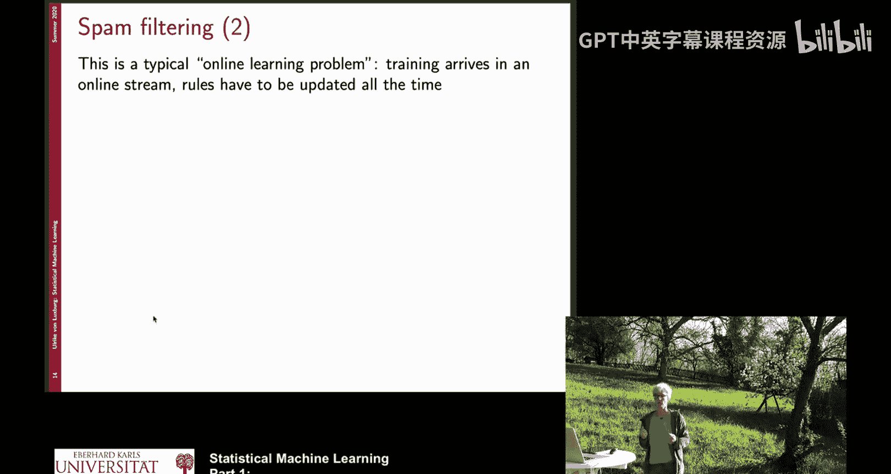
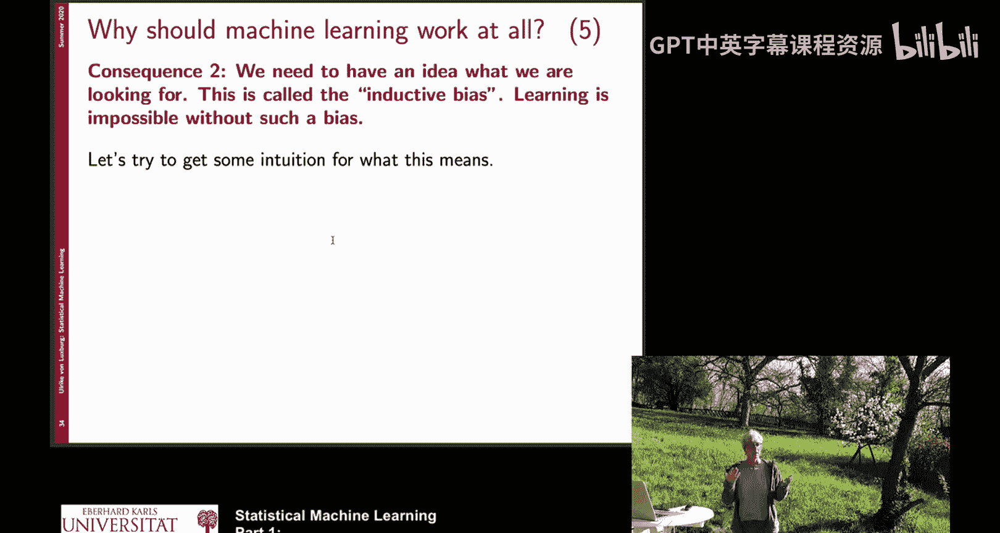
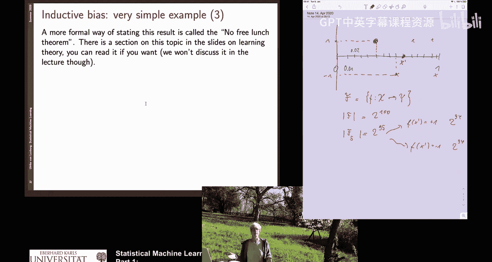
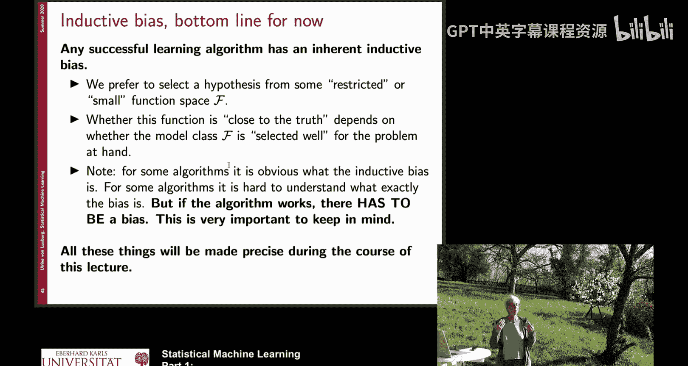

# 图宾根大学《概率和统计机器学习｜Tubingen Probabilistic and Statistical Machine Learning 2020》中英 p02 -02-Part 1 - Machine learning and inductive bias.zh -BV1gso5YGE4s_p2-

Good morning， everybody。Today is the first lecture in Staly machinech learning。

 and we would like to start this lecture with a couple of motivating examples。😊。

The first example I want to talk about is1written digit recognition。

This is one of the founding programs of machine learning。

 and in the 1990s it was considered quite a lot。😊，Under the name of pattern recognition。

The problem is as following， assume you are the Postal Service and you want to deliver a letter so the letter comes on some moving belt。

 you have a camera that takes a picture of your letter and now you want to automatically recognize the address and the zip code of the city where the letter is supposed to go to。

😊，So the problem is you have this photograph but now it's not so easy to give a handwritten rule that says。

 oh look these and these letters are an F and this digit is a7 and so。

 you need to have some systems that are more flexible and you don't want to hand design this rule by yourself but you want the system to find out a rule that can recognize these digits。

😊，Looking at it a bit closer。😮，Assume that we have a photograph of a digit。

And like here on the slide we have the digit 3 in this case it is a 16 by 16 grayscale image so each pixel in this image is like a pixel is one of these little squares and it has a gray scale value。

 it is a number between 0 and 1。😊，0 means white， one means black。

 and every number in between is some shade of gray。

And now what is it that the computer sees about this stitchit， it doesn't see it as an image。

 it sees it as a vector of in this case 256 many numbers between0 and 1。😊。

So here in the bottom of the slide， what we are supposed to do is now we need to learn a function。😊。

The tag is an input such a number which has 256 entries between0 and1。

And the output of this function is supposed to be the digit that is represented by this particular vector。

And this is one of theunding problems in machine learning。And if you look at this particular slide。

 you can already see that it's not so simple。 We have different versions of the digit 5 or the digit 9。

 the digit 7 and 1。😊，And you can already see that it' is quite easy to mix up the digits and for example this nine here looks a bit atypical and this one might even be a5 and here the difference between some of these sevens and some of these ones is also not so easy。

😊，And here the idea is we want to use machine learning to solve this problem of 100 digit recognition。

😊，And in one of the first exercises in this class， you' are going to solve this problem yourself by a very simple algorithm in fact。

😊，Another problem that's also quite old is spam filtering in the 1990s when emails came up Spm maybe was not so much of a problem but it soon became a problem everybody gets all these spam emails and you want to design a filter that automatically can tell apart normal emails from spam emails。

😊，And again， it might be easy to give a couple of keywords that might hint that there is a spam that a particular email is a spam email。

But in general， this is not so easy and handwritten rules often don't work very well。😊。

So what all the email programs have internally， they have a so called spam filter。

The idea is you get your incoming emails and whenever you encounter a spam email in your inbox。

 you press the button spam。And in the background， there is a machine learning classifier that tries to classify emails into spam and non spam。

😊，And whenever you press this button， this classifier is being updated in an online fashion。😊。

AndHopefully in this way， the spam filter is always up to date and can detect emails which are spam emails and can separate them from normal emails。

😊，This is a typical online learning problem as opposed to the handwritten Dit problem where we train the machine learning classifier once and forever and then hopefully it can classify all the digits here in the statute recognition nothing really changes digits are there。

 people have the handwriting but there is no evolution over time。😊，Whereas in spam filtering。

 of course， it's a game between yourself and your opponent who is the person who wants to send these spam emails。

 So whenever you have updated your spam filter， the person is trying to invent some new spam image and this is going ongoing over time。

 So in an online fashion， you want to solve the machine learning problem always with the most up to date。

 And this is called an online machine learning problem。

A very important machine learning application is object detection。😊。

Imagine safe driving cars here you have a scene from some road and traffic and you want to recognize like the safe driving car is supposed to recognize that there are pedestrians。

 there are other cars， there might be a traffic light or traffic。

 some other traffic going on a cyclist and so on。😊。

And so the problem of object detection is given a complex image like a scene like this one。😊。

You want to recognize what is on the scene。

It is a more general version of  hundred digit recognition， but with much。

 much more complicated scenes and many， many more types of objects。😊。

This problem was one of the important problems that needed to be solved for sales driving cars and sales driving cars are one of the big。

One of the big applications of machine learning out there。

In 2005 there was one like people have been trying to build safe driving cars since many。

 many years and the first very important break were happened in 2005 when there was a race where cars were supposed to drive autonomously through a desert for 100 kilometers and they just got the GPS coordinates for like they were starting at the same point and got the GPS coordinates of the point where they were supposed to go。

And for the first time in 2005， one single or a couple of cars managed to solve this challenge。😊。

And from then on self driving cars really became much more prominent and have been developed and are now about to be rolled off in many of the for example。

 in some cities in the US you can already try safe driving cars in Germany。

 they are not yet out there， there are still some technical problems。

 but there are also some problems that come from the law and from responsibility。

One big application area of machine learning already since quite some years is the fe of bioinformatics。

There are many， many machine learning algorithms that are applied to a wide variety of problems。

 for example， one of the starting problems was you wanted to detect different types of diseases for microarray data。

So I'm not a biologist， but my。Understanding of microray data is you have a certain cell and there are proteins that might be active or not。

😊，And you have now some kind of lab experiment that can measure whether a certain protein is active or not。

 and in this little image that you can see on this slide each of the blue green or red dots stands for this particular protein is active or is not active。

😊，And now you want to classify different types of cancer cells， for example， based on this pattern。

 so it's a bit like an 1written digit recognition you have a matrix consisting of zeros and 1。

 say green and red dots。And you want to say which of these patterns belongs to a particular disease because a cell behaves in a certain way。

Another application is drug discovery where you want to say you have a disease and you want to design a drug and to be able to do that what you need to do。

 you have this protein， maybe the virus and you want to knock it out so what you might want to do is you want to find a small molecule that can bind to this protein and then do certain things to the protein so you need to first find a molecule that can bind to the protein。

😊，And here on this slide， you see an example that a protein has a very complicated three dimensional structure。

And it has these little pockets in its three dimension structure。

 And now you need to find a molecule that exactly can bind inside such a pocket。 And again。

 this would be very expensive to try in a lab。 You have like thousands of different molecules that might might be working。

 but you don't want to run a lab experiment for all of them。

You might want to pre screen the different molecules and in order to do that use machine learning again。

 you have a certain description of these pockets it says how large is the pocket what are maybe the molecules that sit at the side of the pockets。

 what are the binding energies of all these molecules。😊，And based on this description。

You want to predict whether a certain molecule is now going to fit into this pocket or not。

This is again， a classification problem that you might be able to solve with machine learning。Here。

 just for the people who work in bioinformatics， I have one slide that shows which are all the different fields in which machine learning is used in bioinformatics if you want you can look at it at home。

😊，Going from bioinformatics more towards medical applications。

 one of the very big fields also very prominent currently in machine learning is applications in medicine。

😊，For example， in personalized medicine， you want to hand design different therapies to to the genetic disposition of particular people。

😊，Here I have an example for skin cancer detection where the idea is you have a it's again some kind of image detection object detection problem。

😊，The idea is you as a person， you think you have a funny piece of color at your skin and you wonder whether it has to do with skin cancer or not。

 So what you do is you take your smartphone， you take a photograph of the skin。

And then you use an automatic classifier that might say， oh。

 this is very harmful or this might be harmful or this is not harmful。😊。

And then depending on the outcome， you can start consulting a doctor。

And the impressive thing is that these systems by now are at least at the accuracy of medical experts who have really been trained for years to detect different types of skin cancer。

 so machine learning in this particular application is really a very powerful tool that can support doctors who then can focus more on the actual treatment of the patient。

😊，There are many， many more applications in science。

And here I just want to outline one in which is a bit funny it's in archaeology and you would think that archaeology is maybe the last field where machine learning could be of an advantage。

 but here is a nice paper that has been published 2019。😊，So last year。

In nature communications where people have been analyzingna the human genome from ancient findings and they found some evidence they tried to reconstruct this development tree in which different kinds of humans have been developing and they found that there must be an additional branch in this tree that has not been discovered yet。

 so we have not found any bone of this particular branch in the human development but it must be there because otherwise you couldn't explain the data that you currently have with if you don't assume that such a tree such a branch exist。

😊，And this is， I think， a cool application because it shows that machine learning not only can solve very specific classification problems。

 but it can really discover things that you wouldn't be able to discover otherwise。😊。

One of the fields where machine learning is very powerful nowadays is language processing。

One first breakthrough was in 2011 when the computer Watson won this there was a quiz show in the US that was called Geopardy。

 it is a bit like the German we had with Millionaire so there are questions that are been asked and then the persons on this case the computer is supposed to answer and the interesting thing here is that these questions are more like world games It's not so much about who won the soccer championship in 19555 or so it's more like kind of world games。

And the surprising thing was that this computer Watson was able to beat the best Geardy players at that time。

By now language processing is very very prominent and you have serialri on your phone or Alexa or you can also try automatic translation systems like if you haven't seen that before deep L is one of my favorite translation services you paste an English sentence and it spits out the perfect German sentence all the other way around。

😊，And this is really impressive， and this wouldn't have been possible a couple of years ago。

One last thing I want to mention is I a go， many of you might have heard about it。😊。

So chess is an old game which has been soldd by computers already in 1996。

 at that time there was a computer which was able to beat the world champion the world leader in chess playing。

😊，At that time， Garrick has power off。However， at that time they didn't use any machine learning for this。

 essentially what they did is a very clever search procedure combined with a very。

 very powerful computer， so essentially at this time 1996 for chess。

 they essentially managed to look ahead a couple of steps and evaluate all the different possibilities and the different directions and the opponent might have and in in this fashion managed to beat the best chess player who might not have such a huge computational power to look ahead for say five steps。

😊，Now， it's a very different story with Alpha Go。😊，An Algo that was in 2016。

 Deep Min managed to program a go playing machine。😊，Pure using machine learning。

And that was really a big breakthrough at the time。Sorry。

 I don't have a slide for this so what happened is essentially they used neural networks to sort of represent the situation on the board and then they first fed the neural network with games that have been played by experts to try to train it to do the same kind of moves that experts had done。

😊，And then in the next step， they let two different systems of AlphaGo play against each other in order to improve and improve and improve and in the end they managed to beat the world championship at that time。

😊，So now we've seen many examples where machine learning plays an important role。

 but now what is machine learning， how can you define it is there a definition at all or how could you explain what happens in the background？

😊，Of course， I mean we are going to spend the whole semester trying to discover it。

 but let's try to start with a couple of first thoughts。😊。

If you look at what is in Wikipedia or in many of these online blocks that try to explain machine learning。

 you will find something along those lines。Machine learning。

Is the development of algorithms which allow a computer to learn specific tasks from training examples。

And there are a couple of birds that are really important here。The first one is specific task。

Machine learning is not at least in my opinion it's not about building general artificial intelligence so you don't want to build an agent that is like a robot that is really intelligent as a human what we try to do in machine learning is to build algorithms that can solve very specific tasks it could be skin detection skin cancer detection。

😊，Or it could be language translation， or it could be to play Alphago。

But you are not or at least currently we are not trying to build an agent that can do all these tasks at the same time and whenever you want your algorithm to do a new task you need to train。

😊，And training for this training typically you need training examples。

 so you need examples of the tasks that you are that the computer is supposed to learn。

 for example you in skin cancer detection， you need images of different pieces of skin and then you need to have the label which says this is skin cancer and this is normal skin。

😊，Now， the next point is learning means that the computer can not only memorize the scene examples。

But can generalize to previously unseen instances。Of course there would be no point in skin detection if you could only show the computer the pieces of skin that you already know what you want to do is you want to have these training examples to train the computer and then that only want to have a new patient and this new person is going to come in and you want to say for this new person whether the person has skin cancer or not and this is what we call generalization so we train on a couple of instances but then this rule that we are going to find is supposed to generalize to new instances of the same problem。

😊，Ideally， the computer should use the examples to extract a general rule how the specific task has to be performed correctly。

So what happens in the background or what is supposed to happen is the computer takes its training examples。

It has some mechanism by which it can generate a rule and we are going to talk about many of these mechanisms in the lecture and then hopefully there is a new function that comes out that is able to solve this task in a very general way。

😊，So on a high level， this is what machine learning is about。😊，Of course。

 this doesn't help you very much at the current time。

 but we are going to see many examples in the lecture。😊，However。

 I still want to show you yet another explanation and this is one I like a bit more and it's more general。

😊，To be able to explain you what I want to talk about now。

 we first need to figure out what is deduction and induction。

Now what you're going to see from time to time， I have questions on my slides and if this would be a normal lecture where people would sit in the audience。

 I would not ask you this question。😊，The questions are always in bold font or in capital letters。Now。

 as you are watching this video at home， I guess。😊，I suggest that whenever such a question comes up。

 you take a bit of time， you stop the video， you think about the question and then you proceed because this would also be the same way we would do it in a lecture and these questions often help you to recap certain things or to think about certain aspects of what we are currently talking about。

😊，So at this point， I would like to ask you whether you know what deduction and induction is。

And maybe you might want to think about it for a minute and then resume watching the video。

So here's the answer。Dduction。Or detective inference is the process of reasoning from one or more general statements premises。

To reach a logically certain conclusion。Essentially this is what is happening in math。

 you say here is statement1 and here is statement 2 and if both of these statements are true。

 then I can make a certain conclusion from these statements。😊，And here I have an example。Pmise one。

Every person in this room is a student。Premise 2。Every student is older than 10 years。

The conclusion is now every person in this room is older than 10 years。

So the important point is if the premises are correct， then all conclusions are correct。

 the conclusions you come to the conclusions by the rules of logic。😊。

And you can always be certain if the premises are correct， then your conclusion is correct as well。😊。

This is a very， very nice framework of course， and all of logic is built on this。

 all of mathematics is built on this。😊，However。The big problem in this kind of thinking we need for machine learning is this term if the premises are correct so typically you can never make a statement you can never be certain about many things there is always an uncertainty attached to it and whenever a statement is not all is not completely sure then this kind of reasoning doesn't apply anymore。

😊，And so this is why detection is not very well。😊，Suited to to machine learning tasks。

 we use different mechanisms。The other principle thats sort of the opposite to deduction is induction。

😊，Inductive inference is some kind of reasoning that constructs or evaluates general propositions that are derived from specific examples。

So induction is what we often do in science， we observe many things and we see some kind of pattern and then we make a hypothesis and think oh。

 this pattern， this is what is always going to happen。😊。

And then we have a hypothesis and then we keep on testing this hypothesis。

 whether it's true or false。This process is induction。And here's an example。

Assume you' are a kid or you have a kit， maybe that's more closer to what is going to happen soon。

 so say you have a kit。😊，And what you're going to see is when the kid is one or two years old。

 it keeps on dropping stuff， so it takes something， it drops it， it takes another stuff。

 it drops it and it gets busy with this process for half a year or four year。😊。

And the kid is always astonished that the thing at the end is on the ground floor。

Now what and eventually the kid is going to learn that whenever it drops things。

 these things are going to fall to the ground floor and maybe not to the ceiling。😊。

And this is a process of inductive influence。You have this experiment， you keep on dropping stuff。😊。

You observe that it always falls down。And then your conclusion is that whenever you drop stuff。

 it is going to fall down。And this is inductive inference。

The important thing is you can never really be sure that your conclusion is correct。

 And this applies to all of science。 And there is a lot of interesting。

Philosophy of science that tries to explain what does it mean， how can we learn something at all。

 how can we explain something and so on？Because we cannot really be certain about it。

Humans to inductive reasoning all the time， essentially all our life is coming up with good rules of thumb in performing induction。

😊，Here's one more example。You come late every single lecture 10 minutes。

 so you I started the lecture and after 10 minutes you enter the room。😊。

For the first couple of lectures， I don't really complain。So you conclude， well。

 she maybe doesn't really care whether I'm late or not。But you cannot be sure maybe at lecture 10。

 I really get annoyed and then there is something happening that you didn't expect。So， here is an。

A situation of uncertainty in your reason。 So we cannot be sure about the conclusions that we make。

Now， why am I telling you all of this？Here's now the second motivation for what machine learning is。

Machine learning tries to automate the process of inductive inference。

And I find this a very powerful explanation of what machine learning is In active inference means we look at training data。

 for example， because we always drop things， we have training data and we build up some hypothesis and this is exactly what machine learning is supposed to do we give some training examples to the computer and the computer is then supposed to learn a general rule to come up with a hypothesis how it could explain future events or future examples of the same process。

And the idea is that machine learning is supposed to automate this process。

 so we want maybe to give some basic framework， but then the algorithm is supposed to come up with this rule in an automatic fashion。

😊，And this is an explanation of machine learning that's very general， of course。

 but I think it really explains what is the heart of machine learning。😊，Now。

 I would like to discuss a bit why。People think oh why this can work at all or whether it can work。

 I mean， you see examples that it works or probably it can work。

 but there might be some assumptions that we need to make。And to do this。

 I want to consider a particular example。So here we have a particular regression example。

 so what we are given is we have pairs of input points and output points X I Yi so XI is always the input point YI is the output value that we are supposed to have。

😊，You see a plot of some data。 I mean， take this very intuitive now we are going to make this much more formal later on。

 but for now it's really about intuition。 Look at the data that is at the bottom of the slide。

So we have four data points。Marked by the crosses， so you always see the x value on the x axis and the y value on the y axis。

And what we want to do is we want to learn a general function that can predict the y values from the x values。

 So what we want to have is we learn we want to learn a function。

That goes from the function F that goes from the space curly X。

 which is the space of all input points。To the space curly Y。

 which is the space of all output points。AndNow if I would ask you in a lecture。

 what do you think is the value that you would predict if the input value would be 0。4？😊。

So you might want to look at this plot and think about it a bit for yourself。

But I'm sure the answer that most of you will come up with is the following so well here on the x axis you have this scale it goes from 0 to 1 here we have 0。

4 this is the point I'm interested in now what would be probably the output point of this one while it' is going to be roughly here。

😊，And if you now assume this is sort of a straight line， the output of this point might also be 0。4。

This is a straightforward kind of conclusion that you could draw from these data points。

Now you could also come up with other conclusions， and here are two examples。

 So the first guess this is the one I've just explained to you。

Is that these data points have been described by this or have been generated by a linear function。

 this kind of red line， the red line is sort of a good fit to your existing data and then you can use this red line to predict a new value for this point youre interested in 0。

4。😊，It could also be the case， what you see here on the right hand。😊，Maybe for some reason。

 you don't think it's a linear function。 You come up with this very kind of。More shaped function。

 which has sort of goes up and down and up and down。

AndIt also like this red function also fits your existing data very well。😊。

But now if you would use this function to predict， you would get a different prediction。

 so the prediction now for 0。4 would maybe 0。8 as your output value。And the question is now。

 which of these two predictions is better or which of these two red curves is more plausible？

And this is now one of these points I would like you to stop the video for a moment and come up with arguments for why the first one might be better or maybe also why the second one might be better。

 What are the differences and what might be criteria along which we could judge which of the two things is better。

😊，Okay I hope that you have made a couple of ideas why each of these functions could be better typically what are the answers that I get in these lectures if there is a real audience in front of me is many people would say well I guess one is better because it's a simpler function and there's no reason if you just see the data that we would need to fit it by such a complicated function as on the right hand side。

😊，So we would prefer the drawing on the left hand side。

Some people would also use the word outcomeshams Razor because people have heard about this before。

And would say Oham Teresa says you should always prefer the simpler solution that it can explain your data。

😊，And they would say this is a reason why we should prefer the left hand。

All these things are correct up to a certain point。

 but we will see later in this lecture that it's not always maybe there are more twists to this explanation。

😊，And then there are also people who tend to argue for that。😊，People who tend to argue for the。

For the right inside， they say， well， maybe we have some background knowledge and we know it's a physical phenomenon and this phenomenon is not a linear phenomenon。

 but it has iss something that goes up and down。 Maybe it's the temperature at different days of the a different days。

And one of these dots has been recorded at night， but the days are missing and now 0。4 is a daytime。

 and typically temperature goes up and down during day and night。😊。

So if she has this background knowledge， maybe guess two would be better。

 and then this might might lead to a better prediction than guess one。

So the bottom line I want to make here is。If you don't have any extra knowledge about your data。

There is no way in which you can decide about which of these things is really better。

 You need to have extra knowledge。Or you need to make assumptions。

One such assumption could be that the function should be simple。

 and then you would go to the left hand side。Or the assumption could be you're trying to fit a periodic function and then you go to the right inside。

However， you cannot make a prediction if you do not make any assumption or make any kind of bias。

 which is the direction in which you' are thinking about。🤧。So here's one aspect。Now assume。

That I tell you that the function values have been generated randomly。

And if I keep on generating data。😊，These are simply random points in the unit square。

 So uniformly distributed。 O sorry， all these data points are。

So you now see we've been drawing many more points， the red points。

And now you can't see any pattern anymore。if I now would ask you， what is your prediction at 0。0。4？

You would probably say well， in fact， I don't know it could be anything between 0 and 1。

 and I have no particular reason that it should be 0。4， for example。

 It could be anything else as well。😊，So here's the inside。

 if there is nothing that you could predict， I mean。

 if if you don't have any pattern that sort of connects the input to the output value。

 you won't be able to predict anything。I would like to summarize this discussion now。

The first consequence that we need to take away from this discussion is。

We will only be able to learn if there is something we can learn in our data。

And this there is something in your data， it sounds very trivial， but in practice。

 this is often not so obvious。 So if you have certain input data say in medicine and you want to predict a certain output data。

 say a particular type of the disease and your input data is the temperature of the person and what the person has been eating during the last days and the age of the person in the shoe size。

😊，Maybe this data is not enough to predict this particular disease。In this case。

 there is no connection between the input data and the output data and you can try whatever you want your machine machine learning algorithm is never going to succeed。

😊，And this is something really important to keep in mind when doing machine learning。

 it sounds trivial， but in practice， you might stumble into this problem very often。So thepressing。

 the output needs to have something to do with input。

And often a kind of bias or assumption we make is that similar input points would lead to similar output values。

😊，So again， if you have certain patients and you want to predict the disease and you have very similar patients。

 then typically you would say， well these patients they behave so similarly。

 so probably they have the same disease。😊，And this is the kind of。Inherent rule that governs many。

 many of the machine learning algorithms。Of course， this is very abstract。

 but still this is what is in the back of machine learning in many applications。

Then the next thing is there needs to be a simple relationship or a simple rule that can predict the output from the input。

If this function is something that is so complicated。

 if your function is a fractal and you are supposed to learn thisractal from 10 data points。

 it is very unlikely that you are going to succeed。😊，So， the function needs to be reasonably simple。

😊，In order for you to succeed。The more training data you have。

 the more complicated functions you will be able to afford。😊，But there needs to be some relationship。

 you can't learn the most complicated function from just three data points。Unless you make very。

 very strong assumptions。The last point is we tend to look for a function that is simple in some aspects。

We need to be a bit careful with this notion and we are going to see in later in Sta learninging theory what simple really means and it's not really I mean this is sort of Ohams Raor but it's not just Oham's Raor there are more aspects to this but we are going to discuss that towards the end of the lecture when we've seen Statistic learning theory。

😊，What is now important is these assumptions that we have on this slide。

 they are rarely made explicit。So people run machine learning algorithms and they press many buttons and they try it out and they record training it test and so on。

😊，However， you need to be aware that these assumptions are always made in machine learning。

 but often it's a bit unclear what really are the specific assumptions that a certain algorithm makes。

 So always keep that in the back of your mind。 when machine learning is being applied。

 there are assumptions that are going to。Be brought into machine learning， threea Hsons are wrong。

 it's very likely that the function that you learn is also wrong。😊。

And you might want to be aware of what are the assumptions that really go into your particular machine learning system。

The second consequence。We said we are going to look for a simple function and so on。

 but the more important thing is we need to have an idea what we are looking for。😊。

And this idea of what we are looking for is called the inductive bias of a machine learning system。

As in the previous example， we need to say in advance are we looking for a linear function or are we looking for a periodic function？

😊，And this is sort of our inherent knowledge on the data。

 on the phenomenon that we are trying to model。😊，And this is called the inductive bias。

And I want to give you a bit of intuition what this reading means。

I now want to show you a simple example for what this inductive bias means and why we really need it。

😊，And for this， let me simply draw an example。 So what we're going to look at is a space。

That is just one dimensional。 So we have points between 0。And one， and the space consists of a grid。

And the grid is so we have 0。01，0。02， and so on。So these are our input points。

And now the output space is either 0 or one， so it can be。 So our training data could be。

 maybe I draw the training data now in red。 So we could have one training point here。 This is one。

So here at this particular input point， our output， if we make an Y axis here is one。

And maybe we have another point here。Until here the output is minus-1。Okay。

 so I now named the output1 and -1 on this slide it says0 and1。

 So don't worry it's just we have two different classes here， say plus one and -1。And I human。

We have seen a couple of training points， so we have seen these two red points and then we have a couple of more points here。

And this is our trading data。And the idea is now we want to learn a function that is going to predict for the remaining data points。

 what is going to be the output value is it minus101？😊。

So what we want to do is we want to learn a function the that goes from the input space x to the output space y。

And now we start with different situations In the first case。

 we assume we do not have any inductive bias， so any of these functions that go from x from the space curly x to curly Y can be the correct function。

And this sounds great because you want to say oh， I don't want to restrict my system。

 I don't really know what the process is that models I don't know this particular disease based on the genetic information。

 I don't have any clue， so I don't want to make any assumption that sort of tries to bring my algorithm into a certain region。

 I simply want to have no prejudices， I want to learn without prejudices。😊。

So you don't make any inductive biass。 So what are you going to do？Our function space。

 and maybe I put this here。 So the space of all functions。

 this is always going to be denoted by curly F。😊，This is the space of all functions F。

That go from the input space to the output space。All functions。Now。

 how many different functions do we have？Our data space X contains about 100 points。

Each point can be mapped to either -1 or plus  one。

So we have two to the2 to the 100 many functions in this space。

 so if we would write it eaglyistic absolute value of the number of functions in this function class is 2 to the 100。

These are really a lot of functions。So。But it sounds good so we have a powerful function space that can model all possible different things we want to learn without our prejudices。

 we now record our first couple of data points so say we have these red data points which are here in the plot five data points。

😊，And assume we don't have any noise， so we assume we are in a perfect situation that the training points that we get always give us the correct answer。

 it's not like in a medical case where you have some uncertainty or so we live in a world without any noise。

 which is also a simplifying assumption。😊，So now we have seen five training points。So we know。

 for example， this particular point here is going to be a plus one。😊，So what does it help us。

 we can now say well all those functions in the function space that would assign minus1 to this space。

 we can rule them out， we can simply throw them out because we know they are not the correct functions because we're in a noise free situation so this is not going to be the correct function。

😊，Similarly， for all the other data points， so for each of the data points that we have。

 we can rule out all the functions that are that do not fit this particular data point。😊，So。

What this now means is that after seeing these five data points our function space that is sort of still contains the functions that might be useful。

 it is a bit smaller so the function space maybe I call it F F5 after we have seen 5 point。

 it is now smaller it only contains 2 to the 95 many different functions。😊，Okay。

 so now we've seen these five training points and now we want to predict at a particular test point。

😊，And this test point， like maybe I put it here， so this is the point where we want to predict it is point x prime。

What are other possibilities that we can do with this point？We have now。

2 to the 94 many functions that are going to predict that the label of this point is minus1。

And we have another two to the 94 functions that would predict that the label of this point is plus  one。

 So our function space here。😊，We have。Those functions that say f of x prime is plus 1。

 and we have functions that would say f of x prime is -1。

And here we have two to the 94 many functions， and here we also have two to the 94 many functions。

Now， what are we supposed to predict for this new data point， We don't have a clue。

 There are as many functions for plus one as there are for -1。

 and we don't have any clue that would would tell us which of these functions or which of the functions at all is more plausible for this particular data point。

And this is where the inductive bias kicks in。 If we do not have any bias。

 there is no way in which we can decide what is the correct function here。We need this induct bias。

 Otherwise， we doomt here。And the trick is this continuously now you would say well。

 maybe five data points are not enough， maybe I need 10 more data points。 Okay。

 you take 10 more data points， but again for this new data point you still don't know。

 So no matter how much training data you are going to record for a point that you haven't seen before。

😊，You will not be able to predict anything。And this is really the good point about machine or the important point about machine learning。

 if we do not make any assumption and you say we do not we do not want to have any prejudice。😊。

We do not want to make any assumptions。 We do not want to restrict the space of functions in which you are looking for a solution。

 It is not going to work。What I've shown you here is a bit of an informal way。

 there exist a formal way of stating the same result and this is called the no free lunch theorem。😊。

The no free lunch theorem essentially says there is not a machine learning algorithm that can always succeed。

😊，You always need to make assumptions。But I don't want to become more formal about the serumem here。

 there are some slides later in the lecture if you want to look at that。

 but I think for now for all purposes this informal reasoning kind of works it's enough。

We now consider a function space that only consists exactly of two functions。

 the function constantly zero or the function constantly one。

 so it's always predicting the same label no matter what is the input point。

 it's going to predict  zero or it's going to predict one。And this is our inive bias。

 so maybe for some reason we know that the input data is completely meaningless。

 the output is always going to be0 or it's always going to be1。😊，We just don't know which one。

And again， we assume that there is no noise in our system。

 and now we observe one particular data point。And now once we've seen this one data point。

 we know which is the correct function because we know it be observed， is it 0 or1。

 I mean is the output value 001。And after observing it， because we don't have any noise。Sorry。

We know what the by our inductive pi is， we know that it's either the function0。

 constant 0 or the function constant1， and then we can predict for all other values in our space and we are always going to get the correct result。

And of course， this is now a bit simplistic。 So I've shown you two extreme cases。

 one extreme case where we say we don't have any inductive bias。

 And we've seen that we cannot learn anything at all。In the other case where we have a very。

 very strong induct bias name we say it's just one out of two functions and we don't have any noise。

😊，So with one training example， we can explain the world。Now。

 the truth for many machine learning applications is obviously somewhere in the middle。

And now all of machine learning or a major part of machine learning consists in finding a good function space for your particular application。

Now， this problem of finding a good function space is called model selection。Of course。

 these examples that we had here is really simplistic also in the sense that we didn't consider any noise。

😊，And also we didn't really consider what happens if this function space F does not even contain the correct function。

 which in practice might happen very often you say for some kind of medical example you make certain assumptions on what the function might look like。

 but maybe in truth it looks a bit differently。And ideally。

 your machine learning algorithm should still work， at least it's up to a certain accuracy。

Now figuring out all these details how these things fit together like the amount of training data。

 the model selection problem， which kind of functions to use， what is the amount of noise and so on。

 this is really tricky and all of machine learning is essentially the science to solve all these problems。

😊，And it is one of the big success stories of machine learning and in particular the theoretical part of machine learning that at least in some standard algorithms and we have worked out exactly how these things work together and it' is really well understood。

😊，And at the end of this lecture course， you will at least understand the rough principles behind all these mechanisms。

😊，There are two important terms when it comes to model selection or finding selecting a good function。

And these terms are overfitting and underfitting。And again。

 this is sort of supposed to demonstrate why finding a good function class is so crucial。

Consider the following example here we see it on the slide。

 the true function is a quadratic function， so you have this parabola。😊，And your data points。

 so this is in the plot， it's the black function。And your training points have been generated from this function with a bit of noise。

 So you see the green crosses in the plot， which are the training points that roughly follow the parbola。

 but there' is a bit of noise。And now you want to learn this function。

And now there are different choices of your function class that you could take。 You could say， oh。

 I fit a really simple model。 I fit a linear line。So you might come up with this red line。

Or as you say， I want to fit a polynomial function of degree 20 when you come up with this blue line。

And what you can see now is there are different reasons for why these things go wrong。

The red line somehow seems too simple， it doesn't even fit the training data。嗯。

So and this is what is going to be called underfitting and the blue line is so extreme it tries to fit each little aspect of your training data that its going to be called overfitting。

 This is also wrong。And here are the explanations for what these are。

Overfitting means we can always find a function that explains all the train points very well or even exactly。

😊，Those functions tend to be complicated and they tend to fit the noise as well this is what we also see on the previous plot the blue line goes nearly through all the data points even though there is noise on the data points and maybe the true function is not supposed to go through all the data points because there is noise and we don't want to model the noise as well。

Predictions on this data for these kind of functions that are overfitting are are poor for new data points because this function is somewhat too complicated And later we are going to see。

That overfitting is characterized by the fact that we have a low approximation error in the high estimation error。

 And don't worry about this。 Now， we are going to see this in the next lecture。

The opposite effect is called underfitting。Here your model is too simplistic。

 you want to use a linear function even though your data cannot be described by a linear function。

The advantage is that the estimated function tends to be very stable with respect to noise。

 So if you add a couple of data points or you be a bit。

 this linear function is not going to move a lot。But for unseen points， again。

 the predictions are going to be poor。And the regime of underfitting is characterized by the fact that there is a large approximation error and a low estimation error。

 again， we are going to talk about this in the next lecture。😊。

At the end of this lecture I want to show you that this notion of an inductive bias is not only used in technical systems。

 it is used in all systems that are supposed to learn and in particular also animals are humans。😊。

So I want to stress again that cannot exist a learning system that does not have an inductive bias。

And we， as humans also need to have inductive biases， otherwise we could not be able to learn。

And now we don't want to make experiments with humans to figure that out。

 but there have been experiments with animals in the 1960s which have tried to show that and I want to explain you what it is about。

😊，So this is an experiment with rats。And now consider you have a rat and the rat has a choice of two types of water。

 so there are two water bowls here。😊，There are two types of water， one is normal water。

 and the other water makes it feelic。And the rat hopefully is supposed to learn to avoid that water that makes it sick and only drink from the normal water。

 Now if there wouldn't be anything by which the rat could decide any features that would show the difference then the rat wouldn't be able to learn that but now there is a feature and in the first experiment the two types of water tastes differently so what you have is you have one type of water that tastes neutrally and the other one has been sweetened by sugar。

So， it taste sweet。And now you have the rat and it drinks and if it drinks from one type of water。

 it gets sick and if it drinks from the other type of water， it doesn't get sick。😊，And now the rat。

 as you can observe in or has been observed in these experiments。

 the rats learn very very fast to only drink from this type of water that doesn't taste sweet。

 So the rat， even if you put the bowls in a different spot and so on the red。

 it would try a tiny bit of the water and if it say if the sweet water is the one that makes it sick。

 it wouldn't drink it if it's sweet and the red dances very fast。😊，Okay， so fast so good。

 nothing really surprising。Now， there was a second experiment。It's again the same setup。

 you have two bolts of water， they can be in different places in the cage。

One of the waters makes the red tick and the other one doesn't。

 but now the difference between these the features that the red can distinguish about these types of water is not the taste。

 so both waters taste the same。But like one type of water is accompanied by certain certain sound and light effects。

 so say one of the waters is in a room that has a red light or there's a certain bell that you can listen to if you are close to that water。

And in the paper， they wrote a writer about audio visual stimuli。

 so you have certain sound and lighting conditions。😊，And then the water。

 like you have one type of water which has these kind of conditions to this particular sound and you have another type of water which does not have this condition。

And now again， the rat is supposed to learn which type of water makes it tick and which one doesn't。

😊，And the surprising thing is now the rat cannot learn it。

The red does not learn the connection between the fact that this water that makes it sick has something to do with the lightning conditions in your room。

So apparently， the rat does not have an in bias that could help it make the connection between lightning conditions in the room。

And water that gets makes it sick or not not sick。And if you think about is it plausible or not you can of course in hindsight come up with a plausible explanation so if a rat like is out there in the wild and it needs to taste food and the food tastes funny then maybe the food is rotten and the red doesn't want to eat it anymore so sort of connecting the taste of food。

😊，With the fact of whether this food makes it tick or not， is something very natural。

 And the red has this connection sort of wired in its brain。

But now different lighting conditions in a room typically don't have anything to do。

 at least in nature with the fact of whether some food is rotten or not。

 so you can look at it at night or at day。 and in one situation， it's bright and in the other。

 it's not bright， but it doesn't have any influence on whether this food makes it sick or not。😊。

And so apparently the brain of the rat is not able to make this connection。

 so the rat has an inductive bias。 It simply cannot learn this function。

 and there' is no way it can sort of overcome this。 the bias of its brain is that it cannot learn it。

This effect has been investigated a lot in psychology。 It's called the Garcia effect。

Because it has been published by a researcher called John Garcia and his cos in the 1960s。

 and there you can see one of the references， but there are many more references out there。😊。

So what is now the inductive fire the bottom line？Any successful learning algorithm has an inductive bias。

😊，We tend to prefer or to select hypothees from some restricted or small function cases。

 function spaces because it helps us to focus on the functions that are important。

And whether this function is then the function that has been learned by the algorithm is close to the truth。

 where it depends on whether this function class is well selected for the problem at hand。

 We haven't really been talking about this at all， but this is obvious like if you have a function class。

 say your function class contains linear functions。

 but the phenomenon that you're trying to model is a paric function then no matter what you want to do what you're going to do。

 it's not going to work out。😊，What is the important message that I want to give you now is for some algorithms it's sort of obvious what the inductive bias is going to be and we are going to discuss that。

😊，For other algorithms， it's not obvious， but there has to be an inductive bias。

 Machine learning is impossible without an inductive bias， and it is important to keep that in mind。

 in particular， if you get funny results， maybe your inductive bias is wrong or even if you have results and they look really good。

 you might want to ask yourself at some point well is the inductive bias really the wrong one。

 the correct one or the wrong one。And all these points are going to be made more precise in the future of this machine learning lecture。

 so I'm hoping that you're going to stay with us and come back for the next lecture thank you。😊。

