# 图宾根大学《概率和统计机器学习｜Tubingen Probabilistic and Statistical Machine Learning 2020》中英 p03 -03-Part 2 - Warmup_ The kNN Classifier.zh_en -BV1gso5YGE4s_p3-

Good morning。Today， we want to talk about the Can nearest nava algorithm is our first machine learning algorithm that we want to try out。

😊，To this end we first of all have to set up our whole machine learning experiment and take some data and then train the algorithm。

 so how is this going to work？As data， we now take a set of points which are going to be called X I。

YI。😊，Xi is always going to be the input。Why is going to be the output that we want the algorithm to predict。

We have N such training points， so we have X I Y I ranging from one to n。

These are other points like these are abstract points for now。

 we are going to give these points to the machine learning algorithm。😊。

And the algorithm is now supposed to train a function F that takes points from the input space as input。

 so this input space is always going to be called curly X。

And takes it to some output which in this case is either0 or 1。 we take a very simple experiment。

 It's a binary classification task。 we have some input and the output is just going to be either0 or1。

 so a binary output。😊，The next thing we are then going to do once we have our algorithm。

 we need to test our algorithm so what we are going to do is we consider a set of test points which have the same form as our input points。

 I call them xj and Yj where J ranges from 1 to M。😊。

And what is very important is that this test set is independent of the training set。

 so none of the test points already occurs in the training set。

This is what we mean by previously unseen points， which we had in the definition of what is machine learning in our last lecture。

And the tests that we going to be used to evaluate our algorithm in the end。

So now we assume we have this training data and have some algorithm。

 it could be the can nearest neighbor algorithm or some other algorithm。😊。

And this algorithm constructs a function which on this slide I always call F ac for F algorithm。

 the function that is being picked by the algorithm on the basis of the training points。

And now we want to compute what is the training error and what is the test error。

The training error works as follows。So for all training points。

 we use now the function that has been constructed by our algorithm to predict what the function thinks the output should be for this particular test point。

😊，So we take an input point XI， we apply F to this input point and this function produces an output which we call FYI hat and statistics hat is always the symbol that you use to quantify estimated quantities so the hat is now what is the estimate of the algorithm for the true label YI。

And now we can compute the loss like did the algorithm predict correctly or not。

 so what we do is we define a loss function which is called L L for loss。😊，And in general。

 the loss function takes three inputs。X I， the input point， Y I。

 the true label and Y I had the predicted label。And how does it compute the loss in the simplest case。

 it is the01 loss function it simply checks whether the predicted label Y I had is the same as the true label Yi。

😊，And if yes， we don't occur at us。And if no， we occur a loss of one。

 So we simply count how many errors do we make and how many cases do we have the say the the correct number of predict the correct output of the algorithm。

So， this loss function first of all computes， this loss for one single data point。

 for one training point。😊，Hence， it is sometimes called a point y 01 loss。

And now we want to take the average of this over all the training points to get what is called a training loss。

 so the training training loss or training error。Of the classifier。

 often also called the risk of the classifier。Is now here on this slide， the risk。

 the training risk of the classifier。Apply it to the function Fx。

 So the function that is being picked by the algorithm。

Is the average loss that the function makes on all the input data points。😔。

When predicting the output and compared to the true output of the training points。

So we just like intuitively it iss really simple， we have our function it predicts for the training points what the output should be and we just take the average of how many mistakes do we make say 10% error would be in many applications a good recite for example。

😊，Okay， this quantity later will be called the empirical risk of a classifier。

 we are going to see that later。😊，Now for the test error we do exactly the same except that we now compute the error on the test points。

 so now for each test point Xj we again take our rule F I。We apply the rule。

The rule spits out a label Y J hat， the estimated label。

 the thing that the algorithm thinks is the correct label。And then again， we evaluate the loss。

 so on this trading point xj that has the true label Yj。And now the predicted label is whichj head。

 the loss is  zero if the predicted label and the true label agree and there is one otherwise。

And again， we now define the test error。As the average over all the test set， so for all test points。

 we take a sum from J from 1 to M average over the loss。And this gives us a number between0 and 1。

 that is the test error of our classifier。A small technical remark here we define the test error as the average over the test set later on we are also going to define the test error on all possible points that could occur as the expected value which is then going to be called the true risk of a classifier and we are going to see this in a minute。

😊，Okay， now here are two remarks before we actually start with our first classifier。

 so obviously it is not really a challenge to produce a classifier that has a low training error because the training said we already know the output and in the worst case we could just produce a lookup table which for all input points tells us what the expected output should be So getting the training error low by itself is not really a challenge。

😊，Still， machine learning algorithms often do not achieve zero training error。😊。

There could be many reasons。 It could be that zero training error is not possible。

 and we will see examples later because there are there is ambiguity in the labels。

We are going to see some examples later on。And。And also。

 there are many reasons why it's not always the best。

 the best idea to produce your training error we have already called in， in the last lecture。

 We have already talked about overfitting。 And often， if we produce it。

A classifier that is zero training error attemptss to overfit because it also models the noise。

 and this is something we often about。Anyway， no matter what the training error is。

 the quantity that we're really interested in is the test error。

 And this is the only measure of success for our machine learning algorithm。 So in the end。

 machine learning is supposed to produce a function that predicts good or new unseen instances。

 We don't really care what a training error is。 The training error might be a tool that we use in the construction of our algorithm to find a reasonably good function。

😊，But the evaluation is purely done on the test data。

 and the test error is the only quantity that we're interested in in the end。

 because this is the quantity that tells us how how likely it is that in future when we apply our land model。

 we are going to make errors or not。😊，And in particular， as I already hinted。

 it is not always the case that a low training error automatically indicates there is a low test error。

 for example， if overfitting takes place， this is not the case。😊。

Now let's talk about the Canous neighbor classifier and the easiest way to explain the Can nearest neighbor classifier is with this figure that you can see on the slides。

😊，On this figure， we have。Two classes of data， we have the green crosses， which are called class 0。

 and we have the black crosses， which are called class 1。

And now we want to produce we want to predict the label of a new point。

 which is this red point in the figure in the center of the figure and how are we going to do that？😊。

We take the red point， we evaluate which of all the training points the crosses are the closest points to this red point。

 so for example， if we use the five nearest neighbor classifier。

 we check which of the training points are the five closest points。

And I've drawn a red ball around the center of this test point。

 So you see what are the five closest points here。And then you simply take the average you let the5 nearest neighbor vote on what do they think should the outcome be。

 and in this case we have three green crosses and two black crosses so the majority of these points in the five nearest neighborhood of the test point says that it' is a green point so we would predict the green class which is0。

😊，And this is what the Can US Ne algorithm does。 It is really about the simplest algorithm you can come up with。

Let's try to make it a bit more formaler。So formally we have given the training points， X I Y。

 I from1 to n。Which come from some space curly X， which is the input space and the binary space you in one for the output labels。

😊，Additionally， we are given a distance function on our input space because if we want to evaluate who are the nearest neighbors of a point。

 we need to have some way to measure how close our data points。

So we need a distance function which tells us given to input points， how close are these points。

And this function is going to be noted by D for distance function。

Now we want to construct a classifier that is able to predict for new test points what the result is going to be。

So how does it work？We are given this test point x prime。

We now compute the distances of this test point X prime to all other input points to all training points。

And then we sort these distances according to who is closest to the test point。

And we take those couple of points which are the closest points to the test points and K is the parameter of the algorithm in the previous figure we had k equals 5 we looked at the5 nearest neighbor algorithm in general we talk about the K nearest neighbor algorithm so K is the number of neighbors that we are going to look at so assume soon we fixed it somehow so we take the K nearest neighbors of this test point。

And then we simply assign the majority vote of the labels of these can neighbors and this is the formula in the bottom slide in the bottom of the slide。

 so y prime is supposed to be the label。😊，That the function gives to the new data point。

And what I did here is essentially， I take the sum of all the incoming labels。😊，And as sum。

 so we have k in incoming labels like the labels of the K points in the K nearest neighborhood with sum over all of them。

😊，And in this case， because labels are either 0 or 1。

 we simply check whether the sum is smaller than k2 or is larger than K half。😊。

If it's smaller than K2， the majority of the labels would have predicted  zero。

 so we also predict zero。If the sum is larger than K， the majority of the labels have predicted one。

 so we would output one。And this is how the Canist neighbor class fireworks。It is a really， very。

 very simple algorithm。It is， it is even so surprisingly simple that there's not really in a training phase。

 So in most other algorithms， we would have a training phase that checks for many possible functions。

 What would be the best functions you to use here。 The can nearest neighbor algorithm even have a training phase。

 We just need to look at the data We need to be able to sort according to distances。

 and then we can immediately start to predict the results for new test。Now。

 the K nearest neighbor algorithm has one parameter k。

 the number of neighbors we are going to look at。And this parameter K can range between1 and n。

 So one would be we simply take the label of the nearest data point。 There is no no averaging。

 no majority vote。 We just check for a test point， which is the closest trading point。

 We use its label to predict the result for the test point。In the other extreme case。

 we could use k equals to n， so this would mean we look at all data points。

And evaluate the label in using a majority board。And now I'd like tod like you to think about the question what do you think should the range of the parameter k be is it good if k is low or is it good if k is large？

😊，And what is going to happen if， if K is going to be very low。

 say1 and if K is going to be very high， say n。And I'd like you please to stop the video now and really think about this for a minute because I think it's important to understand this concept。

😊，Okay， I hope you have made up your mind。 You came to some ideas。

 What is the difference between having a low and the large K。

And I want to show it to you in one figure。😊，Here you can see a data set。😊。

With yellow and blue points。And you see yellow circles and blue circles and these circles are the training points that we are given。

And then you see little dots， orange and blue dots， and these are test points。

And the test and the color of the dot indicates whether this test point would have been classified as yellow or as blue。

😊，And you see two such figures on the left side， you see the one nearest neighbor classifier。😊。

And the black line in the figure indicates the decision boundary between the two classes so where is the class labor going to flip it's sort of between blue and orange this is what the algorithm does the one nearest neighbor algorithm implicitly produces such a boundary。

😊，And now you can look at it and you see that this boundary for the one nearest neighbor classifier is really very。

 very weak。😊，You don't really see anything coherent there and you even see many little islands where there is say a blue data point in the middle of many orange data points and then there's a small region around this one blue data point that is going to be classified as blue whereas the rest is going to be classified as orange。

😊，And this somehow even already， if you look at it， this doesn't sound right。

 So you would be very surprised if a natural phenomenon that you're going to classify would have such a decision boundary。

😊，And what is happening here is exactly the phenomenon of overfitting。😊。

So here the algorithm is going to adapt to each little noisy bit in our data。

 namely if there is a point that is somehow an outlier of its own class。

 the point is going the algorithm is going to make this little island around a point and so and this is overfitting it fits too noise and there the noise and the data has too much influence on the classification result and this is undesired here。

😊，A more moderate parameter K is on the right hand side of this figure。

 so here you see the 15 nearest neighbor classifier。😊。

And so here the classifier takes 15 points in the neighborhood。😊。

And uses them to classify their test point。Here， of course。

 a majority boat takes place because we always have to to average between the 5 nearest neighbors。

And you can see that the boundary between the two classes is much smoother than before。😊。

And here we probably wouldn't say that it's really overfitting。

 It seems to be a reasonable fit to this particular data set。

You can also see that this means the trading error in this case on the right hand side is not zero。😊。

Because there are some orange pines which are in the in the blue domain and the other way around。

 and they would be classified wrongly。But overall， we would probably believe that they are the classifier on the right hand side is a better choice。

And this is a takeaway message for this particular case in if you look at the can nearestna algorithm。

 if the parameter decay is too small， you tend to overfit。😊，Then if you have a moderate K。

 it's sort of O。 And then if the parameter K gets too large， you are going to underfi。

 And if you think about it in the extreme case， you can choose K equals to n。So for each test point。

 you're going to consider all points in your data set as neighbors and take the majority vote。😊。

So no matter what your test point is going to be， you will always output the majority label among your whole training set。

 so the function you are going to produce is going to be a constant function。😊。

If you have more points in your training set that have labeled 0， you are always going to predict 0。

And if you have more points that have labeled one， you're always going to predict one。

And this is now a clear case of underfitting。 so the model is probably not powerful enough to fit your data set unless you really believe you should have a constant function。

 but then you might not need machine learning for that。

 but if you believe your result should be something a bit more complex。

 then if you choose K to n as N， it is going to be underfitting。Okay。

 this is all described on the slide here， maybe one more remark from the theoreticality point of view。

😊，The Canius neighbor algorithm is a really nice algorithm because it' is going to be universally consistent。

 and we are going to see in a minute what this means。😊，嗯。

And in order to achieve a consistent algorithm from the theoretically point of view。

 we can prove what the parameter K should be。And you can prove that that the parameter case should be in the order of lock n。

 So if you have n training points。The parameter case should be chosen such as lock n lockariththmic in in the number of training points。

And what this is going to achieve is that if you have more and more data points。😊。

These little islands you take around your test points become smaller。

 so in in the limit for n to infinity， if you have many， many data points。

 you're only going to average over something that is very closely to your test point。

 which makes sense because you don't want to average about something that is really far away。

But on the same side， even though this region like the diameter of this region shrinks in which you' are going to take the average at the same time we have lock n points in this region。

 so we take an average over an increasing number of points， the number of points is growing lock n。

 it's not constant and in statistics， whenever you want to estimate something you need to have at least an infinite amount of points in the limit to take the average from otherwise it's not going to be the average is not going to to two level out。

😊，And if we choose log N， this is going to happen。Of course。

 one can prove this very formally we are not going to do this in the lecture for now。

 just take it as a rule of thumb。Okay now lets simply look at how this behaves for a couple of examples and we start with a mixture of Gaussians and now I hope you did all your math recap if you haven't reconsider what is a normal distribution start with one dimension and normal distribution。

😊，Consider what is a multivariate normal distribution and then think again about what is a mixture of Gauss。

So intuitively， a mixture of Gausian， like one Gaussian distribution in several dimensions is sort of like a。

Such a hill in the the Gaussian bell curve in several dimensions。

 And now a mixture of Gaussians consists of many of such modes。We're going to see an example。

 in a minute。So what we want to do is now I draw a sample of training points from a mixture of Gaussians and then use the canius neighbor classifier and I simply want to show it to you in a MAlaap demo that I've written。

😊。

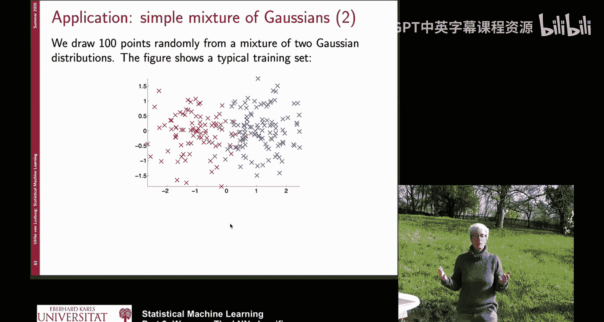

I have some time ago， let me just show it to you。

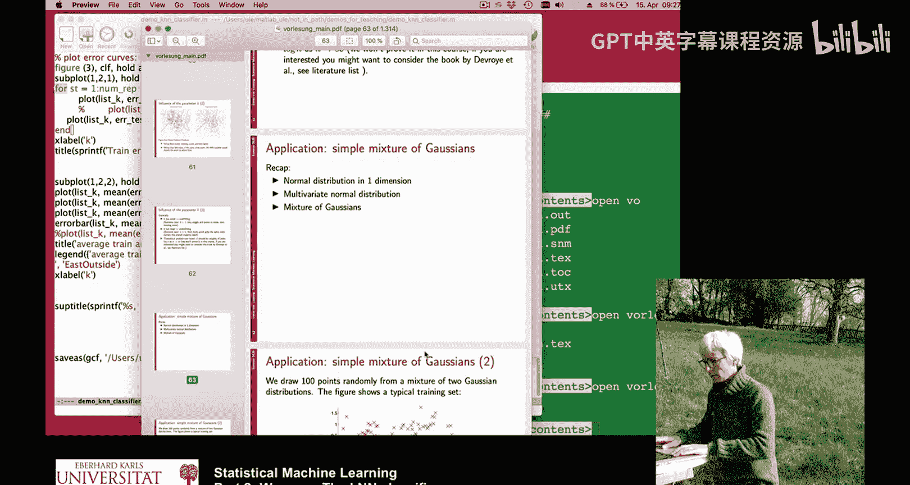

嗯。I simply start a demo and what you can see here in the middle is we are going to generate a number of data sets。

 all these data sets let's again go back all these data sets come from the same mixture of CAus and so its around like each of these figures when it flips means we draw a new data all in all we draw 10 training data sets。

😊，And then we are going to also draw 10 test data sets and we are going to compute what is the training error and a test error。

Let me just do it again so you see it。 So here we have now 10 independent draws of this training data set。

And now in this figure here， you can now see various plots。😊。

On the left hand figure you can now see the training errors and the test errors for these 10 independent repetitions。

 So what happens is like in each so I have 10 repetitions in each repetition I first take the training data once I draw 100 points from the mixture of Gausians。

50 points in blue，50 points in red roughly。I take my test dataset set and I compute for each test point。

 What is the error of the Cans Ne classifier。And here on the x axis， I have this parameter k。

 So say we look at k equals 5。 thats this point here。So for this parameter 5。

 I do the five nearest Ne classifier， I evaluate the results on the training points。

 I evaluate the results on the test points， compute training and test error。😊。

And these are now the many lines that you can see here in this plot。

 So each line corresponds to one draw of the training set and test it。

The red line is always a test error， and the blue line is the training error。

And we do this for a range of parameters ranging from 3 to to 10 in this case。

 so I look at a kous neighbor classifier for k equals 3 K equals 4 K equals 5 and so on until k equals 10 or 12 or whatever it is in the spot。

嗯。And then we can see the results of this classifier as a line。

 So each line connects the the same training data set or same test data set in one of these 10 repetitions of our run。

And what you can see here is now each of these runs of the canuous neighbor classify on independent training and test data produces a curve that is slightly different because we draw our data points randomly from this underlying distribution so if you look back to this figure here sorry。

😊，So they are like this figure looks a bit different whenever we draw in your training data set and test dataset set。

 so the result won't agree completely but maybe up to random variations it is going to be very similar and this is what we can see here so for example。

 the test airlines for these red curves for the independent draws of the training data are all like somewhere between say 0。

5 and 0。12 here in this4K equals 3 in this case。😊，Now。

 these are the 10 independent runs and you can already see that there are some variation in these results。

 Now what you typically would do if you if you set up your own machine learning experiment is you would average over a number of independent runs。

😊，This is what I have done here， so on the right hand side you can see now plot。

 which has three lines left。😊，And these three lines are now the averages over these lines that you can see on the left hand side。

 so the blue line here is the average over all the values that you see here on the left hand side。

 so it's the average training error where this average is now over the 10 independent runs of our procedure。

😊，Similarly。We have the average training error。 This is the。Sorry。

 so the red line is the average test error。 the blue line is the average training error。

And then we have in fact another training error， this is the green one point not included so for the when you compute the training error of a classifier of the Can nearest neighbour classifier。

 you always have to decide whether the point itself is considered to be in its own can nearest neighborhood or not。

If yes， this is what I both choices make sense。 I tend to， like if I would do it in practice。

 I would not include the training point in its own neighborhood。

 but this is really a matter of taste。 And in the end， it doesn't really matter。

 So I just plotted two curves。 So in， in the blue1 is where the point is included and the green one is where the point is not included for the training。

You can also see it's a bit hard to detect here I put standard deviations on the red line so the red one is the test area that you're interested in and if you do this you have an experiment and you repeat it a number of times on independent training set then not only would you like to know what is the average value that you get but you also would like to know what is the variance in your results or the standard deviations。

😊，And in this case， I plotted the standard deviations here as an error bar under the plot。

Maybe we just make it once tomorrow more so we can see how it behaves。

And so here we draw the training set and the test set。😊，Here are the different independent runs。

 And here you now see how the training error and test error behave。

And you can see in this particular case。 So， for example， we are interested in the test error。

 this is really as I said， this is the only measure that were interested in the red one。😊。

And we can see it decreases with the parameter K。 So in this case， for this particular data set。

 it is good to not choose K say equals to5， but maybe it's good to choose it smaller。😊。

We can also try to see what happens if we change the data set a bit。

 so here we have two mixtures of Gaussians which are really close to each other we can now play with the MALap demo。

😊。

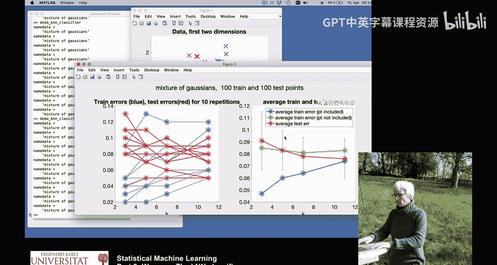

I have the curve here， add the code here。 and let's see。Here are the parameters for。

 for my mixture of Gaussians， What I can do， for example。

 is I can increase the variance of one of these Gaussians。

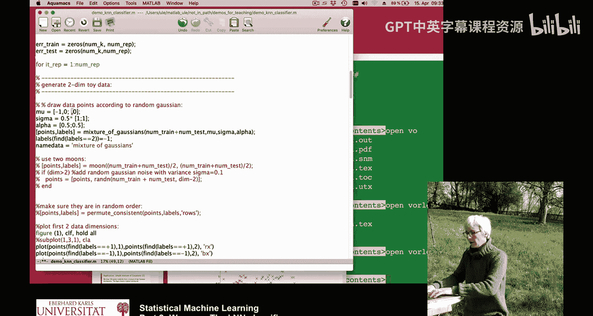

Let's simply see what happens。Oh no sorry， I increased the distance between the2 Gausians。

 This makes the problem much easier。😊，Because lets go like this because you can now see the Gaussians are further apart。

 there there overlap between these two Gaussian so the canous never classifier likely produces a better result。

😊，And this you can also see here in the error。 So you here it's a bit hard to see。

 You have 10 to the-3 here。 So the error is really like is is like， say2 to the  minus-3。

 So this is a tiny error。Maybe just one point got wrong or something like that。

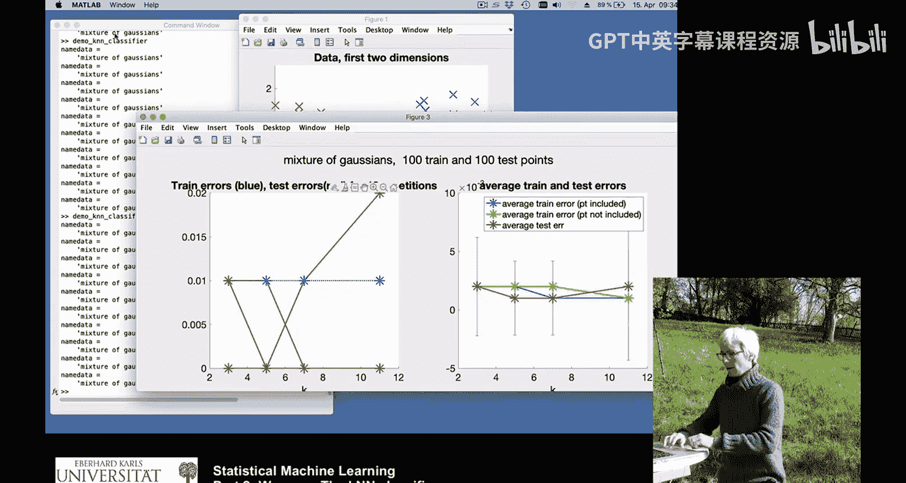

We can also play。 Maybe let's put it back。 We could also move it closer together。 For example， now。

 again， let's look at what happens here。

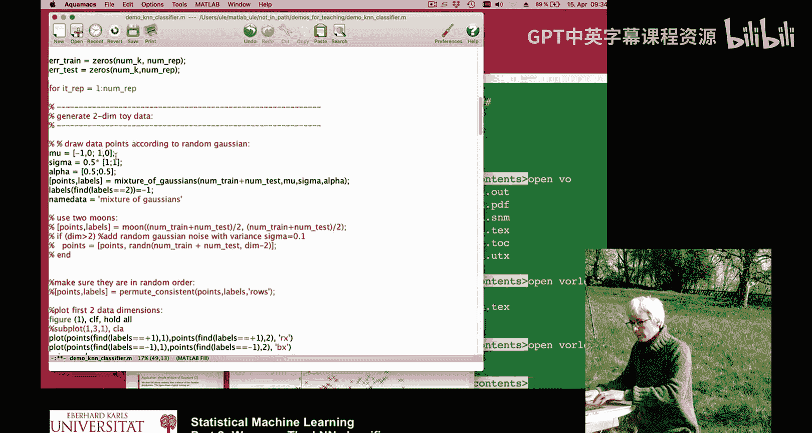

So now you see theres a very big overlap between the two classes and now we can see that the errors all increase in particular the test error essentially is at 0。

3 and we can also see that the number of neighbors in this particular case doesn't even have a very big influence on the results because these results are already pretty bad。

😊。

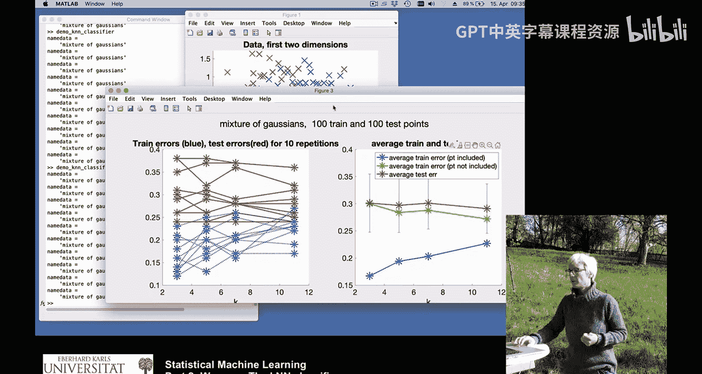

What else could I do， Maybe I put it back to1， I can also change。

The variance of one of the of or maybe， okay， maybe what I do is I put， I change the。

Number of points which we have in both classes， Alpha is the mixture weight。

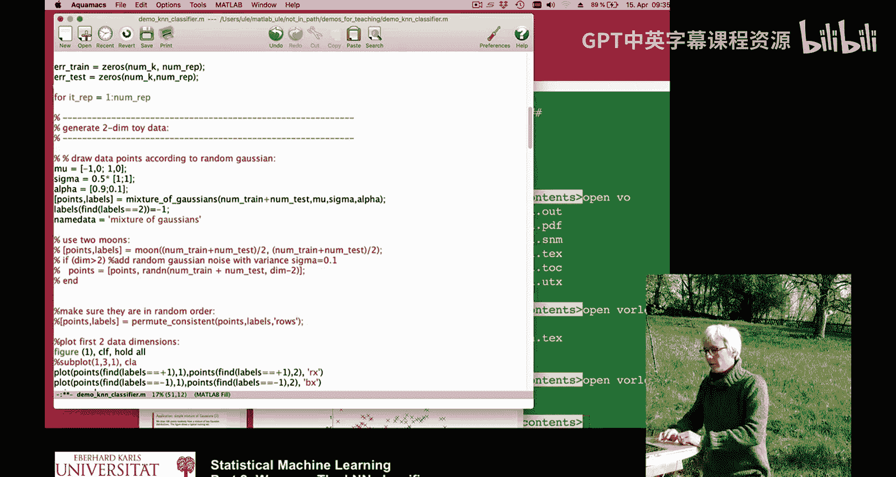

So what we have now is we have a mixture of calciumusians where most 90% of the points。

are red and only 10% of the points are blue and again you can apply the canousna classifier and you can see what happens in this case you see that there is a slight increase between from if you look at of the test error in terms of the parameter k but from my point of view the standard deviation here is still very large so I wouldn't read anything into this figure。

😊。

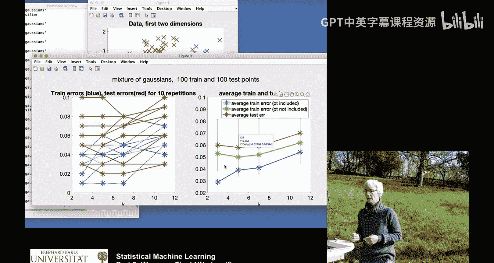

But this is what I wanted to show you。 Let's go back to the slides。

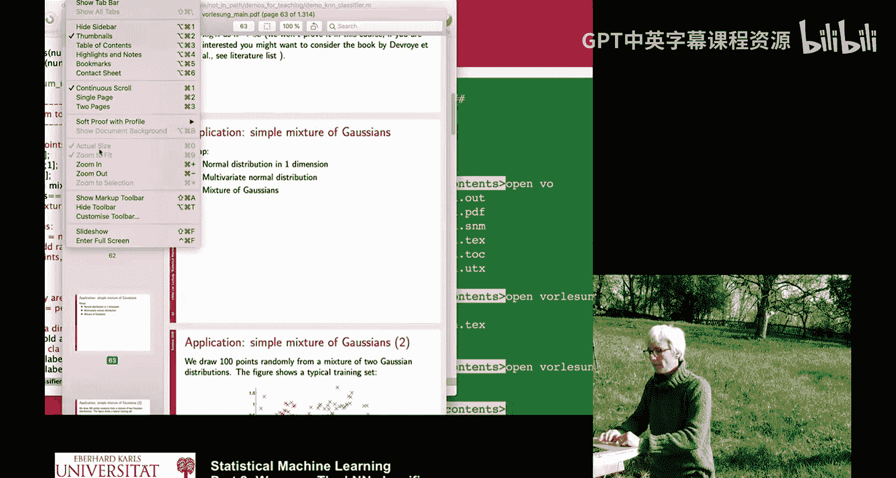

This is how the result works for a mixture of causians。 I have the same things on the slide again。

 but I explained it already。 so you can， in fact， look at the slides at home， if you want。

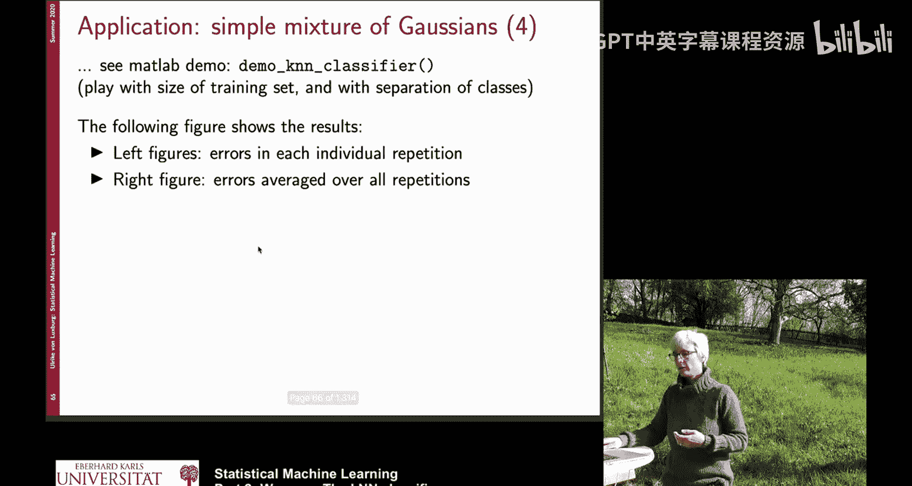

I want to show you a second application which is a bit more natural than a mixture of Gaussians。

 namely 10 digit recognition and this is a data that you're also going to see in your exercises a lot。

 it's called the USPS or the MIS data USPS is the US Postal Service so this was a data that has been created in the 1990s it's this 10 digit data where it's really from the Postal Service where they wanted to learn how to classify the 1written0 digits for the Postal quote。

😊，This data set consists of many 1 hundred digits like this。😊。

All these stitchtes are nicely recorded and centered in the middle of the image。

 These are grayscale images，16 by 16。And so each pixel is encoded with a gray scale value between 0 and 1。

😊，So each of these images， because it's 16 by 16， consists of 256 different numbers between0 and 1。😊。

Now we want to look at the result of two different classification tasks and for now because we looked at binary classification。

 I just want to show you how you can classify say to the digit age versus the digit one。

 so we want simply to learn to distinguish8s from one。😊。

And if you think about how these figures these digits look like。

8 versus 1 seems reasonably straightforward because1 is a very straight line and 8 is something curly。

😊。

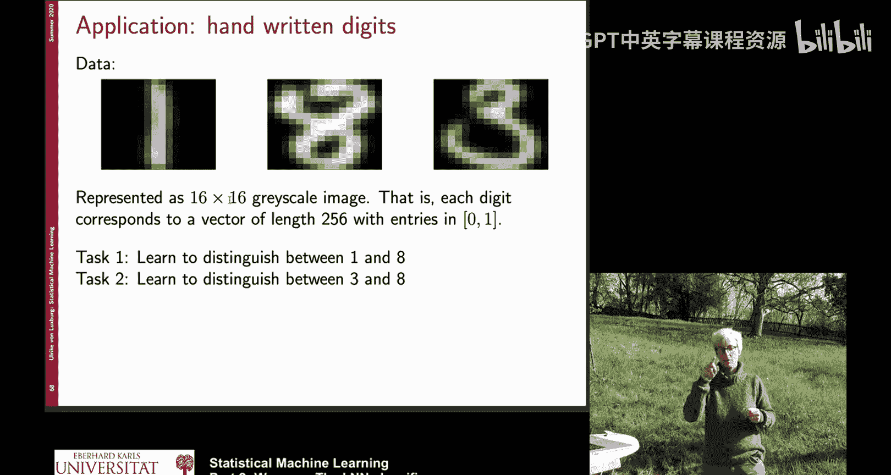

Now， if you want to use the k neighbor classifier for 100 digits， there is now the first hurdle。

 we need to define a distance function between our digits because the can neighbor classifier in the end is going to check who are my nearest neighbors and then you need to evaluate their labels so to know who are your nearest neighbors you need to have some way to measure distances。

NowHow do you compute a distance between two of these  hundred0 digits？

There are many different ways and if you thinking at it from a mathematically way。

 each of these digtits is represented as a vector of 256 dimensions。😊。

So the most naive and most straightforward thing you might be able to do is you simply use the Euclidean distance in your in your vector space。

 So what we do is now， and this is really what we do。 It is sort of the very naive kind of approach。

But let's see。So we have an input point x and an input point x prime。

 each of these point consists of 256 coordinates and we simply compute the distance between these points as the Euclidean distance and if you don't know what this means it's just a the vector space distance where you sum over the square distances between the coordinates of your points and then you take the square root。

😊，This is due Euclidean distance in the vector space。Okay。

 and this is now the distance function we use。And here you can now see the results。

 These are it's sort of the same setup as the one we've just seen in the in the demo for the mixture of Gaussians。

 So again， I did independent test runs， training and test runs for this kind of problem。

 So the USB data had consist of many， many digits I just took now 500 training digits。😊。

And 100 test digits。Both just from the classes one and eight。

And you can see here on the left hand side， what is the result。

 the training and test result of these independent runs whenever Id independently drawn your training and test sets。

on the right hand side maybe this is what we should focus on we see the errors of the procedures and in particular the test error you see it here it goes。

😊，Like this for k equals 3， you have an error of 0。013， maybe。And for k equal 11。

 it goes up to here it close to 0。04。And then there are also the different training errors which are very close to each other。

 This is maybe not so important right now。Now， I'd like to ask you， and this is maybe again。

 a point where you might want to stop your video and stare at this plot for a minute。

 Do you think this is a good result or a bad result。Please try to think about it yourself， first。

Okay， I hope you have made up your mind。😊，This is an outrageously good result。 If you think about it。

 this is1written digit recognition。 It is really a not so easy problem。

 All your data points consist of vectors in 256 dimensions of gray scale values。😊。

And with this stupid simple canous ne classifier that there's nothing sophisticated about it。

 we even use the Euclidean distance which in most cases wouldn't work， but here it works。

 we get an error of just 1%。😊，For k equals 3 and it increases a bit if you choose K larger。

Which would indicate that we should probably choose a reasonably small K。

 at least for this kind of setup we have chosen here。And the test error of 1%。

With a naive base and approach， this is what you typically do not get in your machine learning experiments。

 if you work for some company and they want you to solve a machine learning experiment。

 don't expect to achieve a test error of 1% after the first simple naive approach。

 So this is really very， very good。😊，And it somehow indicates that after all。

 this 1 digit recognition is maybe not the most complicated problem out there。😊。

Maybe one more comment， of course we here only classify digit 1 versus digit 8。

 the error would increase if you would classify among all the 10 test points and we can see this we are going to see this later in this lecture how we do that how we scale from binary approaches to multi-class approaches。

 it's not really complicated but of course the test error is going to increase because there are more different ways in which you can mix up your true test labels。

😊，Here is now the results for for the other classification task where we classify digit 3 versus digit 8。

 so this might be a bit more complicated because if you think about it if you imagine how these digtits look like8 is sort of like this and 3 is half of the8。

😊，At least roughly， so there might be more potential for mixing up these two figures。

Let's now look at the results so we exactly the same kind of setup and you now see here the red curve is again the test and you see it's a bit higher so in the best case here it's 03 sorrys 3% whereas previous it was 1% or so and it increases a bit higher here。

😊，So we can see from like comparing this figure in the previous figure that this case is a bit worse like distinguishing 3 from8。

 it least a slightly higher test error than distinguishing one from 8。

 but still in both cases the test result is really， really， really good。😊。

Now I said what we did so far is really the most simple of all approaches。

 you could even call it naive， we use Canius na classifier。😊，With a small K。

 and as distance function or a similarity function， we use the Euclidean distance。

 And in most application， the Euclidean distance wouldn't work。Of course。

 applying the Canous neighbor classifier can only be successful if your distance function encodes something that is important about your data。

😊，And in fact， in many applications， it's not so easy to come up with a good distance function for your dataset sets。

I have this example here， you want to classify a mushroom。😊。

And the mushrooms should be you want to classify them in edible and non edible。

 so you walk through the forest， you see a mushroom and you want to know， can I eat it or not？😊。

You have a certain feature set maybe the size of the mushroom and its weight and its color and how it looks like and so on。

And now， if you want to apply the Can' name， a classifier。😊。

You need to have a distance function between these mushrooms。

And now if you sort of if all you record about your mushroom is the weight and the size and you use the distance function。

 the Euclidean function here， say or say in a simpler case， even just a difference in weight。

 it is probably not going to work because the weight is nothing that's really indicative for the effect whether you can eat a mushroom or not。

😊，In this example， you could say， well， maybe I didn't really choose the correct features。

 maybe if I would have chosen other features like I would have have some chemical analysis and then would have the concentration of certain certain parts in this mushroom。

 then maybe it would work， yes。But there are many other applications where it's really even much more complicated。

 And here， the example I have is assume you want to classify the genre of a song。

 So you have you a last F M or one of these Internet radios and you want to play a song。

 And then the next song is supposed to be similar to the previous song。😊。

So how would you compute the similarity between two songs like your song is a sound wave in your computer？

Probably the Euclidean distance between the sound wave is not going to give you a good distance function。

And in particular， if you want to encode something very complicated like this genre of a song。

 is it a pop song or is it a piece of classic music？😊，This Euclidean distance is not going to work。

So a lot of work needs to go into the design of this distance function。And this is， in fact。

 something that happens very often in machine learning。😊。

There's a lot of prepros that's necessary to bring your data in a format such that you then can apply a machine learning algorithm in a successful way。

In this pre processingces。Often takes a lot of work。

 and this pre processing often is what makes your algorithm a success or a failure and the machine learning that comes on top。

😊，Is in at least in many cases， it's not so much of it。 I mean， of course， it makes a difference。

 but I use a very naive algorithm or a better algorithm。

But the key is very often the preprocess of your data。

Now here' is another question for you and again please stop the video and think about it for a second。

 what do you think is the inductive bias of the Can nearest neighbor algorithm？😊，In the last lecture。

 we have talked about the fact that machine learning without any inductive bias is impossible。😊。

So what do you think are the type of functions that are going to be learned？😊。

By the k nearest neighbor algorithm。 and maybe what is the type of functions that I would not be able to learn using a k nearest neighbor classifier。

Please stop your video and think about it for a second。Okay， I mean。

 there are many different answers you can give to this question。😊。

I think the simplest and most most straightforward answer to the inductive bias is that what the canous neighbor algorithm tries to encode is that similar input points should lead to similar output because what do you do if you apply your algorithm。

 you take a test point。You check who are the most similar or the most close data points。

And then you say， well， I want to do whatever these close data points tell me。

 So in a maybe a more practical example， you want to predict whether a person is going to buy a Samsung phone or an Apple phone。

😊，And now how are you going to do it， you have some kind of way to measure similarity between people and billions of ways how you can do that。

 but say you just do it you look at who are the closest friends as a similarity function。😊。

And to predict whether I am going to buy a Samsung phone or an Apple phone。😊。

We simply check what is what are my friends going to do。And if all my friends have Apple phones。

 then it's very likely that I buy an Apple phone as well。This is sort of the inductive bias。

 So you check who is very similar to myself。 And then you do whatever these people have been doing。

 And this is the inductive bias of。The key nearest neighbor classifier。

Now there are many extensions that you might be able to use the can neighbor classify or the can neighbor toolbox I should say is very powerful because you can apply it to many。

 many different problems。😊，A very easy thing to do is to apply to regression。 So in regression。

 the output is going to be a real number and not a binary label。 So， for example， in regression。

 you might want to predict the income in 10 years of a certain person。

 So you look at the past history of education and so on。 And then you want to output a number。

 How much is this person going to earn in 10 years。So this is not a classification problem。

 but a regression problem。😊，And again here you could apply the Can Neigh classifier in your trainings data you would have many people and you know their education backgrounds and you know what they earn in 10 years later and now you check who's the most similar person to myself in the training set and I check like among the 10 most similar persons what are they going to earn in 10 years and I take the average and this is maybe a good prediction for what I am going to earn in 10 years。

 at least on average。😊，However， k nearest neighbor methods can also be used for more complicated tasks like outlier detection。

 classification， density estimation， clustering， and so on。

 so essentially for all machine learning tasks that you might want to come up with there is one solution in terms of k nearest neighbor algorithms。

😊，And they tend to be useful baselines to consider。Now。

 let's summarize about the Can nearest neighbor algorithm。

The canous never classifier is about the simplest classifier you can look at。😊。

It often performs quite reasonably。The main challenge is that you need to define a distance function that is useful for your task hunt。

And my recommendation is whenever you have a machine learning problem that you want to solve。

 try the can nearest neighbour first。😊，And if the is in some cases， like the digital recognition。

 it might be the case that the Can nearest Ne algorithm already performs， quite good。😊。

And then maybe there's not so much point in spending five more weeks in trying to improve the machine learning algorithm if already the baseline algorithm is so good。

There might be many， many other examples where the baseline is not bad or sorry。

 but the baseline is much worse。😊，And then there's maybe enough room to perhaps improve your results by applying more clever machine learning algorithms。

From a theoretical point of view， I have already mentioned that the Canius Ne algorithm is a nice algorithm in the sense that it is going to be universally consistent and we are going to see what this means in the next lecture。

😊。

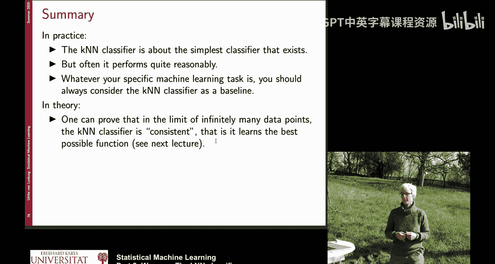